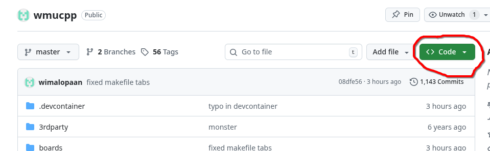
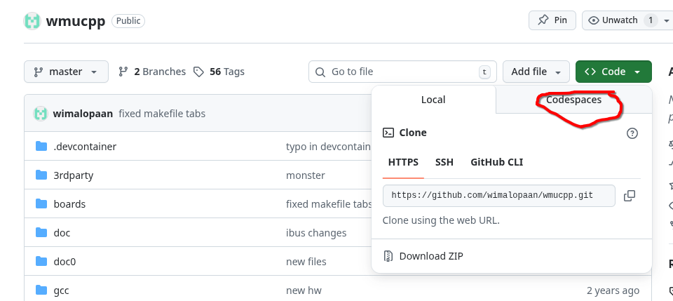
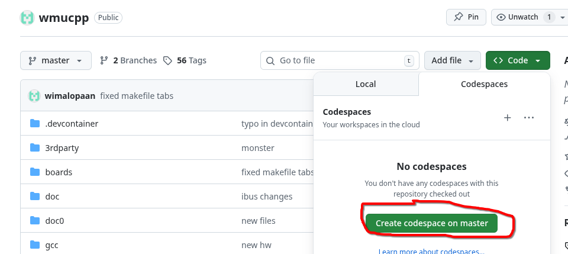
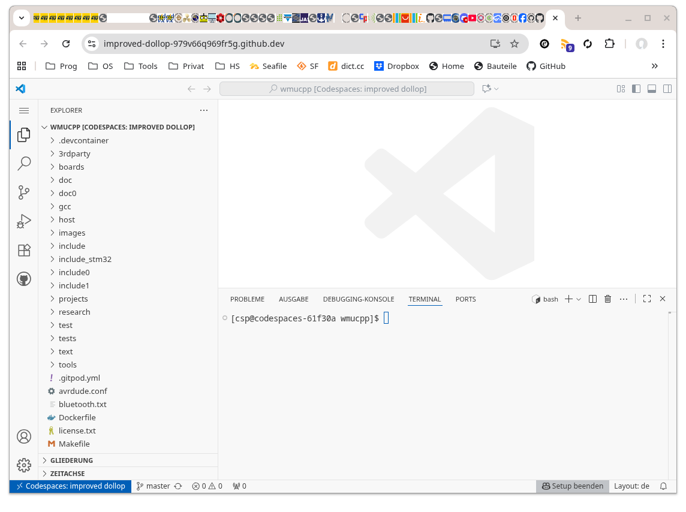
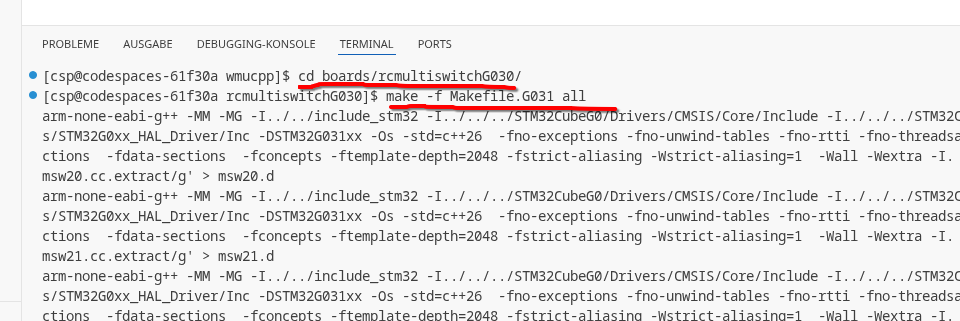
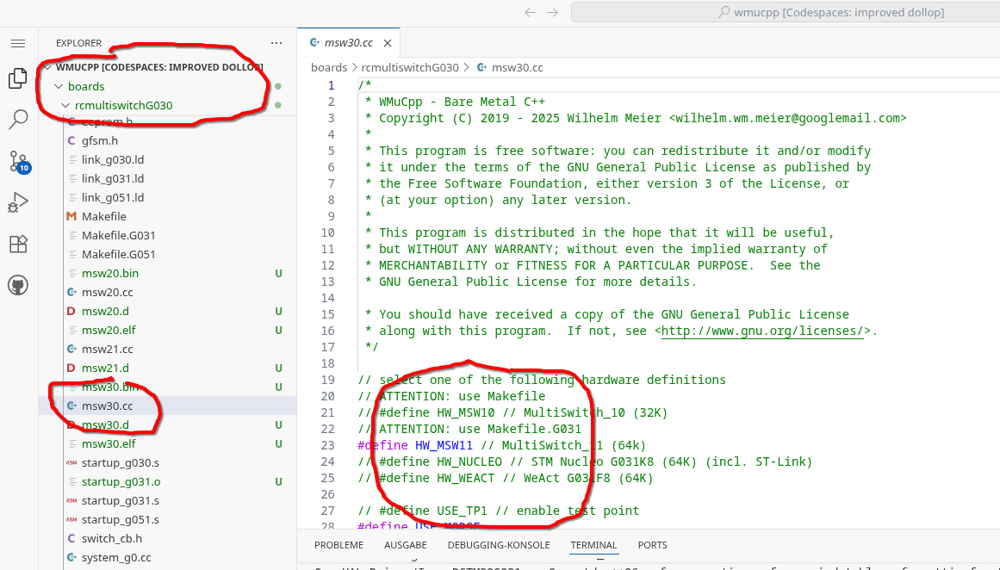
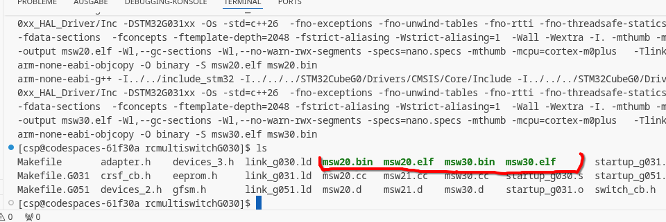
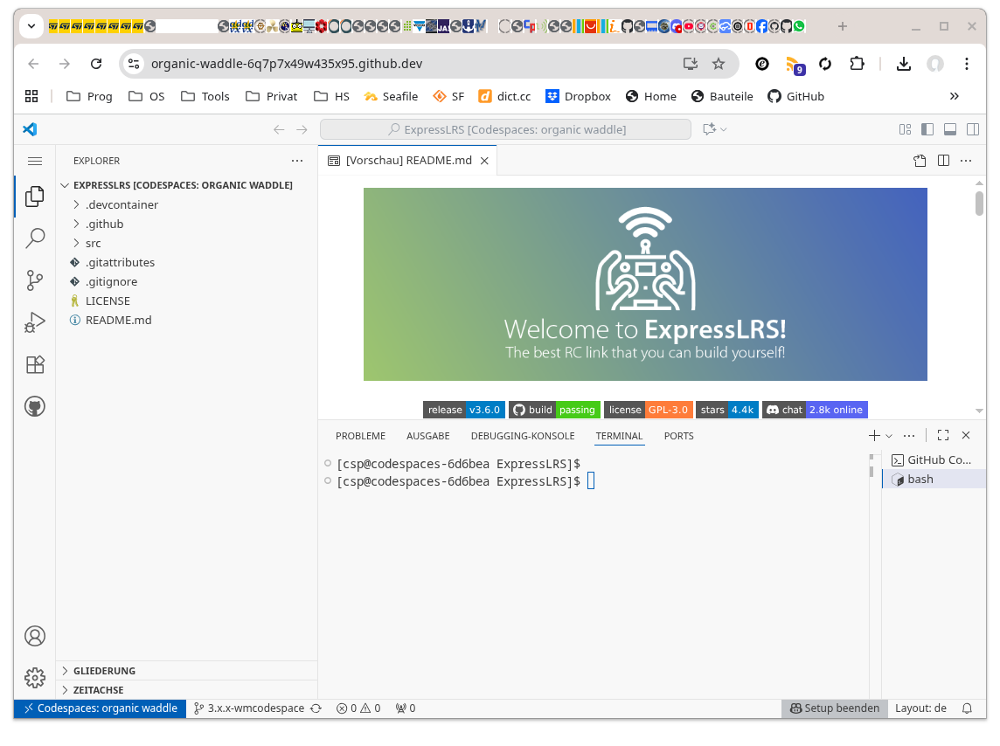
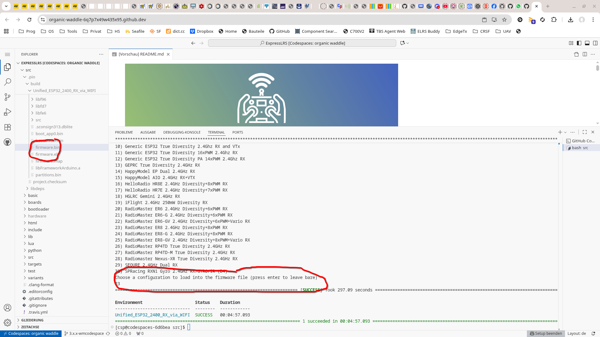

= Building firmware
Wilhelm Meier <wilhelm.wm.meier@googlemail.com>
:toc:
:toclevels: 3
:toc-placement!:
:sectnums:
:sectnumlevels: 5
:tip-caption: :bulb:
:note-caption: :information_source:
:important-caption: :heavy_exclamation_mark:
:caution-caption: :fire:
:warning-caption: :warning:

*English* | <<building.de.adoc#,Deutsch>>

<<../README.adoc#,RC Electronics>> / Building firmware

[NOTE]
--
Compiling my projects (`wmucpp`), EdgeTx, ExpressLRS and ESCape32 with `github` codespaces.
--

toc::[]

This page collects all instructions to compile the firmware of my projects as well as of my modified versions of EdgeTx, ExpressLRS and ESCape32.

[[gitpod_wm]]
== Compiling the source code of my projects (`wmucpp`)

The source code for all my projects described on these pages (if any) is located in this github repository: https://github.com/wimalopaan/wmucpp[]. 
If you want to self-compile the source into a piece of firmware that you can flash onto the µC, you have to clone the repository. 
To be able to compile the source code you have to have a development environment with all the compilers and libraries as well as all 
other needed tools. As I usually only use _Linux_ systems to do my day to day work, the development also takes place on _Linux_ systems. 
To be clear: I don't care of other platforms like Windows or MacOs. And therefore the build process is tested only on _Linux_ systems that are 
setup like my personal development systems. This would require that interested users should use an https://archlinux.org[Arch Linux] system
with all the 3rd-party stuff in the right place. Clearly, this is a real burden for the average user and will limit the amount of
people being able to use all the stuff.

[[cs_wm]]
=== Using `github` CodeSpaces

To use the `github` _codespaces_ service first of all you need a valid `github` account. So, go ahead and create one ;-) 

The next step is that you create and open a new _codespace_. This is fairly simple: got to the code repository https://github.com/wimalopaan/wmucpp[] 
and then click on `Code (green button) --> Tab: Codespaces -->  Button: Create (green)`.

.Steps to create a `github` codespace: step 1

.Steps to create a `github` codespace: step 2

.Steps to create a `github` codespace: step 3

After waiting some time (up to some minutes) you'll see the following interface:

.`github` codespace: main view (vscode)

Now you want to change the directory of the `terminal` (shell)  to the directory of the project you want to compile the code for. The following
example shows the steps for compiling the _RC-MultiSwitch-E-32_, which is located in the directory `/workspaces/wmucpp/boards/rcmultiswitchG030`.
So you have to type in the command `cd boards/rcmultiswitchG030` (because the shell already starts in the directory `/workspaces/wmucpp`.

.Navigating to the right place in the terminal

In most cases you need to change some settings in some of the code files (see description of the projects below). So, open the appropriate file 
in the editor by navigating to the same directory in the left side-bar and then clicking on the file to modify: here `msw30.cc`.

.Open a project file in the editor

After _saving_  the changes to one or more files you can start the compiling: in most cases this is the command `make all`, but in some rare cases
you have to specify the right _makefile_ for the `make` tool. So, in this case, because we want to generate code for the STM32G031 we have to 
use the makefile `Makefile.G031` (see also project description for details).

.Starting the compilation
[source, console]
----
[cs@codespaces-qwazx8g1drv rcmultiswitchG030]$ make -f Makefile.G031 all
----

After a few seconds you (hopefully) get a fresh generated binary file containing the desired firmware. In this case we get the files `msw30.bin`  and `msw30.elf`.
You can use the command `ls` to list the contents of the whole directory where find the new files:

.Result of the compilation

You also find the firmware binary file in the left side bar of the UI.

.Result of the compilation in the left side bar

The last step now is to download the files: please right-click onto the file and select download.

Afterwards you you favorite STM32 programmer to flash the firmware to you µC.

=== Using `gitpod` (not recommended)

[WARNING]
--
The following information about using `gitpod` is kind of outdated, because `gitpod` changed its name to `ONA` and
now is hidden behind a paywal.
--

The much more convinet solution to all this is https://gitpod.io[] (see also <<edgetx_custom>>).

So, just use the following URI to get a fully setup development environment: https://gitpod.io/#https://github.com/wimalopaan/wmucpp[].

After some (ten) minutes of initializing you'll get a `vscode` like workspace. In the lower thrid of this workspace you'll see 
a command line interface.

.Example terminal and changing directory to the RC-Multiswitch-E
[source, console]
----
[gitpod@wimalopaan-wmucpp-qwazx8g1drv wmucpp]$ 
[gitpod@wimalopaan-wmucpp-qwazx8g1drv wmucpp]$ cd boards/
[gitpod@wimalopaan-wmucpp-qwazx8g1drv boards]$ cd rcmultiswitchG030/
[gitpod@wimalopaan-wmucpp-qwazx8g1drv rcmultiswitchG030]$ ls
Makefile   devices.h    link_g030.ld  msw02.cc  msw04.cc  msw06.cc  msw08.cc  msw10.cc  msw12.cc  msw99.cc        system_g0.cc
adapter.h  devices_2.h  msw01.cc      msw03.cc  msw05.cc  msw07.cc  msw09.cc  msw11.cc  msw20.cc  startup_g030.s  todo.txt
[gitpod@wimalopaan-wmucpp-qwazx8g1drv rcmultiswitchG030]$ 
----

The source code for a specific project is located in `boards/<name>`, where `<name>` is the appropriate _name_ for that project. You find
this info / name in the follwing chapters for each project.

After navigating to the specific directory you just need to type: `make all`

.Compiling the source code for the RC-Multiswitch-E
[source, console]
----
[gitpod@wimalopaan-wmucpp-qwazx8g1drv rcmultiswitchG030]$ make all
----

After a couple of seconds the _prompt_ returns and you can list the newly created contents via the command: `ls` or `ls -l`.

.Listing the contents of the directory for the RC-Multiswitch-E
[source, console]
----
[gitpod@wimalopaan-wmucpp-qwazx8g1drv rcmultiswitchG030]$ ls
Makefile   devices_2.h   msw01.d   msw03.cc  msw04.d   msw06.cc  msw07.d   msw09.cc  msw10.d   msw12.cc   msw20.cc   msw99.cc        startup_g030.s  system_g0.o
adapter.h  link_g030.ld  msw02.cc  msw03.d   msw05.cc  msw06.d   msw08.cc  msw09.d   msw11.cc  msw12.d    msw20.d    msw99.d         system_g0.cc    todo.txt
devices.h  msw01.cc      msw02.d   msw04.cc  msw05.d   msw07.cc  msw08.d   msw10.cc  msw11.d   msw20.bin  msw20.elf  startup_g030.o  system_g0.d
[gitpod@wimalopaan-wmucpp-qwazx8g1drv rcmultiswitchG030]$ 
----

In this specific case you find the new created file `msw20.bin` which is exactly the firmware file you want to flash onto the µC. 
You can download the file using the menu-bar on the left: navigating to the very same directory and right-clicking on this file gives you 
the chance to download that file.

Enjoy ;-) 

[[edgetx_custom]]
== Custom EdgeTx builds

[TIP]
--
Precompiled EdgeTx (translation = `german`, includes also <<edgetx.adoc#vcontrols,Virtual Controls for EdgeTx>> and <<edgetx.adoc#edgetx_32channels,32-Channels extension for the CRSF-Protocol>>) con be found here: https://github.com/wimalopaan/Electronics/tree/main/edgetx/firmware[]
--

Being familiar with a _Linux_ system is very handy when dealing with custom builds of _EdgeTx_. Occaisionally I develop some extensions to the main-line _EdgeTx_ 
code. These extension are published as so called _pull-requests_ (PR) to the _EdgeTx_ github repository. Interested users can pull these PR and compile the 
code themselves and then flash them onto the radio. The flashing procedure is the same as it is for the official firmware releases (or RC versions or nightlies). 
But compiling the firmware from the source code may place some burden for the unexperienced users: preparing a development system with all the neccessary tools 
and using the right versions of them may be not the easiest task, especially working on a non-Linux system.

[WARNING]
--
The information to `gitpod` is somewhat outdated: `gitpod` is now hidden behind a paywall. 

But there is help: `github` supports _CodeSpaces_. Please refer to <<cs_wm>>. Then continue with <<compiling_edgetx>>.
--

=== Setting up `gitpod` (not recommended)

But there is a _very_ convenient way to do: using https://gitpod.io[GitPod].
(There is also a howto in the EdgeTx wiki: https://github.com/EdgeTX/edgetx/wiki/Building-radio-firmware-in-a-webbrowser-with-Gitpod[] ).

Maybe you want to use my `virtual controls` extension for _EdgeTx_. This extension is published as https://github.com/EdgeTX/edgetx/pull/5885[pull request 5885].

You can concatenate the URI `https://gitpod.io` with a `#` character and then the URI of the PR itself, e.g. `https://github.com/EdgeTX/edgetx/pull/5885`. 

Type or paste the combined URI into your browsers address field: https://gitpod.io/#https://github.com/EdgeTX/edgetx/pull/5885[]. 

Opening this URI gets you to the gitpod workspace. There you simply click on `Continue` (leaving all settings to their defaults) and 
after some minutes initializing this workspace you'll see a `vscode`-like user interface. In the lower third you'll a command-prompt. 

[[compiling_edgetx]]
=== Compiling EdgeTx

[source,console]
----
gitpod /workspace/edgetx/build (wmvcontrols) $ 
----

In this prompt you simply the the following command line (you may want to change the translation to another language)

----
cmake -DVCONTROLS=YES -DTRANSLATIONS=DE -DPCB=X10 -DPCBREV=TX16S -DLUA=YES -DLUA_MIXER=YES -DGVARS=YES ..
----

For a more vanilla configuration use the following `cmake` line:

----
cmake -DTRANSLATIONS=DE -DPCB=X10 -DPCBREV=TX16S -DLUA=YES -DLUA_MIXER=YES -DGVARS=YES ..
----

[source,console]
----
gitpod /workspace/edgetx/build (wmvcontrols) $ cmake -DVCONTROLS=YES -DTRANSLATIONS=DE -DPCB=X10 -DPCBREV=TX16S -DLUA=YES -DLUA_MIXER=YES -DGVARS=YES ..
----

This line highly depends on how you would like to compile the firmware and it should be described in the text of the PR. 

*If not, please ask* ;-)  

Running this command should be reasonable fast and now you are ready to start the real compilation process. 

Just type `make firmware` :

[source,console]
----
gitpod /workspace/edgetx/build (wmvcontrols) $ make firmware
----

After some minutes you'll find the file `firmware.bin` in the folder `build/arm_none_eabi` on the left side of the workspace. Now right click onto this file and download the firmware. Save it 
on your local machine, connect the radio and flash / copy it.

Ready ;-)

[[build_elrs]]
== ExpressLRS

[[elrs_cs]]
=== Use `github` codespaces to compile ExpressLRS

Before you can compile the source code to get the `firmware.bin` file, that you flash onto the receiver, you 
have to create a `codespace`.

Use this https://github.com/wimalopaan/ExpressLRS/tree/3.x.x-wmaddress[] URL to navigate to the right `github` repository. Then follow <<cs_wm>> 
to setup a _Codespace_.

.Codespace for ExpressLRS: newly created codespace

Now continue with <<elrs_compile>> and also refer to the following image after compilation:

.Codespace for ExpressLRS: result of compilation `firmware.bin`

=== Use `gitpod` to compile ExpressLRS (not recommended)

[WARNING]
--
The following information about using `gitpod` is kind of outdated, because `gitpod` changed its name to `ONA` and
now is hidden behind a paywal.
--

To compile this on your own just use `gitpod` and prepend the above `URL` with `https://gitpod.io/#`. 

For the above simply use: https://gitpod.io/#https://github.com/wimalopaan/ExpressLRS/tree/3.x.x-wmaddress[].

[[elrs_compile]]
=== Compilation

In the terminal area simply type:

[source,console]
----
$ cd src
----

Make sure that the file `user_defines.txt` has the right contents, especially look 
for `\#-DMY_BINDING_PHRASE="default ExpressLRS binding phrase"` and `\#-DRegulatory_Domain_EU_CE_2400`.
Here, remove the first `#` char of these lines and replace the _binding phrase_.

Now, you can start the compilation:

[source,console]
----
$ platformio -c qtcreator run --environment Unified_ESP32_2400_RX_via_WIFI
----

After some minutes you'll be prompted with a menu to choose the desired device configuration:

[source,console]
----
18) RadioMaster ER6 2.4GHz Diversity+6xPWM RX
19) RadioMaster ER6-G 2.4GHz Diversity+6xPWM RX
20) RadioMaster ER6-GV 2.4GHz Diversity+6xPWM+Vario RX
21) RadioMaster ER8 2.4GHz Diversity+8xPWM RX
22) RadioMaster ER8-G 2.4GHz Diversity+8xPWM RX
23) RadioMaster ER8-GV 2.4GHz Diversity+8xPWM+Vario RX
24) RadioMaster RP4-TD True Diversity 2.4GHz RX
Choose a configuration to load into the firmware file (press enter to leave bare)
----

Type in the number, e.g. `18` for a RadioMaster ER6.

After some seconds you can download the file `firmware.bin` out of the corresponding directory, e.g. `src/.pio/build/Unified_ESP32_2400_RX_via_WIFI/` .

[[build_escape32]]
== ESCape32

[[esc32_mod]]
=== Compile modified `ESCape32` in `github codespace`

I added an _Arch Linux_ `docker` configuration to my `ESCape32` 
repository: https://github.com/wimalopaan/ESCape32/tree/wm_codespace[]

To compile one of my branches of `ESCape32` like <<escape32.adoc#esc32_batt,Augmented `BATT` telemetry frames (CRSF)>> please refer to <<cs_wm>>.
