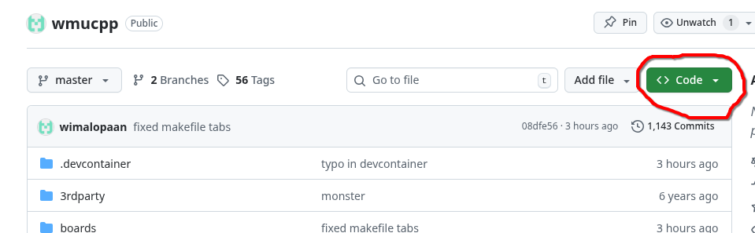
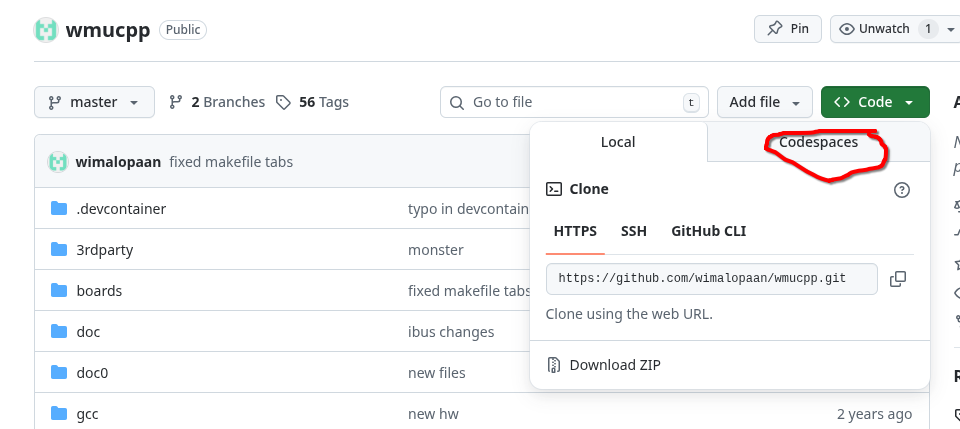
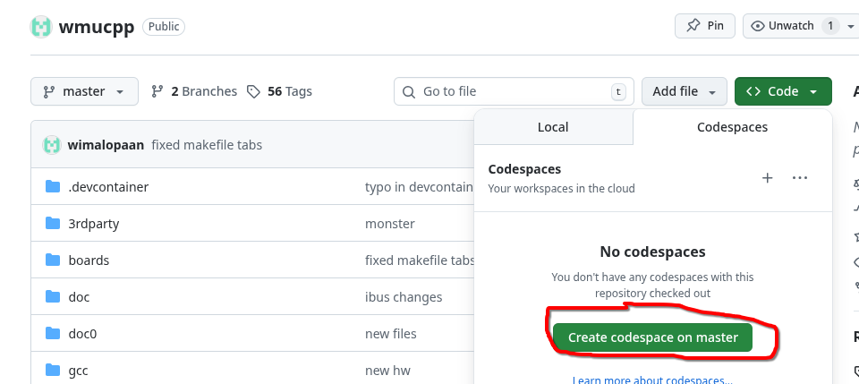
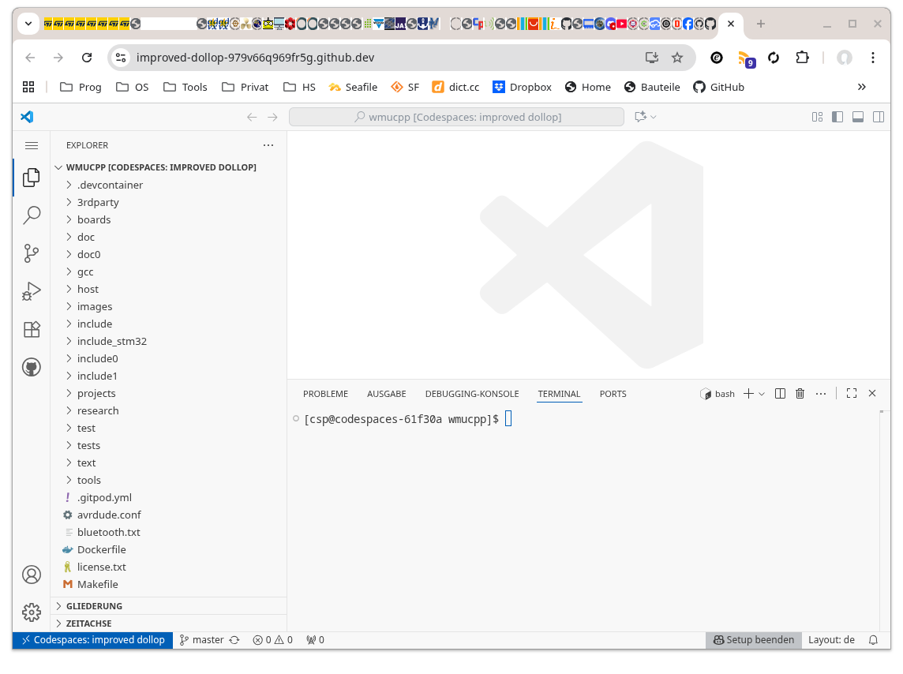
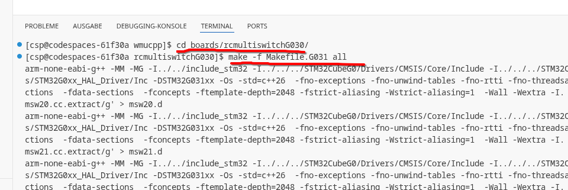
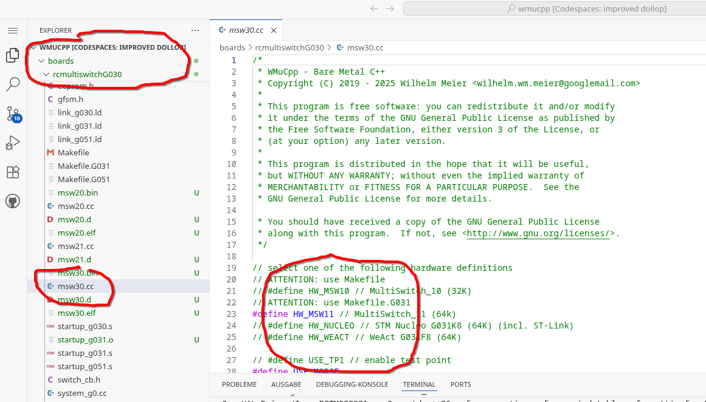
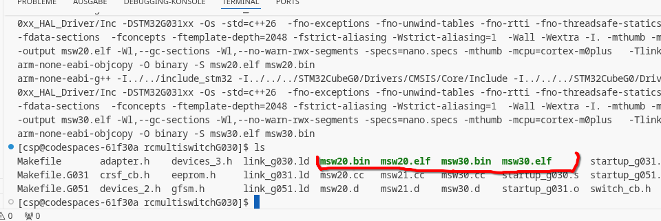
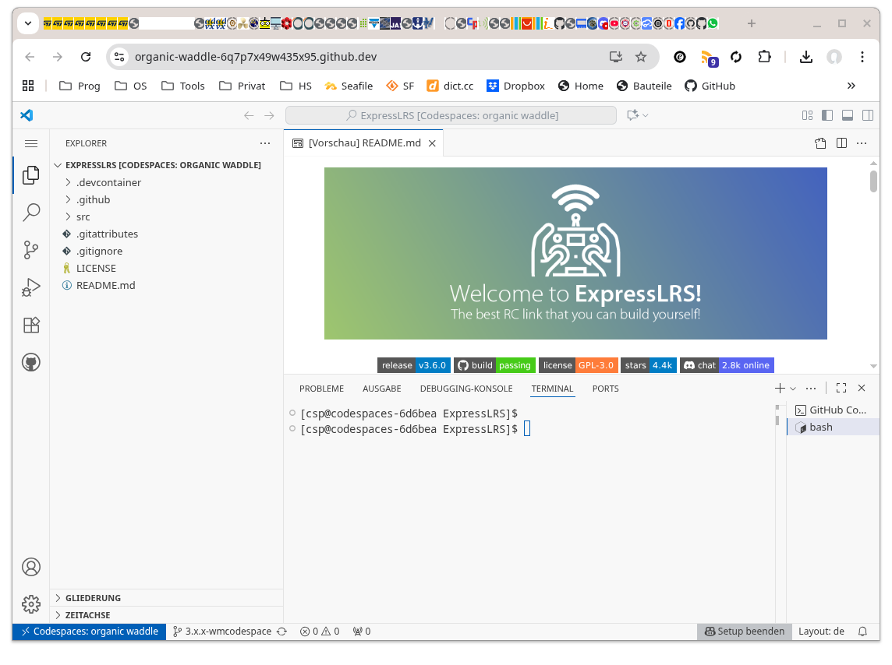
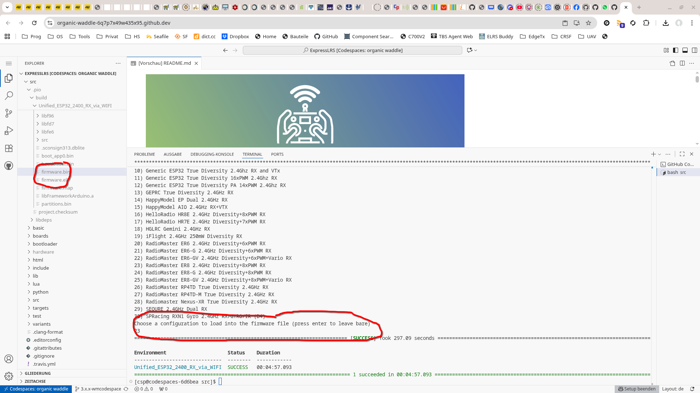

= Firmware kompilieren
Wilhelm Meier <wilhelm.wm.meier@googlemail.com>
:toc:
:toclevels: 3
:toc-placement!:
:sectnums:
:sectnumlevels: 5
:tip-caption: :bulb:
:note-caption: :information_source:
:important-caption: :heavy_exclamation_mark:
:caution-caption: :fire:
:warning-caption: :warning:
:lang: de
:toc-title: Inhaltsverzeichnis
:figure-caption: Abbildung
:table-caption: Tabelle
:example-caption: Beispiel

<<building.adoc#,English>> | *Deutsch*

<<../README.de.adoc#,RC-Elektronik>> / Firmware kompilieren

[NOTE]
--
Meine Projekte (`wmucpp`), EdgeTx, ExpressLRS und ESCape32 mit `github` Codespaces kompilieren.
--

toc::[]

Diese Seite enthält alle Anleitungen zum Kompilieren der Firmware meiner Projekte sowie meiner modifizierten Versionen von EdgeTx, ExpressLRS und ESCape32.

[[gitpod_wm]]
== Den Quellcode meiner Projekte (`wmucpp`) kompilieren

Der Quellcode aller auf diesen Seiten beschriebenen Projekte befindet sich, soweit vorhanden, in diesem GitHub-Repository: https://github.com/wimalopaan/wmucpp[].
Wenn du daraus selbst eine Firmware kompilieren möchtest, die sich auf den µC flashen lässt, musst du das Repository klonen.
Zum Kompilieren benötigst du eine Entwicklungsumgebung mit allen Compilern, Bibliotheken und
sonstigen erforderlichen Werkzeugen. Da ich im Alltag normalerweise ausschließlich _Linux_-Systeme verwende, findet auch die Entwicklung auf _Linux_-Systemen statt.
Um es klar zu sagen: Andere Plattformen wie Windows oder MacOs berücksichtige ich nicht. Der Build-Prozess wird daher nur auf _Linux_-Systemen getestet,
die wie meine persönlichen Entwicklungssysteme eingerichtet sind. Interessierte Nutzer müssten also ein https://archlinux.org[Arch Linux]-System
verwenden, auf dem alle Komponenten von Drittanbietern an der richtigen Stelle installiert sind. Das ist für durchschnittliche Nutzer offensichtlich eine erhebliche Hürde und begrenzt die Anzahl
der Menschen, die diese Projekte nutzen können.

[[cs_wm]]
=== `github` CodeSpaces verwenden

Um den Dienst `github` _codespaces_ zu nutzen, benötigst du zunächst ein gültiges `github`-Konto. Lege also eines an ;-)

Als Nächstes erstellst und öffnest du einen neuen _Codespace_. Das ist recht einfach: Öffne das Quellcode-Repository https://github.com/wimalopaan/wmucpp[]
und klicke auf `Code` (grüne Schaltfläche), dann auf den Reiter `Codespaces` und schließlich auf die grüne Schaltfläche `Create`.

.Einen `github` Codespace erstellen: Schritt 1

.Einen `github` Codespace erstellen: Schritt 2

.Einen `github` Codespace erstellen: Schritt 3

Nach einer Wartezeit von bis zu einigen Minuten erscheint die folgende Oberfläche:

.`github` Codespace: Hauptansicht (vscode)

Wechsle nun im `Terminal` (der Shell) in das Verzeichnis des Projekts, dessen Quellcode du kompilieren möchtest. Das folgende
Beispiel zeigt die Schritte für den _RC-MultiSwitch-E-32_, der im Verzeichnis `/workspaces/wmucpp/boards/rcmultiswitchG030` liegt.
Gib dazu den Befehl `cd boards/rcmultiswitchG030` ein, da die Shell bereits im Verzeichnis `/workspaces/wmucpp` startet.

.Im Terminal zum richtigen Verzeichnis wechseln

Meist musst du einige Einstellungen in den Quellcodedateien ändern (siehe die Projektbeschreibungen weiter unten). Öffne dazu die entsprechende Datei
im Editor: Navigiere in der linken Seitenleiste in dasselbe Verzeichnis und klicke auf die zu bearbeitende Datei, hier `msw30.cc`.

.Eine Projektdatei im Editor öffnen

Nachdem du die Änderungen an einer oder mehreren Dateien _gespeichert_ hast, kannst du die Kompilierung starten. Meist genügt der Befehl `make all`, in einigen seltenen Fällen
musst du dem Werkzeug `make` aber das richtige _Makefile_ angeben. Da wir hier Code für den STM32G031 erzeugen möchten, müssen wir
das Makefile `Makefile.G031` verwenden (Details stehen auch in der Projektbeschreibung).

.Die Kompilierung starten
[source, console]
----
[cs@codespaces-qwazx8g1drv rcmultiswitchG030]$ make -f Makefile.G031 all
----

Nach wenigen Sekunden erhältst du hoffentlich eine neu erzeugte Binärdatei mit der gewünschten Firmware. In diesem Fall entstehen die Dateien `msw30.bin` und `msw30.elf`.
Mit dem Befehl `ls` kannst du den Inhalt des gesamten Verzeichnisses einschließlich der neuen Dateien auflisten:

.Ergebnis der Kompilierung

Die Firmware-Binärdatei findest du auch in der linken Seitenleiste der Benutzeroberfläche.

.Ergebnis der Kompilierung in der linken Seitenleiste

Lade zum Abschluss die Dateien herunter: Klicke mit der rechten Maustaste auf die Datei und wähle die Download-Funktion.

Anschließend kannst du die Firmware mit deinem bevorzugten STM32-Programmiergerät auf den µC flashen.

[[_using_gitpod_not_recommended]]
=== `gitpod` verwenden (nicht empfohlen)

[WARNING]
--
Die folgenden Informationen zur Verwendung von `gitpod` sind veraltet, da `gitpod` inzwischen `ONA` heißt und
nur noch hinter einer Bezahlschranke verfügbar ist.
--

Eine wesentlich bequemere Lösung für all dies ist https://gitpod.io[] (siehe auch <<edgetx_custom>>).

Über die folgende URI erhältst du eine vollständig eingerichtete Entwicklungsumgebung: https://gitpod.io/#https://github.com/wimalopaan/wmucpp[].

Nach einigen (etwa zehn) Minuten Initialisierung erhältst du einen Arbeitsbereich ähnlich wie in `vscode`. Im unteren Drittel dieses Arbeitsbereichs findest du
eine Kommandozeile.

.Beispielterminal und Verzeichniswechsel zum RC-Multiswitch-E
[source, console]
----
[gitpod@wimalopaan-wmucpp-qwazx8g1drv wmucpp]$ 
[gitpod@wimalopaan-wmucpp-qwazx8g1drv wmucpp]$ cd boards/
[gitpod@wimalopaan-wmucpp-qwazx8g1drv boards]$ cd rcmultiswitchG030/
[gitpod@wimalopaan-wmucpp-qwazx8g1drv rcmultiswitchG030]$ ls
Makefile   devices.h    link_g030.ld  msw02.cc  msw04.cc  msw06.cc  msw08.cc  msw10.cc  msw12.cc  msw99.cc        system_g0.cc
adapter.h  devices_2.h  msw01.cc      msw03.cc  msw05.cc  msw07.cc  msw09.cc  msw11.cc  msw20.cc  startup_g030.s  todo.txt
[gitpod@wimalopaan-wmucpp-qwazx8g1drv rcmultiswitchG030]$ 
----

Der Quellcode eines bestimmten Projekts liegt unter `boards/<name>`, wobei `<name>` der jeweilige _Name_ des Projekts ist.
Diese Information beziehungsweise den Namen findest du in den folgenden Kapiteln zum jeweiligen Projekt.

Nachdem du in das entsprechende Verzeichnis gewechselt bist, gib einfach `make all` ein.

.Den Quellcode für den RC-Multiswitch-E kompilieren
[source, console]
----
[gitpod@wimalopaan-wmucpp-qwazx8g1drv rcmultiswitchG030]$ make all
----

Nach einigen Sekunden erscheint wieder die _Eingabeaufforderung_. Mit `ls` oder `ls -l` kannst du die neu erzeugten Dateien auflisten.

.Den Verzeichnisinhalt für den RC-Multiswitch-E auflisten
[source, console]
----
[gitpod@wimalopaan-wmucpp-qwazx8g1drv rcmultiswitchG030]$ ls
Makefile   devices_2.h   msw01.d   msw03.cc  msw04.d   msw06.cc  msw07.d   msw09.cc  msw10.d   msw12.cc   msw20.cc   msw99.cc        startup_g030.s  system_g0.o
adapter.h  link_g030.ld  msw02.cc  msw03.d   msw05.cc  msw06.d   msw08.cc  msw09.d   msw11.cc  msw12.d    msw20.d    msw99.d         system_g0.cc    todo.txt
devices.h  msw01.cc      msw02.d   msw04.cc  msw05.d   msw07.cc  msw08.d   msw10.cc  msw11.d   msw20.bin  msw20.elf  startup_g030.o  system_g0.d
[gitpod@wimalopaan-wmucpp-qwazx8g1drv rcmultiswitchG030]$ 
----

In diesem Fall findest du die neu erzeugte Datei `msw20.bin`. Das ist genau die Firmwaredatei, die du auf den µC flashen möchtest.
Du kannst sie über die Menüleiste links herunterladen: Navigiere in dasselbe Verzeichnis und klicke mit der rechten Maustaste auf die Datei,
um die Download-Funktion aufzurufen.

Viel Spaß ;-)

[[edgetx_custom]]
== Angepasste EdgeTx-Builds

[TIP]
--
Vorkompiliertes EdgeTx (Übersetzung = `german`, enthält auch <<edgetx.de.adoc#vcontrols,Virtuelle Bedienelemente für EdgeTx>> und die <<edgetx.de.adoc#edgetx_32channels,32-Kanal-Erweiterung für das CRSF-Protokoll>>) findet sich hier: https://github.com/wimalopaan/Electronics/tree/main/edgetx/firmware[]
--

Vertrautheit mit _Linux_ ist beim Erstellen angepasster _EdgeTx_-Builds sehr hilfreich. Gelegentlich entwickle ich Erweiterungen für den Hauptzweig des _EdgeTx_-Quellcodes.
Diese Erweiterungen werden als sogenannte _Pull Requests_ (PR) im GitHub-Repository von _EdgeTx_ veröffentlicht. Interessierte Nutzer können diese PRs abrufen,
den Code selbst kompilieren und anschließend auf den Sender flashen. Der Flash-Vorgang ist derselbe wie bei offiziellen Firmware-Releases (oder RC-Versionen beziehungsweise Nightly-Builds).
Das Kompilieren der Firmware aus dem Quellcode kann für unerfahrene Nutzer allerdings eine Hürde sein: Ein Entwicklungssystem mit allen erforderlichen Werkzeugen
in den richtigen Versionen einzurichten ist nicht immer einfach, insbesondere auf einem System ohne Linux.

[WARNING]
--
Die Informationen zu `gitpod` sind inzwischen veraltet: `gitpod` ist nur noch hinter einer Bezahlschranke verfügbar.

Es gibt aber eine Alternative: `github` unterstützt _CodeSpaces_. Siehe dazu <<cs_wm>> und fahre anschließend mit <<compiling_edgetx>> fort.
--

[[_setting_up_gitpod_not_recommended]]
=== `gitpod` einrichten (nicht empfohlen)

Es gibt jedoch einen _sehr_ bequemen Weg: https://gitpod.io[GitPod].
(Eine Anleitung findet sich auch im EdgeTx-Wiki: https://github.com/EdgeTX/edgetx/wiki/Building-radio-firmware-in-a-webbrowser-with-Gitpod[] ).

Vielleicht möchtest du meine Erweiterung für `virtuelle Bedienelemente` in _EdgeTx_ verwenden. Sie ist als https://github.com/EdgeTX/edgetx/pull/5885[Pull Request 5885] veröffentlicht.

Du kannst die URI `https://gitpod.io` mit einem `#` und anschließend der URI des PR selbst verknüpfen, zum Beispiel `https://github.com/EdgeTX/edgetx/pull/5885`.

Gib die zusammengesetzte URI in die Adresszeile deines Browsers ein oder füge sie dort ein: https://gitpod.io/#https://github.com/EdgeTX/edgetx/pull/5885[].

Diese URI öffnet den gitpod-Arbeitsbereich. Klicke dort einfach auf `Continue` und belasse alle Einstellungen bei ihren Standardwerten.
Nach einigen Minuten Initialisierung erscheint eine Benutzeroberfläche ähnlich wie in `vscode`. Im unteren Drittel befindet sich eine Eingabeaufforderung.

[[compiling_edgetx]]
=== EdgeTx kompilieren

[source,console]
----
gitpod /workspace/edgetx/build (wmvcontrols) $ 
----

Gib an dieser Eingabeaufforderung den folgenden Befehl ein (gegebenenfalls kannst du eine andere Sprache für die Übersetzung wählen):

----
cmake -DVCONTROLS=YES -DTRANSLATIONS=DE -DPCB=X10 -DPCBREV=TX16S -DLUA=YES -DLUA_MIXER=YES -DGVARS=YES ..
----

Für eine Konfiguration näher am unveränderten Original verwende die folgende `cmake`-Zeile:

----
cmake -DTRANSLATIONS=DE -DPCB=X10 -DPCBREV=TX16S -DLUA=YES -DLUA_MIXER=YES -DGVARS=YES ..
----

[source,console]
----
gitpod /workspace/edgetx/build (wmvcontrols) $ cmake -DVCONTROLS=YES -DTRANSLATIONS=DE -DPCB=X10 -DPCBREV=TX16S -DLUA=YES -DLUA_MIXER=YES -DGVARS=YES ..
----

Diese Zeile hängt stark davon ab, wie du die Firmware kompilieren möchtest, und sollte im Text des PR beschrieben sein.

*Falls nicht, frage bitte nach* ;-)

Dieser Befehl sollte recht schnell ausgeführt sein. Anschließend kannst du den eigentlichen Kompiliervorgang starten.

Gib einfach `make firmware` ein:

[source,console]
----
gitpod /workspace/edgetx/build (wmvcontrols) $ make firmware
----

Nach einigen Minuten findest du links im Arbeitsbereich die Datei `firmware.bin` im Ordner `build/arm_none_eabi`. Klicke mit der rechten Maustaste darauf und lade die Firmware herunter. Speichere sie
auf deinem lokalen Rechner, schließe den Sender an und flashe beziehungsweise kopiere die Firmware.

Fertig ;-)

[[build_elrs]]
== ExpressLRS

[[elrs_cs]]
=== ExpressLRS mit `github` Codespaces kompilieren

Bevor du den Quellcode zur Datei `firmware.bin` kompilieren kannst, die du auf den Empfänger flashst,
musst du einen `Codespace` erstellen.

Öffne über die URL https://github.com/wimalopaan/ExpressLRS/tree/3.x.x-wmaddress[] das richtige `github`-Repository. Folge anschließend <<cs_wm>>,
um einen _Codespace_ einzurichten.

.Codespace für ExpressLRS: neu erstellter Codespace

Fahre nun mit <<elrs_compile>> fort und beachte nach der Kompilierung auch die folgende Abbildung:

.Codespace für ExpressLRS: Kompilierergebnis `firmware.bin`

[[_use_gitpod_to_compile_expresslrs_not_recommended]]
=== ExpressLRS mit `gitpod` kompilieren (nicht empfohlen)

[WARNING]
--
Die folgenden Informationen zur Verwendung von `gitpod` sind veraltet, da `gitpod` inzwischen `ONA` heißt und
nur noch hinter einer Bezahlschranke verfügbar ist.
--

Zum eigenständigen Kompilieren kannst du `gitpod` verwenden und der obigen `URL` einfach `https://gitpod.io/#` voranstellen.

Für das obige Beispiel verwende: https://gitpod.io/#https://github.com/wimalopaan/ExpressLRS/tree/3.x.x-wmaddress[].

[[elrs_compile]]
=== Kompilierung

Gib im Terminalbereich einfach Folgendes ein:

[source,console]
----
$ cd src
----

Stelle sicher, dass die Datei `user_defines.txt` den richtigen Inhalt hat. Achte besonders
auf `\#-DMY_BINDING_PHRASE="default ExpressLRS binding phrase"` und `\#-DRegulatory_Domain_EU_CE_2400`.
Entferne in diesen Zeilen das erste `#`-Zeichen und ersetze die _Bindungsphrase_.

Nun kannst du die Kompilierung starten:

[source,console]
----
$ platformio -c qtcreator run --environment Unified_ESP32_2400_RX_via_WIFI
----

Nach einigen Minuten erscheint ein Menü zur Auswahl der gewünschten Gerätekonfiguration:

[source,console]
----
18) RadioMaster ER6 2.4GHz Diversity+6xPWM RX
19) RadioMaster ER6-G 2.4GHz Diversity+6xPWM RX
20) RadioMaster ER6-GV 2.4GHz Diversity+6xPWM+Vario RX
21) RadioMaster ER8 2.4GHz Diversity+8xPWM RX
22) RadioMaster ER8-G 2.4GHz Diversity+8xPWM RX
23) RadioMaster ER8-GV 2.4GHz Diversity+8xPWM+Vario RX
24) RadioMaster RP4-TD True Diversity 2.4GHz RX
Choose a configuration to load into the firmware file (press enter to leave bare)
----

Gib die Nummer ein, zum Beispiel `18` für einen RadioMaster ER6.

Nach einigen Sekunden kannst du die Datei `firmware.bin` aus dem entsprechenden Verzeichnis herunterladen, zum Beispiel `src/.pio/build/Unified_ESP32_2400_RX_via_WIFI/`.

[[build_escape32]]
== ESCape32

[[esc32_mod]]
=== Modifiziertes `ESCape32` in einem `github codespace` kompilieren

Ich habe meinem `ESCape32`-Repository eine `docker`-Konfiguration auf Basis von _Arch Linux_
hinzugefügt: https://github.com/wimalopaan/ESCape32/tree/wm_codespace[]

Zum Kompilieren eines meiner `ESCape32`-Branches, etwa für <<escape32.de.adoc#esc32_batt,Erweiterte `BATT`-Telemetrieframes (CRSF)>>, siehe <<cs_wm>>.
