= CRSF devices
Wilhelm Meier <wilhelm.wm.meier@googlemail.com>
:toc:
:toclevels: 3
:toc-placement!:
:sectnums:
:sectnumlevels: 5
:tip-caption: :bulb:
:note-caption: :information_source:
:important-caption: :heavy_exclamation_mark:
:caution-caption: :fire:
:warning-caption: :warning:

*English* | <<crsf-devices.de.adoc#,Deutsch>>

<<../README.adoc#,RC Electronics>> / CRSF devices

[NOTE]
--
LED 4x4, CRSF-Switch/Router, MultiAdapter, RC-Relay32, CRSF to Serial-Servo converter.
--

toc::[]

[[led4x4]]
== LED 4x4 Module

[caption=""]
.Project info
[cols="1h,5",width="100%"]
|===
| Status | 🟢 active
| Hardware | https://oshwlab.com/wilhelm.wm.meier/works[OSHWLab], link:../images/led4x4/RC_Led4x4_32.zip[Gerber/BOM (zip)], link:../images/led4x4/RC_Led4x4_32.T3001[TARGET 3001!]
| Firmware | https://github.com/wimalopaan/wmucpp/tree/master/boards/rcLed4x4[wmucpp: `boards/rcLed4x4`]
| Control | <<multiswitch.adoc#msw_widget,MultiSwitch widget>> (<<protocols.adoc#crsf-sw,CRSF MultiSwitch commands>>)
| Video | https://www.youtube.com/watch?v=Zr4yXvoaQ9k[2025-09-15], <<videos.adoc#v-led4x4,all videos (1)>>
|===

This module can control up to 16 leds. All these leds can be individually controlled, but also can be grouped into up to 4 groups. 
It is especially well suited for _RC crawlers_. 

Features:

* 16 LED outputs with
** individual controllable constant current source
** individual controllable pwm generator
** optionally group membership
* 4 groups with 
** individual ramp-up time
** individual ramp-down time
** individual hold-on time
** individual hold-off time
** continous and single patterns
* 8 virtual switches
** each virtual switch comprises up to 4 outputs

The module is controlled via the _MultiSwitch Widget_ (like the <<multiswitch.adoc#mswe8,MultiSwitch-E8>>), all settings are controllable via the `elrsV3.lua` or the _TBS Agent Lite_.

=== Schematic

You find the actual version on https://oshwlab.com/wilhelm.wm.meier/works[].

[CAUTION]
--
Please note that the following hardware-design is outdated. Use the above mentioned version.
--

.Schematic (click to enlarge)
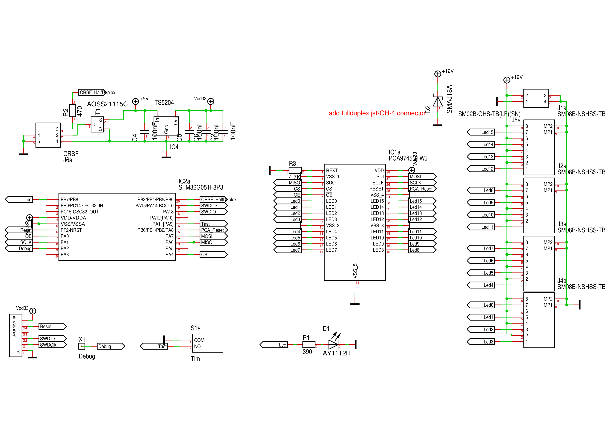

=== PCB

.PCB Top (click to enlarge)
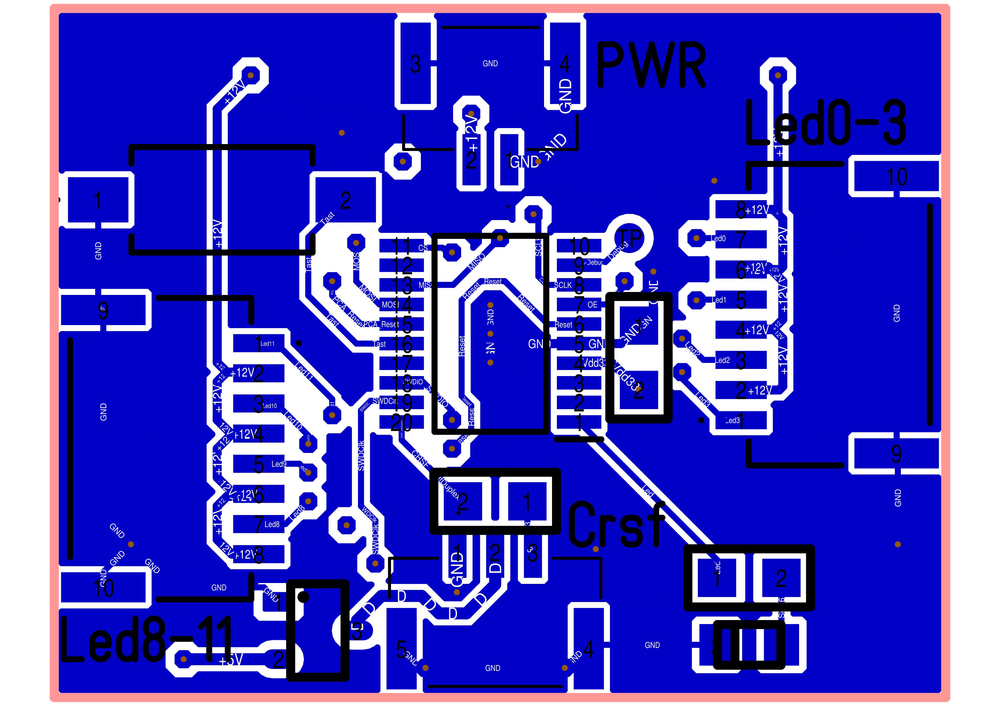

.PCB Bottom (click to enlarge)
image::../images/led4x4/RC_Led4x4_32_PCB_U.PNG[width=240, link="../images/led4x4/RC_Led4x4_32_PCB_U.PNG"]

=== Firmware

Link to the firmware: https://github.com/wimalopaan/wmucpp/tree/master/boards/rcLed4x4[]

=== Production data

Link to link:../images/led4x4/RC_Led4x4_32.T3001[Target 3001 design file].

Link to link:../images/led4x4/RC_Led4x4_32.zip[Gerber].

[[crsf-switch]]
== CRSF-Switch / Router

[caption=""]
.Project info
[cols="1h,5",width="100%"]
|===
| Status | 🟢 active
| Hardware | https://oshwlab.com/wilhelm.wm.meier/crsfcswitch01[OSHWLab]
| Firmware | https://github.com/wimalopaan/wmucpp/tree/master/boards/rcCrsfSwitch[wmucpp: `boards/rcCrsfSwitch`]
| Video | https://www.youtube.com/watch?v=QvIe8XSXLU8[2025-09-27], https://www.youtube.com/watch?v=eo3Svl30hE8[2025-11-19], <<videos.adoc#v-crsf-switch,all videos (2)>>
| See also | <<protocols.adoc#crsf-bus,CRSF-Half-Duplex Bus>>
|===

Allows to connect up to seven half-duplex CRSF devices to a full-duplex receiver.

In contrast to <<protocols.adoc#crsf-bus,CRSF-Half-Duplex Bus>> this `CRSF-Switch` allows _all_ attached devices to be active at the same time (no external activation required).
To be fully usefull, it requires to use ExpressLRS Version 4.x.x or Version 3.x.x with the <<elrs.adoc#elrs-route,Allow other than `0xc8` as extended addresses (Version 3.x.x only)>> extension.

The CRSF-switch acts in some respects like a LAN router/switch inkl. NAT: the attached devices need not to have different _crsf-addresses_, because the CRSF-switch
translates the addresses of the attached devices to a (predefined) set of addresses (used on the receiver side). So, the receiver _sees_ a point-2-point connection with a single device 
with multiple addresses or (similar) a device with its own address (the CRSF-switch address), that routes messages to other devices with different addresses.

Broadcast messages or messages without address information like non-extended messages are forwarded to / from all devices. Be this means, RC-channel (or link-stats messages) data gets to all
connected devices as well as telemetry data (the forwarding can be configured via the CRSF-menu of the CRSF-router). 

The switch _learns_ the addresses of the attached devices by sending _CRSF-ping_ messages to all connected devices on startup. It decides if it is neccessary to translate the
address of an each attached device. 

The switch can act as a CRSF-relay as well (s.a. <<rcrelay32>>). Every connector can be used for a connecttion to an ELRS TX-module (half-duplex) or RX-as-TX (full-duplex).

[NOTE]
--
The PCB of the CRSF-Switch has been updated: now it can connect upto 4 full-duplex and up to 2 half-duplex devices.

The project is shared on OSHWLAB: https://oshwlab.com/wilhelm.wm.meier/crsfcswitch01[]
--

[[elrs_ma]]
== ELRS-MultiAdapter-EA

[caption=""]
.Project info
[cols="1h,5",width="100%"]
|===
| Status | 🔵 stable
| Firmware | https://github.com/wimalopaan/wmucpp/tree/master/boards/rcmultiadapterG030[wmucpp: `boards/rcmultiadapterG030`]
| Control | <<multiswitch.adoc#msw_widget,MultiSwitch widget>>, <<protocols.adoc#prop32,Prop32>>
|===

The `ELRS-MultiAdapter-EA` converts CRSF-serial input into 

* 4 Servo-PWM outputs for arbitrary channels (out of the 16 CRSF channels) or for 4 individual out-of-band channels (4 additional 8-bit channels), or 
* acts like a <<multiswitch.adoc#elrs_msw,ELRS-MultiSwitch>> but with 4 push-pull outputs up to 1A@18V (max.) (occupies 1 switch-module address in this mode), or
* produces up to 4 PWM outputs for analog switch modules (like Graupner 4159) each occupying one of the 256 addresses, or
* produces 4 motor PWM signals (duty 0 ... 100%) (unidirectionl) up to 1A@18V (max.) for 4 individual out-of-band channels (4 additional 8-bit channels) or 4 normal channels (1 ... 16), or
* produces 2 motor PWM signals (duty 0 ... 100%) (bidirectionl) up to 1A@18V (max.) for 2 individual out-of-band channels (4 additional 8-bit channels) or 2 normal channels (1 ... 16), or

[[rcrelay32]]
== RC-Relay32: a CRSF-Relay

[caption=""]
.Project info
[cols="1h,5",width="100%"]
|===
| Status | 🟢 active
| Hardware | https://de.aliexpress.com/item/1005005748198584.html[WeAct STM32G0 board]
| Firmware | https://github.com/wimalopaan/wmucpp/tree/master/boards/rcRelay32[wmucpp: `boards/rcRelay32`]
| Video | https://www.youtube.com/watch?v=U8FipSOZ5B8[2025-12-10], https://www.youtube.com/watch?v=5iENS7tGbj4[2025-12-13], https://www.youtube.com/watch?v=hsxlTjcT4t8[2025-12-13 #2], https://www.youtube.com/watch?v=TunZTMcnqxQ[2025-12-15], <<videos.adoc#v-rcrelay32,all videos (4)>>
| See also | <<elrs.adoc#elrs-relay,ELRS relay configuration>>, <<elrs.adoc#elrs-tx-relay,ELRS-Transmitter as CRSF-Relay>>
|===

(the following documentation is work-in-progess)

With the `CRSF-Relay` you can connect one CRSF-based RC-Link (like https://www.expresslrs.org[ExpressLRS] or TBS Crossfire or ...) comprising 
handset/transmitter-module and receiver to another CRSF-based RC-Link comprising a transmitter-module and receiver. The first receiver and the 
second transmitter-module are connected via the CRSF-Relay, that does all the weird stuff.

(image)

This setup can be used to

* connect two ELRS RC-Links together (e.g. 2400MHz and 868/900MHz)
* connect arbitrary CRSF-based RC-links (like TBS, ...)
* use a ELRS RX-as-TX as transmitter-module (full-duplex) or external module (half-duplex)

This can be usefull to:

* connect a handset/transmitter to a powerful transmitter-module mounted on a pole using a good antenna (maybe directional) and placed on a terrain on high-altitude containing no obstacles to achieve large distances
* solving the multi-model problem (see below)
* changing RF-band in the link to get better penetration e.g. for RC-subwater vessels
* ...

The benefit of this solution is, that all CRSF components in the whole setting are reachable via the `elrsV3.lua` configuration script (or TBS Agent). So, not only
the rc-channels are transported this way, but also the telemetry data from all receivers and modules are send back without collisions.

There maybe need for a LUA-widget running on the handset to convert the tunneled RC-LinkStat packages from the secondary RC-Link (or even more RC-Links).

The firmware can be fund here: https://github.com/wimalopaan/wmucpp/tree/master/boards/rcRelay32[]

The https://de.aliexpress.com/item/1005005748198584.html[WeAct STM32G031F8] is used as the hardware platform.

.Pins of the WeAct STM32G031 Board
|===
| Description | Pin | Pin-Header-Name | Name on the board

| unused | PA0 | P2-7 | A0
| unused | PA1 | P2-8 | A1
| to receiver tx | PA2 | P2-9 | A2
| to receiver rx | PA3 | P2-10 | A3
| unused | PA5 | P3-7 | A5
| unused | PA6 | P3-6 | A6
| unused | PA7 | P3-5 | A7
| unused | PA8 | P3-4 | A8
| to txmodule tx (half-duplex) | PA9 | P3-3  | A9 (A11)
| to txmodule rx | PA10 | P3-2  | A10 (A12)
| button on-board | PA14 |  | not exposed
| LED (onboard) | PA4 | A4 | A4
| unused | PB6 | P3-1 | B6
| unused | PB7 | P2-1 | B7
| unused | PC14 | P2-2 | C14
| unused | PC15 | P2-3 | C15
|===

[[relay_img01]]
.The Relay (click to enlarge)  
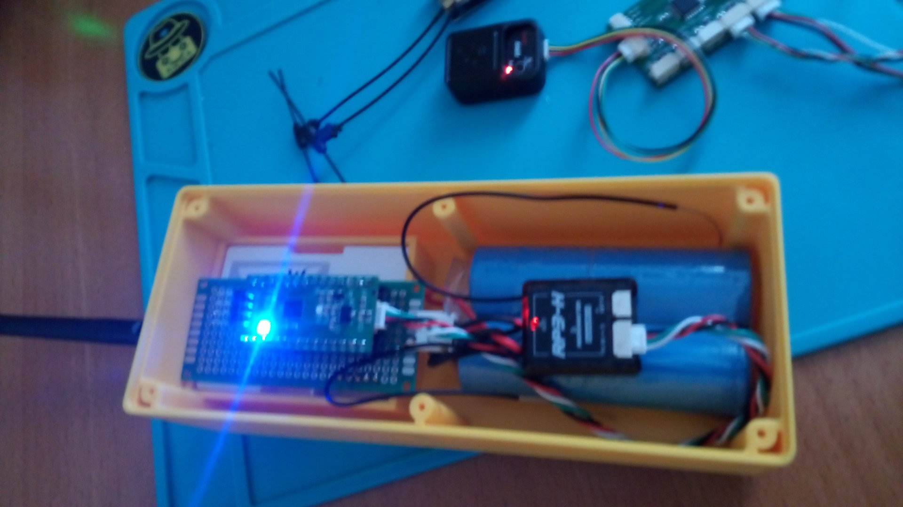

[[relay_img02]]
.The Relay (click to enlarge)  
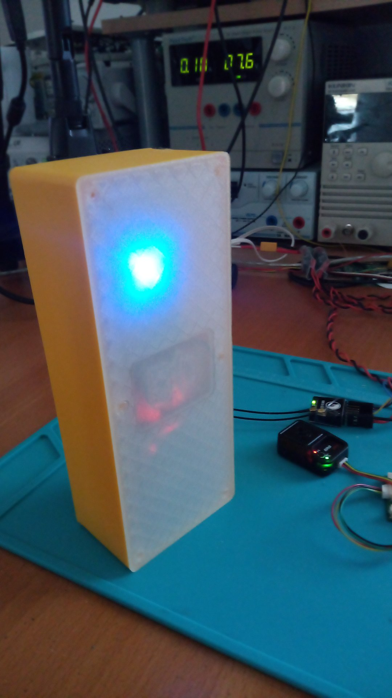

[[relay_img03]]
.The Relay (click to enlarge)  
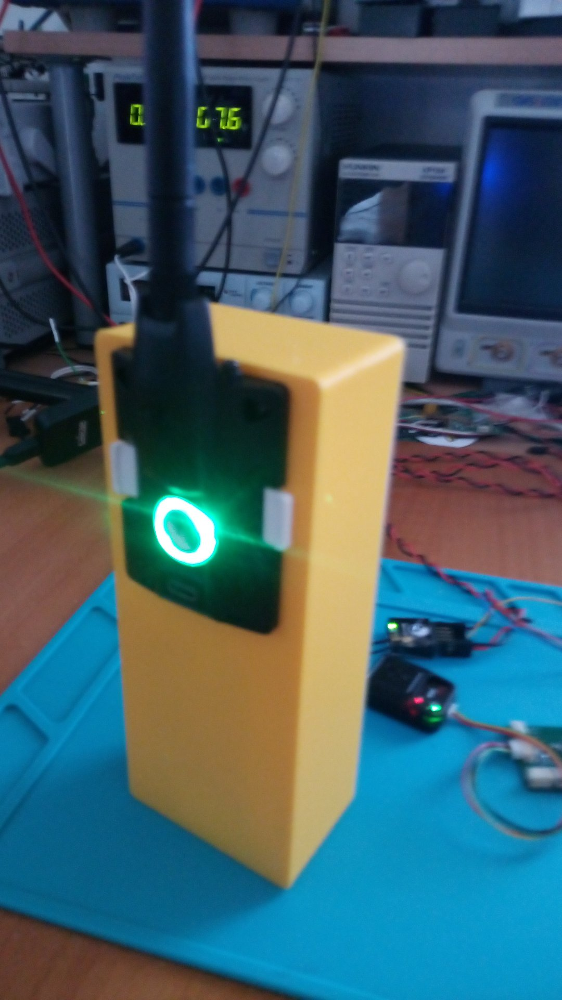

[[relay_menu04]]
.The Menu (click to enlarge)  
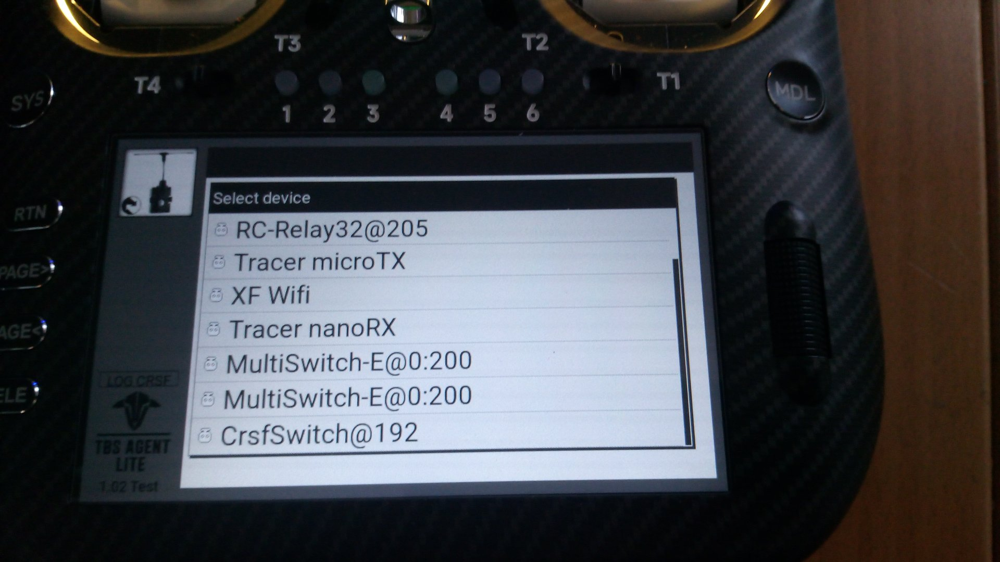

[[relay_menu01]]
.The Menu (click to enlarge)  
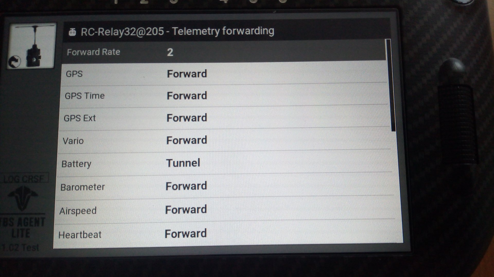

[[relay_menu02]]
.The Menu (click to enlarge)  
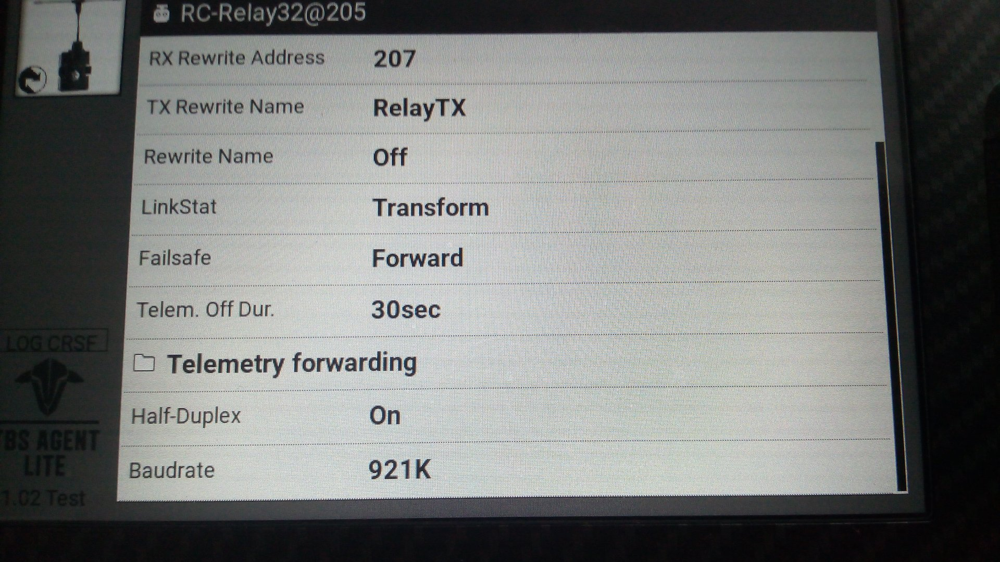

[[relay_menu03]]
.The Menu (click to enlarge)  
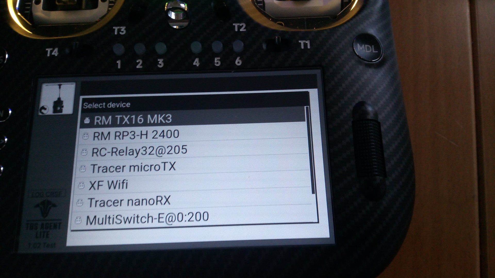

[[multi-part-model]]
=== The Multipart-Model problem

Actually it is kind of a challenge to control more than one RC-model at the same and using also telemetry. You may wonder who is doing such crazy stuff, but 
people want e.g. to control two ship-models (like the DGZRS-Cruisers and their daughter boats) or a RC-Crawler or RC-Truck together with its trailer. Often the RC-systems 
is kept running when the truck drives around with the trailer parked somehow.

So, it would be cool to have an RC-Link with a handset/transmitter-module to which more than one receiver using telemetry is connected to. But this is impossible, even with more than 
one transmitter-module in the handset, because there is no solution for multiple telemetry streams inside e.g. EdgeTx.

So, the CRSF-relay could be a solution: the handset/transmitter connects to the master-rc-model. Inside this you have a receiver as usual but also the CRSF-Relay connected to another
transmittre-module e.g. a very small and cheap ELRS rx-as-tx. This rx-as-tx connects to the slave-rc-model, where another receiver is placed in.

But the is also a much more _simpler_ solution: forward all packets that the receiver gets from the handset to a slave unit be some means that the receiver already has built-in. And for this puepose
_ESP-NOW_ comes into mind because every _ExpressLRS_ receiver is built upon an ESP32/ESP32C3/ESP8255! 

Therefore, if the distance between the main receiver and the slave unit is small like some centimeter between the RC-truck and the trailer or some <25m between the main ship and its daughter boat we can 
cut the chip count and use the ELRS-receiver also as an _ESP-NOW_ transceiver connected to a slave unit solely built on top of an e.g. ESP32C3mini dev-board.

The drawback of this solution is, that you need another modification of _ELRS_ that brings _ESP-NOW_ to the receiver <<elrs.adoc#elrs-esp-now,CRSF-over-ESP-NOW for ELRS V4>>.

[[crsfserialservo]]
== The CRSF to Serial-Servo Converter

[caption=""]
.Project info
[cols="1h,5",width="100%"]
|===
| Status | 🟢 active
| Firmware | https://github.com/wimalopaan/wmucpp/tree/master/boards/rcSerialServo[wmucpp: `boards/rcSerialServo`]
| Configuration | CRSF menu on the handset
| Video | https://www.youtube.com/watch?v=e9p31QfDSqo[2026-05-17], https://youtu.be/_jWBiEMZoZ8[more], <<videos.adoc#v-crsfserialservo,all videos (2)>>
|===

This project is an adapter to use _serial servos_ together with an CRSF receiver.

_Serial servos_ aren't controlled via a PWM servo signal. Instead they use a serial data connection. Typically
each servo has a distinct address, so all servos can be connected to same same serial line. In this case
one has to use a 3-wire connector: Gnd, Vcc, data.

There are (have been) servos that use SBus as serial protocol. To configure the channel (address) they listen to
one has to use some configuration tool, the servo is connected too. This is very cumbersome.

In the robotics area other kind of servo is widely used as e.g. the WaveShare ST3020. The do have another form factor 
than the typical standard rc servos, but they can be equpped with a RC like servo arm. To mount them like a standard RC servo, 
one can use a 3D printed hat (see <<serialservo02>>).

This project impelements the WaveShare serial protocol, and gives the user a CRSF menu on the handset to configure
the servos. No disconnect to a configuration tool is required. The adjustments can be made even if the servo is 
already mounted inside the model.

The here used ST3020 servo is a 360° servo with feedback. 

With this servo the follwing features are possible:

* adjustable rotation angle between 1° and 12 * 360° (for full channel range)
* adjustable speed
* adjustable torque
* stall detection
* overload protection
* position feedback

(see also <<cruise-control.adoc#CC,The `CruiseController`>> and <<cruise-control.adoc#rc720e,Double Schottel-Control (aka Cruise-Controller)>>)

Application of the serial-servo as sailboat winch: https://youtu.be/_jWBiEMZoZ8[Saudade].

[[serialservo01]]
.The WaveShare ST3020 serial servo (click to enlarge)  
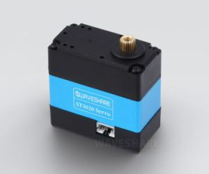

[[serialservo02]]
.The WaveShare ST3020 serial servo connected together (click to enlarge)  
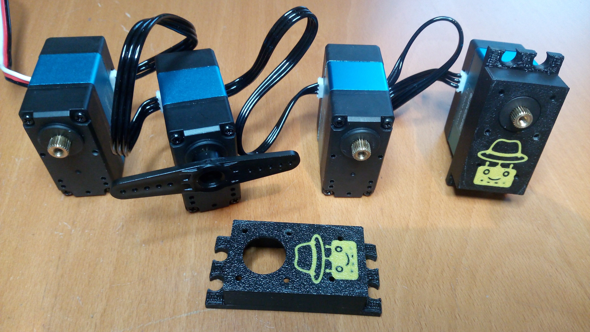

[[serialservo03]]
.The _CRSF to serial servo_ Adapter connected to 4 WaveShare ST3020 serial servos and an ELRS receiver (ER6) (click to enlarge)  
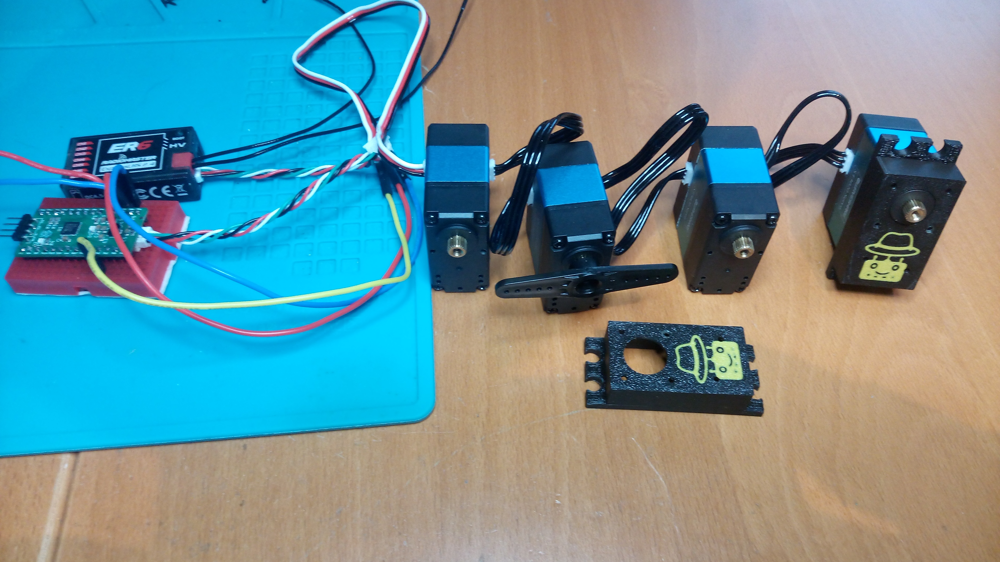
