= CRSF-Geräte
Wilhelm Meier <wilhelm.wm.meier@googlemail.com>
:toc:
:toclevels: 3
:toc-placement!:
:sectnums:
:sectnumlevels: 5
:tip-caption: :bulb:
:note-caption: :information_source:
:important-caption: :heavy_exclamation_mark:
:caution-caption: :fire:
:warning-caption: :warning:
:lang: de
:toc-title: Inhaltsverzeichnis
:figure-caption: Abbildung
:table-caption: Tabelle
:example-caption: Beispiel

<<crsf-devices.adoc#,English>> | *Deutsch*

<<../README.de.adoc#,RC Electronics>> / CRSF-Geräte

[NOTE]
--
LED 4x4, CRSF-Switch/Router, MultiAdapter, RC-Relay32, CRSF-zu-Serial-Servo-Konverter.
--

toc::[]

[[led4x4]]
== LED 4x4-Modul

[caption=""]
.Projektinfo
[cols="1h,5",width="100%"]
|===
| Status | 🟢 aktiv
| Hardware | https://oshwlab.com/wilhelm.wm.meier/works[OSHWLab], link:../images/led4x4/RC_Led4x4_32.zip[Gerber/BOM (zip)], link:../images/led4x4/RC_Led4x4_32.T3001[TARGET 3001!]
| Firmware | https://github.com/wimalopaan/wmucpp/tree/master/boards/rcLed4x4[wmucpp: `boards/rcLed4x4`]
| Steuerung | <<multiswitch.de.adoc#msw_widget,MultiSwitch-Widget>> (<<protocols.de.adoc#crsf-sw,CRSF-MultiSwitch-Befehle>>)
| Video | https://www.youtube.com/watch?v=Zr4yXvoaQ9k[2025-09-15], <<videos.de.adoc#v-led4x4,alle Videos (1)>>
|===

Dieses Modul kann bis zu 16 LEDs steuern. Alle LEDs lassen sich einzeln ansteuern, können aber auch in bis zu 4 Gruppen zusammengefasst werden.
Es eignet sich besonders gut für _RC-Crawler_.

Funktionen:

* 16 LED-Ausgänge mit
** einzeln steuerbarer Konstantstromquelle
** einzeln steuerbarem PWM-Generator
** optionaler Gruppenzugehörigkeit
* 4 Gruppen mit
** individueller Anstiegszeit
** individueller Abfallzeit
** individueller Einschaltdauer
** individueller Ausschaltdauer
** fortlaufenden und einmaligen Abläufen
* 8 virtuelle Schalter
** Jeder virtuelle Schalter umfasst bis zu 4 Ausgänge

Das Modul wird über das _MultiSwitch-Widget_ gesteuert (wie der <<multiswitch.de.adoc#mswe8,MultiSwitch-E8>>); alle Einstellungen lassen sich über `elrsV3.lua` oder den _TBS Agent Lite_ vornehmen.

[[_schematic]]
=== Schaltplan

Die aktuelle Version findet sich unter https://oshwlab.com/wilhelm.wm.meier/works[].

[CAUTION]
--
Bitte beachten: Der folgende Hardwareentwurf ist veraltet. Die oben genannte Version verwenden.
--

.Schaltplan (zum Vergrößern anklicken)
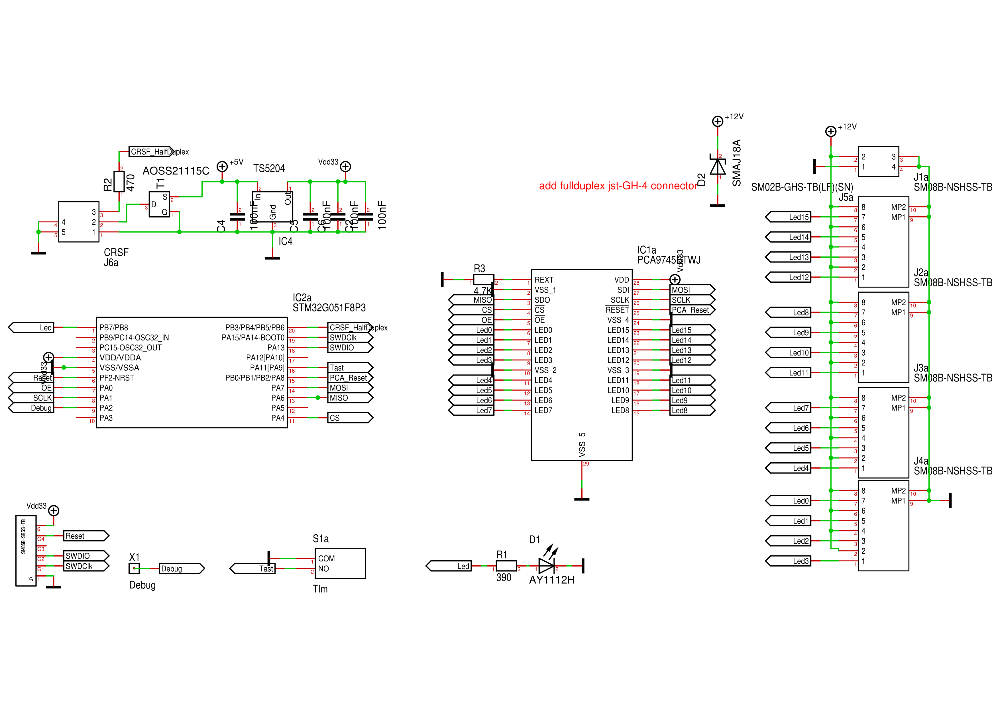

[[_pcb]]
=== Leiterplatte

.Leiterplattenoberseite (zum Vergrößern anklicken)
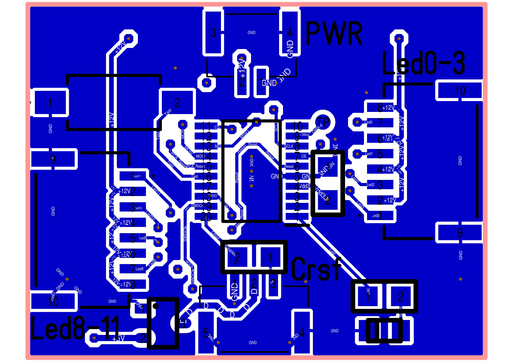

.Leiterplattenunterseite (zum Vergrößern anklicken)
image::../images/led4x4/RC_Led4x4_32_PCB_U.PNG[width=240, link="../images/led4x4/RC_Led4x4_32_PCB_U.PNG"]

[[_firmware]]
=== Firmware

Link zur Firmware: https://github.com/wimalopaan/wmucpp/tree/master/boards/rcLed4x4[]

[[_production_data]]
=== Fertigungsdaten

Link zur link:../images/led4x4/RC_Led4x4_32.T3001[Target 3001-Entwurfsdatei].

Link zu link:../images/led4x4/RC_Led4x4_32.zip[Gerber].

[[crsf-switch]]
== CRSF-Switch / Router

[caption=""]
.Projektinfo
[cols="1h,5",width="100%"]
|===
| Status | 🟢 aktiv
| Hardware | https://oshwlab.com/wilhelm.wm.meier/crsfcswitch01[OSHWLab]
| Firmware | https://github.com/wimalopaan/wmucpp/tree/master/boards/rcCrsfSwitch[wmucpp: `boards/rcCrsfSwitch`]
| Video | https://www.youtube.com/watch?v=QvIe8XSXLU8[2025-09-27], https://www.youtube.com/watch?v=eo3Svl30hE8[2025-11-19], <<videos.de.adoc#v-crsf-switch,alle Videos (2)>>
| Siehe auch | <<protocols.de.adoc#crsf-bus,CRSF-Halbduplex-Bus>>
|===

Ermöglicht den Anschluss von bis zu sieben Halbduplex-CRSF-Geräten an einen Vollduplex-Empfänger.

Im Gegensatz zum <<protocols.de.adoc#crsf-bus,CRSF-Halbduplex-Bus>> können bei diesem `CRSF-Switch` _alle_ angeschlossenen Geräte gleichzeitig aktiv sein (keine externe Aktivierung erforderlich).
Für die vollständige Nutzung ist ExpressLRS Version 4.x.x oder Version 3.x.x mit der Erweiterung <<elrs.de.adoc#elrs-route,Andere erweiterte Adressen als `0xc8` zulassen (nur Version 3.x.x)>> erforderlich.

Der CRSF-Switch arbeitet in mancher Hinsicht wie ein LAN-Router/-Switch einschließlich NAT: Die angeschlossenen Geräte müssen keine unterschiedlichen _CRSF-Adressen_ haben, da der CRSF-Switch
ihre Adressen auf einen (vordefinierten) Satz von Adressen umsetzt (der auf der Empfängerseite verwendet wird). Der Empfänger _sieht_ somit eine Punkt-zu-Punkt-Verbindung zu einem einzelnen Gerät
mit mehreren Adressen oder (vergleichbar) ein Gerät mit eigener Adresse (der CRSF-Switch-Adresse), das Nachrichten an andere Geräte mit unterschiedlichen Adressen weiterleitet.

Broadcast-Nachrichten oder Nachrichten ohne Adressinformationen, etwa nicht erweiterte Nachrichten, werden an alle Geräte bzw. von allen Geräten weitergeleitet. So erreichen RC-Kanaldaten (oder Verbindungsstatistik-Nachrichten) alle
angeschlossenen Geräte, ebenso wie Telemetriedaten (die Weiterleitung lässt sich über das CRSF-Menü des CRSF-Routers konfigurieren).

Der Switch _lernt_ die Adressen der angeschlossenen Geräte, indem er beim Start _CRSF-Ping_-Nachrichten an alle angeschlossenen Geräte sendet. Er entscheidet, ob die
Adresse des jeweiligen Geräts umgesetzt werden muss.

Der Switch kann auch als CRSF-Relais arbeiten (siehe auch <<rcrelay32>>). Jeder Anschluss kann für die Verbindung zu einem ELRS-TX-Modul (Halbduplex) oder RX-as-TX (Vollduplex) verwendet werden.

[NOTE]
--
Die Leiterplatte des CRSF-Switch wurde überarbeitet: Nun können bis zu 4 Vollduplex- und bis zu 2 Halbduplex-Geräte angeschlossen werden.

Das Projekt ist auf OSHWLAB veröffentlicht: https://oshwlab.com/wilhelm.wm.meier/crsfcswitch01[]
--

[[elrs_ma]]
== ELRS-MultiAdapter-EA

[caption=""]
.Projektinfo
[cols="1h,5",width="100%"]
|===
| Status | 🔵 stabil
| Firmware | https://github.com/wimalopaan/wmucpp/tree/master/boards/rcmultiadapterG030[wmucpp: `boards/rcmultiadapterG030`]
| Steuerung | <<multiswitch.de.adoc#msw_widget,MultiSwitch-Widget>>, <<protocols.de.adoc#prop32,Prop32>>
|===

Der `ELRS-MultiAdapter-EA` setzt den seriellen CRSF-Eingang wie folgt um:

* 4 Servo-PWM-Ausgänge für beliebige Kanäle (aus den 16 CRSF-Kanälen) oder für 4 einzelne Außerbandkanäle (4 zusätzliche 8-Bit-Kanäle), oder
* arbeitet wie ein <<multiswitch.de.adoc#elrs_msw,ELRS-MultiSwitch>>, jedoch mit 4 Gegentaktausgängen bis zu 1A@18V (max.) (belegt in diesem Modus 1 Schaltmoduladresse), oder
* erzeugt bis zu 4 PWM-Ausgänge für analoge Schaltmodule (wie Graupner 4159), die jeweils eine der 256 Adressen belegen, oder
* erzeugt 4 Motor-PWM-Signale (Tastgrad 0 ... 100%) (unidirektional) bis zu 1A@18V (max.) für 4 einzelne Außerbandkanäle (4 zusätzliche 8-Bit-Kanäle) oder 4 normale Kanäle (1 ... 16), oder
* erzeugt 2 Motor-PWM-Signale (Tastgrad 0 ... 100%) (bidirektional) bis zu 1A@18V (max.) für 2 einzelne Außerbandkanäle (4 zusätzliche 8-Bit-Kanäle) oder 2 normale Kanäle (1 ... 16), oder

[[rcrelay32]]
== RC-Relay32: ein CRSF-Relais

[caption=""]
.Projektinfo
[cols="1h,5",width="100%"]
|===
| Status | 🟢 aktiv
| Hardware | https://de.aliexpress.com/item/1005005748198584.html[WeAct STM32G0-Platine]
| Firmware | https://github.com/wimalopaan/wmucpp/tree/master/boards/rcRelay32[wmucpp: `boards/rcRelay32`]
| ESP32-C3-Port | https://github.com/wimalopaan/wmucpp/tree/master/boards/esp32/relay[wmucpp: `boards/esp32/relay`] für das WeAct ESP32-C3 Core Board
| ESP32-C3-Dokumentation | https://github.com/wimalopaan/wmucpp/blob/master/boards/esp32/relay/README.de.adoc[Deutsche README], https://github.com/wimalopaan/wmucpp/blob/master/boards/esp32/relay/README.adoc[Englische README]
| Video | https://www.youtube.com/watch?v=U8FipSOZ5B8[2025-12-10], https://www.youtube.com/watch?v=5iENS7tGbj4[2025-12-13], https://www.youtube.com/watch?v=hsxlTjcT4t8[2025-12-13 #2], https://www.youtube.com/watch?v=TunZTMcnqxQ[2025-12-15], <<videos.de.adoc#v-rcrelay32,alle Videos (4)>>
| Siehe auch | <<elrs.de.adoc#elrs-relay,ELRS-Relaiskonfiguration>>, <<elrs.de.adoc#elrs-tx-relay,ELRS-Sender als CRSF-Relais>>
|===

(Die folgende Dokumentation ist noch in Arbeit)

Mit dem `CRSF-Relay` lässt sich eine CRSF-basierte RC-Funkstrecke (wie https://www.expresslrs.org[ExpressLRS] oder TBS Crossfire oder ...), bestehend aus
Sender/Sendemodul und Empfänger, mit einer weiteren CRSF-basierten RC-Funkstrecke aus Sendemodul und Empfänger verbinden. Der erste Empfänger und das
zweite Sendemodul werden über das CRSF-Relais verbunden, das sich um alle komplizierten Einzelheiten kümmert.

(Bild)

Mit diesem Aufbau lassen sich

* zwei ELRS-RC-Funkstrecken verbinden (z. B. 2400MHz und 868/900MHz)
* beliebige CRSF-basierte RC-Funkstrecken verbinden (wie TBS, ...)
* ein ELRS RX-as-TX als Sendemodul (Vollduplex) oder ein externes Modul (Halbduplex) verwenden

Das kann nützlich sein, um:

* einen Sender mit einem leistungsstarken Sendemodul zu verbinden, das an einem Mast mit einer guten Antenne (gegebenenfalls einer Richtantenne) an einem erhöhten, hindernisfreien Standort montiert ist, um große Reichweiten zu erreichen
* das Mehrmodellproblem zu lösen (siehe unten)
* das Funkfrequenzband der Verbindung zu wechseln, um eine bessere Durchdringung zu erreichen, etwa für RC-Unterwasserfahrzeuge
* ...

Der Vorteil dieser Lösung ist, dass alle CRSF-Komponenten des gesamten Aufbaus über das Konfigurationsskript `elrsV3.lua` (oder TBS Agent) erreichbar sind. Auf diese Weise
werden nicht nur die RC-Kanäle übertragen, sondern auch die Telemetriedaten aller Empfänger und Module kollisionsfrei zurückgesendet.

Möglicherweise ist ein LUA-Widget auf dem Sender erforderlich, um die getunnelten RC-LinkStat-Pakete der zweiten RC-Funkstrecke (oder weiterer RC-Funkstrecken) umzusetzen.

Die Firmware findet sich hier: https://github.com/wimalopaan/wmucpp/tree/master/boards/rcRelay32[]

Zusätzlich ist ein ESP-IDF-Port für das WeAct ESP32-C3 Core Board verfügbar.
Seine https://github.com/wimalopaan/wmucpp/blob/master/boards/esp32/relay/README.de.adoc[README]
beschreibt die ESP32-C3-Pinbelegung, unterstützte Funktionen, Unterschiede zur
STM32-Version sowie Bau- und Flash-Anleitung. Ein Hardwaretest dieses Ports
steht noch aus; die folgende STM32-Pinbelegung gilt dafür nicht.

Als Hardwareplattform wird die https://de.aliexpress.com/item/1005005748198584.html[WeAct STM32G031F8] verwendet.

.Pins der WeAct STM32G031-Platine
|===
| Beschreibung | Pin | Stiftleistenbezeichnung | Bezeichnung auf der Platine

| unbenutzt | PA0 | P2-7 | A0
| unbenutzt | PA1 | P2-8 | A1
| zum TX des Empfängers | PA2 | P2-9 | A2
| zum RX des Empfängers | PA3 | P2-10 | A3
| unbenutzt | PA5 | P3-7 | A5
| unbenutzt | PA6 | P3-6 | A6
| unbenutzt | PA7 | P3-5 | A7
| unbenutzt | PA8 | P3-4 | A8
| zum TX des Sendemoduls (Halbduplex) | PA9 | P3-3  | A9 (A11)
| zum RX des Sendemoduls | PA10 | P3-2  | A10 (A12)
| Taster auf der Platine | PA14 |  | nicht herausgeführt
| LED (auf der Platine) | PA4 | A4 | A4
| unbenutzt | PB6 | P3-1 | B6
| unbenutzt | PB7 | P2-1 | B7
| unbenutzt | PC14 | P2-2 | C14
| unbenutzt | PC15 | P2-3 | C15
|===

[[relay_img01]]
.Das Relais (zum Vergrößern anklicken)  
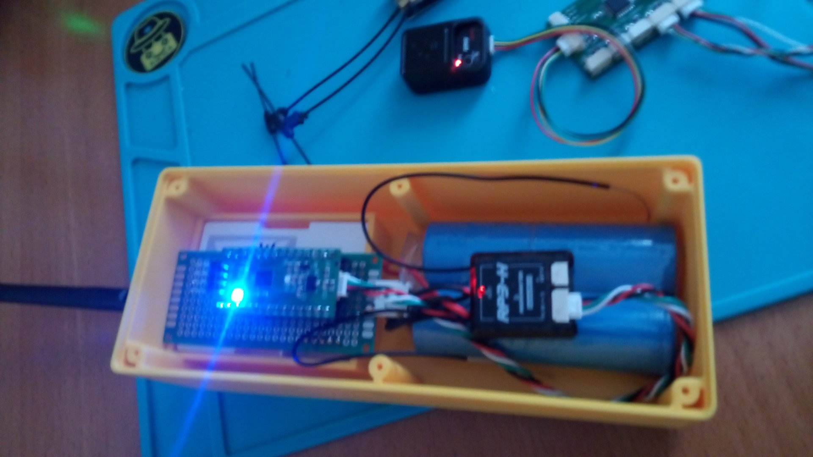

[[relay_img02]]
.Das Relais (zum Vergrößern anklicken)  
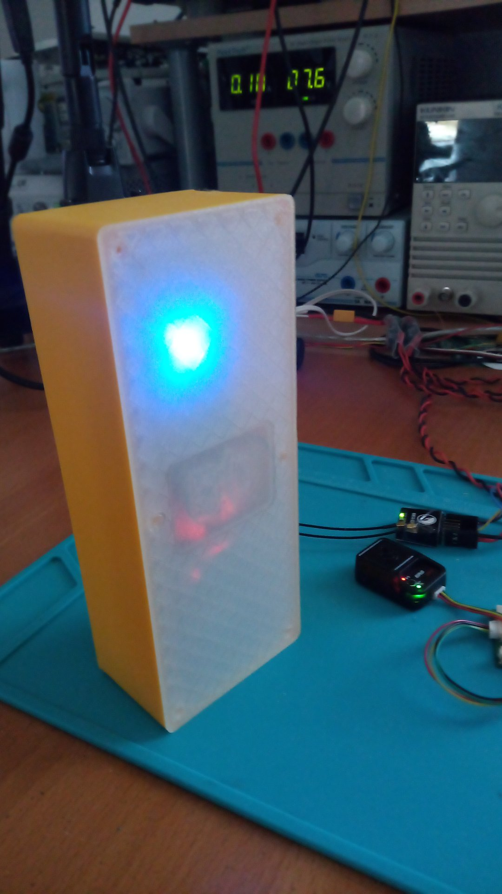

[[relay_img03]]
.Das Relais (zum Vergrößern anklicken)  
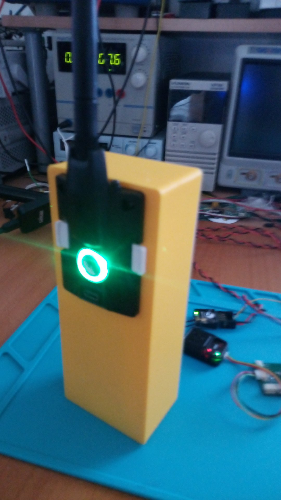

[[relay_menu04]]
.Das Menü (zum Vergrößern anklicken)  
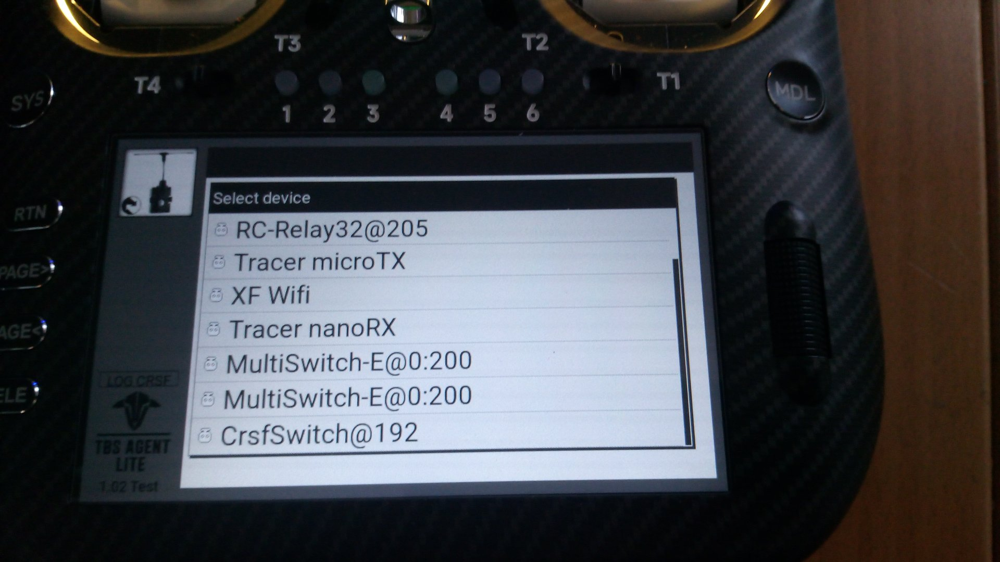

[[relay_menu01]]
.Das Menü (zum Vergrößern anklicken)  
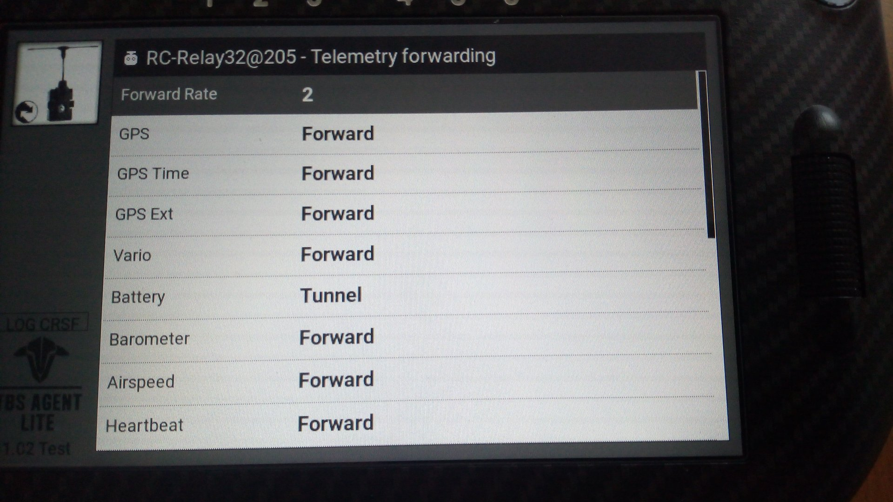

[[relay_menu02]]
.Das Menü (zum Vergrößern anklicken)  
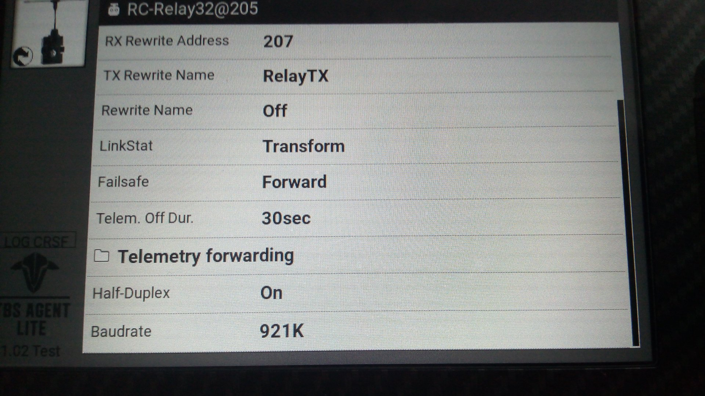

[[relay_menu03]]
.Das Menü (zum Vergrößern anklicken)  
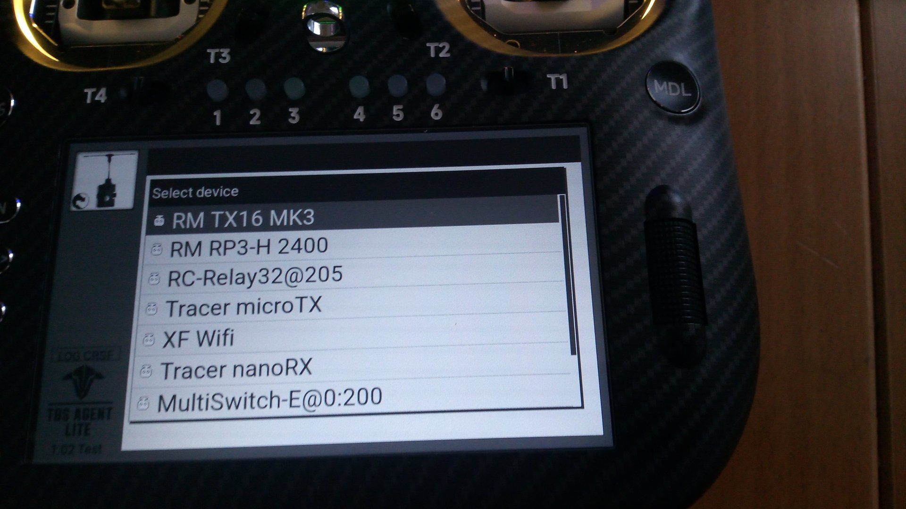

[[multi-part-model]]
=== Das Problem mehrteiliger Modelle

Mehr als ein RC-Modell gleichzeitig zu steuern und dabei auch Telemetrie zu nutzen, ist tatsächlich eine Herausforderung. Man mag sich fragen, wer so etwas Ausgefallenes macht, aber
manche möchten beispielsweise zwei Schiffsmodelle (etwa DGZRS-Seenotrettungskreuzer mit ihren Tochterbooten) oder einen RC-Crawler bzw. RC-Truck zusammen mit seinem Anhänger steuern. Häufig bleibt die RC-Anlage
eingeschaltet, während der Truck herumfährt und der Anhänger irgendwo abgestellt ist.

Es wäre daher praktisch, eine RC-Funkstrecke mit einem Sender/Sendemodul zu haben, an die mehr als ein Empfänger mit Telemetrie angeschlossen ist. Das ist jedoch unmöglich, selbst mit mehr als
einem Sendemodul im Sender, da es etwa in EdgeTx keine Lösung für mehrere Telemetriedatenströme gibt.

Das CRSF-Relais könnte also eine Lösung sein: Der Sender verbindet sich mit dem Haupt-RC-Modell. Darin befindet sich wie üblich ein Empfänger, aber zusätzlich auch das CRSF-Relais, das mit einem weiteren
Sendemodul verbunden ist, etwa einem sehr kleinen und günstigen ELRS RX-as-TX. Dieses RX-as-TX verbindet sich mit dem untergeordneten RC-Modell, in dem ein weiterer Empfänger eingebaut ist.

Es gibt aber auch eine deutlich _einfachere_ Lösung: Alle Pakete, die der Empfänger vom Sender erhält, werden mit einer bereits im Empfänger vorhandenen Möglichkeit an eine untergeordnete Einheit weitergeleitet. Dafür
bietet sich _ESP-NOW_ an, denn jeder _ExpressLRS_-Empfänger basiert auf einem ESP32/ESP32C3/ESP8255!

Ist der Abstand zwischen Hauptempfänger und untergeordneter Einheit klein, etwa einige Zentimeter zwischen RC-Truck und Anhänger oder <25m zwischen Hauptschiff und Tochterboot, können wir daher
die Anzahl der Chips reduzieren und den ELRS-Empfänger zugleich als _ESP-NOW_-Sendeempfänger nutzen, der mit einer untergeordneten Einheit verbunden ist, die lediglich auf beispielsweise einer ESP32C3mini-Entwicklungsplatine basiert.

Der Nachteil dieser Lösung ist, dass eine weitere Änderung an _ELRS_ erforderlich ist, die _ESP-NOW_ auf dem Empfänger bereitstellt: <<elrs.de.adoc#elrs-esp-now,CRSF über ESP-NOW für ELRS V4>>.

[[crsfserialservo]]
== Der CRSF-zu-Serial-Servo-Konverter

[caption=""]
.Projektinfo
[cols="1h,5",width="100%"]
|===
| Status | 🟢 aktiv
| Firmware | https://github.com/wimalopaan/wmucpp/tree/master/boards/rcSerialServo[wmucpp: `boards/rcSerialServo`]
| Konfiguration | CRSF-Menü am Sender
| Video | https://www.youtube.com/watch?v=e9p31QfDSqo[2026-05-17], https://youtu.be/_jWBiEMZoZ8[weitere], <<videos.de.adoc#v-crsfserialservo,alle Videos (2)>>
|===

Dieses Projekt ist ein Adapter, mit dem sich _serielle Servos_ zusammen mit einem CRSF-Empfänger verwenden lassen.

_Serielle Servos_ werden nicht über ein PWM-Servosignal gesteuert. Stattdessen verwenden sie eine serielle Datenverbindung. Üblicherweise
hat jedes Servo eine eigene Adresse, sodass alle Servos an dieselbe serielle Leitung angeschlossen werden können. In diesem Fall
ist ein Anschluss mit 3 Leitungen erforderlich: Gnd, Vcc, Daten.

Es gibt (bzw. gab) Servos, die SBus als serielles Protokoll verwenden. Um den Kanal (die Adresse) einzustellen, auf den sie reagieren,
muss das Servo an ein Konfigurationsgerät angeschlossen werden. Das ist sehr umständlich.

In der Robotik ist eine andere Art von Servo weit verbreitet, etwa das WaveShare ST3020. Diese Servos haben einen anderen Formfaktor
als typische Standard-RC-Servos, können aber mit einem Servoarm wie im RC-Bereich ausgestattet werden. Um sie wie ein Standard-RC-Servo zu montieren,
kann eine 3D-gedruckte Aufsatzhalterung verwendet werden (siehe <<serialservo02>>).

Dieses Projekt implementiert das serielle WaveShare-Protokoll und stellt dem Benutzer am Sender ein CRSF-Menü zur Konfiguration
der Servos bereit. Ein Abstecken zum Anschluss an ein Konfigurationsgerät ist nicht erforderlich. Die Einstellungen lassen sich auch vornehmen, wenn das Servo
bereits im Modell eingebaut ist.

Das hier verwendete ST3020-Servo ist ein 360°-Servo mit Rückmeldung.

Mit diesem Servo sind folgende Funktionen möglich:

* einstellbarer Drehwinkel zwischen 1° und 12 * 360° (für den vollen Kanalbereich)
* einstellbare Geschwindigkeit
* einstellbares Drehmoment
* Blockiererkennung
* Überlastschutz
* Positionsrückmeldung

(siehe auch <<cruise-control.de.adoc#CC,Der `CruiseController`>> und <<cruise-control.de.adoc#rc720e,Doppelte Schottel-Steuerung (auch Cruise-Controller genannt)>>)

Einsatz des seriellen Servos als Segelwinde: https://youtu.be/_jWBiEMZoZ8[Saudade].

[[serialservo01]]
.Das serielle Servo WaveShare ST3020 (zum Vergrößern anklicken)  
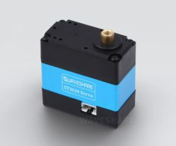

[[serialservo02]]
.Miteinander verbundene serielle Servos WaveShare ST3020 (zum Vergrößern anklicken)  
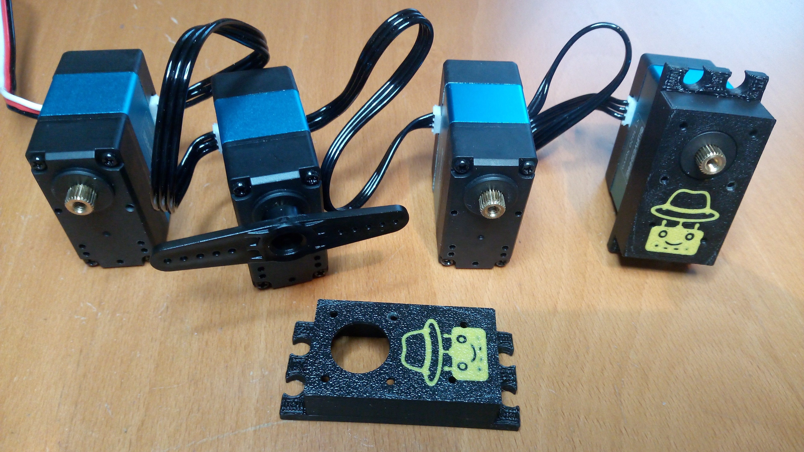

[[serialservo03]]
.Der _CRSF-zu-Serial-Servo_-Adapter, verbunden mit 4 seriellen Servos WaveShare ST3020 und einem ELRS-Empfänger (ER6) (zum Vergrößern anklicken)  
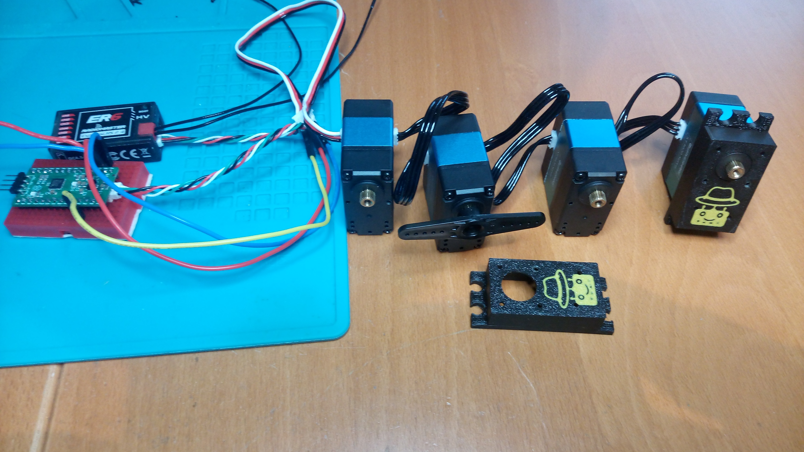
