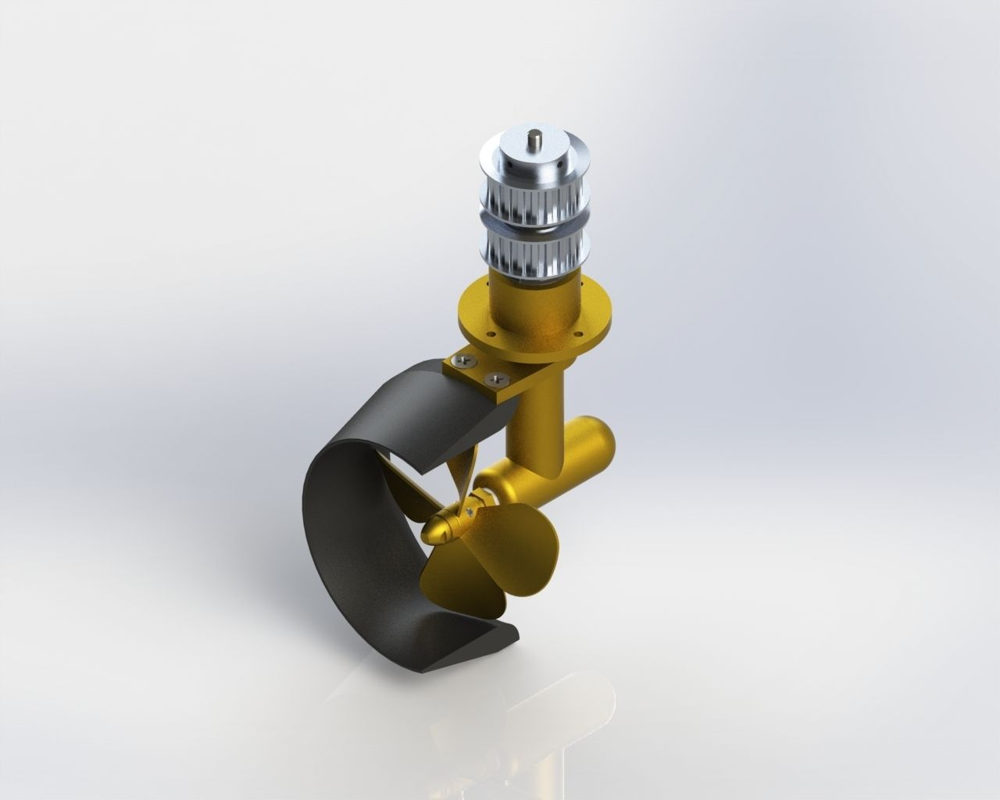
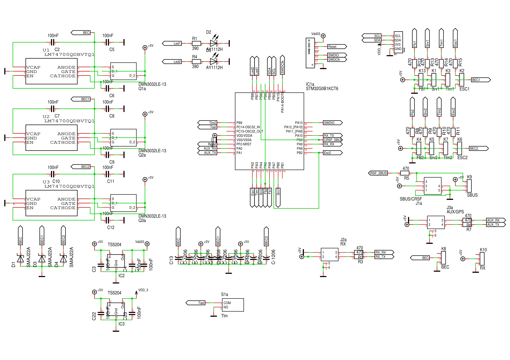
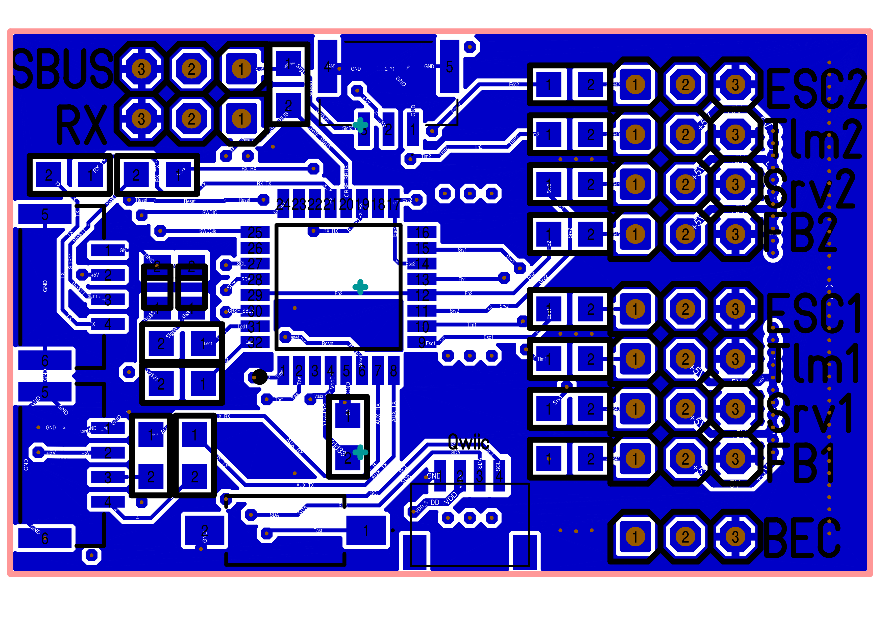
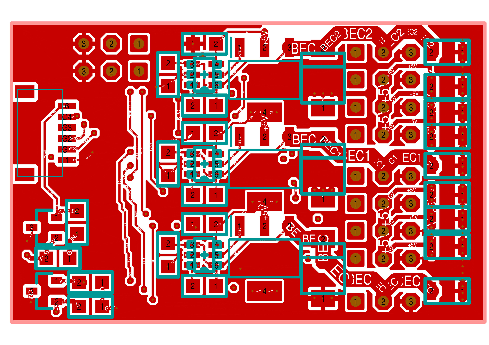

= Cruise-Controller
Wilhelm Meier <wilhelm.wm.meier@googlemail.com>
:toc:
:toclevels: 3
:toc-placement!:
:sectnums:
:sectnumlevels: 5
:tip-caption: :bulb:
:note-caption: :information_source:
:important-caption: :heavy_exclamation_mark:
:caution-caption: :fire:
:warning-caption: :warning:

<<../README.adoc#,RC Electronics>> / Cruise-Controller

[NOTE]
--
Double Schottel-Control (RC720E) and the CruiseController.
--

toc::[]

[[rc720e]]
== Double Schottel-Control (aka Cruise-Controller)

This module was originally designed to control two _Schottel_ drives (for information about those drives
see https://de.wikipedia.org/wiki/Schottel-Ruderpropeller[real world Schottel drive]).

._Schottel_ drive for ship models (Fa. Bauer, see https://www.bauer-modelle.com/Schiffsantriebe-Spezial-und-Wellenantriebe/Schottel-Z-Antriebe[Schottel/Z-Drive])

This module evolved over time and now it can be used as a general _cruise-controller_: this
suggested that it acts like a flight-controller in drones, helicopters or airplanes. Albeit this is true
to some extent, its purpose is somewhat different. So, don't expect to see features like autonomos 
navigation through way points.

The cruise controller more aims at being a protocol-concentrator and information-hub. It combines sensor fusion features 
and protocol-transformation.

Features:

* Servos
** PWM-Servos with analog Feedback (e.g. Feetech FB360M)
** PWM-Servos with PWM-Feedback (e.g. Parallax)
** serial Servos (e.g. WaveShare ST3020) (see also: <<crsf-devices.adoc#crsfserialservo,The CRSF to Serial-Servo Converter>>)

* ESCs
** PWM-ESCs
** `Sbus`,`Sbus2`, `IBus` Escs
** _special_ : KISS(ESCape32), V/ESC
** Telemetry as half-duplex (special, SBUS2) or separate: S.Port, IBus

* BEC joining 
** up to three BEC sources
** if two ESCs are connected with BEC (battery elimination circuit), both BECs are joined (_no disconnect_ of one of the BECs neccessary).

* CRSF
** CRSF input
** CRSF routing to one/two CRSF ports

* Bluetooh
** simple bluetooth module (like HC-05) can be connected to AUX port
** maybe used to control model features without an active radio
** maybe useful to present function/ship models at fairs
** use https://roboremo.app[RoboRemo] to build simple UI.

* GPS, compass, inertial sensor
** Compass / Magnetometer via I2C (QMC5883L)
** Accelerometer via I2C (MPU6050)

* Sbus-Out
** channels 1-16
** Channels 17-32 (needs special mixer script: https://github.com/wimalopaan/LUA?tab=readme-ov-file#mixer-script-crsfch-lua[crsfch.lua])

* SumDV3 Output
** 16/32 channels and 64 binary switches
** ideal to use in combination with e.g. the USM-RC-3 (Fa. Beier: https://www.beier-electronic.de/modellbau/produkte/usm-rc-3/usm-rc-3.php[] )

* SBus / S.Port Input / Telemetry
** 16 channels input
** S.Port telemetry (ESC values, Servo values)
** S.Port telemetry for Schottel visualization
** S.Port (write command) for multiswitch function (e.g. output via SumDV3 to USM-RC-3)

* IBus / SBus / SumDV3 Input
** input for steering and power
** configuration via ELRS
** PC-Link via ELRSBuddy: https://fourflies.mooo.com/elrsbuddy[] and https://github.com/Fourflies/elrsbuddy[]

* CPPM/N, CPPM/P, PWM-Overlay
** input for steering and power

* MultiSwitch
** multi-switch capable as <<multiswitch.adoc#elrs_msw,ELRS-MultiSwitch>>
** output of analog time-multiplex switch signal (like old Graupner 2-16K NAUTIC-Expert Schaltbaustein)

=== Demo (Video)

https://www.youtube.com/watch?v=Hkk3GpHR4N8[Video1]

https://www.youtube.com/watch?v=VOI6-u9Bq1s[Video2]

https://www.youtube.com/watch?v=yr4b6svxh-k[Video3]

=== Schematics

.The schematic  V2 (click to enlarge)

Link to link:../images/rc720e32/RC_720_32_E_02.T3001[Target 3001 design file].

Link to link:../images/rc720e32/RC_720_32_E_02.zip[Gerber design files].

Link to https://aisler.net/p/GBXFAZAU[Aisler RC720E32 V2].

=== PCB

.The PCB top V2  (click to enlarge)

.The PCB bottom V2 (click to enlarge)

=== Firmware

Link to https://github.com/wimalopaan/wmucpp/tree/master/boards/rc720E32[source code] (unfortunately you have to clone to whole repository).

If you have trouble building the firmware from the source, e.g. you don't use a _Linux_ system or do not have all the 
tools installed, please follow this tutorial to build all with _gitpod_ <<building.adoc#gitpod_wm,Compiling the source code of my projects (`wmucpp`)>>. 

=== Widget

LUA https://github.com/wimalopaan/LUA?tab=readme-ov-file#widget-for-rc720e32-schottel-controller[Widget] for `EdgeTx`.

[[CC]]
== The `CruiseController`

The `CC` (CruiseController) is like a _Flight-Controller_ but mainly for ship/boat-models.

It consists of 

* ELRS receiver
* Bluetooth module
* Servo-PWM-outputs
* SBus(2)/IBus/SumdV3 output
* SBus(2)/S.Port/IBus/Hott telemetry
* 4 direct switching lines (up to 1A@16V) (shared with servo pwm outputs)
* additional serial connections (e.g. GPS)
* V/ESC support
* 16-channel switching mezzanine board
* 16-channel LED mezzanine board

The cruise-controller and the dual Schottel controller project now have merged.
Please see <<rc720e>> for more information.
