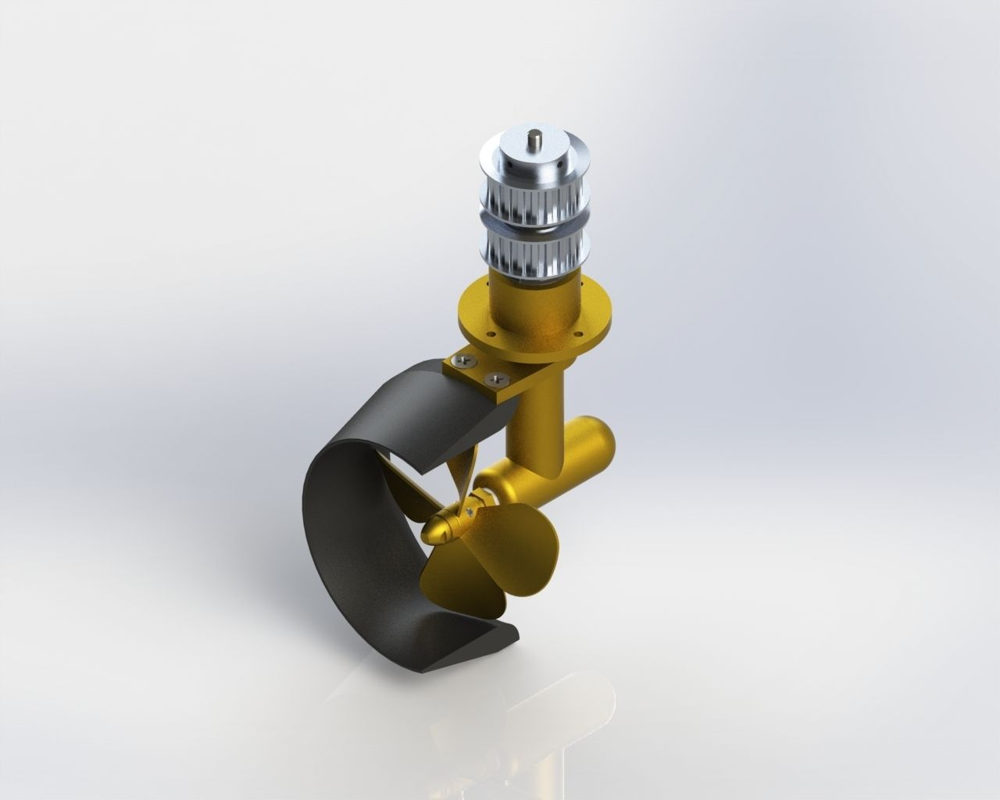
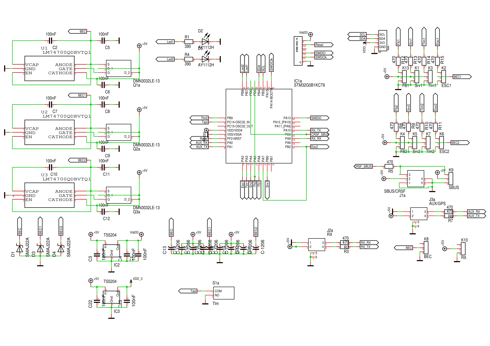
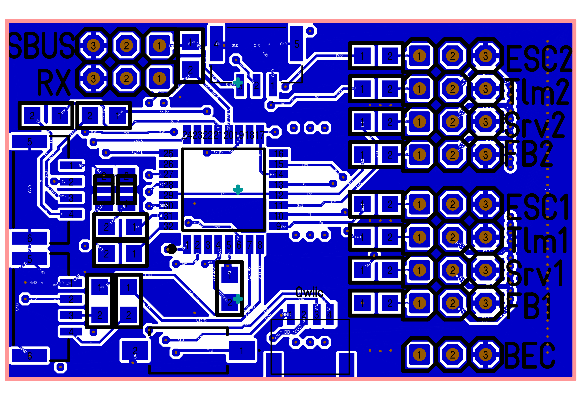
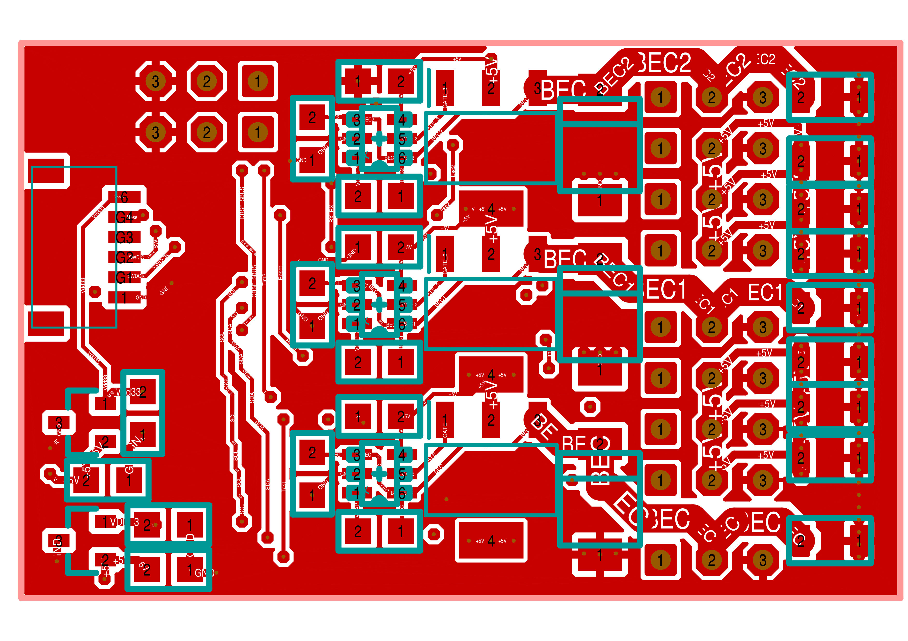

= Cruise-Controller
Wilhelm Meier <wilhelm.wm.meier@googlemail.com>
:toc:
:toclevels: 3
:toc-placement!:
:sectnums:
:sectnumlevels: 5
:tip-caption: :bulb:
:note-caption: :information_source:
:important-caption: :heavy_exclamation_mark:
:caution-caption: :fire:
:warning-caption: :warning:
:lang: de
:toc-title: Inhaltsverzeichnis
:figure-caption: Abbildung
:table-caption: Tabelle
:example-caption: Beispiel

<<cruise-control.adoc#,English>> | *Deutsch*

<<../README.de.adoc#,RC Electronics>> / Cruise-Controller

[NOTE]
--
Doppelte Schottel-Steuerung (RC720E) und der CruiseController.
--

toc::[]

[[rc720e]]
== Doppelte Schottel-Steuerung (auch Cruise-Controller genannt)

[caption=""]
.Projektinfo
[cols="1h,5",width="100%"]
|===
| Status | 🟢 aktiv
| Hardware | link:../images/rc720e32/RC_720_32_E_02.zip[Gerber/BOM (zip)], link:../images/rc720e32/RC_720_32_E_02.T3001[TARGET 3001!], https://aisler.net/p/GBXFAZAU[Aisler]
| Firmware | https://github.com/wimalopaan/wmucpp/tree/master/boards/rc720E32[wmucpp: `boards/rc720E32`]
| Software | https://github.com/wimalopaan/LUA?tab=readme-ov-file#widget-for-rc720e32-schottel-controller[Widget], https://github.com/wimalopaan/LUA?tab=readme-ov-file#mixer-script-crsfch-lua[`crsfch.lua`]
| Konfiguration | CRSF-Menü am Sender, https://github.com/Fourflies/elrsbuddy[ELRS Buddy], https://roboremo.app[RoboRemo]
| Video | https://www.youtube.com/watch?v=SKY4m7ZwLko[2024-11-29 #2], https://www.youtube.com/watch?v=N4GWDGqdjiw[2024-11-29 #3], https://www.youtube.com/watch?v=xTm-Tu6g5xw[2024-11-30], https://www.youtube.com/watch?v=H0YH8MUBlFo[2025-09-22], https://www.youtube.com/watch?v=_Te1dMsY6Sw[2026-04-04], https://www.youtube.com/watch?v=Z9C6JLJYIQY[2026-04-12], <<videos.de.adoc#v-rc720e,alle Videos (10)>>
|===

Dieses Modul wurde ursprünglich zur Steuerung von zwei _Schottel_-Antrieben entwickelt (Informationen zu diesen Antrieben
finden sich unter https://de.wikipedia.org/wiki/Schottel-Ruderpropeller[Schottel-Antrieb im Original]).

._Schottel_-Antrieb für Schiffsmodelle (Fa. Bauer, siehe https://www.bauer-modelle.com/Schiffsantriebe-Spezial-und-Wellenantriebe/Schottel-Z-Antriebe[Schottel/Z-Antrieb])

Dieses Modul wurde im Laufe der Zeit weiterentwickelt und kann nun als allgemeiner _Cruise-Controller_ verwendet werden: Das
legt nahe, dass es wie ein Flugsteuerungsrechner in Drohnen, Hubschraubern oder Flugzeugen arbeitet. Das trifft zwar
bis zu einem gewissen Grad zu, sein Einsatzzweck ist aber etwas anders. Funktionen wie eine autonome
Navigation entlang von Wegpunkten sollte man daher nicht erwarten.

Der Cruise-Controller ist vielmehr als Protokollkonzentrator und Informationsdrehscheibe gedacht. Er verbindet Funktionen zur Sensorfusion
mit Protokollumsetzung.

Funktionen:

* Servos
** PWM-Servos mit analoger Rückmeldung (z. B. Feetech FB360M)
** PWM-Servos mit PWM-Rückmeldung (z. B. Parallax)
** serielle Servos (z. B. WaveShare ST3020) (siehe auch: <<crsf-devices.de.adoc#crsfserialservo,Der CRSF-zu-Serial-Servo-Konverter>>)

* ESCs
** PWM-ESCs
** `Sbus`,`Sbus2`, `IBus`-ESCs
** _Spezialprotokolle_ : KISS(ESCape32), V/ESC
** Telemetrie im Halbduplexbetrieb (Spezialprotokolle, SBUS2) oder separat: S.Port, IBus

* Zusammenführung der BEC-Versorgung
** bis zu drei BEC-Quellen
** Werden zwei ESCs mit BEC (Empfängerstromversorgung ohne separaten Empfängerakku) angeschlossen, werden beide BECs zusammengeführt (_kein Abtrennen_ eines der BECs erforderlich).

* CRSF
** CRSF-Eingang
** CRSF-Routing zu einem/zwei CRSF-Anschlüssen

* Bluetooth
** Ein einfaches Bluetooth-Modul (wie HC-05) kann am AUX-Anschluss angeschlossen werden
** Kann zur Steuerung von Modellfunktionen ohne eingeschalteten Sender verwendet werden
** Kann zur Präsentation von Funktions-/Schiffsmodellen auf Messen nützlich sein
** Mit https://roboremo.app[RoboRemo] lässt sich eine einfache Bedienoberfläche erstellen.

* GPS, Kompass, Inertialsensor
** Kompass / Magnetometer über I2C (QMC5883L)
** Beschleunigungssensor über I2C (MPU6050)

* Sbus-Ausgang
** Kanäle 1-16
** Kanäle 17-32 (benötigt ein spezielles Mischerskript: https://github.com/wimalopaan/LUA?tab=readme-ov-file#mixer-script-crsfch-lua[crsfch.lua])

* SumDV3-Ausgang
** 16/32 Kanäle und 64 binäre Schalter
** Ideal in Kombination mit z. B. dem USM-RC-3 (Fa. Beier: https://www.beier-electronic.de/modellbau/produkte/usm-rc-3/usm-rc-3.php[] )

* SBus / S.Port-Eingang / Telemetrie
** Eingang für 16 Kanäle
** S.Port-Telemetrie (ESC-Werte, Servowerte)
** S.Port-Telemetrie zur Schottel-Visualisierung
** S.Port (Schreibbefehl) für die MultiSwitch-Funktion (z. B. Ausgabe über SumDV3 an USM-RC-3)

* IBus / SBus / SumDV3-Eingang
** Eingang für Lenkung und Antriebsleistung
** Konfiguration über ELRS
** PC-Anbindung über ELRSBuddy: https://fourflies.mooo.com/elrsbuddy[] und https://github.com/Fourflies/elrsbuddy[]

* CPPM/N, CPPM/P, PWM-Overlay
** Eingang für Lenkung und Antriebsleistung

* MultiSwitch
** MultiSwitch-fähig wie <<multiswitch.de.adoc#elrs_msw,ELRS-MultiSwitch>>
** Ausgabe eines analogen Zeitmultiplex-Schaltsignals (wie beim alten Graupner 2-16K NAUTIC-Expert Schaltbaustein)

[[_demo_video]]
=== Vorführung (Video)

https://www.youtube.com/watch?v=Hkk3GpHR4N8[Video1]

https://www.youtube.com/watch?v=VOI6-u9Bq1s[Video2]

https://www.youtube.com/watch?v=yr4b6svxh-k[Video3]

[[_schematics]]
=== Schaltpläne

.Der Schaltplan  V2 (zum Vergrößern anklicken)

Link zur link:../images/rc720e32/RC_720_32_E_02.T3001[Target 3001-Entwurfsdatei].

Link zu den link:../images/rc720e32/RC_720_32_E_02.zip[Gerber-Entwurfsdateien].

Link zu https://aisler.net/p/GBXFAZAU[Aisler RC720E32 V2].

[[_pcb]]
=== Leiterplatte

.Die Leiterplattenoberseite V2  (zum Vergrößern anklicken)

.Die Leiterplattenunterseite V2 (zum Vergrößern anklicken)

[[_firmware]]
=== Firmware

Link zum https://github.com/wimalopaan/wmucpp/tree/master/boards/rc720E32[Quellcode] (leider muss das gesamte Repository geklont werden).

Falls das Erstellen der Firmware aus dem Quellcode Schwierigkeiten bereitet, etwa weil kein _Linux_-System verwendet wird oder nicht alle
Werkzeuge installiert sind, hilft diese Anleitung, alles mit _gitpod_ zu erstellen: <<building.de.adoc#gitpod_wm,Den Quellcode meiner Projekte (`wmucpp`) kompilieren>>.

[[_widget]]
=== Widget

LUA https://github.com/wimalopaan/LUA?tab=readme-ov-file#widget-for-rc720e32-schottel-controller[Widget] für `EdgeTx`.

[[CC]]
== Der `CruiseController`

[caption=""]
.Projektinfo
[cols="1h,5",width="100%"]
|===
| Status | ⚪ abgelöst
| Nachfolger | <<rc720e>>
| Video | https://www.youtube.com/watch?v=jZPSYHhzt6Y[2023-12-16], https://www.youtube.com/watch?v=sN7MZ1YkrwE[2025-05-17], https://www.youtube.com/watch?v=E6eoninhrBU[2025-06-04], https://www.youtube.com/watch?v=DcMbOoBRKYs[2026-05-11], <<videos.de.adoc#v-CC,alle Videos (4)>>
|===

Der `CC` (CruiseController) ist mit einem _Flugsteuerungsrechner_ vergleichbar, jedoch hauptsächlich für Schiffs-/Bootsmodelle gedacht.

Er besteht aus

* ELRS-Empfänger
* Bluetooth-Modul
* Servo-PWM-Ausgängen
* SBus(2)/IBus/SumdV3-Ausgang
* SBus(2)/S.Port/IBus/Hott-Telemetrie
* 4 direkten Schaltausgängen (bis zu 1A@16V) (gemeinsam mit den Servo-PWM-Ausgängen genutzt)
* zusätzlichen seriellen Anschlüssen (z. B. GPS)
* V/ESC-Unterstützung
* 16-Kanal-Schalt-Aufsteckplatine
* 16-Kanal-LED-Aufsteckplatine

Die Projekte Cruise-Controller und doppelte Schottel-Steuerung wurden inzwischen zusammengeführt.
Weitere Informationen finden sich unter <<rc720e>>.
