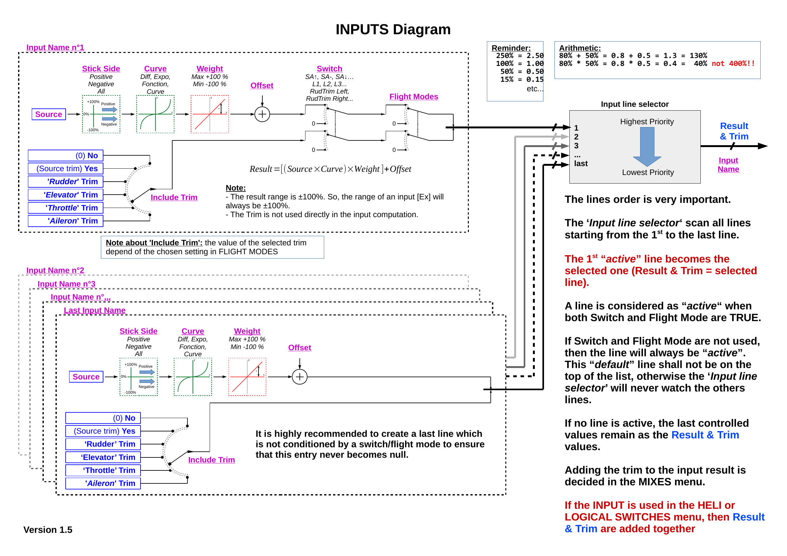
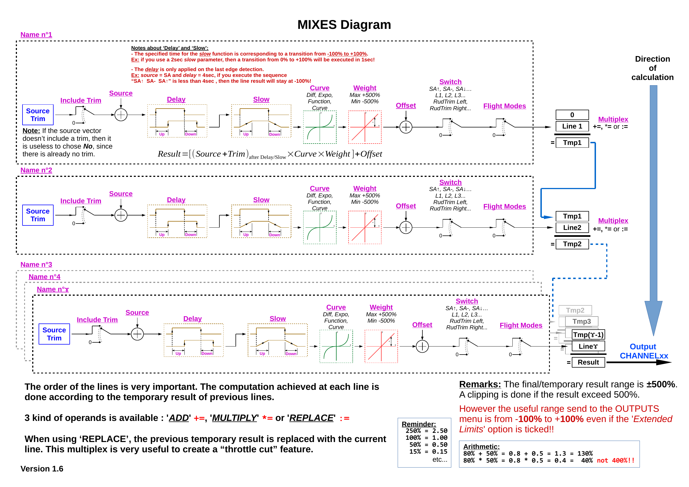
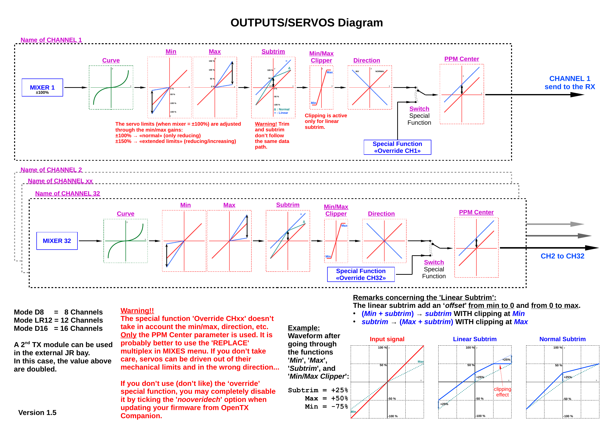

= EdgeTx
Wilhelm Meier <wilhelm.wm.meier@googlemail.com>
:toc:
:toclevels: 3
:toc-placement!:
:sectnums:
:sectnumlevels: 5
:tip-caption: :bulb:
:note-caption: :information_source:
:important-caption: :heavy_exclamation_mark:
:caution-caption: :fire:
:warning-caption: :warning:

<<../README.adoc#,RC Electronics>> / EdgeTx

[NOTE]
--
Extensions and pull-requests for the EdgeTx radio firmware.
--

toc::[]

https://github.com/EdgeTX/edgetx[EdgeTx] is my favorite radio firmware - together with <<elrs.adoc#,ExpressLRS>> as the RC-link. Both are open-source software and therefore 
offers full freedom realizing my (your) ideas and preventing a vendor-lock-in.

[[edgetx-proc]]
== EdgeTx processing

The basic processing of _source_ (like gimbals) via _inputs_, then _mixers_ and finally _outputs_ that was (is) present in `OpenTx` 
is still the same in `EdgeTx`. Therefore, the following images may help to understand that part of `EdgeTx`.

[NOTE]
--
The following images are of unknown copyright or licence. They are originally published here: https://opentx-doc.fr/wiki/diagrammes-de-fonctionnement[], 
the english version is of unknown origin (at least to me).
--

.Processing of inputs in EdgeTx

.Processing of mixers in EdgeTx

.Processing of outputs in EdgeTx

[[vcontrols]]
== Virtual Controls for EdgeTx

[caption=""]
.Project info
[cols="1h,5",width="100%"]
|===
| Status | 🟢 active
| Upstream | https://github.com/EdgeTX/edgetx/pull/5885[EdgeTX PR #5885] (open)
| Software | https://github.com/wimalopaan/LUA/tree/main/WIDGETS/lvglControls[LUA: `lvglControls`]
| Firmware | https://github.com/wimalopaan/Electronics/tree/main/edgetx/firmware[precompiled EdgeTx]
| Video | https://www.youtube.com/watch?v=1ZBTZqaJLPo[2025-01-29], https://www.youtube.com/watch?v=v7tzDOXMhIc[2025-08-14], <<videos.adoc#v-vcontrols,all videos (2)>>
|===

In the good old days there were radios like the FrSky X9E that provide a large amount of potentiometers and switches. 
This type of radio was/is very popular for controlling crawler/ships- or other functional-models. 
The number of these physical items is still limited and due to their physical nature, the labels for all these elements are also handwritten on paper.
With the advent of the `lvgl` LUA support it is possible to create virtual controls that perfectly fit into the UI look-and-feel of EdgeTx 
and also are not very compute-intensive. This opens the way to use widgets to provide arbitrary virtual controls and switches with customisable labes 
and colors. It also opens the way to use widgets to read from serials like AUX1/AUX2 and get controls data from some external devices 
(e.g. a µC with some physical potiometers, switches, incrementals, ... connected) (s.a. <<protocols.adoc#hwext,Hardware-Extension-Protocol>>)

I wrote a https://github.com/EdgeTX/edgetx/pull/5885[PR5885] for EdgetX that adds _virtual inputs_ (Vin1 ... Vin16) 
and _virtual switches_ (VS1 ... VS64) and neccessary LUA support functions 

*  `setVirtualInput()`
*  `getVirtualInput()`
*  `activateVirtualInput()`
*  `setVirtualSwitch()`
*  `getVirtualSwitch()`
*  `activateVirtualSwitch()`

A LUA widget `lvglControls` (see: https://github.com/wimalopaan/LUA/tree/main/WIDGETS/lvglControls ) is provided 
for demonstration a simple use case: extending the number of physical inputs and physical switches of the radio via a widget 
that provides some _virtual_ touch controls for these virtual inputs and virtual switches.

For compiling this PR you may also be interested in <<building.adoc#edgetx_custom,Custom EdgeTx builds>>.

Another purpose is to extend the amount of physical knobs, etc. of the radio by connecting some external device via serial (AUX1, AUX2) 
to the radio, and installing a custom widget, that reads from the serial and uses the above functions to set the virtual inputs and virtual switches.
A <<protocols.adoc#hwext,proposal>> for such a serial protocol can be found later on this page.

Alternative:
There is a cumbersome alternative way to achieve a similar but very limited result: 
a widget could use the function `shmSet()` to transport up to 16 values, to a _mixer_ script which could pick them up via `shmGet()` 
and simple return them (only up to 6). These output values of the mixer script could then be used as mixer-inputs. There is no such a way for switches. 

[[edgetx_32channels]]
== 32-Channels extension for the CRSF-Protocol

[caption=""]
.Project info
[cols="1h,5",width="100%"]
|===
| Status | 🟢 active
| Firmware | https://github.com/wimalopaan/edgetx/tree/wmcrsfchanext[edgetx: `wmcrsfchanext`], https://github.com/wimalopaan/edgetx/tree/wmextensions[edgetx: `wmextensions`], https://github.com/wimalopaan/Electronics/tree/main/edgetx/firmware[precompiled]
| See also | <<elrs.adoc#elrs-ch32,32-channels extension for ELRS V4>>
|===

EdgeTx manages internally 32 channels. But most RF-links only transport 16 out of these 32 channels to the connected receiver. 

A modified ExpressLRS can transport 32 channels: <<elrs.adoc#elrs-ch32,32-channels extension for ELRS V4>>

To use this, EdgeTx must also transport 32 channels to the TX-module. This extension enables to transport 32 channels from EdgeTx to the ELRS TX-modules.

Precompiled EdgeTx (translation = `german`, includes also <<vcontrols>>) con be found here: https://github.com/wimalopaan/Electronics/tree/main/edgetx/firmware[]

This extension is available as this branch: https://github.com/wimalopaan/edgetx/tree/wmcrsfchanext[]

It is also available as https://github.com/wimalopaan/edgetx/tree/wmextensions[] with all EdgeTx extensions.

[[edgetx_shm_bw]]
== SHM-Variables for B&W radios

[caption=""]
.Project info
[cols="1h,5",width="100%"]
|===
| Status | 🔵 stable
| Firmware | https://github.com/wimalopaan/edgetx/tree/wmshmbw[edgetx: `wmshmbw`]
|===

Due to the limited amount of RAM of black-and-white radios (128kB to 192kB) some features are only compiled-in for color-lcd radios.
One of these features is the support of SHM variables (useful to transport of data from one LUA context (e.g. telemety scripts) to another (e.g. mixer scripts)).

This feature is rarely used, and even more rarely requested on b&w radios. 

But the multiswitch telemetry script (<<multiswitch.adoc#msw_bw,MultiSwitch Telemetry Script>>) needs this feature if used together with `SBus`. Despite the fact that this scenario is kind of weird (you can't
transport true bit-information via `SBus` channels because they undergo various strange scalings) some users still request this.

Therefore the https://github.com/wimalopaan/edgetx/tree/wmshmbw[] branch adds excactly this feature (one has to use the `-DSHMBW=YES` command line switch 
to enable this also for b&w radios, for color-lcd radios this feature is always on). Please refer to <<building.adoc#edgetx_custom,Custom EdgeTx builds>> on how to compile this non-standard extension.

[[crsf_batt_id]]
== Enhanced Parser for instance-id augmented CRSF BATT-sensor frames

[caption=""]
.Project info
[cols="1h,5",width="100%"]
|===
| Status | 🟢 active
| Upstream | https://github.com/EdgeTX/edgetx/pull/7571[EdgeTX PR #7571] (open)
| Firmware | https://github.com/wimalopaan/edgetx/tree/wmextensions[edgetx: `wmextensions`]
| Video | https://www.youtube.com/watch?v=zS-a66S6qLg[2026-07-31], <<videos.adoc#v-crsf_batt_id,all videos (1)>>
| See also | <<escape32.adoc#_modifications,ESCape32 modifications>>
|===

The CRSF protocol definition lacks a sensor type for sensing more than _one_ current measurement from a device like an ESC to
the handset. All crafts that have more than one motor / ESC would benefit if there would be a possiblility to 
send multiple current measurements from different devices (e.g. ESCs) to the handset.

Because there is no such sensor frame type in the CRSF protocol definition, it is kind of natural to extend that in a way it was done for 
e.g. RPM, temperature and voltages measurements.

A proposal to extend the CRSF protocol definition has been set: https://github.com/tbs-fpv/tbs-crsf-spec/issues/38[]

But there exists also another possiblilty: that `BATT` sensor can transport one current value together with a voltage measurement and 
a calculated consumed energie and percentage of accu capacity. Originally there is no possibility to send `BATT` sensor frames from different 
sources without confusion.

But the CRSF definition protocol itself allows to extend every frame definition by additional values / fields, if the overall validity of the frame 
is preserved. All conforming CRSF parsers (like in ExpressLRS to transport these frames) should process these frames flawlessly.

So, there is another proposal to the `BATT` sensor to contain an additional instance-id as the last `uint8_t`- field in this frame.

https://github.com/tbs-fpv/tbs-crsf-spec/issues/41[]

To parse these augmented `BATT` frames clearly _EdgeTx_ as the handset operating system has to be modified too:

https://github.com/EdgeTX/edgetx/pull/7571[]

This PR is already included in to the `wmextensions` branch of _EdgeTx_:

https://github.com/wimalopaan/edgetx/tree/wmextensions[]

If you want to test this, there is a PR to <<escape32.adoc#,ESCape32: firmware for a family of small/medium BLDC (and brushed) motor controller (brushless/brushed ESC)>> to generate these augmented `BATT` frames: https://github.com/wimalopaan/ESCape32/tree/wm_crsf_batt_id[]

[[edgetx_custom_moved]]
== Custom EdgeTx builds

How to build a custom EdgeTx firmware (e.g. including the above extensions) is described in <<building.adoc#edgetx_custom,Building firmware: Custom EdgeTx builds>>.
