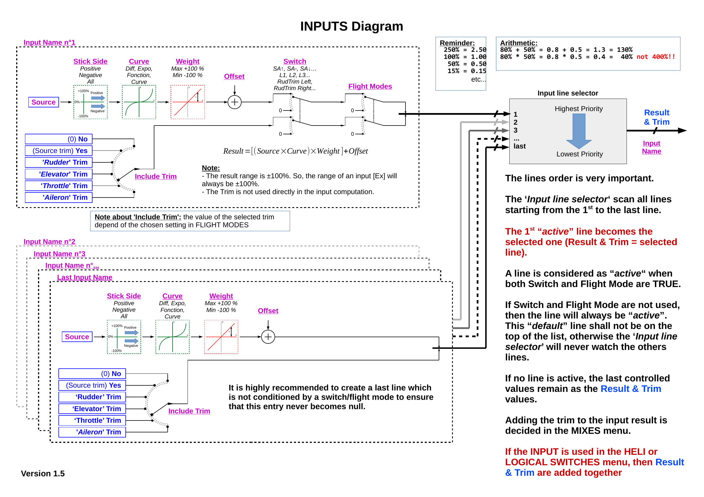
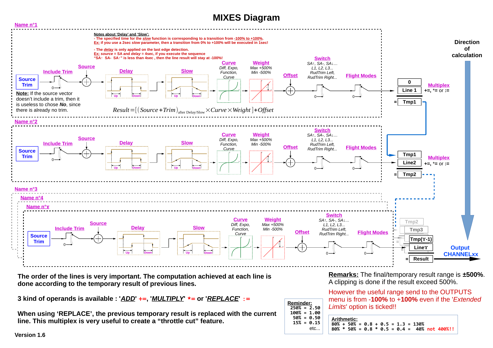
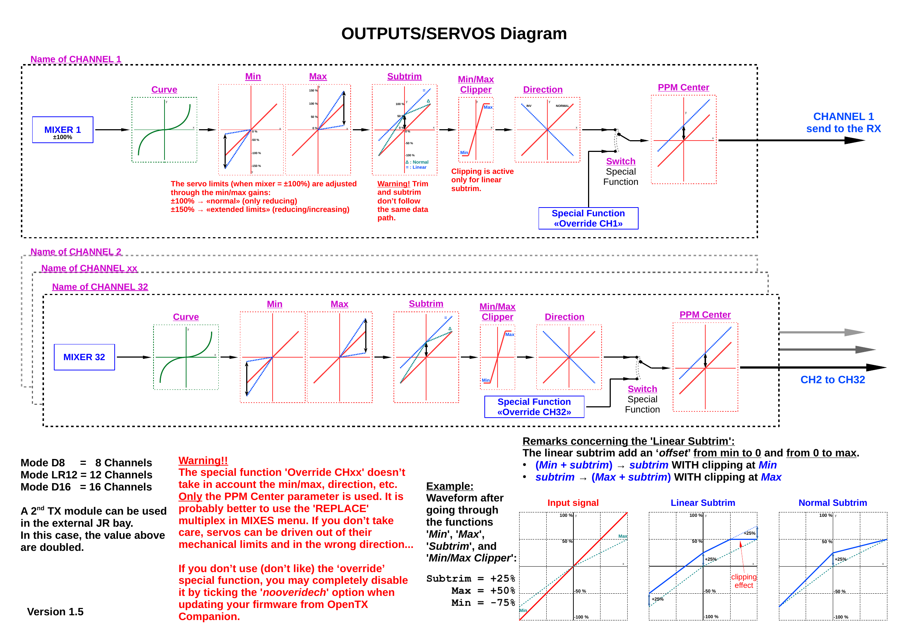

= EdgeTx
Wilhelm Meier <wilhelm.wm.meier@googlemail.com>
:toc:
:toclevels: 3
:toc-placement!:
:sectnums:
:sectnumlevels: 5
:tip-caption: :bulb:
:note-caption: :information_source:
:important-caption: :heavy_exclamation_mark:
:caution-caption: :fire:
:warning-caption: :warning:
:lang: de
:toc-title: Inhaltsverzeichnis
:figure-caption: Abbildung
:table-caption: Tabelle
:example-caption: Beispiel

<<edgetx.adoc#,English>> | *Deutsch*

<<../README.de.adoc#,RC-Elektronik>> / EdgeTx

[NOTE]
--
Erweiterungen und Pull Requests für die Senderfirmware EdgeTx.
--

toc::[]

https://github.com/EdgeTX/edgetx[EdgeTx] ist meine bevorzugte Senderfirmware – zusammen mit <<elrs.de.adoc#,ExpressLRS>> als RC-Verbindung. Beide sind Open-Source-Software und bieten daher
volle Freiheit bei der Umsetzung meiner (und deiner) Ideen, ohne sich an einen Hersteller zu binden.

[[edgetx-proc]]
== Signalverarbeitung in EdgeTx

Die grundlegende Verarbeitung von _Quellen_ (etwa Steuerknüppeln) über _Eingänge_, dann _Mischer_ und schließlich _Ausgänge_, wie sie in `OpenTx` vorhanden war (und ist),
ist in `EdgeTx` unverändert. Die folgenden Abbildungen können deshalb helfen, diesen Teil von `EdgeTx` zu verstehen.

[NOTE]
--
Urheberrechte und Lizenz der folgenden Abbildungen sind unbekannt. Sie wurden ursprünglich hier veröffentlicht: https://opentx-doc.fr/wiki/diagrammes-de-fonctionnement[].
Die Herkunft der englischen Fassung ist unbekannt (zumindest mir).
--

.Verarbeitung der Eingänge in EdgeTx

.Verarbeitung der Mischer in EdgeTx

.Verarbeitung der Ausgänge in EdgeTx

[[vcontrols]]
== Virtuelle Bedienelemente für EdgeTx

[caption=""]
.Projektinfo
[cols="1h,5",width="100%"]
|===
| Status | 🟢 aktiv
| Hauptprojekt | https://github.com/EdgeTX/edgetx/pull/5885[EdgeTX PR #5885] (offen)
| Software | https://github.com/wimalopaan/LUA/tree/main/WIDGETS/lvglControls[LUA: `lvglControls`]
| Firmware | https://github.com/wimalopaan/Electronics/tree/main/edgetx/firmware[vorkompiliertes EdgeTx]
| Video | https://www.youtube.com/watch?v=1ZBTZqaJLPo[2025-01-29], https://www.youtube.com/watch?v=v7tzDOXMhIc[2025-08-14], <<videos.de.adoc#v-vcontrols,alle Videos (2)>>
|===

In der guten alten Zeit gab es Sender wie die FrSky X9E, die eine große Anzahl an Potentiometern und Schaltern bieten.
Diese Senderart war und ist sehr beliebt zum Steuern von Crawlern, Schiffsmodellen und anderen Funktionsmodellen.
Die Anzahl dieser physischen Elemente ist dennoch begrenzt, und ihre Beschriftungen werden aufgrund ihrer Bauform von Hand auf Papier geschrieben.
Mit der LUA-Unterstützung für `lvgl` lassen sich virtuelle Bedienelemente erstellen, die sich nahtlos in das Erscheinungsbild der EdgeTx-Benutzeroberfläche einfügen
und zudem wenig Rechenleistung benötigen. Dadurch können Widgets beliebige virtuelle Bedienelemente und Schalter mit anpassbaren Beschriftungen
und Farben bereitstellen. Außerdem können Widgets serielle Schnittstellen wie AUX1/AUX2 auslesen und Steuerdaten von externen Geräten empfangen
(z. B. einem µC mit angeschlossenen Potentiometern, Schaltern, Inkrementalgebern usw.; siehe auch <<protocols.de.adoc#hwext,Hardware-Erweiterungsprotokoll>>).

Ich habe https://github.com/EdgeTX/edgetx/pull/5885[PR5885] für EdgeTx geschrieben, der _virtuelle Eingänge_ (Vin1 ... Vin16)
und _virtuelle Schalter_ (VS1 ... VS64) sowie die notwendigen LUA-Unterstützungsfunktionen ergänzt:

*  `setVirtualInput()`
*  `getVirtualInput()`
*  `activateVirtualInput()`
*  `setVirtualSwitch()`
*  `getVirtualSwitch()`
*  `activateVirtualSwitch()`

Das LUA-Widget `lvglControls` (siehe https://github.com/wimalopaan/LUA/tree/main/WIDGETS/lvglControls ) demonstriert
einen einfachen Anwendungsfall: Es erweitert die Anzahl der physischen Eingänge und Schalter des Senders durch ein Widget,
das _virtuelle_ Touch-Bedienelemente für diese virtuellen Eingänge und Schalter bereitstellt.

Zum Kompilieren dieses PR ist auch <<building.de.adoc#edgetx_custom,Angepasste EdgeTx-Builds>> interessant.

Ein weiterer Anwendungsfall ist die Erweiterung der Anzahl physischer Drehregler usw. am Sender durch ein externes Gerät, das über eine serielle Schnittstelle (AUX1, AUX2)
angeschlossen wird. Ein angepasstes Widget liest die Schnittstelle aus und setzt mit den obigen Funktionen die virtuellen Eingänge und Schalter.
Ein <<protocols.de.adoc#hwext,Vorschlag>> für ein solches serielles Protokoll findet sich weiter unten auf der verlinkten Seite.

Alternative:
Es gibt einen umständlichen alternativen Weg zu einem ähnlichen, aber stark eingeschränkten Ergebnis:
Ein Widget könnte mit `shmSet()` bis zu 16 Werte an ein _Mischerskript_ übertragen, das sie mit `shmGet()` abholt
und einfach zurückgibt (höchstens 6). Diese Ausgabewerte des Mischerskripts könnten dann als Mischereingänge verwendet werden. Für Schalter gibt es keinen entsprechenden Weg.

[[edgetx_32channels]]
== 32-Kanal-Erweiterung für das CRSF-Protokoll

[caption=""]
.Projektinfo
[cols="1h,5",width="100%"]
|===
| Status | 🟢 aktiv
| Firmware | https://github.com/wimalopaan/edgetx/tree/wmcrsfchanext[edgetx: `wmcrsfchanext`], https://github.com/wimalopaan/edgetx/tree/wmextensions[edgetx: `wmextensions`], https://github.com/wimalopaan/Electronics/tree/main/edgetx/firmware[vorkompiliert]
| Siehe auch | <<elrs.de.adoc#elrs-ch32,32-Kanal-Erweiterung für ELRS V4>>
|===

EdgeTx verwaltet intern 32 Kanäle. Die meisten Funkverbindungen übertragen jedoch nur 16 dieser 32 Kanäle zum angeschlossenen Empfänger.

Ein modifiziertes ExpressLRS kann 32 Kanäle übertragen: <<elrs.de.adoc#elrs-ch32,32-Kanal-Erweiterung für ELRS V4>>

Damit dies nutzbar ist, muss auch EdgeTx 32 Kanäle zum Sendemodul übertragen. Diese Erweiterung ermöglicht die Übertragung von 32 Kanälen von EdgeTx zu den ELRS-Sendemodulen.

Vorkompiliertes EdgeTx (Übersetzung = `german`, enthält auch <<vcontrols>>) findet sich hier: https://github.com/wimalopaan/Electronics/tree/main/edgetx/firmware[]

Diese Erweiterung ist in diesem Branch verfügbar: https://github.com/wimalopaan/edgetx/tree/wmcrsfchanext[]

Sie ist außerdem unter https://github.com/wimalopaan/edgetx/tree/wmextensions[] zusammen mit allen EdgeTx-Erweiterungen verfügbar.

[[edgetx_shm_bw]]
== SHM-Variablen für Sender mit Schwarzweißdisplay

[caption=""]
.Projektinfo
[cols="1h,5",width="100%"]
|===
| Status | 🔵 stabil
| Firmware | https://github.com/wimalopaan/edgetx/tree/wmshmbw[edgetx: `wmshmbw`]
|===

Aufgrund des begrenzten RAMs von Sendern mit Schwarzweißdisplay (128kB bis 192kB) werden manche Funktionen nur für Sender mit Farb-LCD einkompiliert.
Eine davon ist die Unterstützung von SHM-Variablen, mit denen Daten von einem LUA-Kontext (z. B. Telemetrieskripten) in einen anderen (z. B. Mischerskripten) übertragen werden können.

Diese Funktion wird selten verwendet und für Sender mit Schwarzweißdisplay noch seltener nachgefragt.

Das MultiSwitch-Telemetrieskript (<<multiswitch.de.adoc#msw_bw,MultiSwitch-Telemetrieskript>>) benötigt diese Funktion jedoch beim Einsatz mit `SBus`. Obwohl dieses Szenario etwas merkwürdig ist (über
`SBus`-Kanäle lassen sich aufgrund verschiedener ungewöhnlicher Skalierungen keine echten Bitinformationen übertragen), wünschen einige Nutzer diese Möglichkeit dennoch.

Der Branch https://github.com/wimalopaan/edgetx/tree/wmshmbw[] ergänzt deshalb genau diese Funktion. Mit der Kommandozeilenoption `-DSHMBW=YES`
wird sie auch für Sender mit Schwarzweißdisplay aktiviert; bei Sendern mit Farb-LCD ist sie immer eingeschaltet. Wie diese nicht standardmäßige Erweiterung kompiliert wird, beschreibt <<building.de.adoc#edgetx_custom,Angepasste EdgeTx-Builds>>.

[[crsf_batt_id]]
== Erweiterter Parser für CRSF-BATT-Sensorframes mit Instanz-ID

[caption=""]
.Projektinfo
[cols="1h,5",width="100%"]
|===
| Status | 🟢 aktiv
| Hauptprojekt | https://github.com/EdgeTX/edgetx/pull/7571[EdgeTX PR #7571] (offen)
| Firmware | https://github.com/wimalopaan/edgetx/tree/wmextensions[edgetx: `wmextensions`]
| Video | https://www.youtube.com/watch?v=zS-a66S6qLg[2026-07-31], <<videos.de.adoc#v-crsf_batt_id,alle Videos (1)>>
| Siehe auch | <<escape32.de.adoc#_modifications,ESCape32-Modifikationen>>
|===

In der CRSF-Protokolldefinition fehlt ein Sensortyp, mit dem mehr als _ein_ Strommesswert von einem Gerät wie einem ESC an
den Sender übertragen werden kann. Alle Modelle mit mehr als einem Motor beziehungsweise ESC würden davon profitieren,
mehrere Strommesswerte verschiedener Geräte (z. B. ESCs) an den Sender senden zu können.

Da es in der CRSF-Protokolldefinition keinen solchen Sensorframetyp gibt, liegt es nahe, sie entsprechend zu erweitern,
wie dies etwa für Drehzahl-, Temperatur- und Spannungsmessungen geschehen ist.

Ein Vorschlag zur Erweiterung der CRSF-Protokolldefinition wurde eingereicht: https://github.com/tbs-fpv/tbs-crsf-spec/issues/38[]

Es gibt aber noch eine andere Möglichkeit: Der `BATT`-Sensor kann einen Stromwert zusammen mit einem Spannungsmesswert,
der berechneten verbrauchten Energie und dem Prozentsatz der Akkukapazität übertragen. Ursprünglich lassen sich `BATT`-Sensorframes verschiedener
Quellen nicht eindeutig voneinander unterscheiden.

Das CRSF-Protokoll selbst erlaubt jedoch, jede Framedefinition um zusätzliche Werte beziehungsweise Felder zu erweitern, solange der Frame insgesamt
gültig bleibt. Alle konformen CRSF-Parser (etwa in ExpressLRS zur Übertragung dieser Frames) sollten sie problemlos verarbeiten.

Deshalb gibt es einen weiteren Vorschlag, den `BATT`-Sensorframe um eine Instanz-ID als letztes `uint8_t`-Feld zu ergänzen.

https://github.com/tbs-fpv/tbs-crsf-spec/issues/41[]

Damit diese erweiterten `BATT`-Frames eindeutig ausgewertet werden, muss auch _EdgeTx_ als Betriebssystem des Senders angepasst werden:

https://github.com/EdgeTX/edgetx/pull/7571[]

Dieser PR ist bereits im Branch `wmextensions` von _EdgeTx_ enthalten:

https://github.com/wimalopaan/edgetx/tree/wmextensions[]

Zum Testen gibt es einen PR für <<escape32.de.adoc#,ESCape32: Firmware für eine Familie kleiner und mittlerer BLDC- und Bürstenmotorregler (bürstenlose und bürstenbehaftete ESCs)>>, der diese erweiterten `BATT`-Frames erzeugt: https://github.com/wimalopaan/ESCape32/tree/wm_crsf_batt_id[]

[[edgetx_custom_moved]]
== Angepasste EdgeTx-Builds

Wie eine angepasste EdgeTx-Firmware (etwa mit den obigen Erweiterungen) kompiliert wird, beschreibt <<building.de.adoc#edgetx_custom,Firmware kompilieren: Angepasste EdgeTx-Builds>>.
