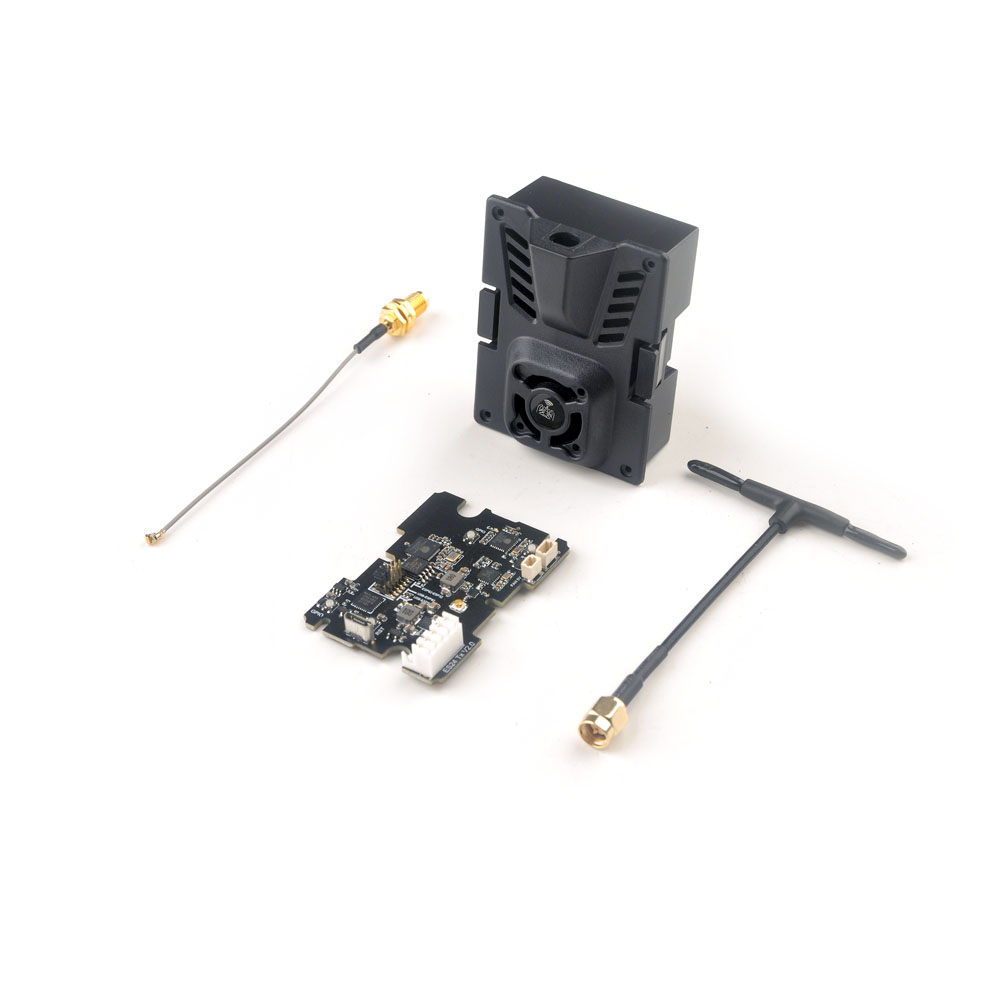
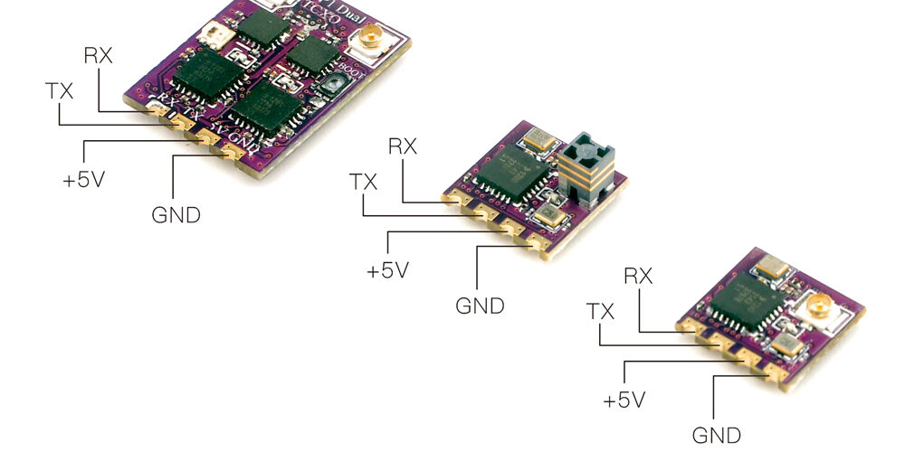
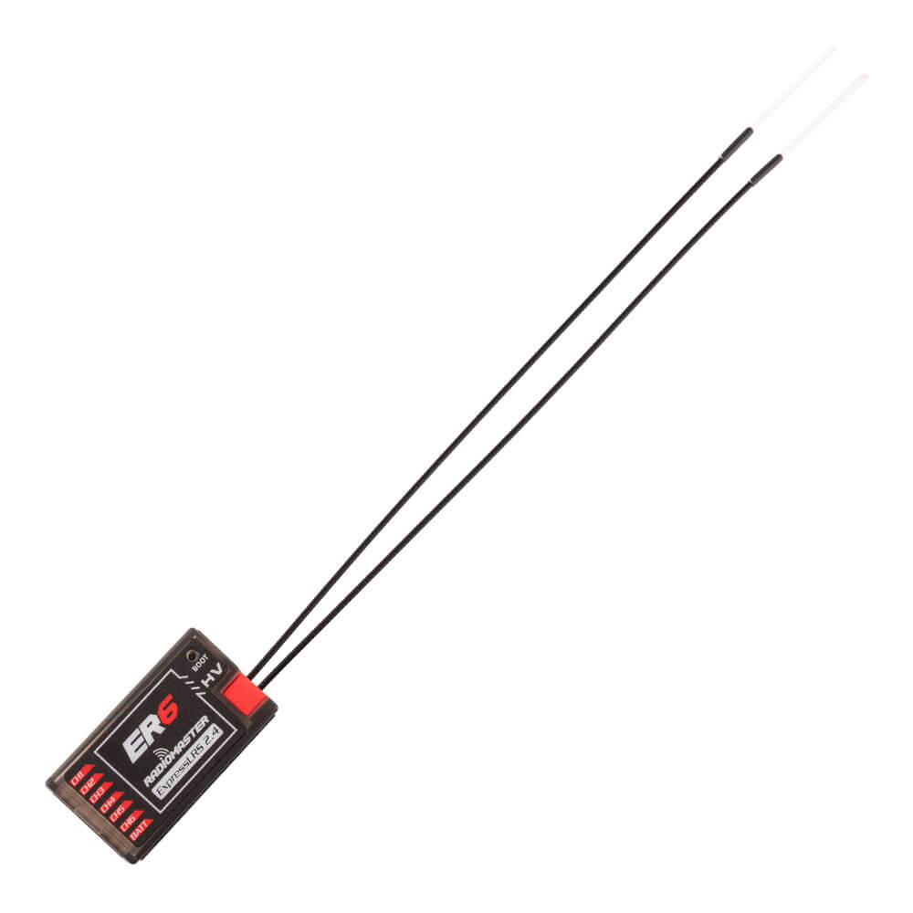
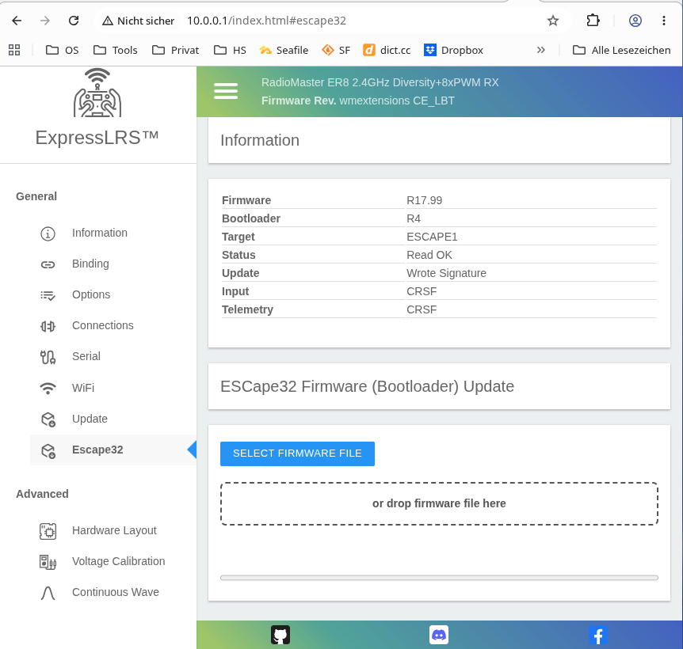

= ExpressLRS
Wilhelm Meier <wilhelm.wm.meier@googlemail.com>
:toc:
:toclevels: 3
:toc-placement!:
:sectnums:
:sectnumlevels: 5
:tip-caption: :bulb:
:note-caption: :information_source:
:important-caption: :heavy_exclamation_mark:
:caution-caption: :fire:
:warning-caption: :warning:

*English* | <<elrs.de.adoc#,Deutsch>>

<<../README.adoc#,RC Electronics>> / ExpressLRS

[NOTE]
--
ExpressLRS: features, modules, receivers and my modifications (V3/V4).
See the <<elrs-matrix>> for an overview of what is available in V3 and V4.
--

toc::[]

== ExpressLRS for short range radio control

https://www.expresslrs.org[ExpressLRS] (ELRS) is a long range link for radio controlled models / machinery of all kind.
Obviously it has some advantages over some other commercial rc-links like AFHDS2A, Hott or ACCST, ...

ExpressLRS is:

[[elrs_feat]]
.Main features of ExpressLRS
* open-source (software and hardware)
* low-latency / high packet-rate
* using open (well-documented) CRSF protocol (https://github.com/crsf-wg/crsf[working group])
* extremely long range

Together with https://edgetx.org[EdgeTx] (Open-Source radio transmitter operating system) one has a extremely powerful system 
at hand to control and monitor all kind of models or machinery from remote. And the whole system (but the handset) now is open-source: 
there are no limits in extending the system.

But ELRS is not limited to its long-range capability, that makes it useful for all kind of flying machinery (planes, helicopters, drones, ...).
ELRS is as well suited for short-range radio control of boats, cars, crawlers, stationary-models (e.g. cranes, ...).

The most appealing features of ELRS with respect to short-range radio-control of models are:

[[elrs_func]]
.Features for functional models
* controllability of all connected `CRSF` devices: the tx-module, the receiver, and _all_ connected devices (ESCs, MultiSwitch, Lighting-Module, ...) 
* extensibility due the flexibility of the CRSF protocol, mainly on the model side (after the receiver)
* low-latency / high packet-rate for new kinds of features (e.g. haptic-control)
* dynamic power down to `10mW`
* very small and cheap receivers

I have proposed some extensions to the CRSF protocol (see <<protocols.adoc#crsf_sw,Proposal for the CRSF protocol>>). These extensions are already in use with my <<cruise-control.adoc#CC,The `CruiseController`>> and some 
multi-switch-modules (<<multiswitch.adoc#elrs_msw,ELRS-MultiSwitch>>) or lighting-modules.

== ExpressLRS: modules and receivers

With ELRS modules like <<hm_es24tx>> (approx. 100mW RF power)  and ultra-small receivers like <<hm_ep1ep2>> or <<rm_er6>>
you get an enormous range of n-times 10km. This is good for drone-pilots but is of no use for crawler or model-boat / ship control.

[[hm_es24tx]]
.Happymodel ES24TX transmitter module

[[hm_ep1ep2]]
.Happymodel EP1 and EP2 receiver with CRSF/SBUS output

[[rm_er6]]
.RadioMaster ER6 receiver with dedicated PWM outputs

The <<elrs_func>> can also be achieved using an ELRS-receiver as a transmitter-module. This is a big advantage because it make it possible 
to equip many handsets with an internal elrs-capability, e.g. the _FrSky X12S_, _X9E_ or _Jumper T12_ or the _FlySky FS-I6X_. 
See <<rx-as-tx.adoc#elrs_jr,JR-module-bay adapter for ELRS receiver as transmitter>> and <<rx-as-tx.adoc#elrs_x12s,Adapter for ELRS receiver as internal XJT/ISRM module for FrSky X12S>> and <<flysky.adoc#elrs_i6x,ELRS for the FlySky-I6X>> for details.

== Multiple ELRS-receivers bound to one ELRS-module

Using the same pass-phrase it is possible to bin more than one receiver to a tx-module. If all receivers were sending telemetry data to the tx-module, 
there will be interference in the rf domain, and, if by pure accident the rf data comes through undistorted, the tx module would receive ambigous data. 
ELRS is not capable of handling multiple telemetry streams in one passphrase realm.

Therefore, one has to disable sending telemetry on all but one receiver. This can be done via the web interface of the receiver(s). In this scenario, one 
may have multiple receivers - maybe in different models -, but only one is allowed to send telemetry, while all others must not send telemetry data. 
Sometimes this may be acceptable, but more often this is not acceptable: if the recivers belong to different models, not all batteries, etc. can be 
monitored. This may lead to severe damage to the batteries.

Since version `3.4` of ELRS it incorporates a feature called _TeamRace_ (see the receivers menu in the `elrsV3.lua` menu).
In _TeamRace_ each receiver has a unique ID-number called `position`. One can select an _active_ receiver via a designated rc channel 
(one of the 16 rc channels). The active receiver outputs servo data and sends back telemetry, an inactive receiver does not send telemetry and goes 
into failsafe for the channel data. For more info see: https://github.com/ExpressLRS/ExpressLRS/pull/2176[TeamRace].

_TeamRace_ allows to switch the receiver / model very quick by e.g. the six-position-switch on a TX16S or X12S.

Going into failsafe for the inactive receivers will not be desired in most above mentioned use cases: it would be way better, if the inactive receiver
simply stops sending telemetry but still outputs the channel data.

This was implemented in this pull-request: https://github.com/ExpressLRS/ExpressLRS/pull/2685[Multi model telemetry].
Unfortunately this pull-request waas not accepted by the ELRS team. Therefore you have to select this pull-request manually in the 
`expresslrs-configurator`.

== 32-channels for ELRS

ELRS transfers 16 RC-channels from the handset to the receiver. In EdgeTx one can select the first of the 16 consecutive channels 
to be transferred.

EdgeTx manages 32 RC-channels, so it would be of interest to tranfer the remaining 16 channels also.

.This is V4 only
[TIP]
--
Please refer to <<elrs-ch32>>.
--

.This is V3 only
[TIP]
--
On the handset a LUA-script (mixer script) collects the channels 17-32 and encodes them as a custom CRSF package (<<protocols.adoc#prop32,Proportional data (e.g. additional channels: >=8bit)>>).
The ELRS-receiver outputs this custom packages on his serial interface (select: CRSF-protokoll). 
Clearly, a special CRSF-decoder is needed: it has to decode the normal RC channel packages and the custom-packages. 
--

The <<cruise-control.adoc#CC,The `CruiseController`>> uses two `SBus`-interface, one for channel 1-16, and one for the channels 17-32.

[[elrs-matrix]]
== Feature matrix

Overview of the ELRS features and modifications described on this page. The table shows for each feature whether it is available
in ELRS V3 and V4, and how to get it.

.Legend
[cols="1,5"]
|===
| *stock* | included in the official ExpressLRS release
| *fork* | in my branch https://github.com/wimalopaan/ExpressLRS/tree/wmextensions[`wmextensions`] (V4). Always requires `-DWMEXTENSION`, plus the listed build switch in `super_defines.txt` (see <<elrs-switches>>).
| *branch* | separate V3 branch in https://github.com/wimalopaan/ExpressLRS[wimalopaan/ExpressLRS] (based on `3.x.x-maintenance`)
| *PR* | pull request to ExpressLRS
| – | not available
|===

[cols="4,4,4,5",options="header"]
|===
| Feature | V3 | V4 | Remarks

4+h| Multiple receivers / addressing
| <<_multiple_elrs_receivers_bound_to_one_elrs_module,TeamRace (select the active receiver via a channel)>>
| stock (≥ 3.4, https://github.com/ExpressLRS/ExpressLRS/pull/2176[PR #2176])
| stock
| Inactive receivers go into failsafe.
| <<_multiple_elrs_receivers_bound_to_one_elrs_module,TeamRace without failsafe (multi-model telemetry)>>
| https://github.com/ExpressLRS/ExpressLRS/pull/2685[PR #2685] (not merged; select the PR in the configurator)
| –
| Inactive receivers keep outputting channel data.
| <<elrs-route,Extended CRSF addresses other than `0xc8`>>
| branch `3.x.x-wmaddress` (https://github.com/ExpressLRS/ExpressLRS/pull/2975[PR #2975], not merged)
| stock (full CRSF routing, see <<elrs_v4>>)
| Required for all CRSF devices with their own address (MultiSwitch, CruiseController, ...).

4+h| Arming
| <<elrs_arm4,Switch-based arming>>
| branch `3.x.x-arm4`
| stock
|
| <<elrs_perm_arm,Permanent arming>>
| branch `3.x.x-perm-arm`
| stock
| Only useful with _PPM_ input.

4+h| Channels and serial protocols
| <<elrs-ch32,32 channels>>
| stock + `crsfch.lua` (<<protocols.adoc#prop32,Prop32>>), needs a Prop32-capable decoder
| fork: `WMCRSF_CHAN_EXT`
| V4: flash the fork on TX _and_ RX. Requires the EdgeTX mod https://github.com/wimalopaan/edgetx/tree/wmcrsfchanext[`wmcrsfchanext`].
| <<elrs_sbus_flip,Channels 17-32 on SBus>>
| branch `3.x.x-wmchanext` (`crsfch.lua`: `Flags` bit 0)
| fork: `WMCRSF_CHAN_EXT` (SBus on `Serial2`: ch17-32)
|
| <<elrs_sumdv3,SumDV3 output with 64 binary switches>>
| branch `3.x.x-wmsumdv3`
| fork
| Switch addresses `240` ... `247`
| <<elrs_sumdv3,SumDV3: swap ch1-16 and ch17-32>>
| branch `3.x.x-wmsumdv3` (`crsfch.lua`: `Flags` bit 1)
| fork: `WMSUMDV3_SWAP`
| e.g. for USM-RC-3

4+h| MultiSwitch and LEDs
| <<elrs_pwm_msw,PWM receiver as MultiSwitch>>
| branch `3.x.x-wmswitch`
| fork
| Switch addresses `240`, `241`. Outputs in `on/off` mode.
| <<elrs_pwm_msw,WS2812 RGB LEDs via MultiSwitch widget>>
| branch `3.x.x-wmswitch`
| fork
| Switch addresses `248` ... `255`
| <<elrs-io-expand,I2C IO expander for MultiSwitch>>
| –
| planned
|

4+h| Devices and interfaces
| <<elrs-escape32,Flash / set up `ESCape32` ESCs>>
| –
| fork: `WMESCAPE32`
| Via the receiver's WiFi web interface
| <<elrs-3rd-serial,Third serial interface>>
| –
| fork: `WMSERIAL2`
| ESP32 receivers only
| <<elrs-esp-now,CRSF over ESP-NOW (master)>>
| –
| fork: `WMESPNOW`
| Forwards to ESP-NOW slaves with the same bind phrase
| <<elrs-esp-now,Receiver as ESP-NOW slave>>
| –
| fork: `WMESPNOW_RECV`, `WMESPNOW_RECV_ADDR`
| Disables reception over LoRa RF
| <<elrs-esp-bridge,ESP32C3-mini as USB/ESP-NOW bridge>>
| –
| fork: `WMESPNOW_SERIAL_NO_RADIO`
| ESP32-C3 only
| <<elrs-rxtx-analog,RX-as-TX with direct analog inputs>>
| –
| fork: `WMRXTX_ANALOG`
| Configure with ELRS Buddy
| <<elrs-tx-relay,TX module / RX-as-TX as CRSF relay>>
| –
| fork: `WMRELAY`
| See also <<elrs-relay>>
|===

[TIP]
--
For V3 the branch `3.x.x-wmaddress-arm4-sumdv3-chanext-switch` combines several of the V3 modifications (see <<elrs_combined>>).
--

[[elrs-switches]]
.Build switches of the `wmextensions` branch (`super_defines.txt`)
[cols="3,6",options="header"]
|===
| Switch | Effect
| `-DWMEXTENSION` | Required for all extensions. Enables MultiSwitch, SumDV3 and RGB LEDs.
| `-DWMCRSF_CHAN_EXT` | 32-channel extension (TX and RX)
| `-DWMCRSF_NO_HIGH_CHANNELS` | Do not output ch17-32 on the CRSF serial output
| `-DWMCRSF_CH_OUT_CONCAT` | Output ch1-16 and ch17-32 (frame type `0x26`) back-to-back on every update, instead of alternating
| `-DWMSUMDV3_SWAP` | Output ch17-32 as SumDV3 ch1-16
| `-DWMFILTER32`, `-DWMFILTER32W=500` | Low-pass filter of channel values
| `-DWMESCAPE32` | ESCape32 support
| `-DWMSERIAL2` | Third serial interface (ESP32 only)
| `-DWMESPNOW` | Forward CRSF over ESP-NOW (master)
| `-DWMESPNOW_RECV`, `-DWMESPNOW_RECV_ADDR=0xEB` | Receiver as ESP-NOW slave, with the CRSF address of the slave
| `-DWMESPNOW_SERIAL_NO_RADIO` | ESP32-C3 as USB/ESP-NOW bridge (no LoRa radio)
| `-DWMRXTX_ANALOG` | RX-as-TX with analog inputs on the PWM pins
| `-DWMRELAY` | TX as CRSF relay (address NAT, link-stat `0x14` -> `0x15`)
|===

[[elrs-mods]]
== ELRS modifications and pull-requests

[TIP]
--
The modifications for ELRS V4 you'll find <<elrs-mods-v4>>.
--

[[elrs-mods-v4]]
=== ExpressLRS V4

The following modifications to ELRS 

* <<elrs_sumdv3>> 
* <<elrs_pwm_msw>>
* RGB Led via MultiSwitch-Widget
* 32 channels extension <<elrs-ch32>>
* ability to flash / setup ESCape32 ESCs <<elrs-escape32>> (s.a. <<escape32.adoc#,ESCape32: firmware for a family of small/medium BLDC (and brushed) motor controller (brushless/brushed ESC)>>)
* forward CRSF over ESP-NOW (s.a. <<elrs-esp-now>>)
* use ExpressLRS (on ESP32C3-mini) as USB2Serial/ESP-NOW bridge (s.a. <<elrs-esp-bridge>>)
* use RX-as-TX receiver as tx-module for reneweing old handsets (s.a. <<elrs-rxtx-analog>>) 

are also available for ELRS V4 now.

Please find the source code here: https://github.com/wimalopaan/ExpressLRS/tree/wmextensions[]

Be sure to put the following line 

[source,console]
----
-DWMEXTENSION
----

in `super_defines.txt`.

The instructions to build ELRS V4 all hold as described in <<building.adoc#elrs_cs,Use `github` codespaces to compile ExpressLRS>> and <<building.adoc#elrs_compile,Compilation>>.

[TIP]
--
The following modifications are unneccessary / useless for V4 of ExpressLRS because they are already included into V4:

* <<elrs-route>>
* <<elrs_arm4>>
* <<elrs_perm_arm>>
--

[[elrs_v4]]
==== Multiple CRSF devices connected to a receiver

ExpressLRS V4 contains a _full_ implementation of the CRSF protocol. This means, that it can handle all valid CRSF (extended) addresses and route them accordingly. I recognises which devices are connected 
to which CRSF endpoints. The serial interfaces of a receiver act as an endpoint as well as the RF-transmitter (over-the-air endpoint) inside the receiver. it is crucial that all connected devices 
have _different_ CRSF addresses.

Please note, that the standard physical layer of CRSF is _not_ a bus! The standard CRSF is a _point-to-point_ protocol. Therefore, you can connect at most _one_ external device to a serial interface of the receiver.

If you want to connect more than on CRSF device, you have to use different serial interfaces of the receiver. Usually, all PWM-receiver can define an additional serial interface using two (CRSF is bidirectional and use rx and tx lines) 
of the pwm-outputs. There exist also non-pwm receiver like the _Radiomaster XR2_ that comprise two serial interfaces.  

To use more than _one_ external CRSF devices on the _same_ serial interface of a receive, you have to use a CRSF switch/router (see <<crsf-devices.adoc#crsf-switch,CRSF-Switch / Router>>).  

[[elrs-ch32]]
=== 32-channels extension for ELRS V4

You can find the modification here:

https://github.com/wimalopaan/ExpressLRS/tree/wmextensions

You have to use that version both on TX as well as on RX because the OTA format was modified and there were no more free bits (well, at first) to make that run-time selectable.

You'll also this EdgeTX mod:

https://github.com/wimalopaan/edgetx/tree/wmcrsfchanext

This mod is based on @rotorman 's work, but adds the ability to detect the modified ELRS. Without this EdgeTx mod the ELRS TX is flooded with packages.

Be sure to put the following lines

[source,console]
----
# activate Extensions (MultiSwitch, SumDV3, LedRGB)
-DWMEXTENSION
# activate 32 channels extension (sbus@serial: ch1-16, sbus@serial2: ch17-ch32)
-DWMCRSF_CHAN_EXT
# output ch17-32 on sumdv3 ch1-16
-DWMSUMDV3_SWAP
# low-pass filter of channel values
-DWMFILTER32
-DWMFILTER32W=500
# activate ESCape32 extension
# -DWMESCAPE32
# activate 3rd serial (Serial2) (only for ESP32)
# -DWMSERIAL2
----

in `super_defines.txt`.

[[elrs-escape32]]
=== Support for flashing / setup of `ESCape32` ESCs

`ESCape32` ESCs (s.a. <<escape32.adoc#,ESCape32: firmware for a family of small/medium BLDC (and brushed) motor controller (brushless/brushed ESC)>>) are capable of reading input via CRSF and also produce telemetry via CRSF. They can be connected full-duplex to an
ExpressLRS receiver. Because they also deliver BEC to the receiver they are best connected to an ExpressLRS-PWM receiver (e.g. like Radiomaster ER6 or ER8). In this
case one has to configure Serial1 (the second serial interface in ExpressLRS) onto two of the PWM connectors, e.g. Output 8 for CRSF-TX and Output 7 for CRSF-RX. 
Then the Output 8 of the receiver must be connected to the signal input of the ESC and Output 7 of the reciver has to be connected to the telemetry pin of the ESC. 

But before this turns into live one has to configure the ESC to accept CRSF as input protocol and CRSF as telemetry protocol ((<<escape32.adoc#,ESCape32: firmware for a family of small/medium BLDC (and brushed) motor controller (brushless/brushed ESC)>>). This normally happens
using the `ESCape32-WiFi-Link`. Clearly, you have to disconnect the ESC from the receiver to use the `WiFi-Link`.

You can avoid this manually changing cables (image a situation in a craft where you can hardly reach the ESC by hand) by using the ELRS
modifications: https://github.com/wimalopaan/ExpressLRS/tree/wmextensions

Be sure to include `-DWMEXTENSION` and `-DWMESCAPE32` 

[source,console]
----
# activate Extensions (MultiSwitch, SumDV3, LedRGB)
-DWMEXTENSION

# activate ESCape32 extension
-DWMESCAPE32
----

in your `super_defines.txt`.

Switch your ELRS receiver to wifi-mode with the ESC connected (to Serial1) and you should notice a new menu-item `Escape32` in the menu bar:

.New menu-item for Escape32

You see the actual state of the ESC.

Select either a ESCape32 bootloader-image (be sure to pick the right one) or a firmware-image.
When you click `OK` in the file selection popup the flashing process starts. 

You should see a progress bar and a finish popup.

Afterward you can refresh the actual web-page and you should the new information (new state of the ESC).

Thats all.

[[elrs-3rd-serial]]
=== Third serial interface for ELRS V4

Sometimes you need even more serials! 

On ESP32 receivers ELRS can setup up to two serial connections. On PWM receivers there is one serial (the first one: `Serial`) connected
almost (at least: if unmodified hardware definition) to the JST-GH connector and the second serial (`Serial1`) may be mapped onto
two of the PWM connectors. 

This being said you can connect a FC or e.g. a _MultiSwitch_ via the JST-GH connector (this is absolutely fine because there is no 
massive current flowing hrough these wires for this purpose) _and_ at the same time connect e.g. an ESC (like <<escape32.adoc#,ESCape32: firmware for a family of small/medium BLDC (and brushed) motor controller (brushless/brushed ESC)>>) via 
`CRSF` in full-duplex. 

But what to do if you have more than one ESC? 

This situation is not uncommon in boats/ships and the like.

Well, you van use the _CruiseController_ (see below). But you also can make use of the third serial each `ESP32` contains.

Please find the source code here: https://github.com/wimalopaan/ExpressLRS/tree/wmextensions[]

Be sure to include `-DWMEXTENSION` and `-DWMSERIAL2` 

[source,console]
----
# activate Extensions (MultiSwitch, SumDV3, LedRGB)
-DWMEXTENSION

# activate 3rd serial (Serial2) (only for ESP32)
-DWMSERIAL2
----

[[elrs-esp-now]]
=== CRSF-over-ESP-NOW for ELRS V4

This extension adds the _CRSF-over-ESP-NOW_ to ExpressLRS (s.a. <<protocols.adoc#crsf-esp-now,CRSF over ESP-NOW>>).

With this extension one can use a dedicated ESP32-Module like the ESP32-C3-mini as a
_slave_ devices. The _master_ receiver forwards all incoming RF-packets via CRSF-over-ESP-NOW
to the _slave_ device. The slave device may then act as e.g. a MutliSwitch/E (see <<multiswitch.adoc#elrs_msw,ELRS-MultiSwitch>>).

The ESP-NOW-Master is activated via the compilation options `-DWMEXTENSION` and `-DWMESPNOW`.

Aside from _slave_ devices like the ESP32-C3-mini one can also use a usual ELRS-receiver as slave
device. This is activatd via the compilation option `-DWMESPNOW_RECV`. If this is activated, the receiver
stops receiving rc-packets via LoRa-RF. Instead it then use ESP-NOW as the main input. Both the master receiver 
and the slave receiver _must_ use the same bind-phrase in order to authenticate each other. 

Using an normal ELRS-receiver as an _slave_ device, on can control _multiple_ models or parts of the 
same model at the same time (see <<crsf-devices.adoc#multi-part-model,The Multipart-Model problem>>). 

In contrast to the normal LoRa-RF connection between TX-module and ELRS-receiver (master), where only _one_ receiver
(with telemetry) could be connected, the ESP-NOW connection between the _master_ receiver and the _slave_ receiver
could be a 1-to-many. Therefore multiple slave receivers could be bound to a master receiver.

Be sure to include `-DWMEXTENSION` and `-DWMESPNOW`, if you want to use an
ELRS-receiver as an ESP-NOW.

[source,console]
----
# activate Extensions (MultiSwitch, SumDV3, LedRGB)
-DWMEXTENSION

# activate ESP-NOW forwarding
-DWMESPNOW

# activate ESP-NOW receiver (disables esp-now forwarding, disables rf-connection)
-DWMESPNOW_RECV 
-DWMESPNOW_RECV_ADDR=0xEB
----

[[elrs-esp-bridge]]
=== ESP32C3-mini as USB/ESP-NOW-Bridge

If one uses <<elrs-rxtx-analog>> and places the rx-as-tx inside the handset, there maybe no wired connection to the rx-as-tx from the outside
to connect to the CRSF port (the JST-GH connector). And opening the enclosure to connect an USB2serial-adapter every time you want to change 
some ELRS parameters or configure some device (be aware that with <<elrs-rxtx-analog>> you do not have the possibility to connect to the rx-as-tx
with normal ELRS over the air).

[[elrs-rxtx-analog]]
=== ELRS-receiver as TX-module with direct analog inputs

Using a _rx-as-tx_ flashed receiver is one of the simplest way to renew an old analo handset (s.a. <<rc-desk.adoc#rcdesk32mini,The RC-Desk mini (for RadioMaster TX16S, TX15, FrSky X12S, X9E, ...)>>). One connects the 
analog sources to the WeAct µC module, and connects this module full-duplex (or half-duplex) to a receiver flashed as rx-as-rx.

On the other hand, the additional µC module strictly isn't needed: a rx-as-tx pwm-receiver could read the analog values via the _former_ 
pwm-pins and use the values as channel-sources for the first N RC-channels.

On the hardware-page (in WiFi mode) you find the `RX-as-TX ADC Inputs` section. Here you can provide a comma-separated list
of inputs (e.g. use the list that you normally find as `pwm-outputs` if the rx is flashed as _normal_ receiver).

If you want to use an analog gauge to monitor the battery, please select the corresponding pin.

The configuration of the rx-as-tx receiver can be done via https://github.com/Fourflies/elrsbuddy[ELRS Buddy]. 

There you find a button for the calibration. 
The calibration is done in steps:

* set the analog inputs to neutral position (will be saved in the next step)
* click the _Calibration_ button
* move all analog inputs to their extrem positions
* if there are no more changes in the extrem values the calibration stops after 10 seconds.
* done!

Be sure to include `-DWMEXTENSION` and `-DWMRXTX_ANALOG`. 

[source,console]
----
# activate Extensions (MultiSwitch, SumDV3, LedRGB)
-DWMEXTENSION

# when Rx-as-Tx 
# - uses PWM-Pins as analog channel inputs, no channels-data via handset / elrs-buddy
# - permanently turns on rf-mode (switch to wifi-mode using elrs-buddy)
-DWMRXTX_ANALOG
----

[[elrs-tx-relay]]
=== ELRS-Transmitter as CRSF-Relay in ELRS V4

This ELRS modification allows to use a tx-modue or a rx-as-tx as an ELRS-relay.

Be sure to use a valid _transmitter_ baudrate like 400KBaud or 921KBaud in the connected relay-receiver, that 
is driving this ELRS relay transmitter.

If you do not modify the hardware layout of the rx-as-tx primary serial interface, you'll have to connect the
relay receiver with a JST-GH cable where the lines for rx and tx are crossed. if you do not want to use a special cable you can
swap the pins of _crsf tx_ and _crsf rx_ on the hardware-layout wifi page of the rx-as-tx (or the relay-receiver).

To understand, what a relay does and why it is neccessary,
see <<elrs-relay>> and <<crsf-devices.adoc#rcrelay32,RC-Relay32: a CRSF-Relay>>.

This is also usefull when using <<elrs-rxtx-analog>>.

Be sure to include `-DWMEXTENSION` and `-DWMRELAY`. 

[source,console]
----
# activate Extensions (MultiSwitch, SumDV3, LedRGB)
-DWMEXTENSION

# activate relay support in transmitter
# NAT for receiver/transmitter CRSF address (to repeater addresses)
# transform link-stat (0x14 -> 0x15)
# suppress timing-packets
-DWMRELAY
----

[[elrs-io-expand]]
=== ELRS-receiver with I2C IO-expander for MultiSwitch in ELRS V4

t.b.d.

=== ELRS V3 Modifications

[TIP]
--
How to compile ExpressLRS (V3 and V4) using `github` codespaces is described in <<building.adoc#build_elrs,Building firmware: ExpressLRS>>.
--

[[elrs-route]]
==== Allow other than `0xc8` as extended addresses (Version 3.x.x only)

The stock ELRS only routes `0xc8` (Flight-Controller) as extended address from and to the handset. This is kind of wrong based on the 
protocol definition of CRSF. 
https://github.com/wimalopaan/ExpressLRS/tree/3.x.x-wmaddress[This] or 
https://github.com/ExpressLRS/ExpressLRS/pull/2975[this]
allows to use the complete range of `0xc0` to `0xcf` to be routed.

[[elrs_arm4]]
==== ELRS4 new arming method for version 3  (Version 3.x.x only)

ELRS version 4 introduces a new arming method: now you can use a switch-based arming instead of a channel-based arming. 

Before the release of ELRS V4 and with ELRS V3 you can use this new arming method with https://github.com/wimalopaan/ExpressLRS/tree/3.x.x-arm4[this] 
based on the version 3 maintenance branch.

To build this version use this URL: https://gitpod.io/#https://github.com/wimalopaan/ExpressLRS/tree/3.x.x-arm4[]

Then follow the steps as decribed under <<elrs-route>>.

[[elrs_perm_arm]]
==== ELRS4 permanent arming (Version 3.x.x only)

[CAUTION]
--
This may only be useful if you have a _PPM_ input to your tx-module.
--

ELRS version 4 introduces a new arming method: now you can use a switch-based arming instead of a channel-based arming. 
This maodification makes the arming permanent. This is useful if you use the _switch mode_ CH16/2 of ELRS. Then you have the
full range of _dynamic power_ (race telemetry isn't of concern here: you can turn telemetry off, since with _PPM_ input
telemetry is useless.

To build this version use this URL: https://gitpod.io/#https://github.com/wimalopaan/ExpressLRS/tree/3.x.x-perm-arm[]

Then follow the steps as decribed under <<elrs-route>>.

[[elrs_sbus_flip]]
==== ELRS, 32-channels and SBus-Output (with channel flipping)  (Version 3.x.x only)

ELRS can use a serial interface (Serial or Serial2) to output SBus data. SBus can (only) transport 16 channels. ELRS therefore outputs
channels 1-16 on this SBus data stream. As this is fully usefull on receiver _without_ PWM outputs, this has the drawback of kind-of doubling
the output of some of the channels 1-16 on the PWM outputs as well.

Additionally, with the <<protocols.adoc#prop32,Proportional data (e.g. additional channels: >=8bit)>> mixer script on the _EdgeTx_ handset, it would be good, if the PWM receiver (maybe with 8, 10,  or 14 pwm ouputs) 
could make use of the additional channels 17-32 instead of doubling all these channels in the SBus output. Therefore this modification enables to select
the upper set of channels (17-32) to be outputted on the SBus.

To enable the flipping and sending the channels 17-32 one must install the mixer-script `crsfch.lua` (see https://github.com/wimalopaan/LUA/tree/main/SCRIPTS/MIXES[]) 
and then set the value of the `Flags` input of the mixer-script to `1` (say, set the `bit0` of the value).

See also: <<elrs_sumdv3>>.

To build this version use this URL: https://gitpod.io/#https://github.com/wimalopaan/ExpressLRS/tree/3.x.x-wmchanext[]

Then follow the steps as decribed under <<elrs-route>>.

[[elrs_sumdv3]]
=== ELRS, SumDV3 and MultiSwitch (V4 and V3)

The stock ELRS can output 16 channels via `SumD`, but not via `SumDV3`. `SumDV3` has several advantages over `SumDV1`: it can transport 32 proportional channels 
and 64 binary switches. 

This modification implements `SumDV3` _and_ implements the MutliSwitch-Protocol as described in <<protocols.adoc#crsf-sw,Commands for MultiSwitch (realm `0xa1`)>> and used in <<multiswitch.adoc#elrs_msw,ELRS-MultiSwitch>> and  <<multiswitch.adoc#msw_widget,MultiSwitch Widget>>.

It works as follows:

* the ELRS receiver running this modification maintains the state of 64 _binary_ switches,
* as usual, it maintains the state of 16 RC-channels,
* setting one of the serial interfaces (_serial_ or _serial2_) to `SumDV3`, it outputs the 16 RC-channles _and_ the state of the 64 binary switches,
* to set/reset a switch the EdgeTx radio has to run the <<multiswitch.adoc#msw_widget,MultiSwitch Widget>>,
* this widget must be configured to use the addresses `240`, ..., `247` (attention: these are the logical _switch_ addresses, _not_ the device `CRSF`-address, so that the first 8 switches are reachable on the address `240`, the next octett of switches on the address `241` ... until the last octett on the address `247`)

.This is V3 only
[TIP]
--
Additionally in combination with <<protocols.adoc#prop32,Proportional data (e.g. additional channels: >=8bit)>> the `SumDV3` can use _all_ of the 32 rc channels. For this to happen one has to use the `crshch.lua` mixer script (see above). This mixer script has 
also the option to flip the channel groups 1-16 and 17-32 in the `SumDV3` output (use case: see below).
--

.This is V4 only
[TIP]
--
To achieve the flipping in V4 you have to use the appropriate compile-time switch in `super_defines.txt`
--

This modification is ideal to use in combination with e.g. the USM-RC-3 (Fa. Beier: https://www.beier-electronic.de/modellbau/produkte/usm-rc-3/usm-rc-3.php[]). 
The minimal setup is to use a tiny receiver like a Radiomaster RP1/RP2 or RP3, and connect this (only the TX-line of the serial-interface of the receiver is needed) to the USM-RC3 (Port X2/8). 
The USM-RC3 can output 4 (of the 32) RC-channels and use all of the 64 switches. 

.This is V3 only
[TIP]
--
Sadly, the USM-RC-3 can only make use of 16 channels (1-16) of the `SumDV3` input. This limitation can be circumvented if you flip the channel groups 1-16 and 17-32 using the above mentioned
mixer-script `crsfch.lua` and setting `bit1` of the flags (use value `2` in the mixr-script options).

To build this version use this URL: https://gitpod.io/#https://github.com/wimalopaan/ExpressLRS/tree/3.x.x-wmsumdv3[]
--

Then follow the steps as decribed under <<elrs-route>>.

[[elrs_pwm_msw]]
=== Use an ELRS PWM-receiver as MultiSwitch

Every stock `pwm` receiver can output binary on/off signals or [0%;100%] duty-cycle pwm signals. The former is useful to switch light loads (up to 10mA) on and off, where the latter is useful to pwm modulate the output
according to the correcpondig channel input. Both outputs can be used to control a logic-level MosFET to switch higher loads.

It is a bit unsatisfactory to use a normal rc channel (one of the 16 channels ELRS transports) to control the binary on/off output of a pwm-receiver. 
This modification implements the MutliSwitch-Protocol as described in <<protocols.adoc#crsf-sw,Commands for MultiSwitch (realm `0xa1`)>> and used in <<multiswitch.adoc#elrs_msw,ELRS-MultiSwitch>> and  <<multiswitch.adoc#msw_widget,MultiSwitch Widget>>, so that it can be used for the switching of the outputs.

It works as follows:

* the ELRS receiver running this modification maintains the state of as many binary switches the receiver outputs has.
* to set/reset a switch the EdgeTx radio has to run the <<multiswitch.adoc#msw_widget,MultiSwitch Widget>>,
* this widget must be configured to use the address `240` (and `241` if it has more than 8 outputs) (attention: these are the logical _switch_ addresses, so that the first 8 switches are reachable on the address `240`, the next octett of switches on the address `241`) 
* on the receiver the outputs must be set to `on/off` mode
* as soon as the receiver gets data from the widget, the `on/off` mode outputs are controlled via the widget and not by the rc channel values anymore.

Additional for receivers with WS2812B external socket:

On switch address(es) `248` (up to `255`) one can set WS2812 RGB leds. For this to happen one has to increase the number of configured rgb leds in the `hardware.html` configuration. 
This normally duplicated the internal led color to the externally connected leds.

If you use the _MultiSwitch-Widget_ <<multiswitch.adoc#msw_widget,MultiSwitch Widget>> you can reach these leds using address `248` and following. You can also set the color of these leds via the multiswitch widget.

.This is V3 only
[TIP]
--
To build this version use this URL: https://gitpod.io/#https://github.com/wimalopaan/ExpressLRS/tree/3.x.x-wmswitch[]
--

Then follow the steps as decribed under <<elrs-route>>.

[[elrs_combined]]
=== Combined ELRS modifications

If you want to use an ELRS firmware with all the following modifications

* <<elrs-route>>, 
* <<elrs_arm4>>, 
* <<elrs_sumdv3>>
* <<elrs_sbus_flip>>
* <<elrs_pwm_msw>>

you can use this branch: https://github.com/wimalopaan/ExpressLRS/tree/3.x.x-wmaddress-arm4-sumdv3-chanext-switch[].

To build this version use this URL: https://gitpod.io/#https://github.com/wimalopaan/ExpressLRS/tree/3.x.x-wmaddress-arm4-sumdv3-chanext-switch[]

Then follow the steps as decribed under <<elrs-route>>.

[[elrs-relay]]
== ELRS relay configuration

An ELRS TX module starts sending ovr the air if if gets valid CRSF `RC_CHANNEL` packets (with appropriate frequency). So, it might be
tempting to connect a receivers tx line (that outputs the CRSF `RC_CHANNEL` packets) to a tx-module. This works because the tx module detects the 
polarity of the signal (a handset outputs this data inverted, a receiver outputs the data normal) and baudrate.

The drawback of this simple configuration is, that there is no telemetry to the tx-module. So, if you have the chain of 

`handset` --> `tx-module1` --> `rx1` --> `tx-module2` --> `rx2` --> `devices` 

the telemetry data is clearly not transported by the relay comprising the `rx1` and `tx-module2`.

One can try to solve this problem and connect the rx-line of `rx1` to the `tx-module2` and the tx-line of `rx1` via a 4,7K resistor also to the
half-duplex input of the `tx-module2`. 
While this is electrically correct, this has a logical problem, because the CRSF addresses in this chain are no longer unique: there are to devices with
a receiver-address (`rx1` and `rx2`) and two devices with transmitter-addresses (`tx-module1` and `tx-module2`). 

To solve this problem, the relay ( `rx1` and `tx-module2`) needs some logic to rewrite these addreses: a µC in between the two can rewrite the addresses of 
`tx-module2` and `rx2` to use otherwise unused addresses. 

The rcDesk32 can do this rewriting.
