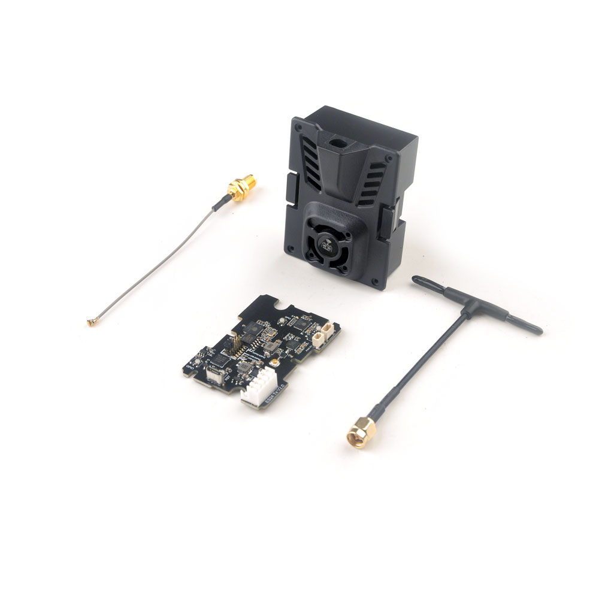
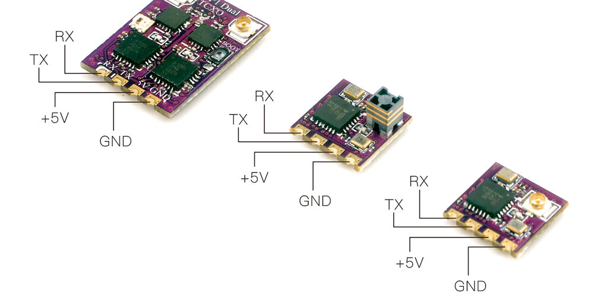
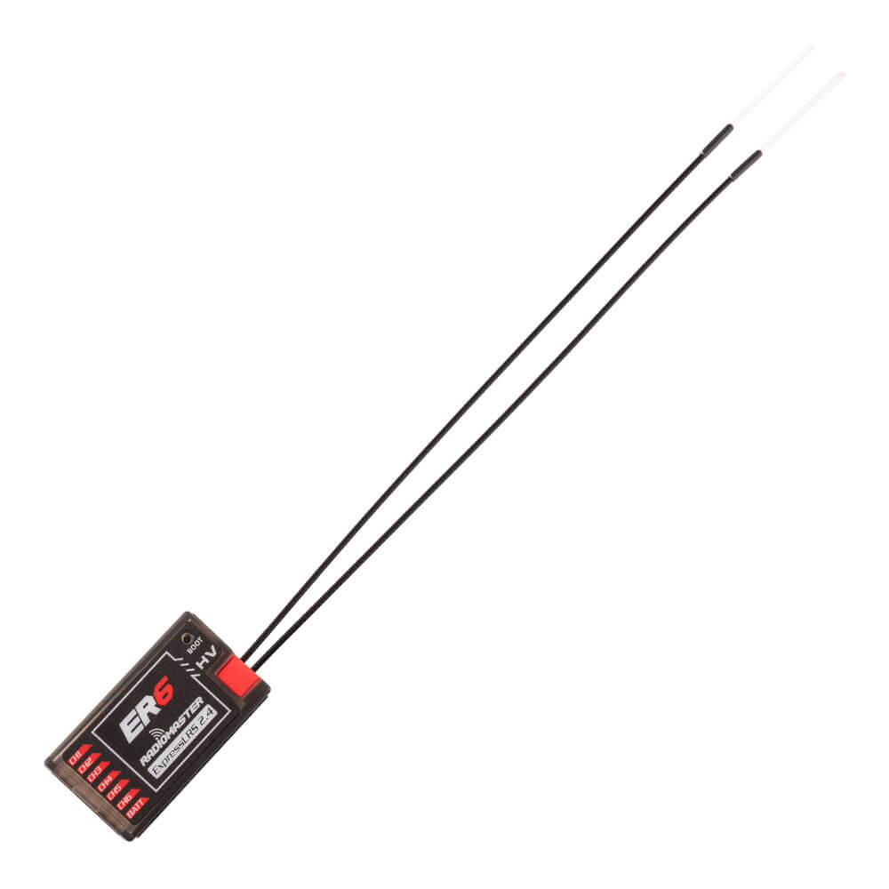
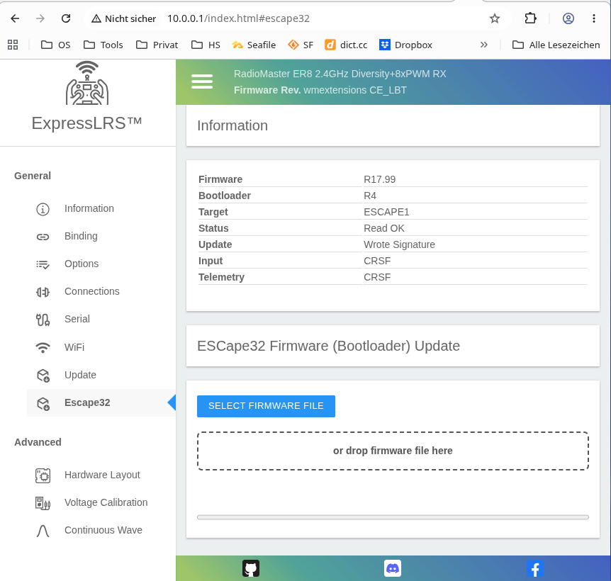

= ExpressLRS
Wilhelm Meier <wilhelm.wm.meier@googlemail.com>
:toc:
:toclevels: 3
:toc-placement!:
:sectnums:
:sectnumlevels: 5
:tip-caption: :bulb:
:note-caption: :information_source:
:important-caption: :heavy_exclamation_mark:
:caution-caption: :fire:
:warning-caption: :warning:
:lang: de
:toc-title: Inhaltsverzeichnis
:figure-caption: Abbildung
:table-caption: Tabelle
:example-caption: Beispiel

<<elrs.adoc#,English>> | *Deutsch*

<<../README.de.adoc#,RC-Elektronik>> / ExpressLRS

[NOTE]
--
ExpressLRS: Funktionen, Module, Empfänger und meine Änderungen (V3/V4).
Eine Übersicht über die in V3 und V4 verfügbaren Funktionen finden Sie in der <<elrs-matrix>>.
--

toc::[]

[[_expresslrs_for_short_range_radio_control]]
== ExpressLRS für Fernsteuerung auf kurze Distanz

https://www.expresslrs.org[ExpressLRS] (ELRS) ist eine Funkverbindung mit großer Reichweite für ferngesteuerte Modelle / Maschinen aller Art.
Es bietet einige offensichtliche Vorteile gegenüber anderen kommerziellen RC-Funksystemen wie AFHDS2A, Hott oder ACCST, ...

ExpressLRS bietet:

[[elrs_feat]]
.Hauptmerkmale von ExpressLRS
* Open Source (Software und Hardware)
* geringe Latenz / hohe Paketrate
* Verwendung des offenen (gut dokumentierten) CRSF-Protokolls (https://github.com/crsf-wg/crsf[Arbeitsgruppe])
* extrem große Reichweite

Zusammen mit https://edgetx.org[EdgeTx] (einem Open-Source-Betriebssystem für Fernsteuersender) steht ein äußerst leistungsfähiges System 
zur Fernsteuerung und Überwachung von Modellen oder Maschinen aller Art zur Verfügung. Das gesamte System (bis auf den Sender selbst) ist nun Open Source: 
Der Erweiterung des Systems sind keine Grenzen gesetzt.

ELRS ist aber nicht auf seine große Reichweite beschränkt, die es für Fluggeräte aller Art (Flugzeuge, Hubschrauber, Drohnen, ...) geeignet macht.
ELRS eignet sich ebenso für die Fernsteuerung von Booten, Autos, Crawlern und stationären Modellen (z.B. Kränen, ...) auf kurze Distanz.

Die interessantesten Eigenschaften von ELRS für die Fernsteuerung von Modellen auf kurze Distanz sind:

[[elrs_func]]
.Funktionen für Funktionsmodelle
* Konfigurierbarkeit aller angeschlossenen `CRSF`-Geräte: des Sendermoduls, des Empfängers und _aller_ angeschlossenen Geräte (ESCs, MultiSwitch, Beleuchtungsmodule, ...) 
* Erweiterbarkeit durch die Flexibilität des CRSF-Protokolls, insbesondere auf der Modellseite (hinter dem Empfänger)
* geringe Latenz / hohe Paketrate für neuartige Funktionen (z.B. haptische Steuerung)
* dynamische Sendeleistung bis hinunter zu `10mW`
* sehr kleine und preiswerte Empfänger

Ich habe einige Erweiterungen des CRSF-Protokolls vorgeschlagen (siehe <<protocols.de.adoc#crsf_sw,Vorschlag für das CRSF-Protokoll>>). Diese Erweiterungen werden bereits in meinem <<cruise-control.de.adoc#CC,`CruiseController`>> und einigen 
MultiSwitch-Modulen (<<multiswitch.de.adoc#elrs_msw,ELRS-MultiSwitch>>) oder Beleuchtungsmodulen verwendet.

[[_expresslrs_modules_and_receivers]]
== ExpressLRS: Module und Empfänger

Mit ELRS-Modulen wie <<hm_es24tx>> (ca. 100mW HF-Leistung) und sehr kleinen Empfängern wie <<hm_ep1ep2>> oder <<rm_er6>>
erreichen Sie eine enorme Reichweite von n-mal 10km. Das ist für Drohnenpiloten gut, bringt aber bei der Steuerung von Crawlern oder Modellbooten / -schiffen keinen Nutzen.

[[hm_es24tx]]
.Happymodel-ES24TX-Sendermodul

[[hm_ep1ep2]]
.Happymodel-EP1- und -EP2-Empfänger mit CRSF/SBUS-Ausgang

[[rm_er6]]
.RadioMaster-ER6-Empfänger mit separaten PWM-Ausgängen

Die <<elrs_func>> lassen sich auch erreichen, indem ein ELRS-Empfänger als Sendermodul verwendet wird. Das ist ein großer Vorteil, weil dadurch 
viele Sender intern mit ELRS ausgestattet werden können, z.B. die _FrSky X12S_, _X9E_, _Jumper T12_ oder _FlySky FS-I6X_. 
Einzelheiten finden Sie unter <<rx-as-tx.de.adoc#elrs_jr,JR-Modulschachtadapter für ELRS-Empfänger als Sender>>, <<rx-as-tx.de.adoc#elrs_x12s,Adapter für ELRS-Empfänger als internes XJT/ISRM-Modul für FrSky X12S>> und <<flysky.de.adoc#elrs_i6x,ELRS für die FlySky-I6X>>.

[[_multiple_elrs_receivers_bound_to_one_elrs_module]]
== Mehrere ELRS-Empfänger an ein ELRS-Modul binden

Mit derselben Bind-Passphrase können mehrere Empfänger an ein Sendermodul gebunden werden. Würden alle Empfänger Telemetriedaten an das Sendermodul senden, 
gäbe es Störungen auf der Funkstrecke; selbst wenn die Funkdaten zufällig unverfälscht ankämen, würde das Sendermodul nicht eindeutig zuordenbare Daten empfangen. 
ELRS kann nicht mit mehreren Telemetriedatenströmen innerhalb desselben Passphrase-Bereichs umgehen.

Deshalb muss das Senden von Telemetrie bei allen Empfängern bis auf einen deaktiviert werden. Dies ist über die Weboberfläche der Empfänger möglich. In diesem Szenario 
kann es mehrere Empfänger geben – vielleicht in verschiedenen Modellen –, aber nur einer darf Telemetrie senden; alle anderen dürfen keine Telemetriedaten senden. 
Manchmal mag das akzeptabel sein, häufiger jedoch nicht: Wenn die Empfänger zu verschiedenen Modellen gehören, können nicht alle Akkus usw. 
überwacht werden. Das kann zu schweren Schäden an den Akkus führen.

Seit Version `3.4` enthält ELRS eine Funktion namens _TeamRace_ (siehe das Empfängermenü im Menü von `elrsV3.lua`).
Bei _TeamRace_ hat jeder Empfänger eine eindeutige ID-Nummer namens `position`. Über einen festgelegten RC-Kanal 
(einen der 16 RC-Kanäle) kann ein _aktiver_ Empfänger ausgewählt werden. Der aktive Empfänger gibt Servodaten aus und sendet Telemetrie zurück; ein inaktiver Empfänger sendet keine Telemetrie und wechselt 
für die Kanaldaten in den Failsafe-Zustand. Weitere Informationen: https://github.com/ExpressLRS/ExpressLRS/pull/2176[TeamRace].

_TeamRace_ ermöglicht einen sehr schnellen Wechsel des Empfängers / Modells, z.B. mit dem Sechspositionsschalter einer TX16S oder X12S.

Der Failsafe-Zustand der inaktiven Empfänger ist in den meisten oben genannten Anwendungsfällen unerwünscht: Es wäre viel besser, wenn ein inaktiver Empfänger
lediglich keine Telemetrie mehr sendet, die Kanaldaten aber weiterhin ausgibt.

Dies wurde in diesem Pull-Request umgesetzt: https://github.com/ExpressLRS/ExpressLRS/pull/2685[Telemetrie für mehrere Modelle].
Leider wurde dieser Pull-Request vom ELRS-Team nicht angenommen. Daher müssen Sie ihn im 
`expresslrs-configurator` manuell auswählen.

[[_32_channels_for_elrs]]
== 32 Kanäle für ELRS

ELRS überträgt 16 RC-Kanäle vom Sender zum Empfänger. In EdgeTx kann der erste der 16 aufeinanderfolgenden zu übertragenden Kanäle 
ausgewählt werden.

EdgeTx verwaltet 32 RC-Kanäle, daher wäre es interessant, auch die übrigen 16 Kanäle zu übertragen.

.Nur für V4
[TIP]
--
Siehe <<elrs-ch32>>.
--

.Nur für V3
[TIP]
--
Auf dem Sender erfasst ein LUA-Skript (Mischerskript) die Kanäle 17-32 und kodiert sie als benutzerdefiniertes CRSF-Paket (<<protocols.de.adoc#prop32,Proportionaldaten (z.B. zusätzliche Kanäle: >=8bit)>>).
Der ELRS-Empfänger gibt diese benutzerdefinierten Pakete an seiner seriellen Schnittstelle aus (Auswahl: CRSF-Protokoll). 
Dafür ist natürlich ein spezieller CRSF-Decoder erforderlich: Er muss sowohl die normalen RC-Kanalpakete als auch die benutzerdefinierten Pakete dekodieren. 
--

Der <<cruise-control.de.adoc#CC,`CruiseController`>> verwendet zwei `SBus`-Schnittstellen: eine für die Kanäle 1-16 und eine für die Kanäle 17-32.

[[elrs-matrix]]
== Funktionsmatrix

Übersicht über die auf dieser Seite beschriebenen ELRS-Funktionen und -Änderungen. Die Tabelle zeigt für jede Funktion, ob sie
in ELRS V3 und V4 verfügbar ist und wie sie bezogen werden kann.

.Legende
[cols="1,5"]
|===
| *Standard* | in der offiziellen ExpressLRS-Version enthalten
| *Fork* | in meinem Branch https://github.com/wimalopaan/ExpressLRS/tree/wmextensions[`wmextensions`] (V4). Erfordert immer `-DWMEXTENSION` sowie die aufgeführte Kompilierungsoption in `super_defines.txt` (siehe <<elrs-switches>>).
| *Branch* | separater V3-Branch in https://github.com/wimalopaan/ExpressLRS[wimalopaan/ExpressLRS] (auf Basis von `3.x.x-maintenance`)
| *PR* | Pull-Request an ExpressLRS
| – | nicht verfügbar
|===

[cols="4,4,4,5",options="header"]
|===
| Funktion | V3 | V4 | Anmerkungen

4+h| Mehrere Empfänger / Adressierung
| <<_multiple_elrs_receivers_bound_to_one_elrs_module,TeamRace (aktiven Empfänger über einen Kanal auswählen)>>
| Standard (≥ 3.4, https://github.com/ExpressLRS/ExpressLRS/pull/2176[PR #2176])
| Standard
| Inaktive Empfänger wechseln in den Failsafe-Zustand.
| <<_multiple_elrs_receivers_bound_to_one_elrs_module,TeamRace ohne Failsafe (Telemetrie für mehrere Modelle)>>
| https://github.com/ExpressLRS/ExpressLRS/pull/2685[PR #2685] (nicht übernommen; PR im Konfigurator auswählen)
| –
| Inaktive Empfänger geben weiterhin Kanaldaten aus.
| <<elrs-route,Erweiterte CRSF-Adressen außer `0xc8`>>
| Branch `3.x.x-wmaddress` (https://github.com/ExpressLRS/ExpressLRS/pull/2975[PR #2975], nicht übernommen)
| Standard (vollständiges CRSF-Routing, siehe <<elrs_v4>>)
| Für alle CRSF-Geräte mit eigener Adresse erforderlich (MultiSwitch, CruiseController, ...).

4+h| Scharfschalten
| <<elrs_arm4,Schalterbasiertes Scharfschalten>>
| Branch `3.x.x-arm4`
| Standard
|
| <<elrs_perm_arm,Dauerhaftes Scharfschalten>>
| Branch `3.x.x-perm-arm`
| Standard
| Nur mit _PPM_-Eingang sinnvoll.

4+h| Kanäle und serielle Protokolle
| <<elrs-ch32,32 Kanäle>>
| Standard + `crsfch.lua` (<<protocols.de.adoc#prop32,Prop32>>), erfordert einen Prop32-fähigen Decoder
| Fork: `WMCRSF_CHAN_EXT`
| V4: Fork auf TX _und_ RX flashen. Erfordert die EdgeTX-Modifikation https://github.com/wimalopaan/edgetx/tree/wmcrsfchanext[`wmcrsfchanext`].
| <<elrs_sbus_flip,Kanäle 17-32 über SBus>>
| Branch `3.x.x-wmchanext` (`crsfch.lua`: `Flags` Bit 0)
| Fork: `WMCRSF_CHAN_EXT` (SBus auf `Serial2`: Kanäle 17-32)
|
| <<elrs_sumdv3,SumDV3-Ausgang mit 64 binären Schaltern>>
| Branch `3.x.x-wmsumdv3`
| Fork
| Schalteradressen `240` ... `247`
| <<elrs_sumdv3,SumDV3: Kanäle 1-16 und 17-32 vertauschen>>
| Branch `3.x.x-wmsumdv3` (`crsfch.lua`: `Flags` Bit 1)
| Fork: `WMSUMDV3_SWAP`
| z.B. für USM-RC-3

4+h| MultiSwitch und LEDs
| <<elrs_pwm_msw,PWM-Empfänger als MultiSwitch>>
| Branch `3.x.x-wmswitch`
| Fork
| Schalteradressen `240`, `241`. Ausgänge im Modus `on/off`.
| <<elrs_pwm_msw,WS2812-RGB-LEDs über das MultiSwitch-Widget>>
| Branch `3.x.x-wmswitch`
| Fork
| Schalteradressen `248` ... `255`
| <<elrs-io-expand,I2C-IO-Expander für MultiSwitch>>
| –
| geplant
|

4+h| Geräte und Schnittstellen
| <<elrs-escape32,`ESCape32`-ESCs flashen / einrichten>>
| –
| Fork: `WMESCAPE32`
| Über die WLAN-Weboberfläche des Empfängers
| <<elrs-3rd-serial,Dritte serielle Schnittstelle>>
| –
| Fork: `WMSERIAL2`
| Nur ESP32-Empfänger
| <<elrs-esp-now,CRSF über ESP-NOW (Master)>>
| –
| Fork: `WMESPNOW`
| Weiterleitung an ESP-NOW-Slaves mit derselben Bind-Passphrase
| <<elrs-esp-now,Empfänger als ESP-NOW-Slave>>
| –
| Fork: `WMESPNOW_RECV`, `WMESPNOW_RECV_ADDR`
| Deaktiviert den Empfang über LoRa-Funk
| <<elrs-esp-bridge,ESP32C3-mini als USB/ESP-NOW-Brücke>>
| –
| Fork: `WMESPNOW_SERIAL_NO_RADIO`
| Nur ESP32-C3
| <<elrs-rxtx-analog,RX-as-TX mit direkten Analogeingängen>>
| –
| Fork: `WMRXTX_ANALOG`
| Konfiguration mit ELRS Buddy
| <<elrs-tx-relay,TX-Modul / RX-as-TX als CRSF-Relais>>
| –
| Fork: `WMRELAY`
| Siehe auch <<elrs-relay>>
|===

[TIP]
--
Für V3 kombiniert der Branch `3.x.x-wmaddress-arm4-sumdv3-chanext-switch` mehrere der V3-Änderungen (siehe <<elrs_combined>>).
--

[[elrs-switches]]
.Kompilierungsoptionen des Branches `wmextensions` (`super_defines.txt`)
[cols="3,6",options="header"]
|===
| Option | Wirkung
| `-DWMEXTENSION` | Für alle Erweiterungen erforderlich. Aktiviert MultiSwitch, SumDV3 und RGB-LEDs.
| `-DWMCRSF_CHAN_EXT` | 32-Kanal-Erweiterung (TX und RX)
| `-DWMCRSF_NO_HIGH_CHANNELS` | Kanäle 17-32 nicht am seriellen CRSF-Ausgang ausgeben
| `-DWMCRSF_CH_OUT_CONCAT` | Kanäle 1-16 und 17-32 (Frametyp `0x26`) bei jeder Aktualisierung direkt nacheinander statt abwechselnd ausgeben
| `-DWMSUMDV3_SWAP` | Kanäle 17-32 als SumDV3-Kanäle 1-16 ausgeben
| `-DWMFILTER32`, `-DWMFILTER32W=500` | Tiefpassfilter für die Kanalwerte
| `-DWMESCAPE32` | ESCape32-Unterstützung
| `-DWMSERIAL2` | Dritte serielle Schnittstelle (nur ESP32)
| `-DWMESPNOW` | CRSF über ESP-NOW weiterleiten (Master)
| `-DWMESPNOW_RECV`, `-DWMESPNOW_RECV_ADDR=0xEB` | Empfänger als ESP-NOW-Slave mit der CRSF-Adresse des Slaves
| `-DWMESPNOW_SERIAL_NO_RADIO` | ESP32-C3 als USB/ESP-NOW-Brücke (ohne LoRa-Funk)
| `-DWMRXTX_ANALOG` | RX-as-TX mit Analogeingängen an den PWM-Pins
| `-DWMRELAY` | TX als CRSF-Relais (Adress-NAT, Link-Statistik `0x14` -> `0x15`)
|===

[[elrs-mods]]
== ELRS-Änderungen und Pull-Requests

[TIP]
--
Die Änderungen für ELRS V4 finden Sie unter <<elrs-mods-v4>>.
--

[[elrs-mods-v4]]
=== ExpressLRS V4

Die folgenden Änderungen an ELRS 

* <<elrs_sumdv3>> 
* <<elrs_pwm_msw>>
* RGB-LEDs über das MultiSwitch-Widget
* 32-Kanal-Erweiterung <<elrs-ch32>>
* Möglichkeit zum Flashen / Einrichten von ESCape32-ESCs <<elrs-escape32>> (siehe auch <<escape32.de.adoc#,ESCape32: Firmware für eine Familie kleiner/mittlerer BLDC- und Bürstenmotorregler (bürstenlose/Bürsten-ESCs)>>)
* Weiterleitung von CRSF über ESP-NOW (siehe auch <<elrs-esp-now>>)
* Verwendung von ExpressLRS (auf ESP32C3-mini) als USB2Serial/ESP-NOW-Brücke (siehe auch <<elrs-esp-bridge>>)
* Verwendung eines RX-as-TX-Empfängers als Sendermodul zur Modernisierung alter Sender (siehe auch <<elrs-rxtx-analog>>) 

sind jetzt auch für ELRS V4 verfügbar.

Den Quellcode finden Sie hier: https://github.com/wimalopaan/ExpressLRS/tree/wmextensions[]

Tragen Sie unbedingt die folgende Zeile 

[source,console]
----
-DWMEXTENSION
----

in `super_defines.txt` ein.

Für das Kompilieren von ELRS V4 gelten die Anweisungen unter <<building.de.adoc#elrs_cs,ExpressLRS mit `github` Codespaces kompilieren>> und <<building.de.adoc#elrs_compile,Kompilierung>> unverändert.

[TIP]
--
Die folgenden Änderungen sind für V4 von ExpressLRS nicht nötig / nutzlos, weil sie bereits in V4 enthalten sind:

* <<elrs-route>>
* <<elrs_arm4>>
* <<elrs_perm_arm>>
--

[[elrs_v4]]
==== Mehrere CRSF-Geräte an einem Empfänger

ExpressLRS V4 enthält eine _vollständige_ Implementierung des CRSF-Protokolls. Es kann also alle gültigen (erweiterten) CRSF-Adressen verarbeiten und entsprechend routen. Es erkennt, welche Geräte 
mit welchen CRSF-Endpunkten verbunden sind. Die seriellen Schnittstellen eines Empfängers dienen ebenso als Endpunkte wie der HF-Sender (Endpunkt über die Funkstrecke) im Empfänger. Entscheidend ist, dass alle angeschlossenen Geräte 
_unterschiedliche_ CRSF-Adressen haben.

Beachten Sie, dass die physikalische Standardschicht von CRSF _kein_ Bus ist! Standard-CRSF ist ein _Punkt-zu-Punkt_-Protokoll. Deshalb können Sie höchstens _ein_ externes Gerät an eine serielle Schnittstelle des Empfängers anschließen.

Wenn Sie mehr als ein CRSF-Gerät anschließen möchten, müssen Sie unterschiedliche serielle Schnittstellen des Empfängers verwenden. Üblicherweise können alle PWM-Empfänger eine zusätzliche serielle Schnittstelle auf zwei 
PWM-Ausgängen definieren (CRSF ist bidirektional und verwendet RX- und TX-Leitungen). Es gibt auch Empfänger ohne PWM-Ausgänge, etwa den _Radiomaster XR2_, die zwei serielle Schnittstellen besitzen.  

Um mehr als _ein_ externes CRSF-Gerät an der _gleichen_ seriellen Schnittstelle eines Empfängers zu verwenden, benötigen Sie einen CRSF-Switch/Router (siehe <<crsf-devices.de.adoc#crsf-switch,CRSF-Switch / Router>>).  

[[elrs-ch32]]
=== 32-Kanal-Erweiterung für ELRS V4

Die Änderung finden Sie hier:

https://github.com/wimalopaan/ExpressLRS/tree/wmextensions

Sie müssen diese Version sowohl auf TX als auch auf RX verwenden, da das OTA-Format geändert wurde und keine freien Bits mehr vorhanden waren (zumindest zunächst), um dies zur Laufzeit auswählbar zu machen.

Außerdem benötigen Sie diese EdgeTX-Modifikation:

https://github.com/wimalopaan/edgetx/tree/wmcrsfchanext

Diese Modifikation basiert auf der Arbeit von @rotorman, ergänzt aber die Erkennung des modifizierten ELRS. Ohne diese EdgeTx-Modifikation wird der ELRS-TX mit Paketen überflutet.

Tragen Sie unbedingt die folgenden Zeilen

[source,console]
----
# activate Extensions (MultiSwitch, SumDV3, LedRGB)
-DWMEXTENSION
# activate 32 channels extension (sbus@serial: ch1-16, sbus@serial2: ch17-ch32)
-DWMCRSF_CHAN_EXT
# output ch17-32 on sumdv3 ch1-16
-DWMSUMDV3_SWAP
# low-pass filter of channel values
-DWMFILTER32
-DWMFILTER32W=500
# activate ESCape32 extension
# -DWMESCAPE32
# activate 3rd serial (Serial2) (only for ESP32)
# -DWMSERIAL2
----

in `super_defines.txt` ein.

[[elrs-escape32]]
=== Unterstützung für das Flashen / Einrichten von `ESCape32`-ESCs

`ESCape32`-ESCs (siehe auch <<escape32.de.adoc#,ESCape32: Firmware für eine Familie kleiner/mittlerer BLDC- und Bürstenmotorregler (bürstenlose/Bürsten-ESCs)>>) können Eingangsdaten über CRSF lesen und auch Telemetrie über CRSF erzeugen. Sie lassen sich im Vollduplex-Modus an einen
ExpressLRS-Empfänger anschließen. Da sie den Empfänger auch über ein BEC versorgen, werden sie am besten mit einem ExpressLRS-PWM-Empfänger verbunden (z.B. Radiomaster ER6 oder ER8). In diesem
Fall muss Serial1 (die zweite serielle Schnittstelle in ExpressLRS) auf zwei PWM-Anschlüssen konfiguriert werden, z.B. Output 8 für CRSF-TX und Output 7 für CRSF-RX. 
Anschließend muss Output 8 des Empfängers mit dem Signaleingang des ESC und Output 7 des Empfängers mit dem Telemetriepin des ESC verbunden werden. 

Bevor das funktioniert, muss der ESC jedoch so konfiguriert werden, dass er CRSF als Eingangs- und Telemetrieprotokoll verwendet ((<<escape32.de.adoc#,ESCape32: Firmware für eine Familie kleiner/mittlerer BLDC- und Bürstenmotorregler (bürstenlose/Bürsten-ESCs)>>). Dies geschieht normalerweise
mit dem `ESCape32-WiFi-Link`. Um den `WiFi-Link` zu verwenden, müssen Sie den ESC natürlich vom Empfänger trennen.

Dieses manuelle Umstecken der Kabel können Sie vermeiden (stellen Sie sich einen Einbau im Modell vor, bei dem Sie den ESC kaum mit der Hand erreichen), indem Sie die ELRS-
Änderungen verwenden: https://github.com/wimalopaan/ExpressLRS/tree/wmextensions

Tragen Sie unbedingt `-DWMEXTENSION` und `-DWMESCAPE32` 

[source,console]
----
# activate Extensions (MultiSwitch, SumDV3, LedRGB)
-DWMEXTENSION

# activate ESCape32 extension
-DWMESCAPE32
----

in Ihre `super_defines.txt` ein.

Schalten Sie Ihren ELRS-Empfänger bei angeschlossenem ESC (an Serial1) in den WLAN-Modus. In der Menüleiste sollte ein neuer Menüpunkt `Escape32` erscheinen:

.Neuer Menüpunkt für Escape32

Sie sehen den aktuellen Zustand des ESC.

Wählen Sie entweder ein ESCape32-Bootloader-Image (achten Sie unbedingt auf das richtige) oder ein Firmware-Image.
Wenn Sie im Dateiauswahldialog auf `OK` klicken, beginnt der Flashvorgang. 

Sie sollten einen Fortschrittsbalken und zum Abschluss einen Dialog sehen.

Danach können Sie die aktuelle Webseite neu laden; sie sollte nun die neuen Informationen (den neuen Zustand des ESC) anzeigen.

Das ist alles.

[[elrs-3rd-serial]]
=== Dritte serielle Schnittstelle für ELRS V4

Manchmal brauchen Sie noch mehr serielle Schnittstellen! 

Auf ESP32-Empfängern kann ELRS bis zu zwei serielle Verbindungen einrichten. Bei PWM-Empfängern ist eine serielle Schnittstelle (die erste: `Serial`)
üblicherweise (zumindest bei unveränderter Hardwaredefinition) mit dem JST-GH-Anschluss verbunden; die zweite (`Serial1`) kann
zwei PWM-Anschlüssen zugeordnet werden. 

Damit können Sie einen FC oder z.B. einen _MultiSwitch_ über den JST-GH-Anschluss verbinden (das ist völlig in Ordnung, da dabei keine 
hohen Ströme durch diese Leitungen fließen) _und_ gleichzeitig z.B. einen ESC (wie <<escape32.de.adoc#,ESCape32: Firmware für eine Familie kleiner/mittlerer BLDC- und Bürstenmotorregler (bürstenlose/Bürsten-ESCs)>>) über 
`CRSF` im Vollduplex-Modus anschließen. 

Aber was tun, wenn Sie mehr als einen ESC haben? 

Diese Situation ist bei Booten/Schiffen und ähnlichen Modellen nicht ungewöhnlich.

Sie können den _CruiseController_ verwenden (siehe unten). Sie können aber auch die dritte serielle Schnittstelle nutzen, die jeder `ESP32` besitzt.

Den Quellcode finden Sie hier: https://github.com/wimalopaan/ExpressLRS/tree/wmextensions[]

Tragen Sie unbedingt `-DWMEXTENSION` und `-DWMSERIAL2` ein. 

[source,console]
----
# activate Extensions (MultiSwitch, SumDV3, LedRGB)
-DWMEXTENSION

# activate 3rd serial (Serial2) (only for ESP32)
-DWMSERIAL2
----

[[elrs-esp-now]]
=== CRSF über ESP-NOW für ELRS V4

Diese Erweiterung ergänzt ExpressLRS um _CRSF über ESP-NOW_ (siehe auch <<protocols.de.adoc#crsf-esp-now,CRSF über ESP-NOW>>).

Mit dieser Erweiterung können Sie ein separates ESP32-Modul wie das ESP32-C3-mini als
_Slave_-Gerät verwenden. Der _Master_-Empfänger leitet alle eingehenden Funkpakete über CRSF über ESP-NOW
an das _Slave_-Gerät weiter. Dieses kann dann beispielsweise als MultiSwitch/E dienen (siehe <<multiswitch.de.adoc#elrs_msw,ELRS-MultiSwitch>>).

Der ESP-NOW-Master wird mit den Kompilierungsoptionen `-DWMEXTENSION` und `-DWMESPNOW` aktiviert.

Neben _Slave_-Geräten wie dem ESP32-C3-mini können Sie auch einen gewöhnlichen ELRS-Empfänger als Slave-
Gerät verwenden. Dies wird mit der Kompilierungsoption `-DWMESPNOW_RECV` aktiviert. Ist diese aktiv, empfängt der Empfänger
keine RC-Pakete mehr über LoRa-Funk. Stattdessen verwendet er ESP-NOW als Haupteingang. Sowohl der Master-Empfänger 
als auch der Slave-Empfänger _müssen_ dieselbe Bind-Passphrase verwenden, um sich gegenseitig zu authentifizieren. 

Wenn ein gewöhnlicher ELRS-Empfänger als _Slave_-Gerät verwendet wird, können _mehrere_ Modelle oder Teile 
desselben Modells gleichzeitig gesteuert werden (siehe <<crsf-devices.de.adoc#multi-part-model,Das Problem mehrteiliger Modelle>>). 

Im Gegensatz zur normalen LoRa-Funkverbindung zwischen TX-Modul und ELRS-Empfänger (Master), bei der nur _ein_ Empfänger
(mit Telemetrie) angeschlossen werden kann, kann die ESP-NOW-Verbindung zwischen dem _Master_-Empfänger und den _Slave_-Empfängern
eine Eins-zu-viele-Verbindung sein. Daher können mehrere Slave-Empfänger an einen Master-Empfänger gebunden werden.

Tragen Sie unbedingt `-DWMEXTENSION` und `-DWMESPNOW` ein, wenn Sie einen
ELRS-Empfänger für ESP-NOW verwenden möchten.

[source,console]
----
# activate Extensions (MultiSwitch, SumDV3, LedRGB)
-DWMEXTENSION

# activate ESP-NOW forwarding
-DWMESPNOW

# activate ESP-NOW receiver (disables esp-now forwarding, disables rf-connection)
-DWMESPNOW_RECV 
-DWMESPNOW_RECV_ADDR=0xEB
----

[[elrs-esp-bridge]]
=== ESP32C3-mini als USB/ESP-NOW-Brücke

Wenn Sie <<elrs-rxtx-analog>> verwenden und den RX-as-TX im Sender unterbringen, gibt es möglicherweise keine von außen zugängliche Kabelverbindung zum RX-as-TX,
um den CRSF-Port (den JST-GH-Anschluss) zu erreichen. Dann müssten Sie jedes Mal das Gehäuse öffnen und einen USB2Serial-Adapter anschließen, wenn Sie
ELRS-Parameter ändern oder ein Gerät konfigurieren möchten (beachten Sie, dass Sie sich bei <<elrs-rxtx-analog>> nicht über die normale ELRS-Funkstrecke mit dem RX-as-TX
verbinden können).

[[elrs-rxtx-analog]]
=== ELRS-Empfänger als TX-Modul mit direkten Analogeingängen

Ein als _rx-as-tx_ geflashter Empfänger ist eine der einfachsten Möglichkeiten, einen alten analogen Sender zu modernisieren (siehe auch <<rc-desk.de.adoc#rcdesk32mini,Der RC-Desk mini (für RadioMaster TX16S, TX15, FrSky X12S, X9E, ...)>>). Dazu verbinden Sie die 
analogen Signalquellen mit dem WeAct-µC-Modul und dieses im Vollduplex- (oder Halbduplex-)Modus mit einem als rx-as-rx geflashten Empfänger.

Andererseits ist das zusätzliche µC-Modul streng genommen nicht nötig: Ein RX-as-TX-PWM-Empfänger kann die Analogwerte über die _ehemaligen_ 
PWM-Pins lesen und diese Werte als Kanalquellen für die ersten N RC-Kanäle verwenden.

Auf der Hardwareseite (im WLAN-Modus) finden Sie den Abschnitt `RX-as-TX ADC Inputs`. Hier können Sie eine durch Kommas getrennte Liste
von Eingängen angeben (z.B. die Liste, die Sie normalerweise unter `pwm-outputs` finden, wenn der RX als _normaler_ Empfänger geflasht ist).

Wenn Sie ein analoges Anzeigeinstrument zur Akkuüberwachung verwenden möchten, wählen Sie den entsprechenden Pin.

Die Konfiguration des RX-as-TX-Empfängers kann über https://github.com/Fourflies/elrsbuddy[ELRS Buddy] erfolgen. 

Dort finden Sie eine Schaltfläche zur Kalibrierung. 
Die Kalibrierung erfolgt in mehreren Schritten:

* Bringen Sie die analogen Eingänge in Neutralstellung (sie wird im nächsten Schritt gespeichert).
* Klicken Sie auf die Schaltfläche _Calibration_ (Kalibrierung).
* Bewegen Sie alle analogen Eingänge in ihre Endstellungen.
* Wenn sich die Extremwerte nicht mehr ändern, endet die Kalibrierung nach 10 Sekunden.
* Fertig!

Tragen Sie unbedingt `-DWMEXTENSION` und `-DWMRXTX_ANALOG` ein. 

[source,console]
----
# activate Extensions (MultiSwitch, SumDV3, LedRGB)
-DWMEXTENSION

# when Rx-as-Tx 
# - uses PWM-Pins as analog channel inputs, no channels-data via handset / elrs-buddy
# - permanently turns on rf-mode (switch to wifi-mode using elrs-buddy)
-DWMRXTX_ANALOG
----

[[elrs-tx-relay]]
=== ELRS-Sender als CRSF-Relais in ELRS V4

Diese ELRS-Änderung ermöglicht die Verwendung eines TX-Moduls oder eines RX-as-TX als ELRS-Relais.

Stellen Sie im angeschlossenen Relaisempfänger, der diesen ELRS-Relaissender ansteuert, unbedingt eine gültige _Sender_-Baudrate wie 400KBaud oder 921KBaud 
ein.

Wenn Sie die Hardwarebelegung der primären seriellen Schnittstelle des RX-as-TX nicht ändern, müssen Sie den
Relaisempfänger mit einem JST-GH-Kabel verbinden, bei dem RX und TX gekreuzt sind. Wenn Sie kein Spezialkabel verwenden möchten, können Sie
die Pins für _crsf tx_ und _crsf rx_ auf der WLAN-Seite zur Hardwarebelegung des RX-as-TX (oder des Relaisempfängers) vertauschen.

Was ein Relais macht und warum es erforderlich ist,
erfahren Sie unter <<elrs-relay>> und <<crsf-devices.de.adoc#rcrelay32,RC-Relay32: ein CRSF-Relais>>.

Dies ist auch bei Verwendung von <<elrs-rxtx-analog>> nützlich.

Tragen Sie unbedingt `-DWMEXTENSION` und `-DWMRELAY` ein. 

[source,console]
----
# activate Extensions (MultiSwitch, SumDV3, LedRGB)
-DWMEXTENSION

# activate relay support in transmitter
# NAT for receiver/transmitter CRSF address (to repeater addresses)
# transform link-stat (0x14 -> 0x15)
# suppress timing-packets
-DWMRELAY
----

[[elrs-io-expand]]
=== ELRS-Empfänger mit I2C-IO-Expander für MultiSwitch in ELRS V4

Noch auszuarbeiten.

[[_elrs_v3_modifications]]
=== Änderungen für ELRS V3

[TIP]
--
Wie Sie ExpressLRS (V3 und V4) mit `github` Codespaces kompilieren, ist unter <<building.de.adoc#build_elrs,Firmware kompilieren: ExpressLRS>> beschrieben.
--

[[elrs-route]]
==== Andere erweiterte Adressen als `0xc8` zulassen (nur Version 3.x.x)

Das unveränderte ELRS routet nur `0xc8` (Flight-Controller) als erweiterte Adresse vom und zum Sender. Gemessen an der 
Protokolldefinition von CRSF ist das nicht ganz korrekt. 
https://github.com/wimalopaan/ExpressLRS/tree/3.x.x-wmaddress[Dieser Branch] oder 
https://github.com/ExpressLRS/ExpressLRS/pull/2975[dieser PR]
ermöglicht das Routing des gesamten Bereichs von `0xc0` bis `0xcf`.

[[elrs_arm4]]
==== Neue ELRS4-Methode zum Scharfschalten für Version 3  (nur Version 3.x.x)

ELRS-Version 4 führt eine neue Methode zum Scharfschalten ein: Statt kanalbasiert kann nun schalterbasiert scharfgeschaltet werden. 

Schon vor der Veröffentlichung von ELRS V4 können Sie diese neue Methode mit ELRS V3 über https://github.com/wimalopaan/ExpressLRS/tree/3.x.x-arm4[diesen Branch] verwenden, 
der auf dem Wartungsbranch von Version 3 basiert.

Zum Kompilieren dieser Version verwenden Sie diese URL: https://gitpod.io/#https://github.com/wimalopaan/ExpressLRS/tree/3.x.x-arm4[]

Folgen Sie anschließend den unter <<elrs-route>> beschriebenen Schritten.

[[elrs_perm_arm]]
==== Dauerhaftes Scharfschalten mit ELRS4 (nur Version 3.x.x)

[CAUTION]
--
Dies ist möglicherweise nur sinnvoll, wenn Ihr Sendermodul einen _PPM_-Eingang verwendet.
--

ELRS-Version 4 führt eine neue Methode zum Scharfschalten ein: Statt kanalbasiert kann nun schalterbasiert scharfgeschaltet werden. 
Diese Änderung schaltet dauerhaft scharf. Das ist nützlich, wenn Sie den _Switch-Modus_ CH16/2 von ELRS verwenden. Dann steht Ihnen der
volle Bereich der _dynamischen Sendeleistung_ zur Verfügung (Race-Telemetrie spielt hier keine Rolle: Sie können die Telemetrie abschalten, da sie mit einem _PPM_-Eingang
ohnehin nutzlos ist).

Zum Kompilieren dieser Version verwenden Sie diese URL: https://gitpod.io/#https://github.com/wimalopaan/ExpressLRS/tree/3.x.x-perm-arm[]

Folgen Sie anschließend den unter <<elrs-route>> beschriebenen Schritten.

[[elrs_sbus_flip]]
==== ELRS, 32 Kanäle und SBus-Ausgang (mit Vertauschen der Kanalgruppen)  (nur Version 3.x.x)

ELRS kann SBus-Daten über eine serielle Schnittstelle (Serial oder Serial2) ausgeben. SBus kann (nur) 16 Kanäle übertragen. ELRS gibt deshalb
die Kanäle 1-16 in diesem SBus-Datenstrom aus. Bei Empfängern _ohne_ PWM-Ausgänge ist dies uneingeschränkt sinnvoll; bei Empfängern mit PWM-Ausgängen hat es dagegen den Nachteil, dass
einige der Kanäle 1-16 zusätzlich über die PWM-Ausgänge und damit gewissermaßen doppelt ausgegeben werden.

Mit dem Mischerskript für <<protocols.de.adoc#prop32,Proportionaldaten (z.B. zusätzliche Kanäle: >=8bit)>> auf dem _EdgeTx_-Sender wäre es außerdem sinnvoll, wenn der PWM-Empfänger (etwa mit 8, 10 oder 14 PWM-Ausgängen) 
die zusätzlichen Kanäle 17-32 nutzen könnte, statt die Kanäle am SBus-Ausgang zu duplizieren. Daher ermöglicht diese Änderung die Auswahl
der oberen Kanalgruppe (17-32) zur Ausgabe über SBus.

Um die Kanalgruppen zu vertauschen und die Kanäle 17-32 zu senden, müssen Sie das Mischerskript `crsfch.lua` installieren (siehe https://github.com/wimalopaan/LUA/tree/main/SCRIPTS/MIXES[]) 
und anschließend den Wert des Eingangs `Flags` des Mischerskripts auf `1` setzen (also `bit0` des Werts setzen).

Siehe auch: <<elrs_sumdv3>>.

Zum Kompilieren dieser Version verwenden Sie diese URL: https://gitpod.io/#https://github.com/wimalopaan/ExpressLRS/tree/3.x.x-wmchanext[]

Folgen Sie anschließend den unter <<elrs-route>> beschriebenen Schritten.

[[elrs_sumdv3]]
=== ELRS, SumDV3 und MultiSwitch (V4 und V3)

Das unveränderte ELRS kann 16 Kanäle über `SumD`, aber nicht über `SumDV3` ausgeben. `SumDV3` bietet mehrere Vorteile gegenüber `SumDV1`: Es kann 32 proportionale Kanäle 
und 64 binäre Schalter übertragen. 

Diese Änderung implementiert `SumDV3` _und_ das MultiSwitch-Protokoll, das unter <<protocols.de.adoc#crsf-sw,Befehle für MultiSwitch (Bereich `0xa1`)>> beschrieben ist und in <<multiswitch.de.adoc#elrs_msw,ELRS-MultiSwitch>> sowie <<multiswitch.de.adoc#msw_widget,MultiSwitch-Widget>> verwendet wird.

Es funktioniert wie folgt:

* Der ELRS-Empfänger mit dieser Änderung verwaltet den Zustand von 64 _binären_ Schaltern.
* Wie üblich verwaltet er den Zustand von 16 RC-Kanälen.
* Wenn eine der seriellen Schnittstellen (_serial_ oder _serial2_) auf `SumDV3` eingestellt wird, gibt sie die 16 RC-Kanäle _und_ den Zustand der 64 binären Schalter aus.
* Zum Setzen/Zurücksetzen eines Schalters muss auf dem EdgeTx-Sender das <<multiswitch.de.adoc#msw_widget,MultiSwitch-Widget>> laufen.
* Dieses Widget muss für die Adressen `240`, ..., `247` konfiguriert werden (Achtung: Dies sind die logischen _Schalter_-Adressen, _nicht_ die `CRSF`-Geräteadresse. Die ersten 8 Schalter sind somit unter Adresse `240` erreichbar, die nächste Achtergruppe unter Adresse `241` ... bis zur letzten Achtergruppe unter Adresse `247`).

.Nur für V3
[TIP]
--
In Kombination mit <<protocols.de.adoc#prop32,Proportionaldaten (z.B. zusätzliche Kanäle: >=8bit)>> kann `SumDV3` zusätzlich _alle_ 32 RC-Kanäle nutzen. Dazu muss das Mischerskript `crshch.lua` verwendet werden (siehe oben). Dieses Mischerskript bietet 
auch die Möglichkeit, die Kanalgruppen 1-16 und 17-32 am `SumDV3`-Ausgang zu vertauschen (Anwendungsfall: siehe unten).
--

.Nur für V4
[TIP]
--
Um die Kanalgruppen in V4 zu vertauschen, müssen Sie die entsprechende Kompilierungsoption in `super_defines.txt` verwenden.
--

Diese Änderung eignet sich ideal für die Kombination z.B. mit dem USM-RC-3 (Fa. Beier: https://www.beier-electronic.de/modellbau/produkte/usm-rc-3/usm-rc-3.php[]). 
Der minimale Aufbau besteht aus einem winzigen Empfänger wie einem Radiomaster RP1/RP2 oder RP3, der mit dem USM-RC3 (Port X2/8) verbunden wird (es wird nur die TX-Leitung der seriellen Empfängerschnittstelle benötigt). 
Das USM-RC3 kann 4 (der 32) RC-Kanäle ausgeben und alle 64 Schalter nutzen. 

.Nur für V3
[TIP]
--
Leider kann das USM-RC-3 nur 16 Kanäle (1-16) des `SumDV3`-Eingangs nutzen. Diese Einschränkung lässt sich umgehen, indem Sie mit dem oben genannten
Mischerskript `crsfch.lua` die Kanalgruppen 1-16 und 17-32 vertauschen und `bit1` der Flags setzen (verwenden Sie den Wert `2` in den Mischerskriptoptionen).

Zum Kompilieren dieser Version verwenden Sie diese URL: https://gitpod.io/#https://github.com/wimalopaan/ExpressLRS/tree/3.x.x-wmsumdv3[]
--

Folgen Sie anschließend den unter <<elrs-route>> beschriebenen Schritten.

[[elrs_pwm_msw]]
=== Einen ELRS-PWM-Empfänger als MultiSwitch verwenden

Jeder unveränderte `pwm`-Empfänger kann binäre Ein/Aus-Signale oder PWM-Signale mit einem Tastgrad von [0%;100%] ausgeben. Erstere eignen sich zum Ein- und Ausschalten kleiner Lasten (bis 10mA), letztere zur PWM-Modulation des Ausgangs
entsprechend dem zugehörigen Kanaleingang. Beide Ausgangsarten können einen Logic-Level-MOSFET ansteuern, um größere Lasten zu schalten.

Es ist etwas unbefriedigend, einen normalen RC-Kanal (einen der 16 von ELRS übertragenen Kanäle) zur Steuerung des binären Ein/Aus-Ausgangs eines PWM-Empfängers zu verwenden. 
Diese Änderung implementiert das unter <<protocols.de.adoc#crsf-sw,Befehle für MultiSwitch (Bereich `0xa1`)>> beschriebene und in <<multiswitch.de.adoc#elrs_msw,ELRS-MultiSwitch>> sowie <<multiswitch.de.adoc#msw_widget,MultiSwitch-Widget>> verwendete MultiSwitch-Protokoll, sodass es zum Schalten der Ausgänge genutzt werden kann.

Es funktioniert wie folgt:

* Der ELRS-Empfänger mit dieser Änderung verwaltet so viele binäre Schalterzustände, wie er Ausgänge besitzt.
* Zum Setzen/Zurücksetzen eines Schalters muss auf dem EdgeTx-Sender das <<multiswitch.de.adoc#msw_widget,MultiSwitch-Widget>> laufen.
* Dieses Widget muss für Adresse `240` konfiguriert werden (und `241`, wenn mehr als 8 Ausgänge vorhanden sind). Achtung: Dies sind die logischen _Schalter_-Adressen; die ersten 8 Schalter sind unter Adresse `240` erreichbar, die nächste Achtergruppe unter Adresse `241`. 
* Am Empfänger müssen die Ausgänge auf den Modus `on/off` eingestellt werden.
* Sobald der Empfänger Daten vom Widget erhält, werden die Ausgänge im Modus `on/off` über das Widget und nicht mehr durch die RC-Kanalwerte gesteuert.

Zusätzlich für Empfänger mit externem WS2812B-Anschluss:

Über die Schalteradressen `248` (bis `255`) können WS2812-RGB-LEDs eingestellt werden. Dazu muss die Anzahl der konfigurierten RGB-LEDs in der Konfiguration unter `hardware.html` erhöht werden. 
Normalerweise wird dadurch die Farbe der internen LED auf die extern angeschlossenen LEDs übertragen.

Mit dem _MultiSwitch-Widget_ <<multiswitch.de.adoc#msw_widget,MultiSwitch-Widget>> erreichen Sie diese LEDs über Adresse `248` und die folgenden Adressen. Auch die Farbe dieser LEDs lässt sich über das MultiSwitch-Widget einstellen.

.Nur für V3
[TIP]
--
Zum Kompilieren dieser Version verwenden Sie diese URL: https://gitpod.io/#https://github.com/wimalopaan/ExpressLRS/tree/3.x.x-wmswitch[]
--

Folgen Sie anschließend den unter <<elrs-route>> beschriebenen Schritten.

[[elrs_combined]]
=== Kombinierte ELRS-Änderungen

Wenn Sie eine ELRS-Firmware mit allen folgenden Änderungen verwenden möchten,

* <<elrs-route>>, 
* <<elrs_arm4>>, 
* <<elrs_sumdv3>>
* <<elrs_sbus_flip>>
* <<elrs_pwm_msw>>

können Sie diesen Branch verwenden: https://github.com/wimalopaan/ExpressLRS/tree/3.x.x-wmaddress-arm4-sumdv3-chanext-switch[].

Zum Kompilieren dieser Version verwenden Sie diese URL: https://gitpod.io/#https://github.com/wimalopaan/ExpressLRS/tree/3.x.x-wmaddress-arm4-sumdv3-chanext-switch[]

Folgen Sie anschließend den unter <<elrs-route>> beschriebenen Schritten.

[[elrs-relay]]
== ELRS-Relaiskonfiguration

Ein ELRS-TX-Modul beginnt über Funk zu senden, sobald es gültige CRSF-`RC_CHANNEL`-Pakete (mit geeigneter Frequenz) erhält. Deshalb liegt es
nahe, die TX-Leitung eines Empfängers (die die CRSF-`RC_CHANNEL`-Pakete ausgibt) mit einem TX-Modul zu verbinden. Das funktioniert, weil das TX-Modul 
die Signalpolarität (ein Sender gibt diese Daten invertiert aus, ein Empfänger mit normaler Polarität) und die Baudrate erkennt.

Der Nachteil dieser einfachen Konfiguration ist, dass keine Telemetrie zum TX-Modul gelangt. Bei der Kette 

`handset` --> `tx-module1` --> `rx1` --> `tx-module2` --> `rx2` --> `devices` 

werden die Telemetriedaten also nicht durch das aus `rx1` und `tx-module2` bestehende Relais transportiert.

Sie können versuchen, dieses Problem zu lösen, indem Sie die RX-Leitung von `rx1` mit `tx-module2` verbinden und die TX-Leitung von `rx1` über einen 4,7K-Widerstand ebenfalls mit dem
Halbduplex-Eingang von `tx-module2` verbinden. 
Elektrisch ist das korrekt, es entsteht jedoch ein logisches Problem: Die CRSF-Adressen in dieser Kette sind nicht mehr eindeutig. Es gibt zwei Geräte mit
einer Empfängeradresse (`rx1` und `rx2`) und zwei Geräte mit Senderadressen (`tx-module1` und `tx-module2`). 

Um dieses Problem zu lösen, benötigt das Relais ( `rx1` und `tx-module2`) eine Logik zum Umschreiben dieser Adressen: Ein µC zwischen den beiden kann die Adressen von 
`tx-module2` und `rx2` auf ansonsten ungenutzte Adressen umschreiben. 

Der rcDesk32 kann dieses Umschreiben übernehmen.
