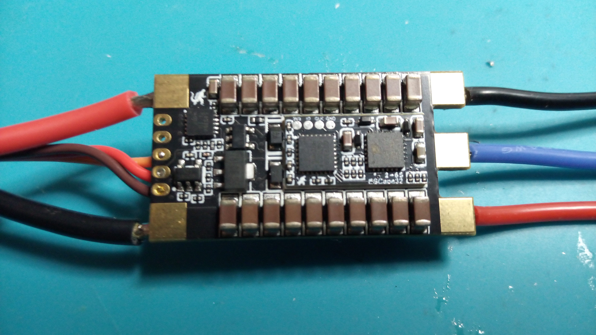

= ESCape32: firmware for a family of small/medium BLDC (and brushed) motor controller (brushless/brushed ESC)
Wilhelm Meier <wilhelm.wm.meier@googlemail.com>
:toc:
:toclevels: 3
:toc-placement!:
:sectnums:
:sectnumlevels: 5
:tip-caption: :bulb:
:note-caption: :information_source:
:important-caption: :heavy_exclamation_mark:
:caution-caption: :fire:
:warning-caption: :warning:

<<../README.adoc#,RC Electronics>> / ESCape32: firmware for a family of small/medium BLDC (and brushed) motor controller (brushless/brushed ESC)

[NOTE]
--
ESCape32 firmware for small/medium BLDC (and brushed) ESCs and my modifications.
--

toc::[]

[caption=""]
.Project info
[cols="1h,5",width="100%"]
|===
| Status | 🟢 active
| Firmware | https://github.com/wimalopaan/ESCape32[wimalopaan/ESCape32] (fork of https://github.com/neoxic/ESCape32[neoxic/ESCape32]), branch https://github.com/wimalopaan/ESCape32/tree/wm_crsf_batt_id[`wm_crsf_batt_id`]
| Upstream | https://github.com/neoxic/ESCape32/pull/40[ESCape32 PR #40] (not merged)
| See also | <<elrs.adoc#elrs-escape32,Flash / set up ESCape32 via ELRS>>, <<building.adoc#build_escape32,Building ESCape32>>
|===

`ESCape32` is a firmware for a family of brushless motor controller sharing a common hardware design (originated in the _BLHeli_-project). 
One of the most outstanding feature of `ESCape32` is the possibility to use a great variety of serial input (SBus(2), CRSF, SumDV3(HoTT), ...) 
and telemetry (CRSF, SBus2, S.Port, HoTT-Telemetry, ...). 
A markable feature is the `Sbus2` protocoll, that combines control and telemetry data via one half-duplex line.

As of version 17 the firmware supports full CRSF protocol. This means that you can configure all parameters of the 
firmware via the handset. Just fire up the ExpressLRS LUA (or TBS Agent), look for the ESC showing up under `Other devices` 
and go into that menu. You'll find all parameters in the menu.

[IMPORTANT]
--
To make use of the CRSF full-duplex be sure to configure the ESC to `input_mode == 5` (CRSF) and `telem_mode == 4` (CRSF)!
--

[WARNING]
--
Please be aware that you need an ESC that has the _input pin_ defined as `PA2` or `PA6` to get a _serial_ input via 
SBus/CRSF/SumDV3/IBUS. Targets with `PB4` (like the popular `SEQURE`) will not work. 

Please refer to https://github.com/neoxic/ESCape32/wiki/Targets[]
--

[WARNING]
--
Please also note that you need an exposed telemetry pin for _full-duplex_ CRSF to get full use of the CRSF-config-protocol.
--

This really simpifies configuration of your setup, especially when all components are built into the model. You 
don't have to pull-out a wire just to connect that to the WiFi-Link (or PC). Instead, all stays installed
and you can modify without even opening your craft.

The project: https://github.com/wimalopaan/ESCape32[ESCape32]

== Sine startup

Link to link:../bldc/escape32/esc.m[Octave code] for calculation.

== Modifications

[TIP]
--
How to compile a modified `ESCape32` is described in <<building.adoc#esc32_mod,Building firmware: ESCape32>>.
--

[[esc32_batt]]
=== Augmented `BATT` telemetry frames (CRSF)

In this PR https://github.com/neoxic/ESCape32/pull/40[] you find a modification of `ESCape32` to produce
_augmented_ `BATT` frames. These frame now carry an additional `id` field. This is used to discriminate different 
`BATT` telemetry frames in the handset. 

If you already want to use this modification, you can use this branch https://github.com/wimalopaan/ESCape32/tree/wm_crsf_batt_id[]
and compile the firmware in a _codespace_: <<building.adoc#esc32_mod,Compile modified `ESCape32` in `github codespace`>>.

For `EdgeTx` you need this PR: <<edgetx.adoc#crsf_batt_id,Enhanced Parser for instance-id augmented CRSF BATT-sensor frames>>.

== Hardware

.ESCape32

The project also defines special hardware targets (please contact me if you have interest).

== Info

I've a mini-series of videos in my YouTube-channel: please check them out!
