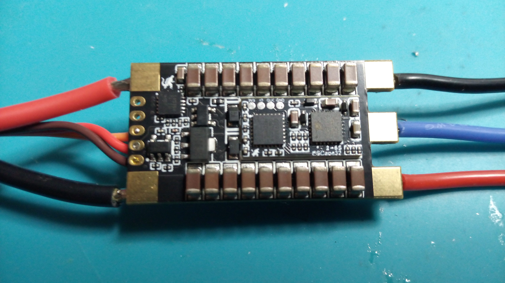

= ESCape32: Firmware für eine Familie kleiner/mittlerer BLDC- und Bürstenmotorregler (bürstenlose/Bürsten-ESCs)
Wilhelm Meier <wilhelm.wm.meier@googlemail.com>
:toc:
:toclevels: 3
:toc-placement!:
:sectnums:
:sectnumlevels: 5
:tip-caption: :bulb:
:note-caption: :information_source:
:important-caption: :heavy_exclamation_mark:
:caution-caption: :fire:
:warning-caption: :warning:
:lang: de
:toc-title: Inhaltsverzeichnis
:figure-caption: Abbildung
:table-caption: Tabelle
:example-caption: Beispiel

<<escape32.adoc#,English>> | *Deutsch*

<<../README.de.adoc#,RC-Elektronik>> / ESCape32: Firmware für eine Familie kleiner/mittlerer BLDC- und Bürstenmotorregler (bürstenlose/Bürsten-ESCs)

[NOTE]
--
ESCape32-Firmware für kleine/mittlere BLDC- und Bürsten-ESCs und meine Änderungen.
--

toc::[]

[caption=""]
.Projektinfo
[cols="1h,5",width="100%"]
|===
| Status | 🟢 aktiv
| Firmware | https://github.com/wimalopaan/ESCape32[wimalopaan/ESCape32] (Fork von https://github.com/neoxic/ESCape32[neoxic/ESCape32]), Branch https://github.com/wimalopaan/ESCape32/tree/wm_crsf_batt_id[`wm_crsf_batt_id`]
| Ursprungsprojekt | https://github.com/neoxic/ESCape32/pull/40[ESCape32 PR #40] (nicht übernommen)
| Video | https://www.youtube.com/watch?v=Ml0HefXdywQ[2026-06-27], https://www.youtube.com/watch?v=faEkrqY5Qcw[2026-06-28], https://www.youtube.com/watch?v=_6bDXWGudbA[2026-07-04], https://www.youtube.com/watch?v=t_e8S7JaIZU[2026-07-07], https://www.youtube.com/watch?v=L-Nj9KezeGk[2026-07-17], https://www.youtube.com/watch?v=WrCTSGZR8j8[2026-07-28], <<videos.de.adoc#v-escape32,alle Videos (7)>>
| Siehe auch | <<elrs.de.adoc#elrs-escape32,ESCape32 über ELRS flashen / einrichten>>, <<building.de.adoc#build_escape32,ESCape32 kompilieren>>
|===

`ESCape32` ist eine Firmware für eine Familie bürstenloser Motorregler mit einem gemeinsamen Hardwaredesign (ursprünglich aus dem _BLHeli_-Projekt). 
Eine der herausragenden Eigenschaften von `ESCape32` ist die Unterstützung zahlreicher serieller Eingangsprotokolle (SBus(2), CRSF, SumDV3(HoTT), ...) 
und Telemetrieprotokolle (CRSF, SBus2, S.Port, HoTT-Telemetrie, ...). 
Besonders erwähnenswert ist das `Sbus2`-Protokoll, das Steuer- und Telemetriedaten über eine einzige Halbduplex-Leitung kombiniert.

Ab Version 17 unterstützt die Firmware das vollständige CRSF-Protokoll. Dadurch können Sie alle Parameter der 
Firmware über den Sender konfigurieren. Starten Sie einfach das ExpressLRS-LUA-Skript (oder TBS Agent), suchen Sie den unter `Other devices` angezeigten ESC 
und öffnen Sie dessen Menü. Dort finden Sie alle Parameter.

[IMPORTANT]
--
Um CRSF im Vollduplex-Modus zu nutzen, konfigurieren Sie den ESC unbedingt mit `input_mode == 5` (CRSF) und `telem_mode == 4` (CRSF)!
--

[WARNING]
--
Beachten Sie, dass Sie für einen _seriellen_ Eingang über 
SBus/CRSF/SumDV3/IBUS einen ESC benötigen, dessen _Eingangspin_ als `PA2` oder `PA6` definiert ist. Targets mit `PB4` (wie das verbreitete `SEQURE`) funktionieren nicht. 

Siehe https://github.com/neoxic/ESCape32/wiki/Targets[]
--

[WARNING]
--
Beachten Sie außerdem, dass Sie für _Vollduplex_-CRSF einen zugänglichen Telemetriepin benötigen, um das CRSF-Konfigurationsprotokoll vollständig nutzen zu können.
--

Das vereinfacht die Konfiguration Ihres Aufbaus erheblich, besonders wenn alle Komponenten im Modell eingebaut sind. Sie 
müssen kein Kabel herausziehen, nur um es mit dem WiFi-Link (oder PC) zu verbinden. Stattdessen bleibt alles eingebaut,
und Sie können Änderungen vornehmen, ohne das Modell überhaupt zu öffnen.

Das Projekt: https://github.com/wimalopaan/ESCape32[ESCape32]

[[_sine_startup]]
== Sinusförmiger Anlauf

Link zum link:../bldc/escape32/esc.m[Octave-Code] für die Berechnung.

[[_modifications]]
== Änderungen

[TIP]
--
Wie Sie ein modifiziertes `ESCape32` kompilieren, ist unter <<building.de.adoc#esc32_mod,Firmware kompilieren: ESCape32>> beschrieben.
--

[[esc32_batt]]
=== Erweiterte `BATT`-Telemetrieframes (CRSF)

In diesem PR https://github.com/neoxic/ESCape32/pull/40[] finden Sie eine Änderung an `ESCape32`, die
_erweiterte_ `BATT`-Frames erzeugt. Diese Frames enthalten nun ein zusätzliches `id`-Feld. Damit lassen sich verschiedene 
`BATT`-Telemetrieframes im Sender unterscheiden. 

Wenn Sie diese Änderung bereits nutzen möchten, können Sie diesen Branch verwenden: https://github.com/wimalopaan/ESCape32/tree/wm_crsf_batt_id[]
und die Firmware in einem _Codespace_ kompilieren: <<building.de.adoc#esc32_mod,Modifiziertes `ESCape32` in einem `github codespace` kompilieren>>.

Für `EdgeTx` benötigen Sie diesen PR: <<edgetx.de.adoc#crsf_batt_id,Erweiterter Parser für CRSF-BATT-Sensorframes mit Instanz-ID>>.

[[_hardware]]
== Hardware

.ESCape32

Das Projekt definiert auch spezielle Hardware-Targets (bei Interesse kontaktieren Sie mich bitte).

[[_info]]
== Informationen

Auf meinem YouTube-Kanal gibt es eine kleine Videoserie: Schauen Sie sie sich gerne an!
