= Actual gear
Wilhelm Meier <wilhelm.wm.meier@googlemail.com>
:toc:
:toclevels: 3
:toc-placement!:
:sectnums:
:sectnumlevels: 5
:tip-caption: :bulb:
:note-caption: :information_source:
:important-caption: :heavy_exclamation_mark:
:caution-caption: :fire:
:warning-caption: :warning:

*English* | <<gear.de.adoc#,Deutsch>>

<<../README.adoc#,RC Electronics>> / Actual gear

[NOTE]
--
My actual RC gear and modifications.
--

toc::[]

In the following chapters you will see my actual gear and the modifications.

== RadioMaster

=== TX16S MK3

My review of the MK3 version: https://www.youtube.com/watch?v=gwQktlNaL68[]

internal ExpressLRS

EdgeTx

=== TX15

internal ExpressLRS

EdgeTx

=== MT12

internal ExpressLRS

EdgeTx

=== TX16S

EdgeTx

hall-sticks

internal 4-in-1

Extensions:

* 2x incremental encoder
** withc µC attiny412
** on top of the handset
** wired in poti-mode to Ext1/Ext2
* stick switches
** encoded by a µC (Attiny1614) inside the handset into FrSky-D telemetry via AUX1
* SWD-connector
** magnetic connector on the bottom of the handset

.TX16S incremental encoder (click to enlarge)
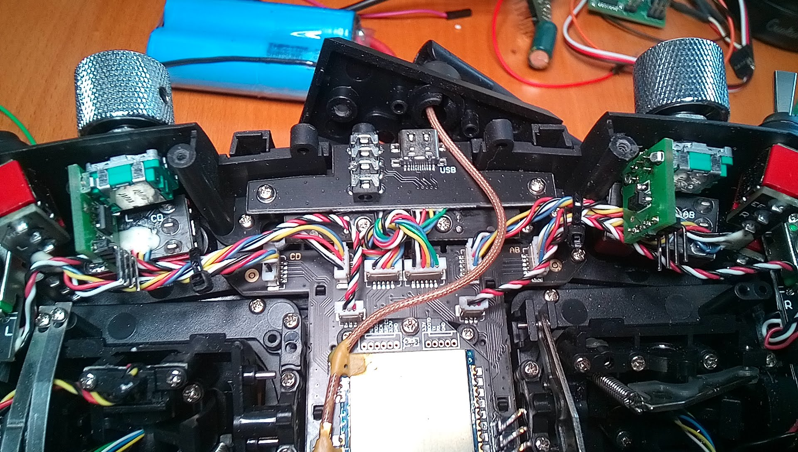

.TX16S SWD magnetic adapter (click to enlarge)
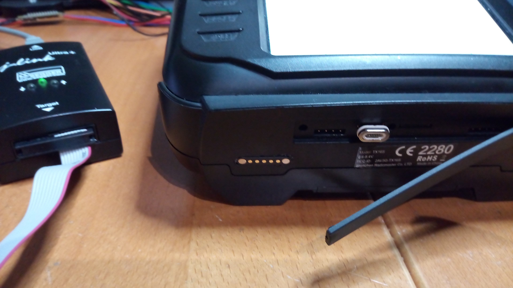

.TX16S desk with space mouse (click to enlarge)
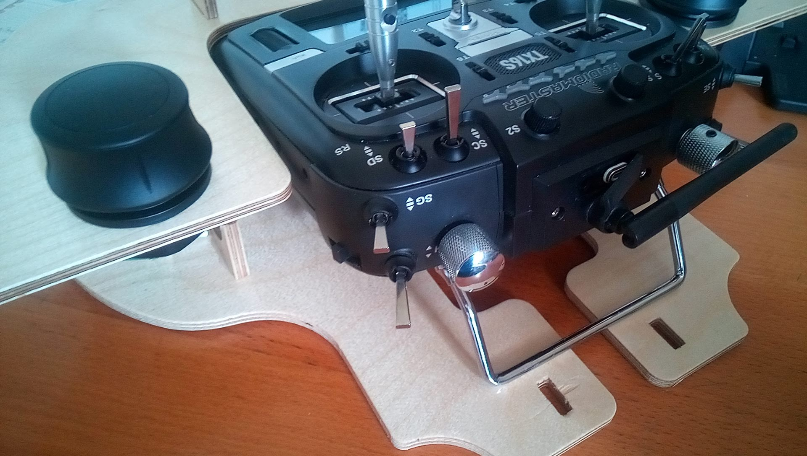

.TX16S desk with space mouse (click to enlarge)
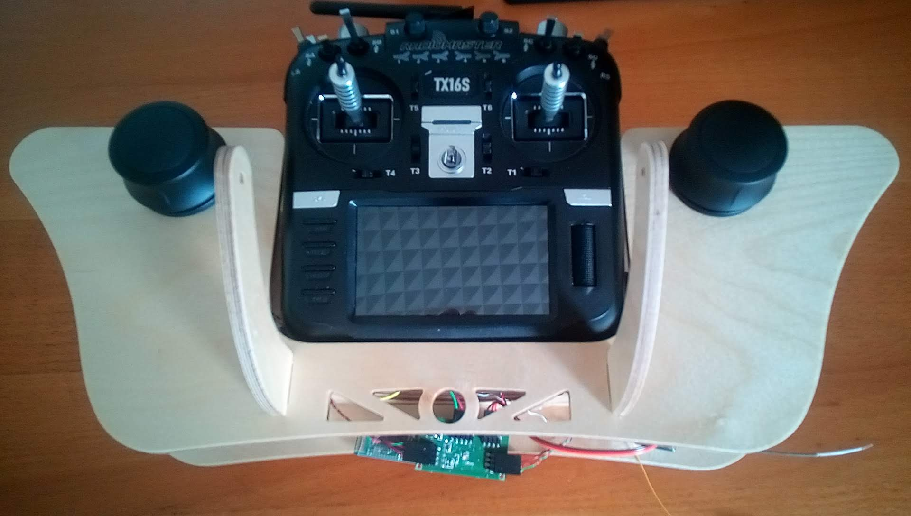

.TX16S stick switches: the attiny1614 inside the radio (click to enlarge)
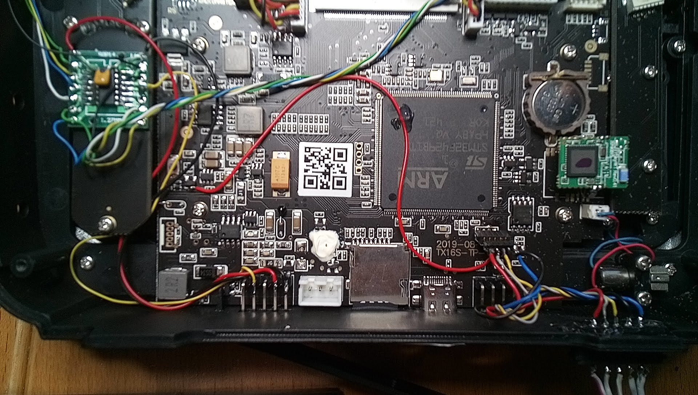

.TX16S stick switches (click to enlarge)
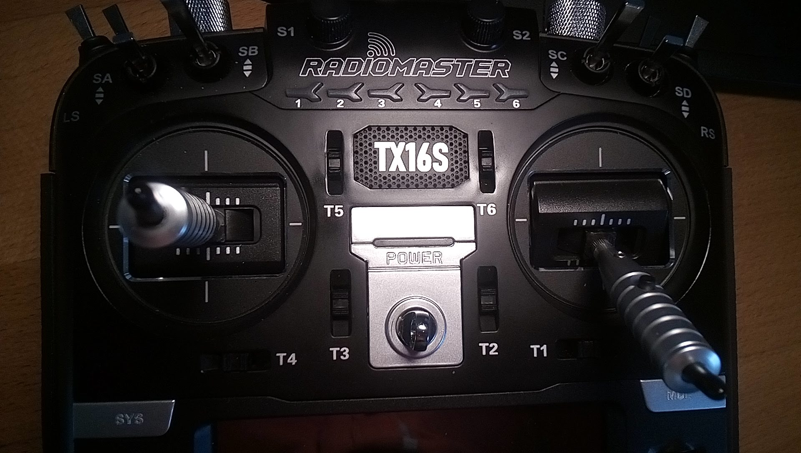

=== Desk for the TX16s

== FlySky

=== FS-i6X

https://github.com/OpenI6X/opentx[OpenI6X]

Modifications:

* External ELRS (rx-as-tx EP2) inside the handset (<<flysky.adoc#elrs_i6x,ELRS for the FlySky-I6X>>)
* SWD-connector 
** magnetic connector on the bottom of the handset
* Make all switches `SA`, `SB`, `SC` and `SD` 3-position 

.Closeup of the magnetic SWD connector (click to enlarge)
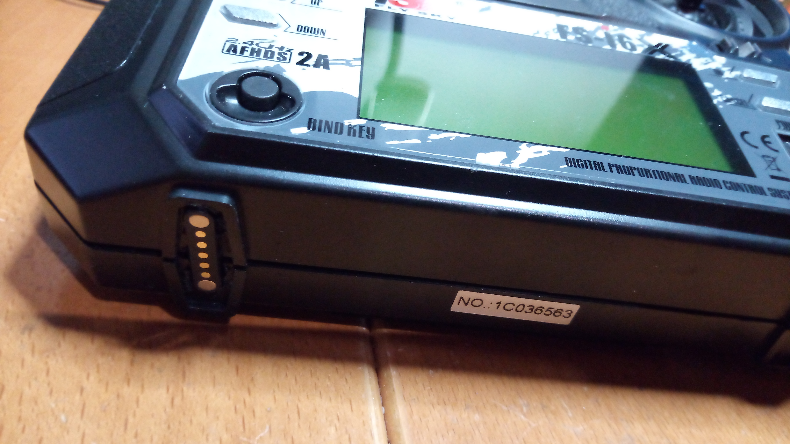

== Jumper

=== T12

EdgeTx

External ELRS (JR-module bay): <<rx-as-tx.adoc#elrs_jr,JR-module-bay adapter for ELRS receiver as transmitter>> 

== FrSky

=== X9e

EdgeTx

External ELRS (JR-module bay)(inside the housing): <<rx-as-tx.adoc#elrs_jr,JR-module-bay adapter for ELRS receiver as transmitter>> 

Modifications:

* AUX1 (P12)
** magnetic connector at the bottom of the handset 

.Closeup of the magnetic serial connector (click to enlarge)
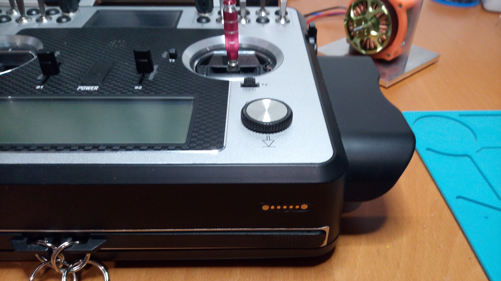

=== X12S

EdgeTx

Modifications:

* touch-screen: <<radio-mods.adoc#x12s_touch,Touch-Screen for the FrSky X12S>>
* internal ELRS: <<rx-as-tx.adoc#elrs_x12s,Adapter for ELRS receiver as internal XJT/ISRM module for FrSky X12S>>
* LiIon accu
* AUX1
** magnetic connector at the bottom of the handset

.Closeup of the magnetic serial connector (click to enlarge)
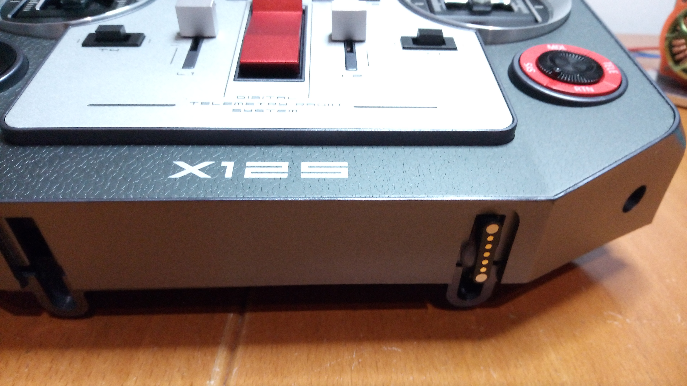

.Serial connection to the desk electronik (click to enlarge)
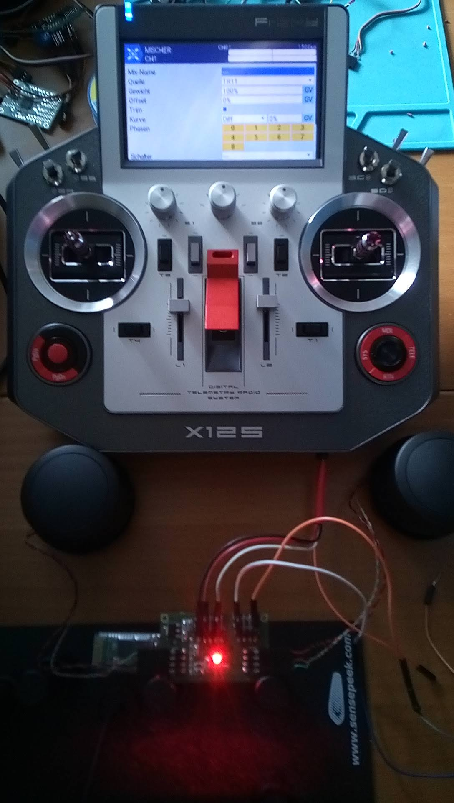

.LiIon-accu (click to enlarge)
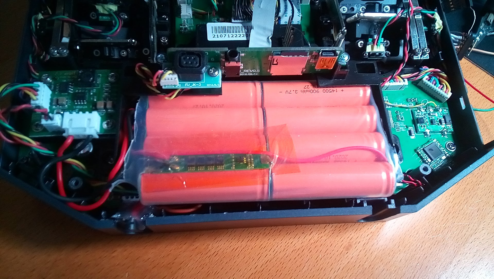

== Graupner/SJ

=== MC-16
