= Aktuelle Ausrüstung
Wilhelm Meier <wilhelm.wm.meier@googlemail.com>
:toc:
:toclevels: 3
:toc-placement!:
:sectnums:
:sectnumlevels: 5
:tip-caption: :bulb:
:note-caption: :information_source:
:important-caption: :heavy_exclamation_mark:
:caution-caption: :fire:
:warning-caption: :warning:
:lang: de
:toc-title: Inhaltsverzeichnis
:figure-caption: Abbildung
:table-caption: Tabelle
:example-caption: Beispiel

<<gear.adoc#,English>> | *Deutsch*

<<../README.de.adoc#,RC-Elektronik>> / Aktuelle Ausrüstung

[NOTE]
--
Meine aktuelle RC-Ausrüstung und Umbauten.
--

toc::[]

In den folgenden Kapiteln stelle ich meine aktuelle Ausrüstung und die daran vorgenommenen Umbauten vor.

[[_radiomaster]]
== RadioMaster

[[_tx16s_mk3]]
=== TX16S MK3

Mein Testbericht zur MK3-Version: https://www.youtube.com/watch?v=gwQktlNaL68[]

Internes ExpressLRS

EdgeTx

[[_tx15]]
=== TX15

Internes ExpressLRS

EdgeTx

[[_mt12]]
=== MT12

Internes ExpressLRS

EdgeTx

[[_tx16s]]
=== TX16S

EdgeTx

Steuerknüppel mit Hall-Sensoren

Internes 4-in-1-Modul

Erweiterungen:

* 2x Inkrementalgeber
** mit µC attiny412
** auf der Oberseite des Senders
** im Potentiometer-Modus an Ext1/Ext2 angeschlossen
* Knüppelschalter
** von einem µC (Attiny1614) im Sender als FrSky-D-Telemetrie über AUX1 codiert
* SWD-Anschluss
** Magnetsteckverbinder an der Unterseite des Senders

.TX16S-Inkrementalgeber (zum Vergrößern anklicken)
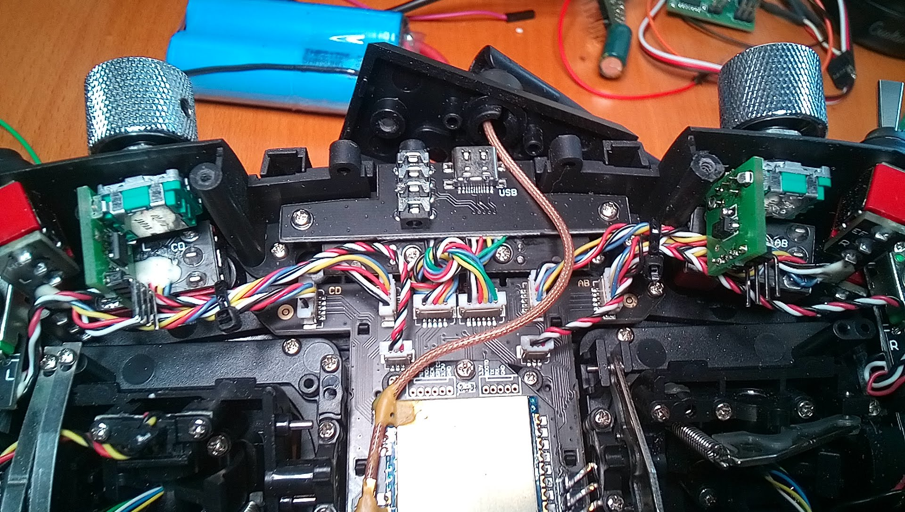

.TX16S-SWD-Magnetadapter (zum Vergrößern anklicken)
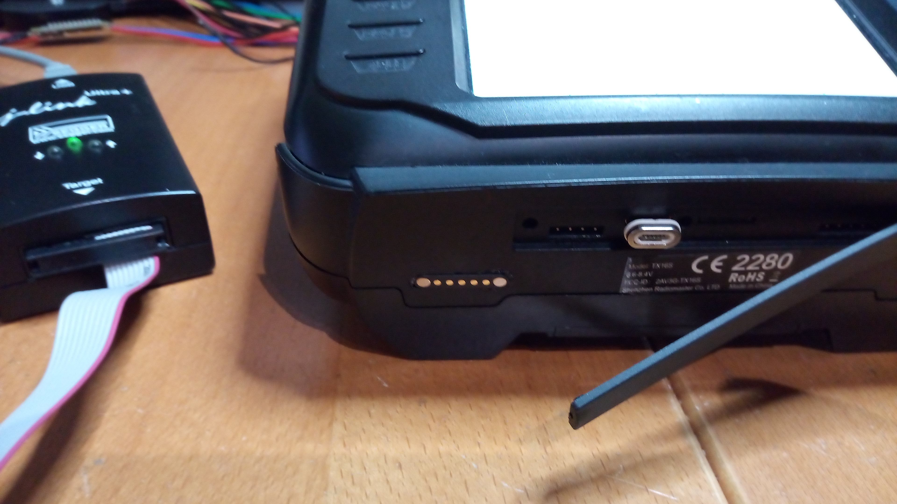

.TX16S-Senderpult mit Space-Mouse (zum Vergrößern anklicken)
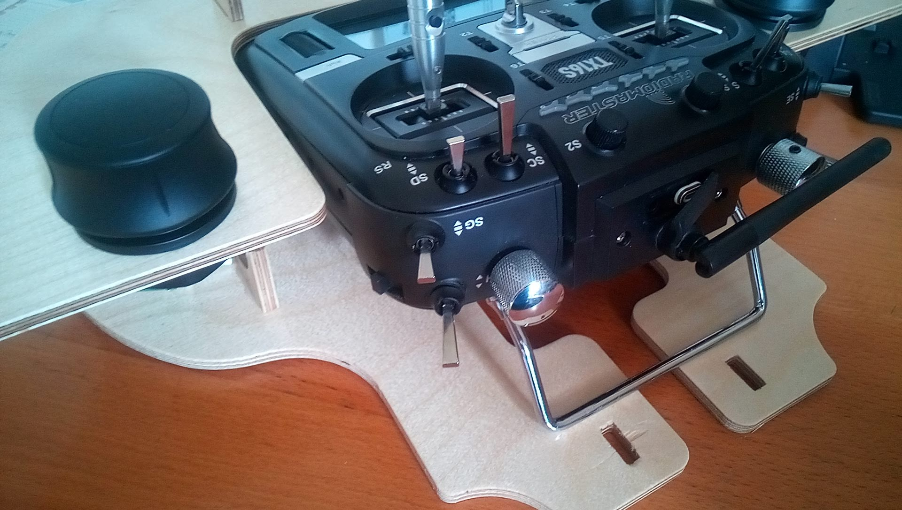

.TX16S-Senderpult mit Space-Mouse (zum Vergrößern anklicken)
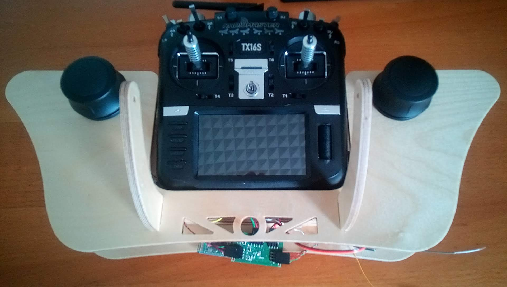

.TX16S-Knüppelschalter: der attiny1614 im Sender (zum Vergrößern anklicken)
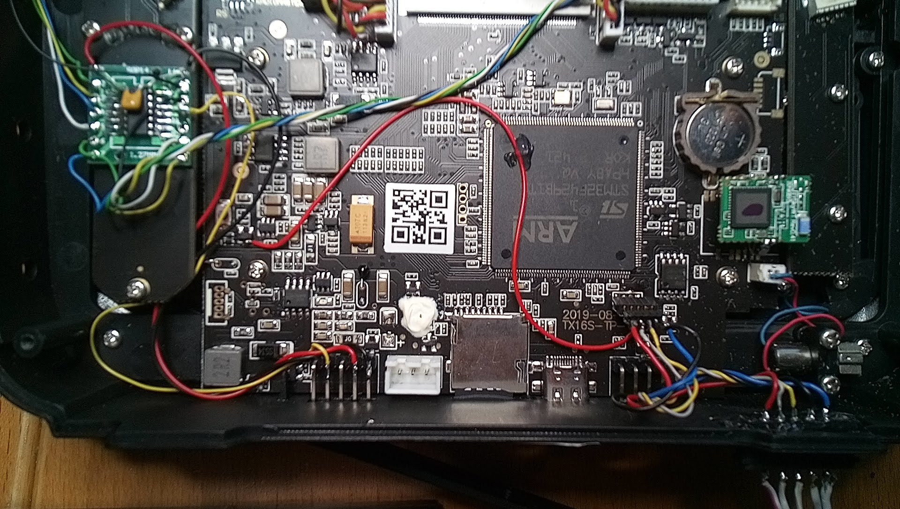

.TX16S-Knüppelschalter (zum Vergrößern anklicken)
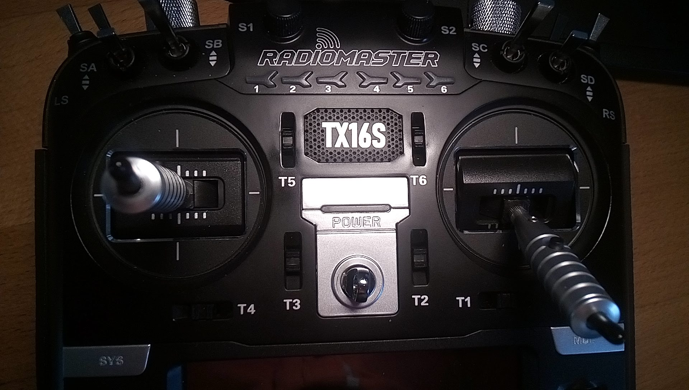

[[_desk_for_the_tx16s]]
=== Senderpult für die TX16s

[[_flysky]]
== FlySky

[[_fs_i6x]]
=== FS-i6X

https://github.com/OpenI6X/opentx[OpenI6X]

Umbauten:

* Externes ELRS (rx-as-tx EP2) im Sender (<<flysky.de.adoc#elrs_i6x,ELRS für die FlySky-I6X>>)
* SWD-Anschluss 
** Magnetsteckverbinder an der Unterseite des Senders
* Alle Schalter `SA`, `SB`, `SC` und `SD` auf drei Schaltstellungen umbauen 

.Nahaufnahme des SWD-Magnetsteckverbinders (zum Vergrößern anklicken)
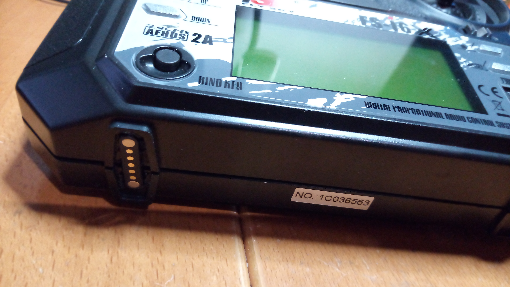

[[_jumper]]
== Jumper

[[_t12]]
=== T12

EdgeTx

Externes ELRS (JR-Modulschacht): <<rx-as-tx.de.adoc#elrs_jr,JR-Modulschachtadapter für ELRS-Empfänger als Sender>> 

[[_frsky]]
== FrSky

[[_x9e]]
=== X9e

EdgeTx

Externes ELRS (JR-Modulschacht)(im Gehäuse): <<rx-as-tx.de.adoc#elrs_jr,JR-Modulschachtadapter für ELRS-Empfänger als Sender>> 

Umbauten:

* AUX1 (P12)
** Magnetsteckverbinder an der Unterseite des Senders 

.Nahaufnahme des seriellen Magnetsteckverbinders (zum Vergrößern anklicken)
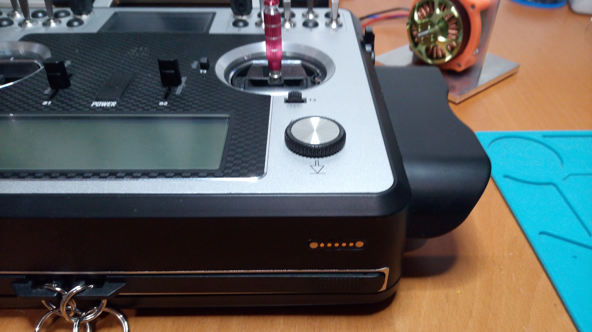

[[_x12s]]
=== X12S

EdgeTx

Umbauten:

* Touchscreen: <<radio-mods.de.adoc#x12s_touch,Touchscreen für die FrSky X12S>>
* Internes ELRS: <<rx-as-tx.de.adoc#elrs_x12s,Adapter für ELRS-Empfänger als internes XJT/ISRM-Modul für die FrSky X12S>>
* LiIon-Akku
* AUX1
** Magnetsteckverbinder an der Unterseite des Senders

.Nahaufnahme des seriellen Magnetsteckverbinders (zum Vergrößern anklicken)
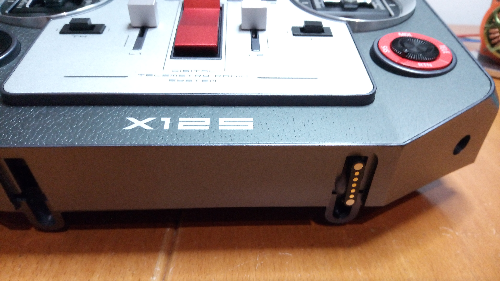

.Serielle Verbindung zur Senderpult-Elektronik (zum Vergrößern anklicken)
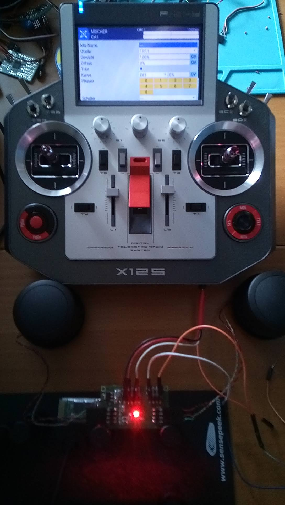

.LiIon-Akku (zum Vergrößern anklicken)
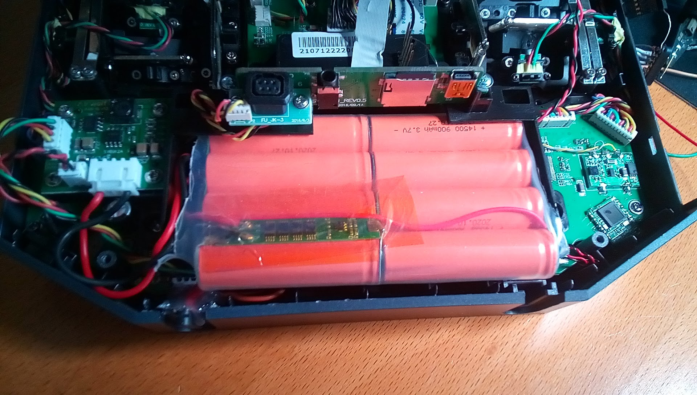

[[_graupnersj]]
== Graupner/SJ

[[_mc_16]]
=== MC-16
