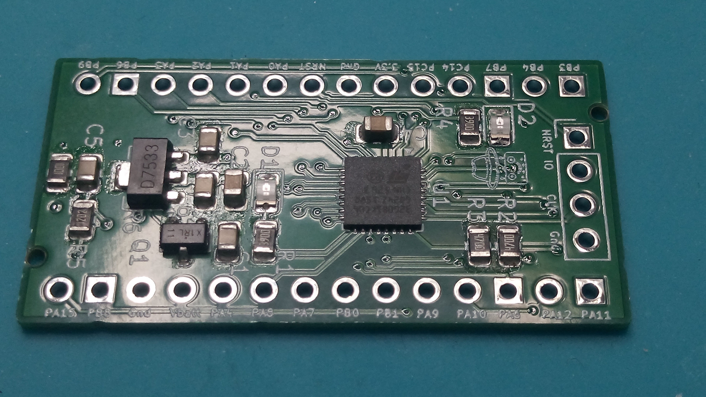

= Miscellaneous projects
Wilhelm Meier <wilhelm.wm.meier@googlemail.com>
:toc:
:toclevels: 3
:toc-placement!:
:sectnums:
:sectnumlevels: 5
:tip-caption: :bulb:
:note-caption: :information_source:
:important-caption: :heavy_exclamation_mark:
:caution-caption: :fire:
:warning-caption: :warning:

<<../README.adoc#,RC Electronics>> / Miscellaneous projects

[NOTE]
--
STM32G0B1 development board, simple main power switch.
--

toc::[]

[[devg0b1]]
== WM STM32G0B1 development board

[[devg0b1img]]
.The WM STM32G0B1 (click to enlarge)  

The https://de.aliexpress.com/item/1005005748198584.html[WeAct STM32G031F8] is used for some of he here described projects. Although it is a 
nice dev-board for all kind of (small) projects, it has its limitations:

* limited RAM (8k), limited flash (64k)
* supply voltage limited to 5V (absolute max. 6V)
* using button disables SWD (one has to use connect-under-reset)
* only one LED
* unflexible pin assignment due to small µC-package

The alternate STM32G0B1 (or G051 and G071) dev-board alleviates these burdens.

* extended PCB, but still compatible with WeAct STM32G031
* 144k RAM, 128/512k flash
* supply up to 20V
* two LEDs
* JST-GH connector (CRSF)
* voltage devider for ADC to measure supply voltage

You can find the board here: https://github.com/wimalopaan/Electronics/tree/main/hardware/wmg0b1[]

== Simple RC main power latched switch

In the old days there was this simple project: https://github.com/wimalopaan/Electronics/blob/main/Old.adoc#diy-rc-hauptschalter[main switch]. 
Please follow the preceeding link to get the documentation (unfortunately only in german, don't have the time to translated all documents). 

If you want to build this board, the link:../rc/boards/onoff_simple.T3001[Target3001] design file may be of interest.
