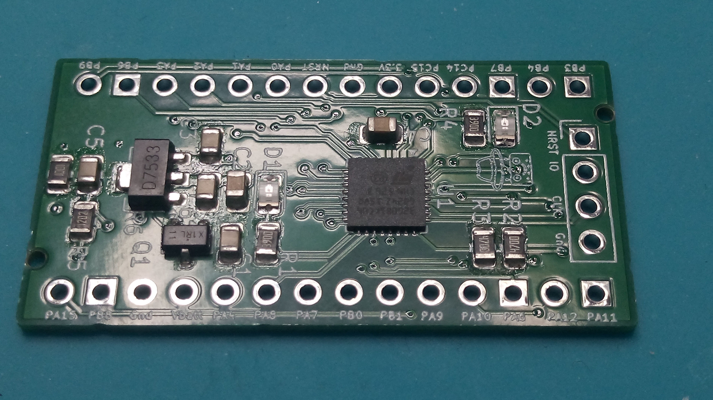

= Verschiedene Projekte
Wilhelm Meier <wilhelm.wm.meier@googlemail.com>
:toc:
:toclevels: 3
:toc-placement!:
:sectnums:
:sectnumlevels: 5
:tip-caption: :bulb:
:note-caption: :information_source:
:important-caption: :heavy_exclamation_mark:
:caution-caption: :fire:
:warning-caption: :warning:
:lang: de
:toc-title: Inhaltsverzeichnis
:figure-caption: Abbildung
:table-caption: Tabelle
:example-caption: Beispiel

<<misc.adoc#,English>> | *Deutsch*

<<../README.de.adoc#,RC-Elektronik>> / Verschiedene Projekte

[NOTE]
--
STM32G0B1-Entwicklungsplatine, einfacher Hauptschalter.
--

toc::[]

[[devg0b1]]
== WM STM32G0B1-Entwicklungsplatine

[caption=""]
.Projektinfo
[cols="1h,5",width="100%"]
|===
| Status | 🔵 stabil
| Hardware | https://github.com/wimalopaan/Electronics/tree/main/hardware/wmg0b1[`hardware/wmg0b1`]
| Firmware | https://github.com/wimalopaan/wmucpp/tree/master/boards/WmG0B1[wmucpp: `boards/WmG0B1`]
| Video | https://www.youtube.com/watch?v=sgfcfx7HFlQ[2025-12-21], <<videos.de.adoc#v-devg0b1,alle Videos (1)>>
|===

[[devg0b1img]]
.Der WM STM32G0B1 (zum Vergrößern anklicken)  

Der https://de.aliexpress.com/item/1005005748198584.html[WeAct STM32G031F8] wird für einige der hier beschriebenen Projekte verwendet. Obwohl er eine
schöne Entwicklungsplatine für allerlei (kleine) Projekte ist, hat er seine Einschränkungen:

* begrenzter RAM (8k), begrenzter Flash (64k)
* Versorgungsspannung auf 5V begrenzt (absolutes Maximum 6V)
* die Verwendung des Tasters deaktiviert SWD (man muss „connect-under-reset“ verwenden)
* nur eine LED
* unflexible Pinbelegung aufgrund des kleinen µC-Gehäuses

Die alternative STM32G0B1-Entwicklungsplatine (oder G051 und G071) mildert diese Einschränkungen.

* erweiterte Platine, aber weiterhin kompatibel mit WeAct STM32G031
* 144k RAM, 128/512k Flash
* Versorgung bis zu 20V
* zwei LEDs
* JST-GH-Steckverbinder (CRSF)
* Spannungsteiler für den ADC zur Messung der Versorgungsspannung

Die Platine ist hier zu finden: https://github.com/wimalopaan/Electronics/tree/main/hardware/wmg0b1[]

[[_simple_rc_main_power_latched_switch]]
== Einfacher selbsthaltender RC-Hauptschalter

[caption=""]
.Projektinfo
[cols="1h,5",width="100%"]
|===
| Status | 🔵 stabil
| Hardware | link:../rc/boards/onoff_simple.T3001[TARGET 3001!]
| Siehe auch | https://github.com/wimalopaan/Electronics/blob/main/Old.adoc#diy-rc-hauptschalter[DIY RC-Hauptschalter (Old.adoc)]
|===

Früher gab es dieses einfache Projekt: https://github.com/wimalopaan/Electronics/blob/main/Old.adoc#diy-rc-hauptschalter[Hauptschalter].
Bitte dem vorstehenden Link zur Dokumentation folgen (leider nur auf Deutsch; mir fehlt die Zeit, alle Dokumente zu übersetzen).

Wer diese Platine bauen möchte, dürfte an der link:../rc/boards/onoff_simple.T3001[Target3001]-Entwurfsdatei interessiert sein.
