= Motor controllers
Wilhelm Meier <wilhelm.wm.meier@googlemail.com>
:toc:
:toclevels: 3
:toc-placement!:
:sectnums:
:sectnumlevels: 5
:tip-caption: :bulb:
:note-caption: :information_source:
:important-caption: :heavy_exclamation_mark:
:caution-caption: :fire:
:warning-caption: :warning:

<<../README.adoc#,RC Electronics>> / Motor controllers

[NOTE]
--
Brushed DC-motor controller and V/ESC.
--

toc::[]

== Brushed DC-motor controller with sensorless measurement of rotational speed

[caption=""]
.Project info
[cols="1h,5",width="100%"]
|===
| Status | 🟡 experimental
| Hardware | link:../bdc/BDC_ESC_G431_02.T3001[V1], link:../bdc/BDC_ESC_mC_Module_01.T3001[V2 µC module], link:../bdc/BDC_ESC_PWR_Module_01.T3001[V2 power module] (TARGET 3001!)
| Firmware | https://github.com/wimalopaan/wmucpp/tree/master/boards/rcBdc[wmucpp: `boards/rcBdc`]
|===

Features:

* SBus(2)/IBus/SumDV3 serial input
* SBus2/S.Port/IBus/Hott telemetry
* PPM-Input
* serial terminal configuration interface
* telemetry
** supply voltage
** motor current
** motor temperature (sensor needed)
** motor rotational speed (*no* sensor)

=== Rotational speed measurement

A bit of theory ...

tbd

=== Version 1: max. 8A / 36V

The smaller one of the two versions comes as one _pcb_.

[[bdc_S_sch]]
==== Schematic and PCB

.Schematic (Version 1) (click to enlarge)
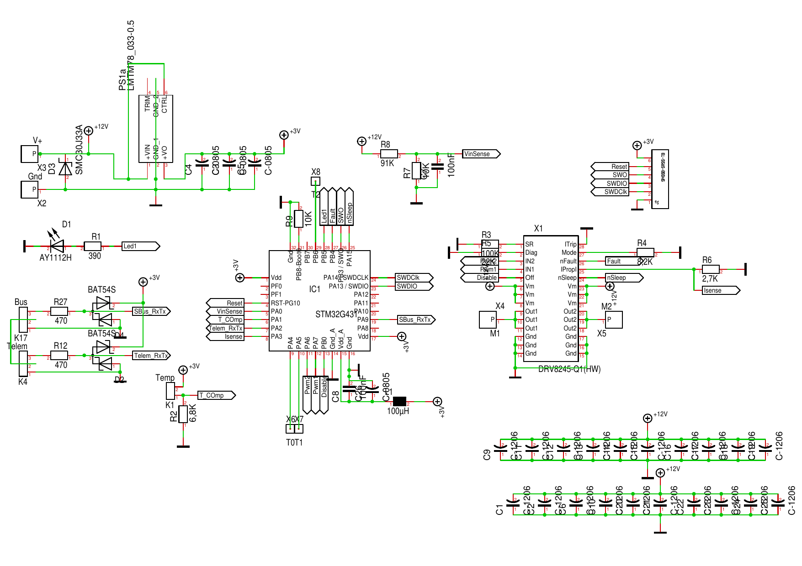

.PCB (Version 1) (click to enlarge)
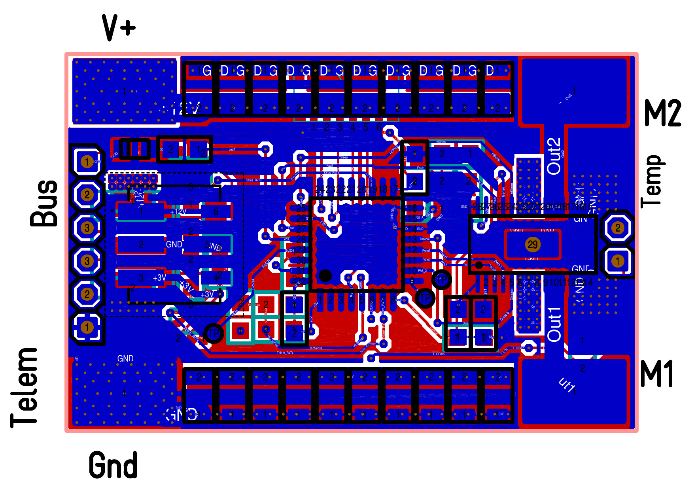

If you use _Target 3001_ as your EDA: link:../bdc/BDC_ESC_G431_02.T3001[Target 3001 design file].

==== Images

.BDC (Version 1) (click to enlarge)
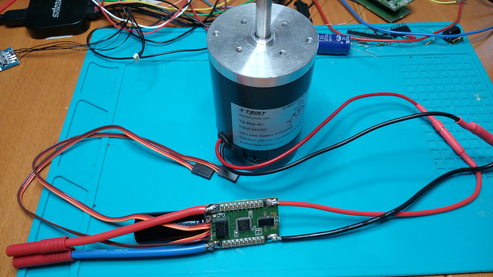

.BDC (Version 1) (click to enlarge)
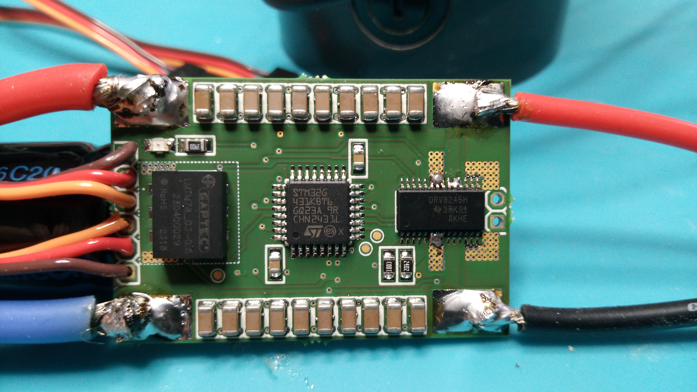

.BDC (Version 1) (click to enlarge)
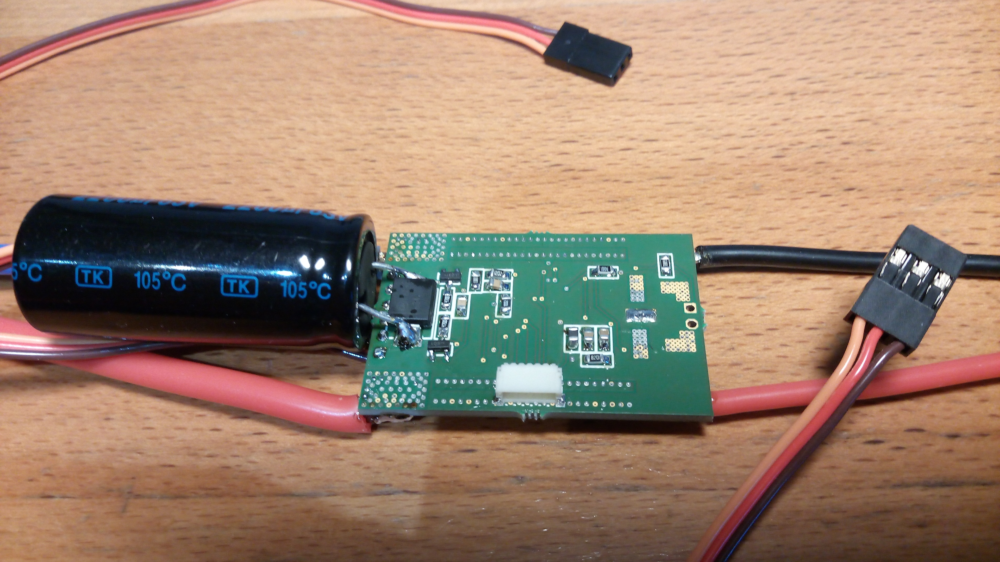

.BDC (Version 1) (click to enlarge)
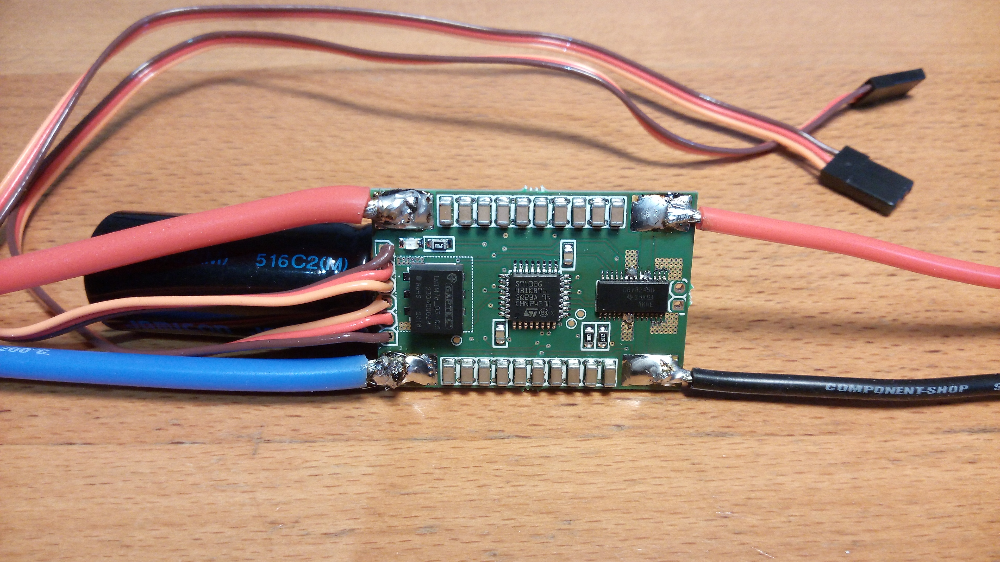

=== Version 2: max. 50A / 36V

The bigger one of the two versions consists of two pcbs, one pcb for the µC module and one pcb for the power module.
Both are connected via two pin-header or the can be soldered directly back-to-back with one layer of capton-tape in between.

==== µC module

.Schematic µC module (Version 1) (click to enlarge)
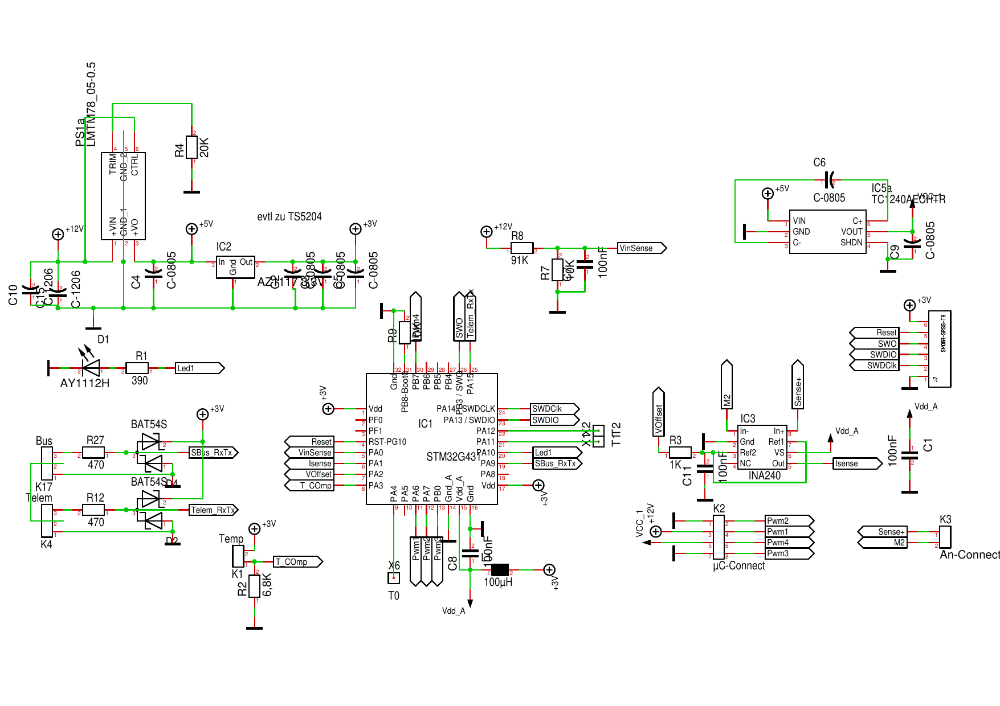

.PCB µC module (Version 1) (click to enlarge)
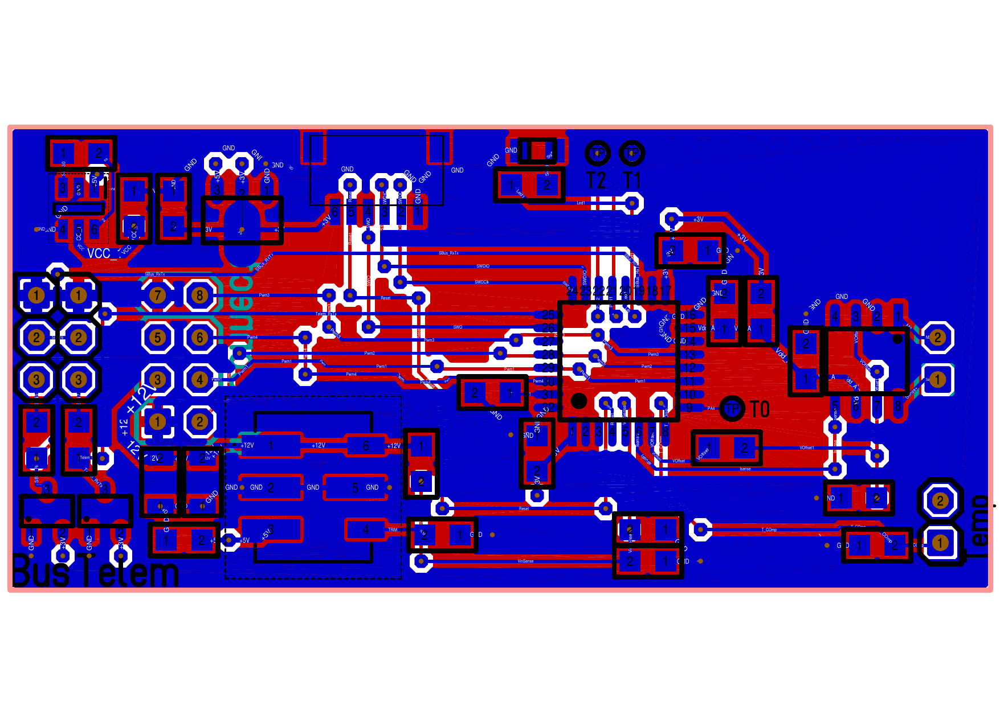

If you use _Target 3001_ as your EDA: link:../bdc/BDC_ESC_mC_Module_01.T3001[Target 3001 design file].

==== Power module

.Schematic power module (Version 1) (click to enlarge)
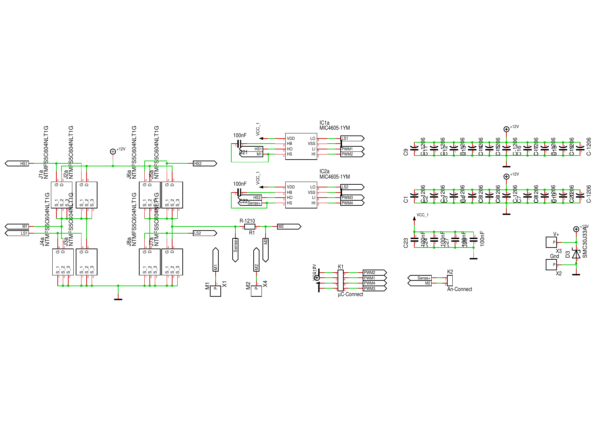

.PCB power module (Version 1) (click to enlarge)
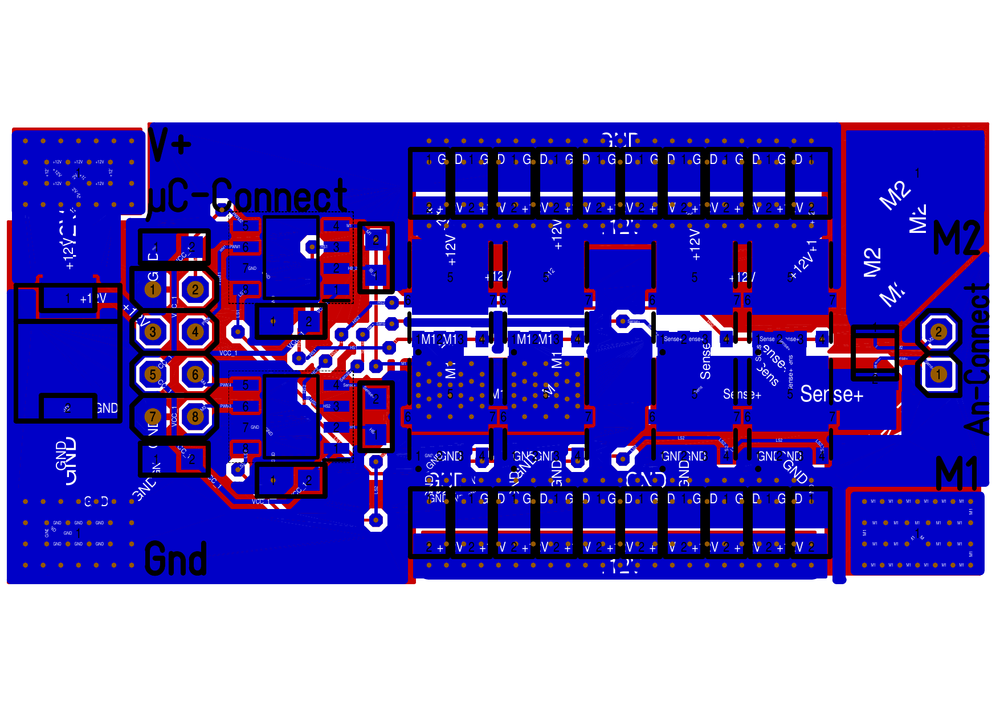

If you use _Target 3001_ as your EDA: link:../bdc/BDC_ESC_PWR_Module_01.T3001[Target 3001 design file].

==== Images

.BDC (Version 2) (click to enlarge)
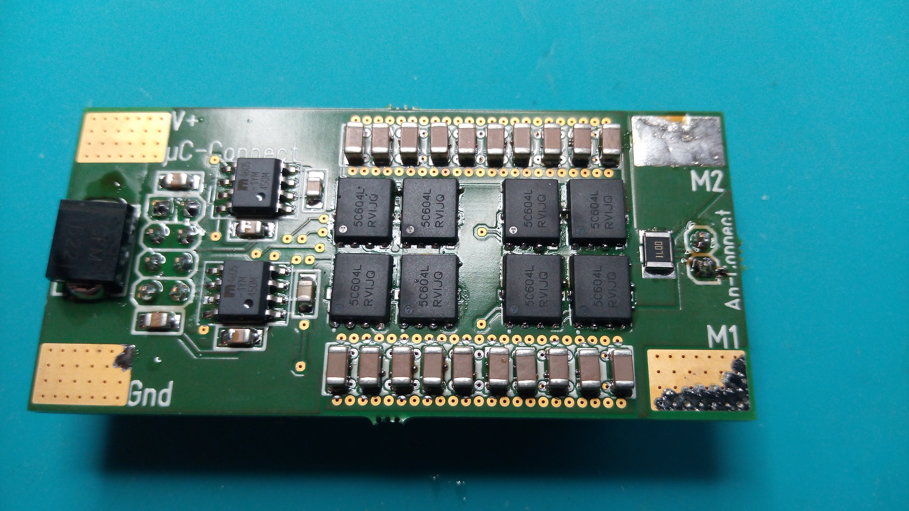

.BDC (Version 2) (click to enlarge)
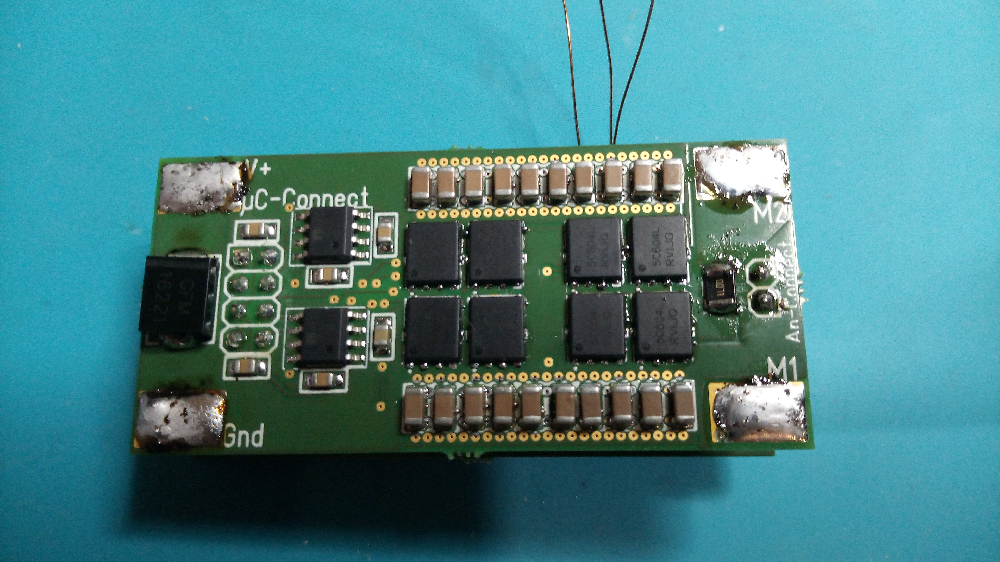

.BDC (Version 2) (click to enlarge)
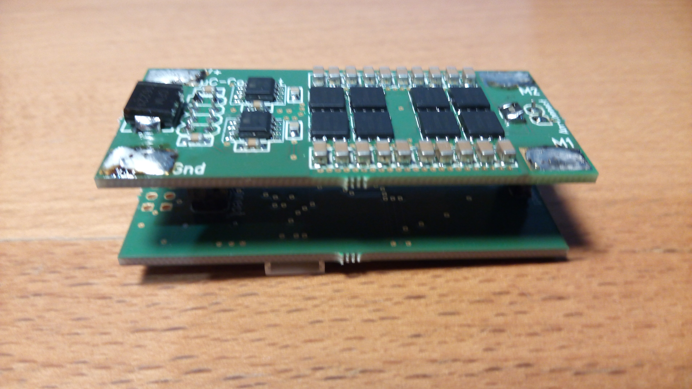

.BDC (Version 2) (click to enlarge)
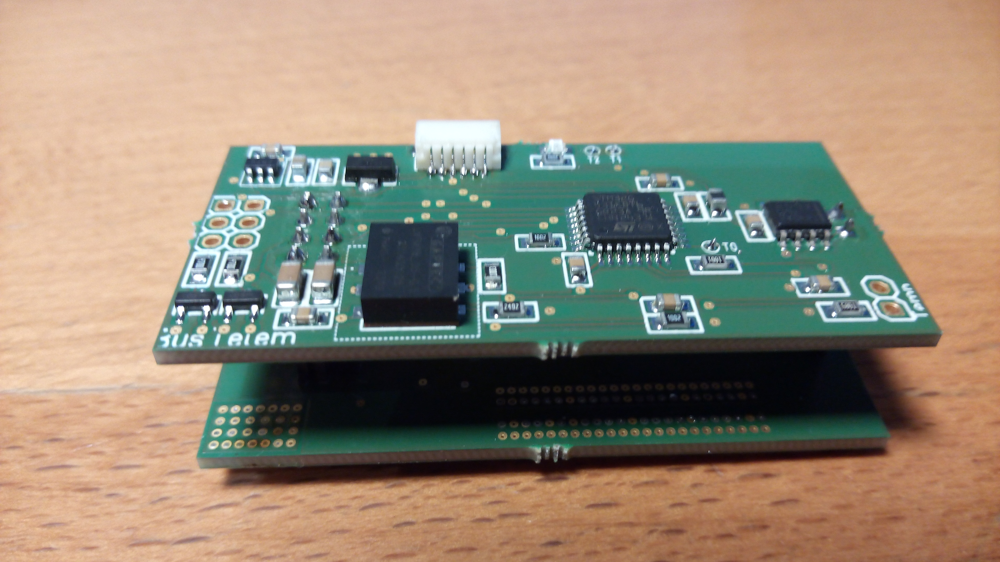

[[vesc]]
== V/ESC: the ultimate firmware for medium/big BLDC motor controller (brushless ESC)

[caption=""]
.Project info
[cols="1h,5",width="100%"]
|===
| Status | 🟢 active
| Firmware | https://github.com/wimalopaan/bldc/tree/master[wimalopaan/bldc]
|===

Clearly, _V/ESC_ is the king. The firmware provides sensorless FOC, that gives us full torque from *zero* RPM and silent motor 
operation. This comes together with an incredible configuration software.

Unfortunately the `V/ESC` project has only an analog PPM input, but no SBUS/IBUS/SumDv3 serial input. 

This modification introduces a serial, half-duplex connection using the V/ESC serial commands for the FlipSky hardware:

Half-Duplex Modification https://github.com/wimalopaan/bldc/tree/master[VESC]
