= Motorregler
Wilhelm Meier <wilhelm.wm.meier@googlemail.com>
:toc:
:toclevels: 3
:toc-placement!:
:sectnums:
:sectnumlevels: 5
:tip-caption: :bulb:
:note-caption: :information_source:
:important-caption: :heavy_exclamation_mark:
:caution-caption: :fire:
:warning-caption: :warning:
:lang: de
:toc-title: Inhaltsverzeichnis
:figure-caption: Abbildung
:table-caption: Tabelle
:example-caption: Beispiel

<<motor-controllers.adoc#,English>> | *Deutsch*

<<../README.de.adoc#,RC-Elektronik>> / Motorregler

[NOTE]
--
Bürsten-Gleichstrommotorregler und V/ESC.
--

toc::[]

[[_brushed_dc_motor_controller_with_sensorless_measurement_of_rotational_speed]]
== Bürsten-Gleichstrommotorregler mit sensorloser Drehzahlmessung

[[brushed_dc]]
[caption=""]
.Projektinfo
[cols="1h,5",width="100%"]
|===
| Status | 🟡 experimentell
| Hardware | link:../bdc/BDC_ESC_G431_02.T3001[V1], link:../bdc/BDC_ESC_mC_Module_01.T3001[V2 µC-Modul], link:../bdc/BDC_ESC_PWR_Module_01.T3001[V2 Leistungsmodul] (TARGET 3001!)
| Firmware | https://github.com/wimalopaan/wmucpp/tree/master/boards/rcBdc[wmucpp: `boards/rcBdc`]
| Video | https://www.youtube.com/watch?v=-AuSsFyT9KE[2024-06-17], https://www.youtube.com/watch?v=pSujc2e9Vw8[2024-08-15], https://www.youtube.com/watch?v=01CGYFpl2ts[2024-09-11], https://www.youtube.com/watch?v=bP0L_lYn8nw[2024-10-02], <<videos.de.adoc#v-brushed,alle Videos (4)>>
|===

Funktionen:

* serieller SBus(2)/IBus/SumDV3-Eingang
* SBus2/S.Port/IBus/Hott-Telemetrie
* PPM-Eingang
* Konfigurationsschnittstelle über ein serielles Terminal
* Telemetrie
** Versorgungsspannung
** Motorstrom
** Motortemperatur (Sensor erforderlich)
** Motordrehzahl (*kein* Sensor)

[[_rotational_speed_measurement]]
=== Drehzahlmessung

Ein wenig Theorie ...

Noch auszuarbeiten

[[_version_1_max_8a_36v]]
=== Version 1: max. 8A / 36V

Die kleinere der beiden Versionen besteht aus einer _Platine_.

[[bdc_S_sch]]
==== Schaltplan und Platine

.Schaltplan (Version 1) (zum Vergrößern anklicken)
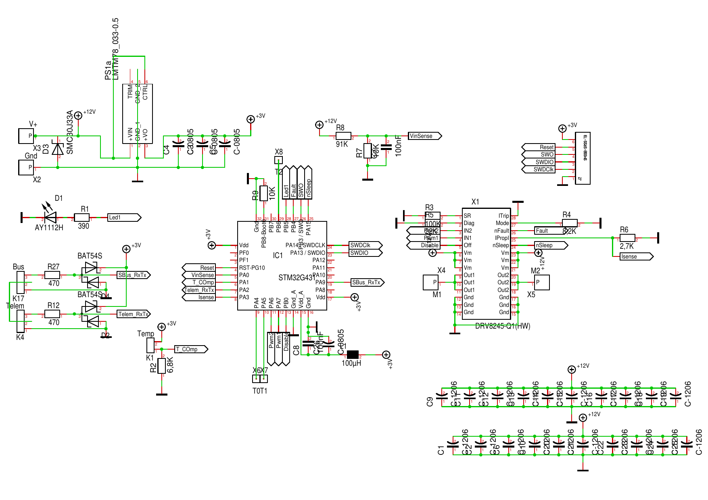

.Platine (Version 1) (zum Vergrößern anklicken)
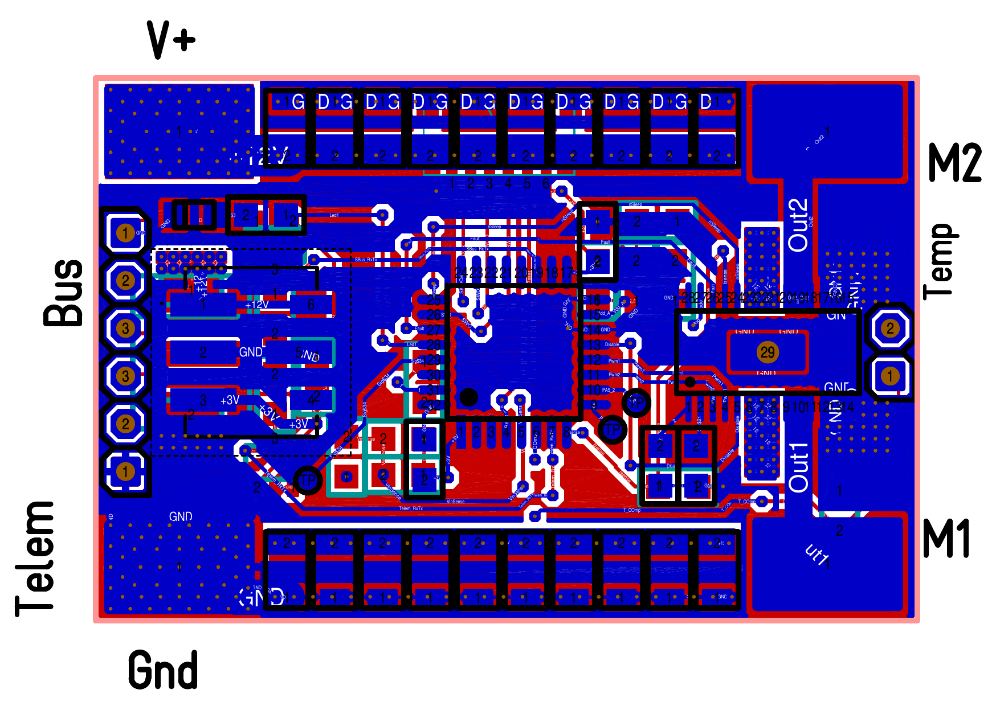

Wer _Target 3001_ als EDA-Software verwendet: link:../bdc/BDC_ESC_G431_02.T3001[Target 3001-Entwurfsdatei].

[[_images]]
==== Bilder

.BDC (Version 1) (zum Vergrößern anklicken)
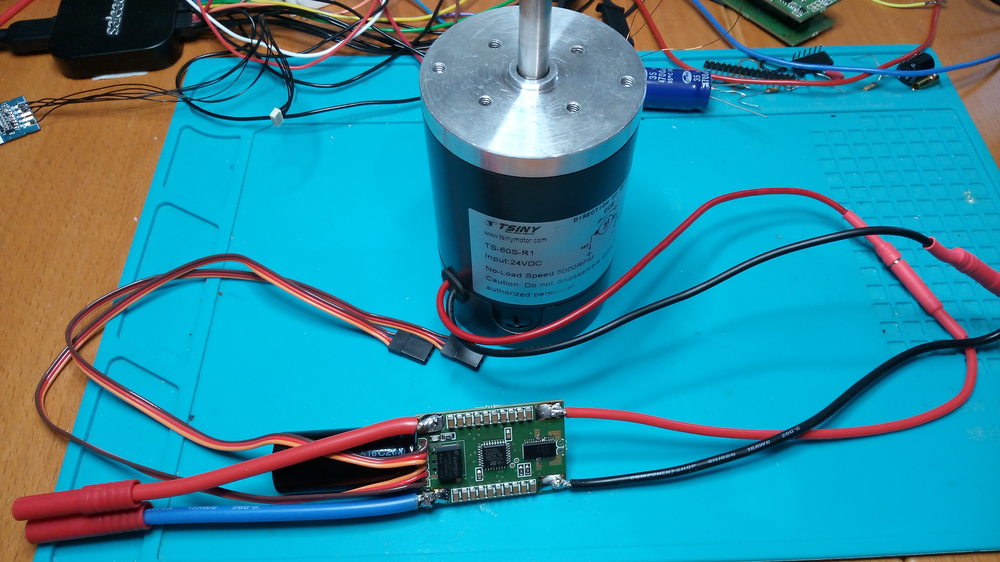

.BDC (Version 1) (zum Vergrößern anklicken)
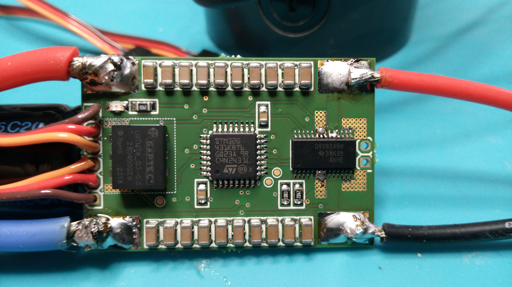

.BDC (Version 1) (zum Vergrößern anklicken)
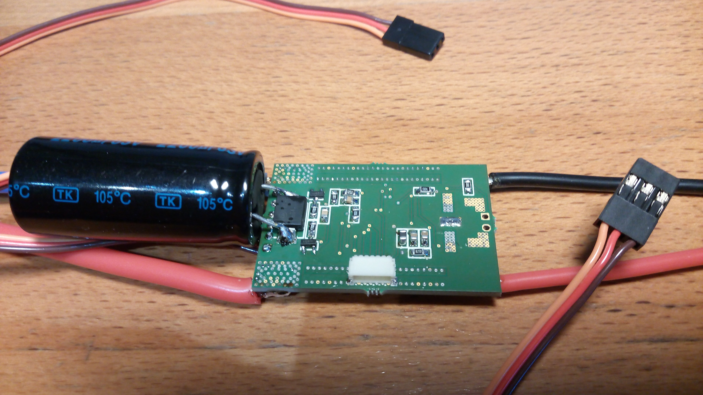

.BDC (Version 1) (zum Vergrößern anklicken)
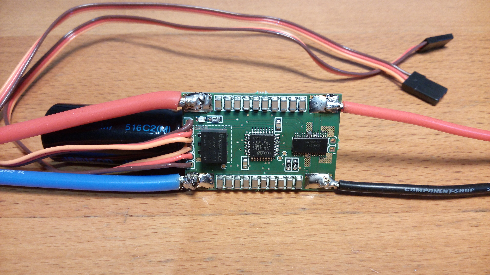

[[_version_2_max_50a_36v]]
=== Version 2: max. 50A / 36V

Die größere der beiden Versionen besteht aus zwei Platinen, einer für das µC-Modul und einer für das Leistungsmodul.
Beide werden über zwei Stiftleisten verbunden oder können mit einer Lage Kapton-Klebeband dazwischen direkt Rücken an Rücken verlötet werden.

[[_µc_module]]
==== µC-Modul

.Schaltplan des µC-Moduls (Version 1) (zum Vergrößern anklicken)
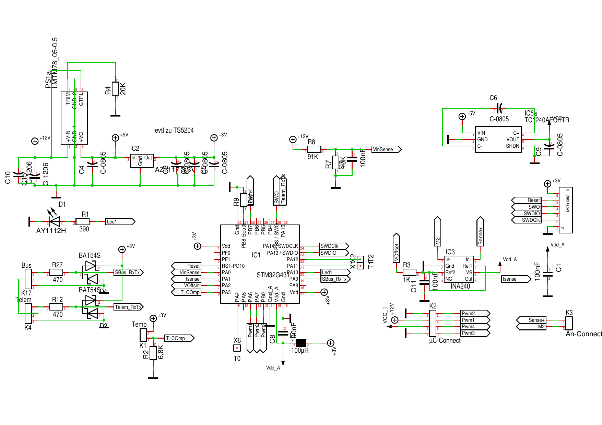

.Platine des µC-Moduls (Version 1) (zum Vergrößern anklicken)
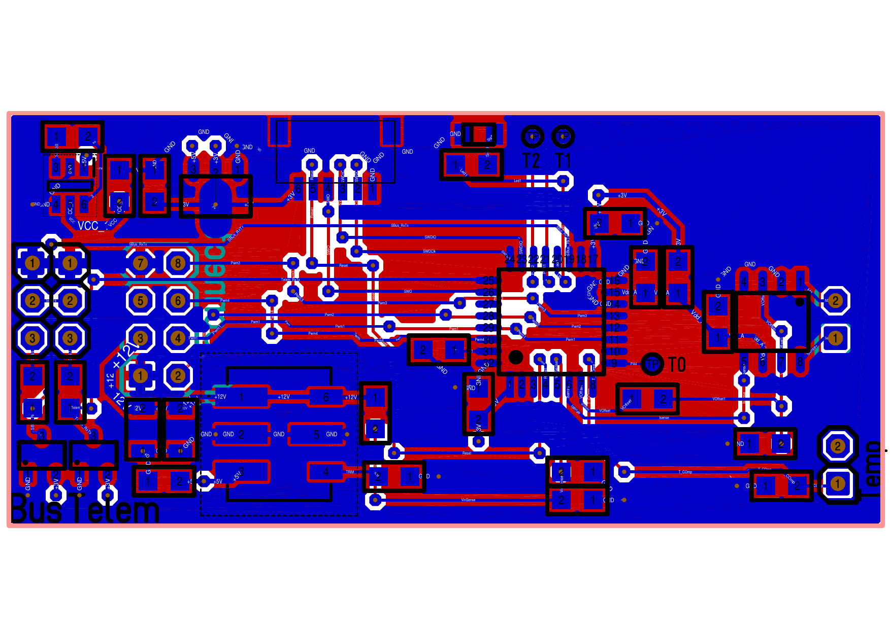

Wer _Target 3001_ als EDA-Software verwendet: link:../bdc/BDC_ESC_mC_Module_01.T3001[Target 3001-Entwurfsdatei].

[[_power_module]]
==== Leistungsmodul

.Schaltplan des Leistungsmoduls (Version 1) (zum Vergrößern anklicken)
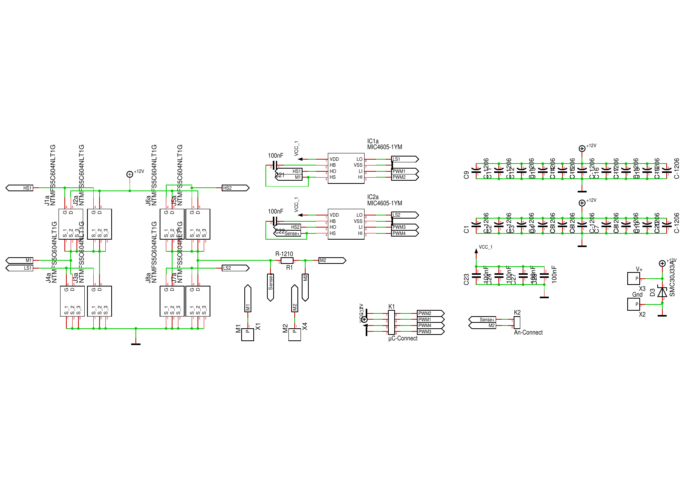

.Platine des Leistungsmoduls (Version 1) (zum Vergrößern anklicken)
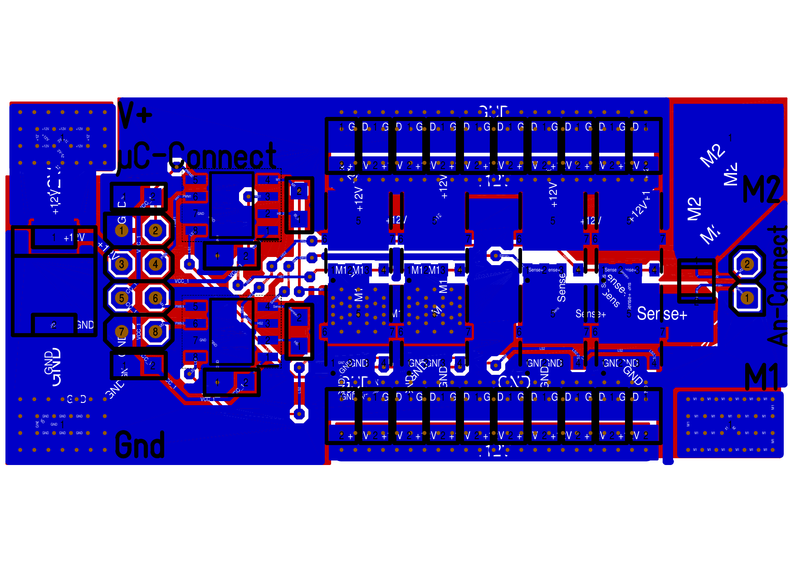

Wer _Target 3001_ als EDA-Software verwendet: link:../bdc/BDC_ESC_PWR_Module_01.T3001[Target 3001-Entwurfsdatei].

[[_images_2]]
==== Bilder

.BDC (Version 2) (zum Vergrößern anklicken)
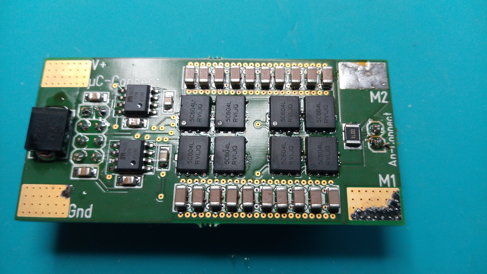

.BDC (Version 2) (zum Vergrößern anklicken)
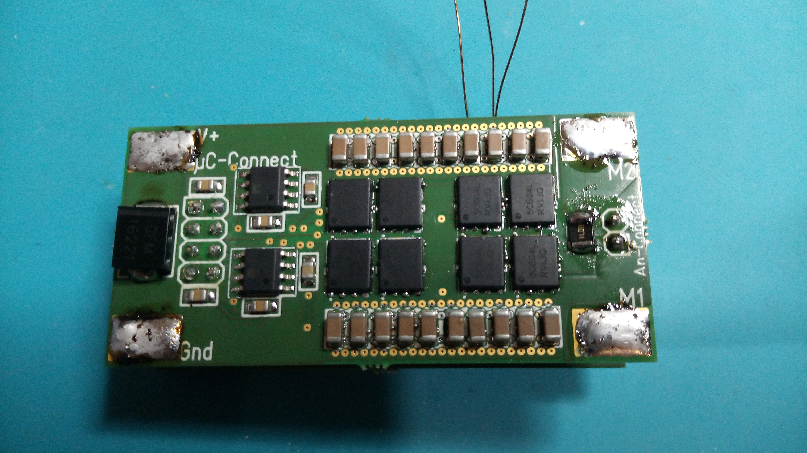

.BDC (Version 2) (zum Vergrößern anklicken)
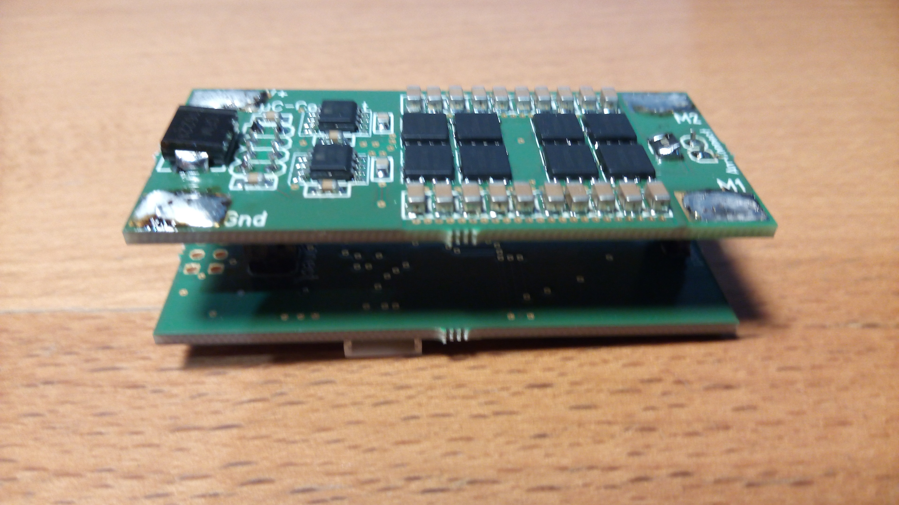

.BDC (Version 2) (zum Vergrößern anklicken)
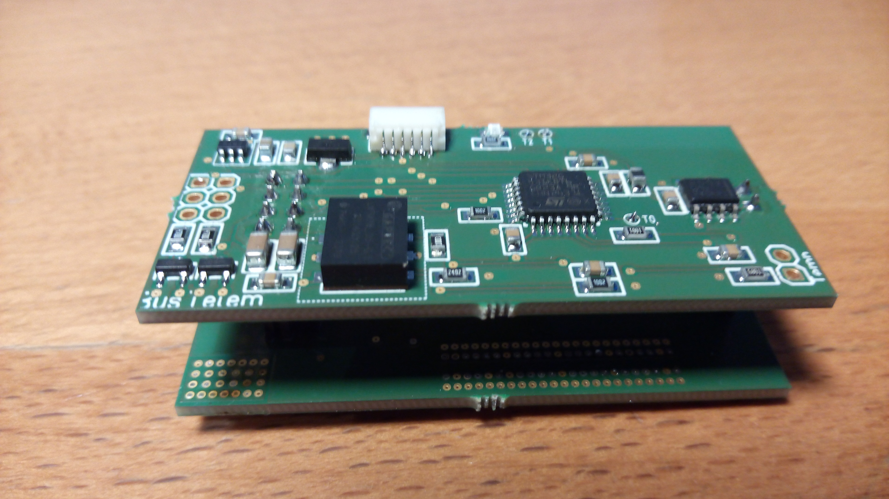

[[vesc]]
== V/ESC: die ultimative Firmware für mittlere/große BLDC-Motorregler (bürstenlose ESC)

[caption=""]
.Projektinfo
[cols="1h,5",width="100%"]
|===
| Status | 🟢 aktiv
| Firmware | https://github.com/wimalopaan/bldc/tree/master[wimalopaan/bldc]
| Video | https://www.youtube.com/watch?v=0YcNDozbAes[2026-03-29], <<videos.de.adoc#v-vesc,alle Videos (1)>>
|===

Ganz klar: _V/ESC_ ist die Königsklasse. Die Firmware bietet sensorlose FOC, die uns volles Drehmoment ab *null* U/min und einen leisen
Motorbetrieb ermöglicht. Dazu kommt eine beeindruckende Konfigurationssoftware.

Leider verfügt das `V/ESC`-Projekt nur über einen analogen PPM-Eingang, aber nicht über einen seriellen SBUS/IBUS/SumDv3-Eingang.

Diese Modifikation ergänzt eine serielle Halbduplexverbindung mit den seriellen V/ESC-Befehlen für die FlipSky-Hardware:

Halbduplex-Modifikation https://github.com/wimalopaan/bldc/tree/master[VESC]
