= MultiSwitch
Wilhelm Meier <wilhelm.wm.meier@googlemail.com>
:toc:
:toclevels: 3
:toc-placement!:
:sectnums:
:sectnumlevels: 5
:tip-caption: :bulb:
:note-caption: :information_source:
:important-caption: :heavy_exclamation_mark:
:caution-caption: :fire:
:warning-caption: :warning:

*English* | <<multiswitch.de.adoc#,Deutsch>>

<<../README.adoc#,RC Electronics>> / MultiSwitch

[NOTE]
--
ELRS/CRSF MultiSwitch modules, widget and telemetry script.
--

toc::[]

[[elrs_msw]]
== ELRS-MultiSwitch

=== In the old days

I have been working for a long time on generalized _MultiSwitch_-Modules (s.a. https://github.com/wimalopaan/Electronics/blob/main/Old.adoc#msd[MultiSwitch-D] ).
For those not knowing what a _MultiSwitch_ is lets first explain some things (for the german reader, 
the follwing maybe sufficient: https://www.beier-electronic.de/modellbau/produkte/nms-16/nms-16.php[Beier])

In ancient times handset / transmitters were only capable of transmitting proportional _channel values_ like rudder or speed. These value got encoded as `PPM`-signals. There was no possibility to 
transport _binary_ information, e.g. like the state of a 2-position switch on the handset. Some clever people therefore invented the so called multi-switch-encoder / decoder. The encoder was placed 
inside the handset and encoded the state of a set of switches (typically 8) as distinct pulse-length on one of the _proportional_-channels of the transmitter. Since only _one_ channel should be use for 
this purpose, the switch-states have to be encoded as a time-multiplex, making it neccessary to introduce a 9th (and maybe 10th) impulse as synchronizing event.

This situation has not really changed with the advent of modern, digital 2,4GHz rc-links: these are typically designed to transport 16 (or 24 or 32) 10/11/12-bit integers as _proportional_ values. 
There is not *direct* way to transport arbitrary binary (state of switches) information (exception: Hott/SJ together with SUMDV3 can transport 64 binary state values). 

My above mentioned old MultiSwitch modules somewhat got around this limitation with the obvious technique: use the 10/11/12-bit integers to transport the binary data. But if you want to do this 
you have recognize that there is some _scaling_ on the way from the handset to the transmitter-module and inside the receiver. This renders this approach ... well ... say uncomfortable (but working). 
Other limitations are e.g. that the communacation uni-directional (exception as said above: Hott).

But the really serious limitation was, that all these rc-links (Hott, ACCST, AFHDS2A, ...) where _closed-source_ stuff!

But eventually then I dicovered `ExpressLRS`. And this was a game changer.

=== New ELRS version

With ELRS and clearly EdgeTx we have two open-source projects, that work perfectly together and give us a _complete_ rc solution. No need for closed-source components anymore. 
And as an additional important fact, the communication protocoll between the handset and the ELRS transmitter-module and betwenn the ELRS-receiver and some other device (e.g. flight-controller) 
is `CRSF`, which is well documented and nowadays the evolution is kind-of governed: https://github.com/crsf-wg/crsf[CRSF-WG].

==== Overview

The first MutliSwitch-ELRS module is the MultiSwitch-E8: this module is capable of switching 8 loads (dc-motors, LEDs, sound, ...) steady on/off, intervall on/off (blinking) 
or pwm on/off (the on-state is pwm-modulated). It is possible to have up to 256 such MultiSwitch-E8 connected to _one_ ELRS-receiver. 

To make use of the functions of the MultiSwitch-E8, a special `MultiSwitch`-Widget is needed on the radio. This widget has the _module address_ (0 ... 255) as an option. Each widget instance
can control one of the 256 MultiSwitch-E8 modules in the model. All functions can be reached via the touch-screen. If appropriate some of the functions can also be controlled via the 
physical switches on the radio.

The configuration of each of all the MultiSwitch-E8 modules is done via the standard `elrsv3.lua` script. The modules are listed under `Other devices` in the menu of that `elrsv3.lua` script.

Different to the old versions using other rc-links (AFHDS2A, ACCST, ...) this new concept does not need one the the 16 proportional channels: it is completely 
independent!

.The `MultiSwitch` widget
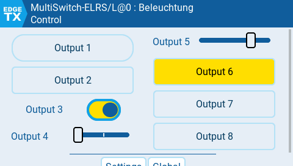

.The `MultiSwitch` telemetry script
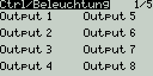

==== Puzzling parts

The hardware components:

* Radio running `EdgeTx`
* ELRS-Transmitter module
* ELRS-Receiver (PWM or serial-only)
* up to 256 MultiSwitch-ELRS modules (see below)
* CRSF-half-duplex bus (not strictly needed) (see below)

The software components:

* `elrsv3.lua` script on the radio (if you are already using ELRS, you know it for sure)
* `MultiSwitch` widget script (see below

Additional:

If you want to use multiple `MultiSwitch-E` with the _telemetry-menu_ permanently on (without pressing the button), there are some prerequisites:

* use the <<elrs.adoc#elrs-route,Allow other than `0xc8` as extended addresses (Version 3.x.x only)>> version for ELRS
* make sure, each `MultiSwitch-E` uses a different CRSF-Bus address (from `0xc0` up to `0xcf`)
* make sure, each `MultiSwitch-E` uses a different _ping-answer-slot_ (which is ensured, if you use the defaults in the config menu)

Auto-Configuration:

If you want to use the _Auto-Configuration_ of the `MultiSwitch-E` be sure to use https://github.com/EdgeTX/edgetx/pull/5773[this] PR for EgdeTx.
This is optional if you only use _one_ MultiSwitch-Widget at a time. But if you plan to use more thant one MultiSwitch-Widget in one model configuration
then you'll need this. Otherwise the _auto-configuration_ may not work.

==== Design

Although it would be possible to control the MultiSwitch-E8 via the standard `elrsv3.lua` script, this approch would be very inconvenient. So, I wrote a special 
widget to control the MultiSwitch modules. Each MultiSwitch module has its own _address_ (0 ... 255), so the widget must _know_ the appropriate address. There is a widget 
option where you can set the address of the correponding module.

For each address you can also set a descriptive _name_ of the module unique for each model on the radio, as well as the names of the _function_ to switch on or off and 
which physical switches should be used (if any). This is done via a model-specific configuration file on the sd-card of the radio.

The CRSF protocol is extensible, and this fact is used to propose an to control such modules: <<protocols.adoc#crsf-sw,Commands for MultiSwitch (realm `0xa1`)>>.

[[mswe8]]
==== MultiSwitch-E8

[caption=""]
.Project info
[cols="1h,5",width="100%"]
|===
| Status | 🟢 active
| Hardware | https://oshwlab.com/wilhelm.wm.meier/works[OSHWLab], https://aisler.net/p/GCSJNSFV[Aisler], link:../images/elrs_msw/RCMultiSwitchSmall10.zip[Gerber/BOM (zip)], link:../images/elrs_msw/RCMultiSwitchSmall10.T3001[TARGET 3001!]
| Firmware | https://github.com/wimalopaan/wmucpp/tree/master/boards/rcmultiswitchG030[wmucpp: `boards/rcmultiswitchG030`]
| Control | <<msw_widget>>
| See also | https://github.com/firlefantz/Elrs-Multiswitch-guide[housing / build guide]
|===

You find the actual version on https://oshwlab.com/wilhelm.wm.meier/works[].

[CAUTION]
--
The following design is outdated. Please use the new design.
--

.The schematic (click to enlarge)
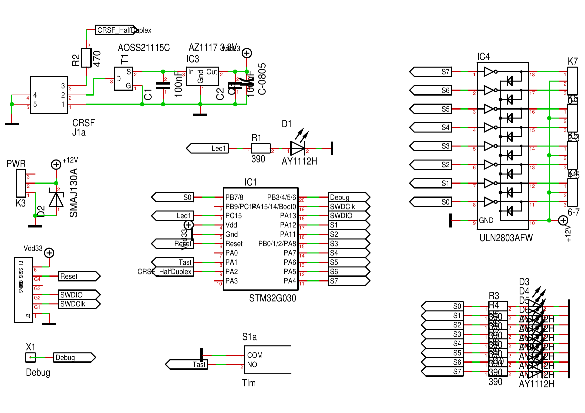

.The PCB  (click to enlarge)
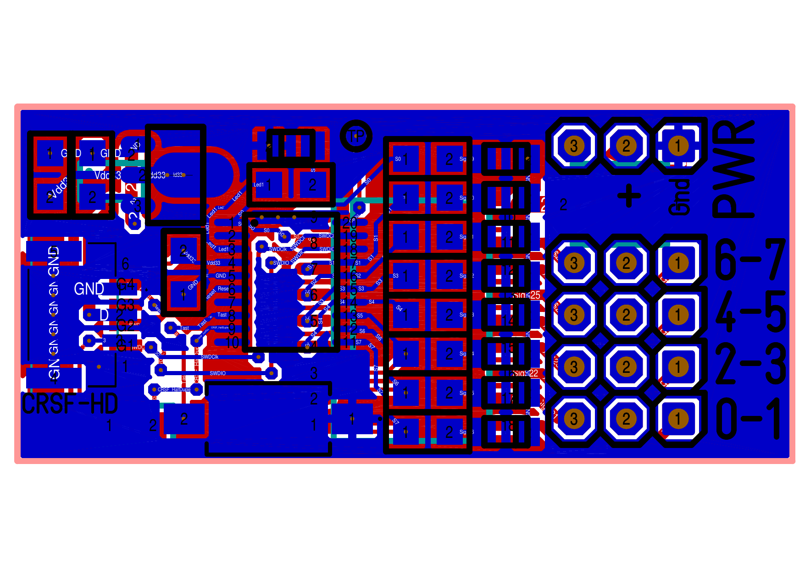

Link to the PCB order (Aisler): https://aisler.net/p/GCSJNSFV[PCB order]

Link to link:../images/elrs_msw/RCMultiSwitchSmall10.T3001[Target 3001 design file].

Link to link:../images/elrs_msw/RCMultiSwitchSmall10.zip[Gerber].

Link to https://github.com/wimalopaan/wmucpp/tree/master/boards/rcmultiswitchG030[source code] (unfortunately you have to clone to whole repository)

Instructions to compile to firmware:

[source,console]
----
$ cd <repo-root>/boards/rcmultiswitchG030
$ make all
----

==== Housing

here you can find the files to print a nice housing for the PCS: https://github.com/firlefantz/Elrs-Multiswitch-guide[Housing and additional information].

==== Super simple MultiSwitch (ELRS/CRSF, FlySky/SBus, FlySky/IBus, FrSky/SBus, FrSky/S.Port, Graupner/SumDV3)

[[supersimple]]
[caption=""]
.Project info
[cols="1h,5",width="100%"]
|===
| Status | 🟢 active
| Firmware | https://github.com/wimalopaan/wmucpp/tree/master/boards/rcmultiswitch[wmucpp: `boards/rcmultiswitch`]
| Control | <<msw_widget>>, <<msw_bw>>, https://github.com/wimalopaan/LUA/tree/main/SCRIPTS/MIXES[mixer scripts]
| Video | https://www.youtube.com/watch?v=SQZCM9e6v1E[2025-03-23], https://www.youtube.com/watch?v=e6teZWhJzoQ[2025-03-25], https://www.youtube.com/watch?v=ES77NcNwEtA[2025-10-12], https://www.youtube.com/watch?v=N7wzqSIUbUA[2026-06-20], <<videos.adoc#v-supersimple,all videos (4)>>
|===

There was demand for a much simpler hardware compared to the <<mswe8>>: it should comprise only THT parts, so one could solder it onto a simple
stripe THT-PCB. And it should use simpler µC, since the STM32/ARM looks too complicated to some hobbyists.

So I decided to strip done the code and to port it to the AVR-DA/DB and the AVRtiny1 series. The only µC available as DIP package is the 
AVR32DA28 (or other AVRxxDA28). Out of the AVRtiny1 series the ATtiny1614 looks promising, albeit it is available only in SOIC-14. But for this 
package there exist ready to use adapter boards with THT pin header.

Clearly there are some limitations:

* simple turn on/off of the outputs
* no ELRS telemetry, no menu via the `ELRSv3.lua` or TBS Agent
* no PWM output
* no blinking patterns
* all other stuff via the `ELRSv3.lua` is not possible

The code can be found here: https://github.com/wimalopaan/wmucpp/tree/master/boards/rcmultiswitch[]. There you should find `mswitch01.cc`.

You find an actual hardware-design here: <<ssmsw>>.

[NOTE]
--
Please not that the file `mswitch01.cc` is a generic source-code. So, please obey the pin assignment in the source-code.

The users of my _old_ multiswitch hardware (PCB): please use the file `sbus01.cc` instead of `mswitchß1.cc` for all following steps.
But also be sure to edit the _address_ and the _encoding_ in the first few lines of the file `sbus01.cc` according to your needs!
--

You can compile the firmware using this _gitpod_: https://gitpod.io/#https://github.com/wimalopaan/wmucpp[]. 

Please do the following:

* Navigate to the directory: `boards/rcmultiswitch`
* Edit the top lines in the file `mswitch01.cc`
** select input (CRSF or SBUS or IBUS or S.Port or SumDV3)
** select the multiswitch address 0...7
** select if SBus is _normal_ or _inverted_
** select the rc-link (ELRS/AFHDS2A/ACCST for SBUS)
* Edit the `Makefile.da`: just de/comment the lines to choose the right µC
* use the command: `make -f Makefile.da all`
* download `mswitch01.hex`
* connect the µC to the UPDI programmer (USBserial with a diode)
* flash, e.g.: `pymcuprog write --erase -d avr128da32 -t uart -u /dev/ttyUSB0 -f mswitch01.hex`

.Two multiswitches on the breadboad and the widget 
image::../images/elrs_msw/ss01.png[width=240, link="../images/elrs_msw/ss01.png"]

.Two multiswitches on the breadboad
image::../images/elrs_msw/ss02.png[width=240, link="../images/elrs_msw/ss02.png"]

Something to say about the configuration of the <<msw_widget>>: the widget was designed to work 
with `CRSF` (and ELRS). If you use ELRS gear and connect this super simple multiswitch to the
receiver via `CRSF` you are fine.

But you can connect the super simple multiswitch also via `SBUS`, which makes sense, because the 
super simple multiswitch does not have telemetry, e.g. no menu via `elrsv3.lua` or TBS Agent. So, the 
communication is simply uni-directional.

You can connect the super simple multiswitch via `SBUS` (see source code:  `mswitch01.cc`) and you can use
different RC-links aside from ELRS like AFHDS2A/FlySky or ACCST/FrSky. But you have to be aware that the `SBUS` channel 
values undergo some really obscure scaling. So, the bits in a `SBUS` channel aren't exactly received by a device connected 
to the receivers `SBUS`.

Additionally `SBUS` does not allow to transport _out-of-band_ data. As a consequence the data has to encoded and send out 
via one of the `SBUS` 16 channels (in the case of `mswitch01.cc` this has to be channel 16). Therefore you must encode the
data in channel 16 one the radio. This is done via a _mixer_ script in EdgeTx: `mswsb.lua`, 
see https://github.com/wimalopaan/LUA/tree/main/SCRIPTS/MIXES[].

For the _widget_ and the _mixer_ script to communicate, setup the `ShmEncoding` in the widgets settings. And use the same
SHM variable in the mixer script.

If yout `SBUS` setup does not work, maybe because of the above mentioned obscure scalings, your next try may be S.Port. In the
widget you can select the S.Port transport and the appropriate physical ID and application ID.

If you are a FlySky user, a better approach is to use `ibus`.  FlySky does not support S.Port but the channel values do not undergo
such strange scalings as with ACCST/SBus. Beaware that the mixer script is `mswib.lua`, obviously.

There are also good news for the users of _Graupner_ (HoTT) stuff: the actor protocol `SumDV3` can transport up to 32 RC-channels 
and also 64 binary switches. Clearly you need a handset that is capable to define _digital switches_.

[[ssmsw]]
==== 16-Outputs PCB

[caption=""]
.Project info
[cols="1h,5",width="100%"]
|===
| Status | 🟢 active
| Hardware | https://oshwlab.com/wilhelm.wm.meier/supersimplemultiswitch[OSHWLab]
| Firmware | https://github.com/wimalopaan/wmucpp/tree/master/boards/rcsupersimplemultiswitch[wmucpp: `boards/rcsupersimplemultiswitch`]
| Control | <<msw_widget>>
| Video | https://www.youtube.com/watch?v=mU0vg94EXQQ[2025-10-23], <<videos.adoc#v-ssmsw,all videos (1)>>
|===

I designed a _SuperSimpleMultiSwitch_-Hardware using the AVR128DA28 in DIP-packes. This is a very easy reproducible hardware design that 
you can find on https://oshwlab.com/wilhelm.wm.meier/supersimplemultiswitch[]. 
If the PCB doen't attract you, you can use the schematics to design your own. 

.The SuperSimpleMultiSwitch with 16 outputs
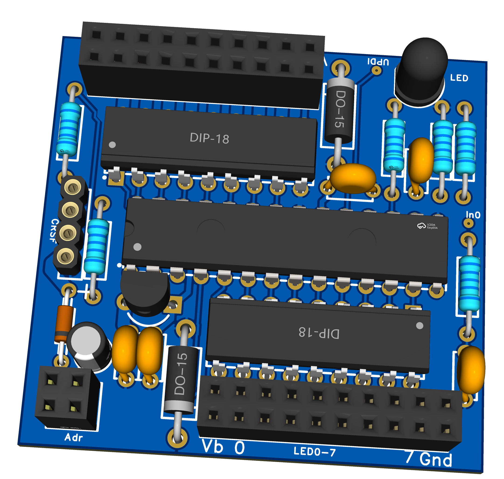

.The SuperSimpleMultiSwitch with 16 outputs PCB
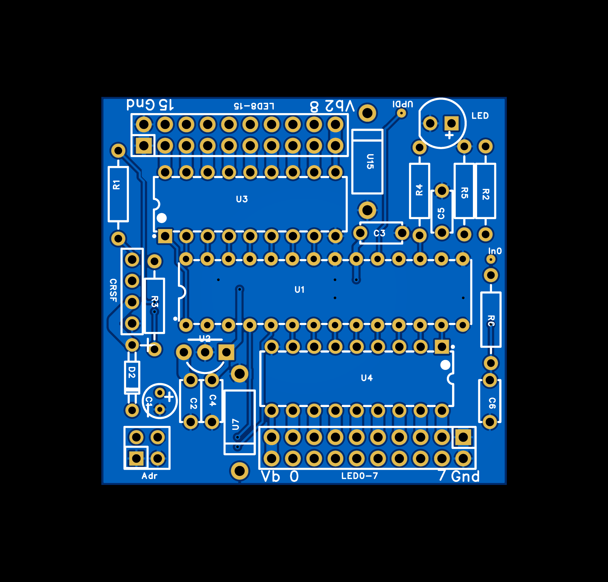

It has 16 output channels, so it inherently ues _two_ multiswitch address. The base address of the module can be selected via two jumpers on the board.

The firmware con be found here: https://github.com/wimalopaan/wmucpp/tree/master/boards/rcsupersimplemultiswitch[]. If you don't want to compile the firmware locally 
on your notebook or PC, you can use `github` _CodeSpaces_ to do so. Please refer to  <<building.adoc#cs_wm,Using `github` CodeSpaces>>.

Please do the following:

* Navigate to the directory: `boards/rcsupersimplemultiswitch`
* Edit the top lines in the file `settings.h`
** select input (CRSF or SBUS or IBUS or S.Port or SUMDV3)
** select if SBus is _normal_ or _inverted_
** select the rc-link (ELRS/AFHDS2A/ACCST for SBUS)
* use the command: `make -f Makefile all`
* download `ssmsw02.hex`
* connect the µC to the UPDI programmer (USBserial with a diode)
* flash, e.g.: `pymcuprog write --erase -d avr128da32 -t uart -u /dev/ttyUSB0 -f ssmsw02.hex`

.Limitations
[TIP]
--
The firmware does not use the RESPONSE_SLOT algorithm (and no open-drain tx-line),
therefore only one module should send telemetry data ro the RX.
If modules are parallelized only one should be connected with its tx-line to the receivers-rx line.
Alternative two modules using telemetry can be connected to different serial connections of
the receiver, or the CRSF-switch/router has to be used.
--

[[msw_nucleo]]
==== STM32G031F8 Nucleo-Board as a MultiSwitch

[caption=""]
.Project info
[cols="1h,5",width="100%"]
|===
| Status | 🟢 active
| Hardware | https://www.st.com/en/evaluation-tools/nucleo-g031k8.html[ST Nucleo-G031K8]
| Firmware | https://github.com/wimalopaan/wmucpp/tree/master/boards/rcmultiswitchG030[wmucpp: `boards/rcmultiswitchG030`]
| Control | <<msw_widget>>
| Video | https://www.youtube.com/watch?v=-KHh-UYU7IA[2025-08-21], <<videos.adoc#v-msw_nucleo,all videos (1)>>
|===

Despite the fact that there are man people assembling there one <<mswe8>>, there are also people who do not want to order these boards and assemble all
parts by themselves, nor do they want to use the assembly-service of some of the main pcb manufactorers. Therefore, there was some demand for more DIY friendly
version of this MultiSwitch.

The solution is to use bre-built µC boards, that contain all that smd stuff and on the other hand have some 2.54mm pin-header, where all the connections
to the receiver, power-supply, outputs and programming connections go. In the case of the used STM Nucleo boards, these boards also come with a simple to use 
on-board programmer: programming is as simple as to copy the firmware file to the emulated USB drive of the on-board programmer (but you can use the st-link programming 
software as well).

The STM nucleo-board: https://www.st.com/en/evaluation-tools/nucleo-g031k8.html[]. In this documentation you can find all the details of the board.

The pinout used for the MultiSwitch for the nucleo-board can be found here: https://github.com/wimalopaan/wmucpp/blob/a9a4ad7189aacfe1117c3167641f161669980336/boards/rcmultiswitchG030/devices_2.h#L310-L319[]

So, all you have to do is to build the firmware via gitpod (see: <<building.adoc#gitpod_wm,Compiling the source code of my projects (`wmucpp`)>>).

Please be sure to enable the correct version of the firmware: https://github.com/wimalopaan/wmucpp/blob/69835d2d781f9924fd9ded9a67e0e75d033ec7dc/boards/rcmultiswitchG030/msw20.cc#L19-L24[here]

Here you enable `HW_NUCLEO` (comment all the others).

.Pins of the Nucleo STM32G031 Board
|===
| Description | Pin | Pin-Header-Name

| Output 0 | PA7 | A7
| Output 1 | PA6 | A6
| Output 2 | PA11 | A5
| Output 3 | PA8 | D9
| Output 4 | PA5 | A3
| Output 5 | PA4 | A2
| Output 6 | PA1 | A1
| Output 7 | PB3 | D13
| to receiver crsf tx | PA9 | D5 
| to receiver crsf rx | PA10 | D4 
| button | PB6 | D1
| serial debug output | PA2 | (via USB) 
| LED (onboard) | PC6 | 
| Testpoint (if enabled) | PB4 | D12
|===

At last you use `make` to compile the `G031` version of the source:

[source]
--
make clean g031
--

[TIP]
--
If you want to use more than one Nucleo-MultiSwitch in parallel, be sure to set `CRSF_TX_OPENDRAIN` in the source code. Then you can connect the `tx` and `rx` line of all 
modules in parallel.
--

[[msw_weact]]
==== WeAct STM32G031F8 as a MultiSwitch

[caption=""]
.Project info
[cols="1h,5",width="100%"]
|===
| Status | 🟢 active
| Hardware | https://de.aliexpress.com/item/1005005748198584.html[WeAct STM32G0 board]
| Firmware | https://github.com/wimalopaan/wmucpp/tree/master/boards/rcmultiswitchG030[wmucpp: `boards/rcmultiswitchG030`]
| Control | <<msw_widget>>
| Video | https://www.youtube.com/watch?v=vY8LG9SDndU[2025-08-23], https://www.youtube.com/watch?v=LgFiy0gqKGg[2025-09-07], <<videos.adoc#v-msw_weact,all videos (2)>>
|===

The https://de.aliexpress.com/item/1005005748198584.html[] is even smaller than the <<msw_nucleo, nucleo>> version. So, this board is a really good choice in terms of price and size.

The differences to the <<msw_nucleo, nucleo>> are, that there is no programmer included (you have to use a separate `st-link` programmer, and that the pin assignments are different

So, all you have to do is to build the firmware via gitpod (see: <<building.adoc#gitpod_wm,Compiling the source code of my projects (`wmucpp`)>>).

Please be sure to enable the correct version of the firmware: https://github.com/wimalopaan/wmucpp/blob/a9a4ad7189aacfe1117c3167641f161669980336/boards/rcmultiswitchG030/msw20.cc#L19-L22[]
Here you enable `HW_WEACT` (comment all the others).

.Pins of the WeAct STM32G031 Board
|===
| Description | Pin | Pin-Header-Name | Name on the board

| Output 0 | PA0 | P2-7 | A0
| Output 1 | PA1 | P2-8 | A1
| Output 2 | PA2 | P2-9 | A2
| Output 3 | PA3 | P2-10 | A3
| Output 4 | PB6 | P3-1 | B6
| Output 5 | PA6 | P3-6 | A6
| Output 6 | PA7 | P3-5 | A7
| Output 7 | PA8 | P3-4 | A8
| to receiver crsf tx | PA9 | P3-3  | A9 
| to receiver crsf rx | PA10 | P3-2  | A10
| button on-board | PA14 | 
| serial debug output | PA14 | (collision with button) 
| LED (onboard) | PA4 | 
| Testpoint (if enabled) | PB7 | P2-1
| Status input 0 | PA5 | P3-7 | A5
| Status input 1 | PB7 | P2-1 | B7
|===

At last you use `make` to compile the `G031` version of the source:

[source]
--
make clean g031
--

[TIP]
--
If you want to use more than one Nucleo-MultiSwitch in parallel, be sure to set `CRSF_TX_OPENDRAIN` in the source code. Then you can connect the `tx` and `rx` line of all 
modules in parallel.
--

[[msw_tht]]
==== WeAct STM32G031F8 as a MultiSwitch with PCB as THT

[caption=""]
.Project info
[cols="1h,5",width="100%"]
|===
| Status | 🔵 stable
| Hardware | link:../images/elrs_msw/seaspotter/Gerber_CRSF-Multiswitch-THT-v1.1.zip[Gerber (zip)]
| Firmware | https://github.com/wimalopaan/wmucpp/tree/master/boards/rcmultiswitchG030[wmucpp: `boards/rcmultiswitchG030`]
| Control | <<msw_widget>>
| Video | https://www.youtube.com/watch?v=DVyyuaLCTKw[2025-09-17], <<videos.adoc#v-msw_tht,all videos (1)>>
|===

The following PCB design is by courtesy of Florian (`seaspotter`).

.The `MultiSwitch` PCB with THT components
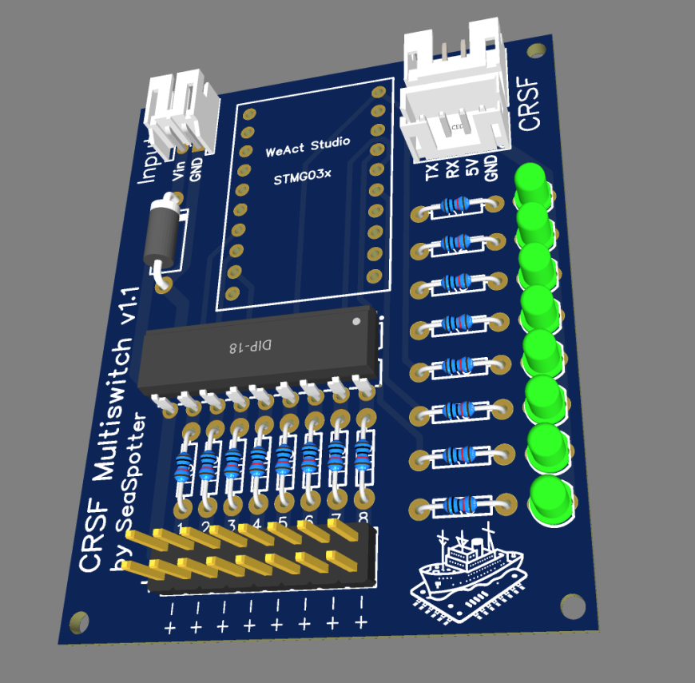

.The `MultiSwitch` PCB with THT components schematics
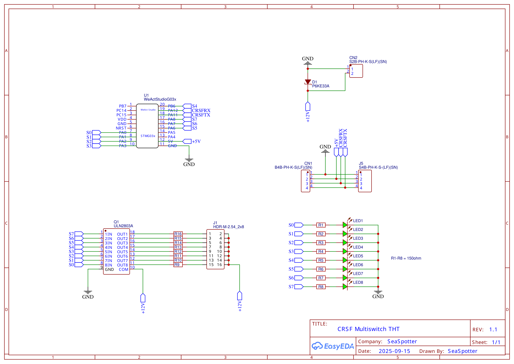

If you want to produce this PCB, you can use the following link to the gerber files.

Link to link:../images/elrs_msw/seaspotter/Gerber_CRSF-Multiswitch-THT-v1.1.zip[Gerber].

[[msw_weact_esp32c3]]
==== WeAct ESP32-C3 Core Board as a MultiSwitch

[caption=""]
.Project info
[cols="1h,5",width="100%"]
|===
| Status | 🟡 experimental
| Hardware | https://github.com/WeActStudio/WeActStudio.ESP32C3CoreBoard[WeAct ESP32-C3 Core Board]
| Firmware | https://github.com/wimalopaan/wmucpp/tree/master/boards/esp32/multiswitch[wmucpp: `boards/esp32/multiswitch`]
| Control | <<msw_widget>>
| Configuration | CRSF parameter menu on the transmitter
| Documentation | https://github.com/wimalopaan/wmucpp/blob/master/boards/esp32/multiswitch/README.en.adoc[Firmware README]
| See also | <<msw_weact,WeAct STM32G031F8 as a MultiSwitch>>
|===

ESP-IDF port of `boards/rcmultiswitchG030` for the WeAct ESP32-C3FH4
Core Board (4 MB flash). The ESP32 configuration (`EEProm`) is kept
separately in `main/settings.h`; the `config-v4` NVS layout remains unchanged.
Pattern parameters and CRSF parameter serialization are reused from the
original project and `include_stm32`, respectively. The STM32 hardware
abstraction is not required.

The following paths and build commands refer to the firmware directory
`boards/esp32/multiswitch` in the `wmucpp` repository.

===== Connections

[cols="1,2"]
|===
|Function |GPIO
|Output 0..7 |0, 1, 3, 4, 5, 6, 7, 10
|CRSF RX (from receiver TX) |20
|CRSF TX (to receiver RX) |21
|Blue onboard LED, active low |8
|BOOT button, active low |9
|Status input IN0, active low with pull-up |2
|USB Serial/JTAG |18/19, unchanged
|===

Pin assignment: `main/board.h`. Connect a common ground with the receiver.
The UART uses non-inverted 3.3 V signals in two-wire full-duplex mode.
The outputs are active-high logic signals, not power outputs:
connect loads through suitable drivers/MOSFETs. External pull-downs are
required to keep loads safely off during reset/boot.
GPIO4..7 cannot be used for external JTAG with this pin assignment.
GPIO2/8/9 are strapping pins; holding BOOT during power-up starts the ROM
bootloader.

The onboard LED and button pin assignments follow the
https://github.com/WeActStudio/WeActStudio.ESP32C3CoreBoard/tree/master/Hardware[WeAct schematic].

===== Features

* Eight switching outputs with software PWM, interval/multiple-flash
  operation, and Morse.
* CRSF switch commands Set, Set4, Set4M, and Prop; default switch address 0.
* Automatic baud-rate scanning at 400000, 420000, and 921600 baud;
  starting at 420000.
* CRSF device discovery and a dynamic parameter menu including
  Operate/Test, Morse text, failsafe, and a confirmed factory reset.
* Four virtual groups, four pattern generators with chaining, and
  global PWM modulation through a separate virtual address.
* Master/slave operation with broadcast output states and individual
  slave enable settings per output, compatible with the STM32 command.
* Failsafe after one second without valid channel, link, ping, or matching
  switch command packets: Hold, All-Off, or a configured output state.
  All-Off also sets remote PWM to zero.
* NVS persistence, 500 ms after the last configuration change.
  Operate/Test and Prop values are not saved. Factory reset is saved.
* CRSF status telemetry in the original format, every 500 ms.
  Status input IN0 on GPIO2 is reported in bit 0; bits 1..7 remain zero.
  Telemetry pauses for 30 seconds after discovery/configuration accesses.

The status LED uses the original timing: 100 ms flashes, with 100 ms gaps
between flashes in a sequence. Baud-rate scanning: one flash followed by
a 1200 ms pause; operation without telemetry: one flash followed by a
5000 ms pause; with telemetry: two flashes followed by a 5000 ms pause.
Connection lost: one flash followed by a 210 ms pause.
A temporarily enabled configuration window in Button mode is indicated by
a steady light while connected.

====== Differences from the STM32 version

All eight outputs share one PWM frequency from 100 to 1000 Hz
(`PWM f (O0..7)`, in 100 Hz units, default 1000 Hz).
The logical duty resolution is 1 percent. A GPTimer switches only at the
required edges; outputs continue running during NVS accesses.
Software PWM is nevertheless not jitter-free and must be checked under
real load using a logic analyzer.

PWM modes Off/On/Remote/Global-Indiv match the original.
PWM Expo has no effect, as in the original.
IrDA, half-duplex, and STM32-specific ADC/voltage/temperature measurements
are not part of this port.
Parameters are listed dynamically; their indices do not match those of
individual STM32 hardware variants.

`Config resp.` is enabled by default. In Button mode, holding BOOT for
at least one second enables replies for 30 seconds; parameter accesses
extend this window.
Reading the reset menu entry does not trigger a reset; CRSF confirmation
is required.
Morse output can be stopped while running; spaces and unknown characters
are handled with bounded processing.

===== Status input

GPIO2 is an active-low input with its pull-up enabled:
open/high reports status bit 0 = 0, and a connection to GND reports
status bit 0 = 1. Use a dry contact or an open-drain output with a common
ground. The input is suitable for 3.3 V signals only; do not connect 5 V
or receiver battery voltage.

GPIO2 is a strapping pin with a pull-up on the WeAct board.
For reliable startup/flashing, keep the input open/high during reset
where possible. All other pin assignments are retained; there is no
second status input. The level is sampled when status telemetry is sent,
without debouncing or pulse latching.
The existing telemetry enable setting and the 30-second pause after
discovery/configuration accesses also apply to this status report.

===== Morse with four text fields

The `Morse` menu provides `Text1` through `Text4`, each holding up to
15 characters. Non-empty fields are joined in this order with one space
between them; empty fields and fields containing only spaces are skipped.
`Full Text` shows the combined text as a read-only value
(up to 63 characters).
All outputs in Morse mode use this shared text and the shared Morse timing.
Field boundaries introduce a word pause; the fields are not four
independently selectable messages. After an upgrade, the previous text
remains in `Text1`; `Text2` through `Text4` are empty.

===== Virtuals, patterns, and global dimming

`Global / Switch Addr` addresses the eight physical outputs;
`Global / Virtual Addr` addresses virtual functions (default 1).
The two addresses should be different. Under `Virtuals`, four groups
with up to four outputs each can be configured;
`None` leaves a member slot unused.
Set, Set4, and Set4M commands to the virtual address switch these groups
using indices 0..3. With `Enable Virtuals = On`, their members ignore
physical switch commands; Operate/Test remains directly usable.

Virtual switch indices 4..7 start/stop the four generators under
`Pattern / Pattern Virt. 5` through `Pattern Virt. 8`. Each generator has
its own ordered member list with up to eight slots, On/Off times in
10 ms increments, and six modes:
Cont-LR, Cont-RL, Cont-LRL, Single-LR, Single-RL, and Single-LRL.
`Off` disables the generator. Members of an enabled pattern are reserved
for its control, even when `Enable Virtuals` is off.
Empty lists stay off; single-member lists are also supported.
Avoid overlapping groups/patterns so that multiple controllers do not
switch the same output. For PWM within a pattern, use PWM mode
On or Global/Indiv, not the independent Remote mode.

After a single run, a broadcast start command for the same pattern number
is sent to `Next Address`. An incoming start command can trigger the next
run. To repeat a local test, select Stop/Off, then Start/On.
Stop is propagated to other modules using `Group`; a received group stop
stops all matching local generators without retransmission.
Group 0 disables stop propagation. If `Next Address` is one of the module's
own addresses, no chaining command is sent. Failsafe All-Off/Set stops
running patterns and sets physical outputs regardless of their assignments.

`Virtuals / Virtual 4 = Global Dimming` enables Prop commands on channel 4
of the virtual address. These scale the individual duty values of all
outputs in Global/Indiv mode by 0..100 percent. Off, On, and Remote remain
unchanged. Disabling virtuals/global dimming resets the global factor to
100 percent. Test, Start/Stop, and current dimming values are not saved;
addresses, assignments, and pattern settings are saved.

===== Master/slave operation

On the master, set `Global / Slave Cmd = On`. When enabled and whenever
states change, the module sends the states of its eight outputs as a
CRSF broadcast `InterModuleSlaveSet` (0x13), using `Switch Addr` as the
master identifier. This is independent of `Config resp.`/status telemetry.
A state packet contains all eight bits; unchanged states are not
continuously retransmitted.

On each slave, set `Global / Master` to the master's `Switch Addr`
and enable `Output N / Slave = On` for the desired outputs.
Output N always follows bit N of the master; outputs not enabled as slaves
remain locally controllable. Slave outputs ignore normal physical and
virtual switch commands. Operate/Test and failsafe remain effective.
Leave `Slave Cmd` off on slave-only modules and use different switch
addresses to avoid feedback loops. The connection must forward CRSF
broadcasts between modules; sharing a receiver connection does not
guarantee this forwarding.

The transmitted on/off state represents the output envelope, including
interval, Morse, and pattern transitions, not individual PWM edges or
duty values. A duty value greater than zero counts as on.
The slave uses its own PWM/interval/Morse settings.
For direct mirroring, disable interval/Morse on the slave and use PWM mode
Off or On/Global-Indiv; Remote operates independently of switch commands.
Do not also assign slave outputs to local patterns. The protocol provides
neither acknowledgements nor periodic state refreshes; if a slave restarts
later, toggle `Slave Cmd` off and on again on the master if necessary.

===== Existing settings

Valid settings from previous firmware versions (`config-v1`, `config-v2`,
and `config-v3`) are automatically migrated and saved as `config-v4`.
Output, Morse, failsafe, and existing virtual/pattern and master/slave
settings are preserved. When upgrading from v1/v2, master transmission
and all per-output slave settings are initially off.
When upgrading from v1, new groups are empty, and patterns and global
dimming are disabled. The new virtual address is 1, or 2 if it would
conflict with the previous switch address. After flashing, reopen the
device menu on the transmitter to reload the expanded parameter list.
No factory reset or NVS erase is required.

===== Building and flashing

Activate ESP-IDF with an installed ESP32-C3 toolchain. This port was built
with ESP-IDF 6.1 and uses the GPTimer and UART drivers.

[source,sh]
----
. "$IDF_PATH/export.sh"
idf.py set-target esp32c3
idf.py build
idf.py -p /dev/ttyACM0 flash monitor
----

USB is used for console/debug output; logs are not sent over the CRSF UART.
Firmware: `build/multiswitch.bin`. For the first USB connection, hold BOOT
and press Reset if necessary.

Host tests cover framing/CRC, command lengths and addressing, PWM edges,
interval operation, four Morse text fields, failsafe outputs, parameters/reset,
virtuals, all pattern modes, chaining, global dimming, master/slave,
status input/telemetry, and NVS migration:

[source,sh]
----
make -C tests test
----

The new virtual/pattern/master-slave features and inter-module chaining
have not yet been tested with a real receiver/output driver. In particular,
verify interaction between multiple modules and PWM jitter under load on
the actual hardware before use.

[[msw_widget_ng]]
==== MultiSwitch NG Widget

[caption=""]
.Project info
[cols="1h,5",width="100%"]
|===
| Status | 🟢 active
| Software | https://github.com/wimalopaan/LUA/tree/main/WIDGETS/lvglMultiSwNG[LUA: `lvglMultiSwNG`] (color radios)
| Requirements | EdgeTX 2.11.3 or newer with LVGL support
| Protocol | <<protocols.adoc#crsf_sw,CRSF MultiSwitch commands>>, S.Port WM, S.Port ACW 1.5 / 1.4
| Documentation | https://github.com/wimalopaan/LUA/blob/main/WIDGETS/lvglMultiSwNG/README.adoc[Installation, operation and configuration]
|===

`MultiSwitch NG` is a new implementation of the LVGL MultiSwitch widget. The existing <<msw_widget,MultiSwitch Widget>> remains available and unchanged.

The widget provides:

* configurable tabs with individual default addresses, layouts and controls
* latching buttons, toggles, three-position controls, momentary buttons and sliders (sliders require CRSF)
* physical switch and source assignments, activation switches and exclusive groups across tabs
* configurable names, colors, fonts and optional button images
* CRSF switching, proportional outputs and optional LED color transmission, or S.Port WM / ACW output
* shared configuration and output states across widget instances of the same model
* automatic saving and separate configuration, storage and operating status displays
* a German or English interface selected automatically from the EdgeTX menu language

Copy the complete directory to `/WIDGETS/lvglMultiSwNG/` on the SD card and select the widget `MultiSw NG`.
Operation and configuration take place in fullscreen mode.

[WARNING]
--
Test the widget on the radio or in the EdgeTX simulator before using it in a model.
The old widget's configuration is neither loaded nor overwritten; migration is not yet supported.
--

[[msw_widget]]
==== MultiSwitch Widget

[caption=""]
.Project info
[cols="1h,5",width="100%"]
|===
| Status | 🔵 stable
| Software | https://github.com/wimalopaan/LUA?tab=readme-ov-file#lvglmsw[LUA: `lvglMultiSw`] (color radios)
| Protocol | <<protocols.adoc#crsf-sw,CRSF MultiSwitch commands>>
| Video | https://www.youtube.com/watch?v=aaKBlDT08Tc[2025-07-28], https://www.youtube.com/watch?v=s7mjQJYgb9o[2025-08-15], https://www.youtube.com/watch?v=fQk5mrm1Hiw[2025-10-15], https://www.youtube.com/watch?v=NAWFy8ZdQog[2025-11-05], https://www.youtube.com/watch?v=Gw56sHEIoD8[2025-11-12], https://www.youtube.com/watch?v=7_HkYi2aqZk[2025-11-15], <<videos.adoc#v-msw_widget,all videos (7)>>
|===

The stable widget can be found here: https://github.com/wimalopaan/LUA?tab=readme-ov-file#lvglmsw[]
For the actively developed new implementation, see <<msw_widget_ng,MultiSwitch NG Widget>>.

[TIP]
--
Be sure to copy all files _into_ a directory name `lvglMultiSw` (obey small and capital letters). 
--

[WARNING]
--
Before installing a new version of the widget, _allways_ make a copy _all_ config files for the widget. The config file
are named `<modelname>_<startaddress>.lua` 
--

.The `MultiSwitch` widget main screen

.The `MultiSwitch` widget settings 1 screen
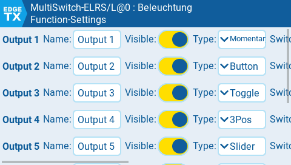

.The `MultiSwitch` widget global settings screen
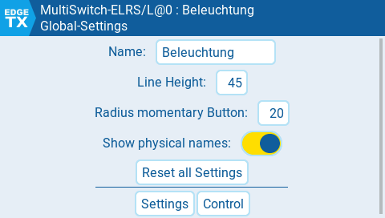

.The `MultiSwitch` widget telemetry screen
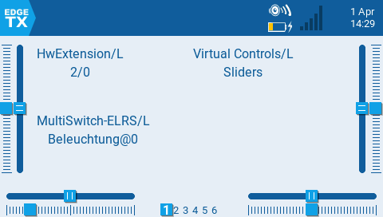

The widget can:

* control MultiSwitch-E (via CRSF, also SBus, IBus, SPort)
* use buttons, momentary-buttons, check-box, slider to control outputs
* set name and color of buttons
* use physical switches to control Multiswitch-W
* can set logical-switches and virtual-switches
* mapping to different switch addresses and outputs
* use confifurable number of buttons
* send color information to rgb leds (ELRS-receiver, Cruise-Controller)
* display status bits
* ...

////
(the following is *outdated information*) 

The code of the widget can be found here: https://github.com/wimalopaan/LUA[]

.The `MultiSwitch` widget

.The `MultiSwitch` widget (fullscreen)
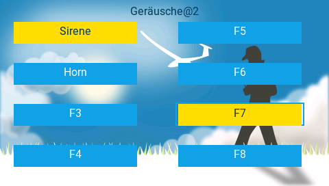

Normally the widget uses a _config-file_ (name of the file: `<name_of_model>.lua`) to determine the type of buttons, the text of the buttons, which logical switch to use, ...
This work well, but if you switch the handet, the new handset must ahve the same model name set up and also you must copy (and keep equal) the config file. This might be tedious.
This overcomde this limitation, the `MultiSwitch-E` module itself can contain the configuration and the widget can request that configuration.

To use this, enable the `AutoConf` option of the widget.
////

[[msw_bw]]
==== MultiSwitch Telemetry Script

[caption=""]
.Project info
[cols="1h,5",width="100%"]
|===
| Status | 🔵 stable
| Software | https://github.com/wimalopaan/LUA?tab=readme-ov-file#multiswitch-bw-telemetry-script[LUA telemetry script] (B&W radios)
| Video | https://www.youtube.com/watch?v=bK-Kyz6lSjs[2025-06-20], <<videos.adoc#v-msw_bw,all videos (1)>>
| See also | <<edgetx.adoc#edgetx_shm_bw,SHM-Variables for B&W radios>>
|===

To use the `MultiSwitch` with black&white LCD radios you have to install a _telemetry_ script. 
This _script_ can be found here: https://github.com/wimalopaan/LUA?tab=readme-ov-file#multiswitch-bw-telemetry-script[]

This script runs fine alongside with `elrcV3.lua` on radios with 192kB of RAM. But don't expect it to run on radios with only 128kB or less of RAM. 

.The `MultiSwitch` telemetry script control screen

.The `MultiSwitch` telemetry script settings 1 screen
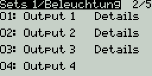

.The `MultiSwitch` telemetry script settings details screen
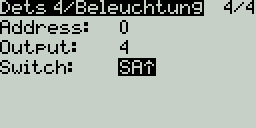

.The `MultiSwitch` telemetry script settings 2 screen
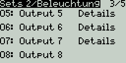

.The `MultiSwitch` telemetry script global screen
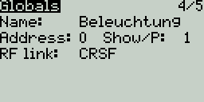

.The `MultiSwitch` telemetry script info screen
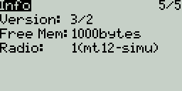

[[crsf_enc]]
==== CRSF encoding

The encoding of the switch states is done via the CRSF protocol (see <<protocols.adoc#crsf_sw,Proposal for the CRSF protocol>>).

[[sport_enc]]
==== S.Port encoding

The encoding of the switch states is done via S.Port commands. For the multiswitch part a _write-command_ (`0x31`) is used:

* S.Port command: `0x31`
* physical ID: configurable
* applicationID: `0x5100` (DIY1) (switch address `0`) to `0x51ff` (switch address `255`)
* value: 16bit (out of 32bit): each switch as 2-bit (binary, ternary, quaternary switches are possible)

These S.Port commands are send to the multiswitch module, which has to decode this command.

[[sbus_enc]]
==== SBus simple (unreliable) encoding

The encoding of the switch states is done via channel values.

A word of caution: the transport of the channel values undergoes several scaling steps including `EdgeTx`, RF-module and receiver. Different vendors use different
scaling techniques. As a consequence, out of the 11 bits of the SBus channel vakues only 6 bits are usable. On the transmitter state the state of an output (1Bit), the
number of the output (3bit) and the address of the multiswitch module (2bit) is encoded into one 6bit code and upshifted to reach the full SBus scale. On the receiver side 
in the multiswitch module the channel value is richt-shifted by 4 and the 6bit are decoded. 
