= MultiSwitch
Wilhelm Meier <wilhelm.wm.meier@googlemail.com>
:toc:
:toclevels: 3
:toc-placement!:
:sectnums:
:sectnumlevels: 5
:tip-caption: :bulb:
:note-caption: :information_source:
:important-caption: :heavy_exclamation_mark:
:caution-caption: :fire:
:warning-caption: :warning:
:lang: de
:toc-title: Inhaltsverzeichnis
:figure-caption: Abbildung
:table-caption: Tabelle
:example-caption: Beispiel

<<multiswitch.adoc#,English>> | *Deutsch*

<<../README.de.adoc#,RC Electronics>> / MultiSwitch

[NOTE]
--
ELRS/CRSF-MultiSwitch-Module, Widget und Telemetrieskript.
--

toc::[]

[[elrs_msw]]
== ELRS-MultiSwitch

[[_in_the_old_days]]
=== In früheren Zeiten

Ich arbeite schon lange an universellen _MultiSwitch_-Modulen (siehe auch https://github.com/wimalopaan/Electronics/blob/main/Old.adoc#msd[MultiSwitch-D] ).
Für alle, die nicht wissen, was ein _MultiSwitch_ ist, zunächst einige Erläuterungen (für deutschsprachige Leser
reicht möglicherweise bereits Folgendes: https://www.beier-electronic.de/modellbau/produkte/nms-16/nms-16.php[Beier])

Früher konnten Fernsteuersender nur proportionale _Kanalwerte_ wie Ruderstellung oder Geschwindigkeit übertragen. Diese Werte wurden als `PPM`-Signale codiert. Es gab keine Möglichkeit,
_binäre_ Informationen zu übertragen, etwa den Zustand eines Schalters mit 2 Stellungen am Sender. Einige findige Leute erfanden deshalb die sogenannten MultiSwitch-Encoder/-Decoder. Der Encoder wurde
im Sender eingebaut und codierte die Zustände einer Reihe von Schaltern (typischerweise 8) als unterschiedliche Impulslängen auf einem der _Proportionalkanäle_ des Senders. Da hierfür nur _ein_ Kanal verwendet werden sollte,
mussten die Schaltzustände im Zeitmultiplexverfahren codiert werden, wofür ein 9. (und gegebenenfalls 10.) Impuls zur Synchronisation erforderlich war.

Mit dem Aufkommen moderner digitaler 2,4GHz-RC-Funkstrecken hat sich daran nicht wirklich etwas geändert: Sie sind üblicherweise dafür ausgelegt, 16 (oder 24 oder 32) 10/11/12-Bit-Ganzzahlen als _Proportionalwerte_ zu übertragen.
Es gibt keinen *direkten* Weg, beliebige binäre Informationen (Schaltzustände) zu übertragen (Ausnahme: Hott/SJ kann zusammen mit SUMDV3 64 binäre Zustandswerte übertragen).

Meine oben erwähnten alten MultiSwitch-Module umgingen diese Einschränkung teilweise mit der naheliegenden Methode: Die 10/11/12-Bit-Ganzzahlen werden zur Übertragung der binären Daten genutzt. Dabei
muss man jedoch berücksichtigen, dass auf dem Weg vom Sender zum Sendemodul und innerhalb des Empfängers eine _Skalierung_ stattfindet. Das macht diesen Ansatz ... nun ja ... etwas umständlich (aber funktionsfähig).
Eine weitere Einschränkung ist beispielsweise die unidirektionale Kommunikation (Ausnahme wie oben erwähnt: Hott).

Die wirklich schwerwiegende Einschränkung war jedoch, dass all diese RC-Funkstrecken (Hott, ACCST, AFHDS2A, ...) _nicht quelloffen_ waren!

Schließlich entdeckte ich aber `ExpressLRS`. Und das änderte alles.

[[_new_elrs_version]]
=== Neue ELRS-Version

Mit ELRS und natürlich EdgeTx haben wir zwei quelloffene Projekte, die hervorragend zusammenarbeiten und eine _vollständige_ RC-Lösung bieten. Nicht quelloffene Komponenten sind nicht mehr nötig.
Ein weiterer wichtiger Punkt: Das Kommunikationsprotokoll zwischen Sender und ELRS-Sendemodul sowie zwischen ELRS-Empfänger und einem anderen Gerät (z. B. einem Flugsteuerungsrechner)
ist `CRSF`. Es ist gut dokumentiert und seine Weiterentwicklung wird inzwischen in gewissem Maße koordiniert: https://github.com/crsf-wg/crsf[CRSF-WG].

[[_overview]]
==== Überblick

Das erste MultiSwitch-ELRS-Modul ist der MultiSwitch-E8: Dieses Modul kann 8 Verbraucher (Gleichstrommotoren, LEDs, Sound, ...) dauerhaft ein-/ausschalten, im Intervall ein-/ausschalten (blinken)
oder per PWM ein-/ausschalten (der eingeschaltete Zustand wird PWM-moduliert). Bis zu 256 solcher MultiSwitch-E8 können an _einen_ ELRS-Empfänger angeschlossen werden.

Um die Funktionen des MultiSwitch-E8 zu nutzen, wird ein spezielles `MultiSwitch`-Widget auf dem Sender benötigt. Dieses Widget bietet die _Moduladresse_ (0 ... 255) als Option. Jede Widget-Instanz
kann eines der 256 MultiSwitch-E8-Module im Modell steuern. Alle Funktionen sind über den Touchscreen erreichbar. Bei Bedarf können einige Funktionen auch über die
physischen Schalter am Sender gesteuert werden.

Jedes der MultiSwitch-E8-Module wird über das Standardskript `elrsv3.lua` konfiguriert. Die Module erscheinen unter `Other devices` (andere Geräte) im Menü dieses `elrsv3.lua`-Skripts.

Anders als die alten Versionen für andere RC-Funkstrecken (AFHDS2A, ACCST, ...) benötigt dieses neue Konzept keinen der 16 Proportionalkanäle: Es ist vollständig
unabhängig!

.Das `MultiSwitch`-Widget
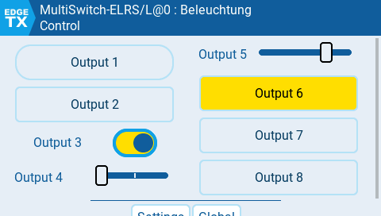

.Das `MultiSwitch`-Telemetrieskript
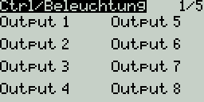

[[_puzzling_parts]]
==== Die einzelnen Bausteine

Die Hardwarekomponenten:

* Sender mit `EdgeTx`
* ELRS-Sendemodul
* ELRS-Empfänger (PWM oder rein seriell)
* bis zu 256 MultiSwitch-ELRS-Module (siehe unten)
* CRSF-Halbduplex-Bus (nicht zwingend erforderlich) (siehe unten)

Die Softwarekomponenten:

* `elrsv3.lua`-Skript auf dem Sender (wer ELRS bereits verwendet, kennt es sicher)
* `MultiSwitch`-Widget-Skript (siehe unten

Zusätzlich:

Wer mehrere `MultiSwitch-E` mit dauerhaft aktiviertem _Telemetriemenü_ (ohne Tastendruck) verwenden möchte, muss einige Voraussetzungen erfüllen:

* die ELRS-Version <<elrs.de.adoc#elrs-route,Andere erweiterte Adressen als `0xc8` zulassen (nur Version 3.x.x)>> verwenden
* sicherstellen, dass jeder `MultiSwitch-E` eine andere CRSF-Bus-Adresse verwendet (von `0xc0` bis `0xcf`)
* sicherstellen, dass jeder `MultiSwitch-E` einen anderen _Ping-Antwort-Zeitschlitz_ verwendet (bei Verwendung der Standardwerte im Konfigurationsmenü ist dies gewährleistet)

Automatische Konfiguration:

Wer die _automatische Konfiguration_ des `MultiSwitch-E` nutzen möchte, sollte unbedingt https://github.com/EdgeTX/edgetx/pull/5773[diesen] PR für EgdeTx verwenden.
Das ist optional, wenn jeweils nur _ein_ MultiSwitch-Widget verwendet wird. Sollen jedoch mehrere MultiSwitch-Widgets in einer Modellkonfiguration eingesetzt werden,
ist diese Änderung erforderlich. Andernfalls funktioniert die _automatische Konfiguration_ möglicherweise nicht.

[[_design]]
==== Konzept

Der MultiSwitch-E8 ließe sich zwar über das Standardskript `elrsv3.lua` steuern, das wäre aber sehr unpraktisch. Deshalb habe ich ein spezielles
Widget zur Steuerung der MultiSwitch-Module geschrieben. Jedes MultiSwitch-Modul hat eine eigene _Adresse_ (0 ... 255), die das Widget _kennen_ muss. In einer Widget-Option
lässt sich die Adresse des zugehörigen Moduls einstellen.

Für jede Adresse lässt sich außerdem ein aussagekräftiger _Name_ des Moduls festlegen, der für jedes Modell auf dem Sender individuell ist, ebenso wie die Namen der ein- oder auszuschaltenden _Funktionen_ und
die gegebenenfalls zu verwendenden physischen Schalter. Dies geschieht über eine modellspezifische Konfigurationsdatei auf der SD-Karte des Senders.

Das CRSF-Protokoll ist erweiterbar. Darauf basiert der Vorschlag zur Steuerung solcher Module: <<protocols.de.adoc#crsf-sw,Befehle für MultiSwitch (Bereich `0xa1`)>>.

[[mswe8]]
==== MultiSwitch-E8

[caption=""]
.Projektinfo
[cols="1h,5",width="100%"]
|===
| Status | 🟢 aktiv
| Hardware | https://oshwlab.com/wilhelm.wm.meier/works[OSHWLab], https://aisler.net/p/GCSJNSFV[Aisler], link:../images/elrs_msw/RCMultiSwitchSmall10.zip[Gerber/BOM (zip)], link:../images/elrs_msw/RCMultiSwitchSmall10.T3001[TARGET 3001!]
| Firmware | https://github.com/wimalopaan/wmucpp/tree/master/boards/rcmultiswitchG030[wmucpp: `boards/rcmultiswitchG030`]
| Steuerung | <<msw_widget>>
| Siehe auch | https://github.com/firlefantz/Elrs-Multiswitch-guide[Gehäuse / Bauanleitung]
|===

Die aktuelle Version findet sich unter https://oshwlab.com/wilhelm.wm.meier/works[].

[CAUTION]
--
Der folgende Entwurf ist veraltet. Bitte den neuen Entwurf verwenden.
--

.Der Schaltplan (zum Vergrößern anklicken)
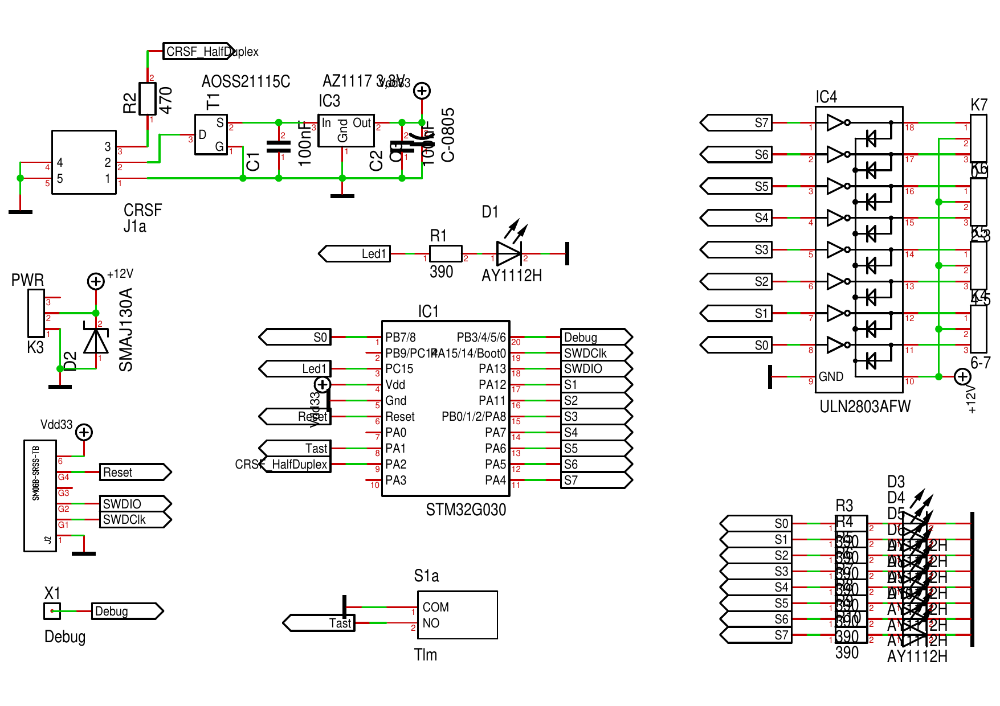

.Die Leiterplatte  (zum Vergrößern anklicken)
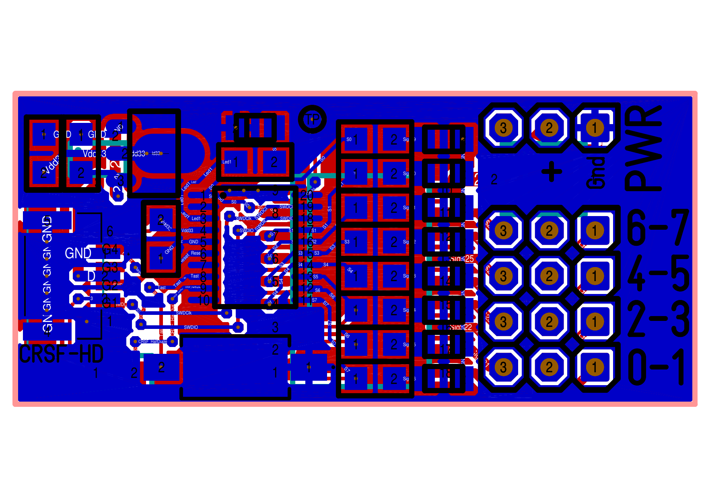

Link zur Leiterplattenbestellung (Aisler): https://aisler.net/p/GCSJNSFV[Leiterplattenbestellung]

Link zur link:../images/elrs_msw/RCMultiSwitchSmall10.T3001[Target 3001-Entwurfsdatei].

Link zu link:../images/elrs_msw/RCMultiSwitchSmall10.zip[Gerber].

Link zum https://github.com/wimalopaan/wmucpp/tree/master/boards/rcmultiswitchG030[Quellcode] (leider muss das gesamte Repository geklont werden)

Anleitung zum Kompilieren der Firmware:

[source,console]
----
$ cd <repo-root>/boards/rcmultiswitchG030
$ make all
----

[[_housing]]
==== Gehäuse

Hier finden sich die Dateien zum Drucken eines ansprechenden Gehäuses für die Leiterplatte: https://github.com/firlefantz/Elrs-Multiswitch-guide[Gehäuse und weitere Informationen].

[[_super_simple_multiswitch_elrscrsf_flyskysbus_flyskyibus_frskysbus_frskys_port_graupnersumdv3]]
==== Sehr einfacher MultiSwitch (ELRS/CRSF, FlySky/SBus, FlySky/IBus, FrSky/SBus, FrSky/S.Port, Graupner/SumDV3)

[[supersimple]]
[caption=""]
.Projektinfo
[cols="1h,5",width="100%"]
|===
| Status | 🟢 aktiv
| Firmware | https://github.com/wimalopaan/wmucpp/tree/master/boards/rcmultiswitch[wmucpp: `boards/rcmultiswitch`]
| Steuerung | <<msw_widget>>, <<msw_bw>>, https://github.com/wimalopaan/LUA/tree/main/SCRIPTS/MIXES[Mischerskripte]
| Video | https://www.youtube.com/watch?v=SQZCM9e6v1E[2025-03-23], https://www.youtube.com/watch?v=e6teZWhJzoQ[2025-03-25], https://www.youtube.com/watch?v=ES77NcNwEtA[2025-10-12], https://www.youtube.com/watch?v=N7wzqSIUbUA[2026-06-20], <<videos.de.adoc#v-supersimple,alle Videos (4)>>
|===

Es bestand der Wunsch nach einer gegenüber dem <<mswe8>> deutlich einfacheren Hardware: Sie sollte nur THT-Bauteile umfassen, damit man sie auf eine einfache
Streifenrasterplatine löten kann. Außerdem sollte sie einfachere µC verwenden, da STM32/ARM manchen Hobbybastlern zu kompliziert erscheint.

Deshalb entschied ich mich, den Code zu reduzieren und auf die AVR-DA/DB- und AVRtiny1-Serien zu portieren. Der einzige im DIP-Gehäuse erhältliche µC ist der
AVR32DA28 (oder ein anderer AVRxxDA28). Aus der AVRtiny1-Serie erscheint der ATtiny1614 vielversprechend, obwohl er nur im SOIC-14-Gehäuse erhältlich ist. Für dieses
Gehäuse gibt es jedoch fertige Adapterplatinen mit THT-Stiftleisten.

Natürlich gibt es einige Einschränkungen:

* nur einfaches Ein-/Ausschalten der Ausgänge
* keine ELRS-Telemetrie, kein Menü über `ELRSv3.lua` oder TBS Agent
* keine PWM-Ausgabe
* keine Blinkmuster
* alle weiteren Funktionen über `ELRSv3.lua` sind nicht möglich

Der Code findet sich hier: https://github.com/wimalopaan/wmucpp/tree/master/boards/rcmultiswitch[]. Dort sollte die Datei `mswitch01.cc` zu finden sein.

Ein aktueller Hardwareentwurf findet sich hier: <<ssmsw>>.

[NOTE]
--
Bitte beachten: Die Datei `mswitch01.cc` enthält generischen Quellcode. Deshalb unbedingt die Pinbelegung im Quellcode beachten.

Wer meine _alte_ MultiSwitch-Hardware (Leiterplatte) verwendet, sollte bei allen folgenden Schritten die Datei `sbus01.cc` statt `mswitchß1.cc` verwenden.
Dabei unbedingt auch die _Adresse_ und die _Codierung_ in den ersten Zeilen der Datei `sbus01.cc` entsprechend den eigenen Anforderungen anpassen!
--

Die Firmware lässt sich mit diesem _gitpod_ kompilieren: https://gitpod.io/#https://github.com/wimalopaan/wmucpp[].

Folgende Schritte ausführen:

* In das Verzeichnis wechseln: `boards/rcmultiswitch`
* Die obersten Zeilen der Datei `mswitch01.cc` bearbeiten
** Eingang auswählen (CRSF oder SBUS oder IBUS oder S.Port oder SumDV3)
** MultiSwitch-Adresse 0...7 auswählen
** auswählen, ob SBus _normal_ oder _invertiert_ ist
** RC-Funkstrecke auswählen (ELRS/AFHDS2A/ACCST für SBUS)
* `Makefile.da` bearbeiten: Zum Auswählen des richtigen µC die entsprechenden Zeilen auskommentieren bzw. die Kommentare entfernen
* Den Befehl ausführen: `make -f Makefile.da all`
* `mswitch01.hex` herunterladen
* Den µC an den UPDI-Programmieradapter anschließen (USBserial mit einer Diode)
* Flashen, z. B.: `pymcuprog write --erase -d avr128da32 -t uart -u /dev/ttyUSB0 -f mswitch01.hex`

.Zwei MultiSwitches auf dem Steckbrett und das Widget
image::../images/elrs_msw/ss01.png[width=240, link="../images/elrs_msw/ss01.png"]

.Zwei MultiSwitches auf dem Steckbrett
image::../images/elrs_msw/ss02.png[width=240, link="../images/elrs_msw/ss02.png"]

Ein Hinweis zur Konfiguration des <<msw_widget>>: Das Widget wurde für den Betrieb
mit `CRSF` (und ELRS) entwickelt. Wer ELRS-Komponenten verwendet und diesen sehr einfachen MultiSwitch über `CRSF` an den
Empfänger anschließt, kann es problemlos nutzen.

Der sehr einfache MultiSwitch kann aber auch über `SBUS` angeschlossen werden. Das ist sinnvoll, denn
er bietet keine Telemetrie, also beispielsweise kein Menü über `elrsv3.lua` oder TBS Agent. Die
Kommunikation ist somit rein unidirektional.

Der sehr einfache MultiSwitch lässt sich über `SBUS` anschließen (siehe Quellcode:  `mswitch01.cc`), und es können
neben ELRS auch andere RC-Funkstrecken wie AFHDS2A/FlySky oder ACCST/FrSky verwendet werden. Dabei ist jedoch zu beachten, dass die `SBUS`-Kanalwerte
eine ziemlich undurchsichtige Skalierung durchlaufen. Die Bits eines `SBUS`-Kanals kommen daher nicht unverändert bei einem Gerät an,
das am `SBUS` des Empfängers angeschlossen ist.

Außerdem erlaubt `SBUS` keine Übertragung von _Außerbanddaten_. Die Daten müssen daher codiert und
über einen der 16 `SBUS`-Kanäle gesendet werden (bei `mswitch01.cc` muss das Kanal 16 sein). Deshalb müssen die
Daten auf dem Sender in Kanal 16 codiert werden. Dies geschieht über ein _Mischerskript_ in EdgeTx: `mswsb.lua`,
siehe https://github.com/wimalopaan/LUA/tree/main/SCRIPTS/MIXES[].

Damit _Widget_ und _Mischerskript_ miteinander kommunizieren können, muss `ShmEncoding` in den Widget-Einstellungen eingerichtet werden. Im Mischerskript ist dieselbe
SHM-Variable zu verwenden.

Falls der `SBUS`-Aufbau nicht funktioniert, etwa wegen der erwähnten undurchsichtigen Skalierungen, kann als Nächstes S.Port ausprobiert werden. Im
Widget lassen sich die S.Port-Übertragung sowie die passende physische ID und Anwendungs-ID auswählen.

Für FlySky-Nutzer ist `ibus` der bessere Ansatz.  FlySky unterstützt zwar kein S.Port, die Kanalwerte durchlaufen jedoch
keine so merkwürdigen Skalierungen wie bei ACCST/SBus. Dabei ist selbstverständlich das Mischerskript `mswib.lua` zu verwenden.

Auch für Nutzer von _Graupner_-Komponenten (HoTT) gibt es gute Nachrichten: Das Aktorprotokoll `SumDV3` kann bis zu 32 RC-Kanäle
und zusätzlich 64 binäre Schalter übertragen. Dafür ist natürlich ein Sender erforderlich, auf dem sich _digitale Schalter_ definieren lassen.

[[ssmsw]]
==== Leiterplatte mit 16 Ausgängen

[caption=""]
.Projektinfo
[cols="1h,5",width="100%"]
|===
| Status | 🟢 aktiv
| Hardware | https://oshwlab.com/wilhelm.wm.meier/supersimplemultiswitch[OSHWLab]
| Firmware | https://github.com/wimalopaan/wmucpp/tree/master/boards/rcsupersimplemultiswitch[wmucpp: `boards/rcsupersimplemultiswitch`]
| Steuerung | <<msw_widget>>
| Video | https://www.youtube.com/watch?v=mU0vg94EXQQ[2025-10-23], <<videos.de.adoc#v-ssmsw,alle Videos (1)>>
|===

Ich habe eine _SuperSimpleMultiSwitch_-Hardware mit dem AVR128DA28 im DIP-Gehäuse entworfen. Dieser Hardwareentwurf lässt sich sehr einfach nachbauen und
findet sich unter https://oshwlab.com/wilhelm.wm.meier/supersimplemultiswitch[].
Wem die Leiterplatte nicht zusagt, der kann anhand der Schaltpläne eine eigene entwerfen.

.Der SuperSimpleMultiSwitch mit 16 Ausgängen
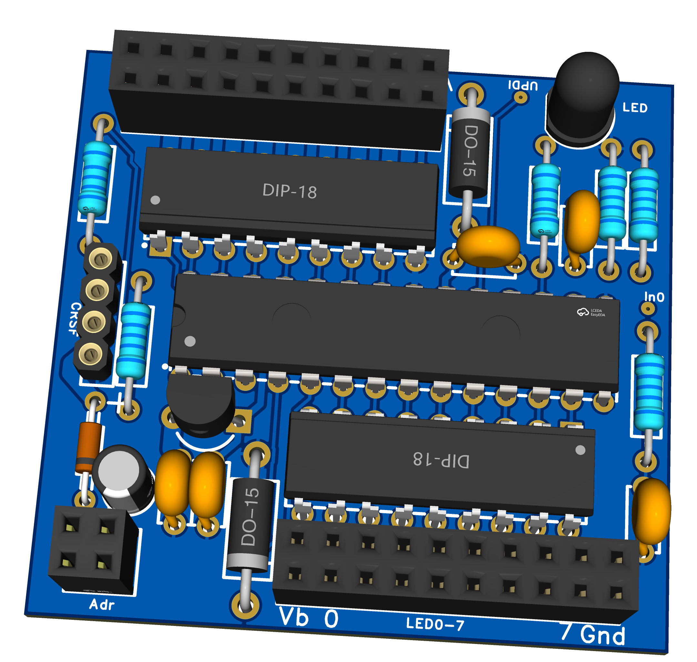

.Die Leiterplatte des SuperSimpleMultiSwitch mit 16 Ausgängen
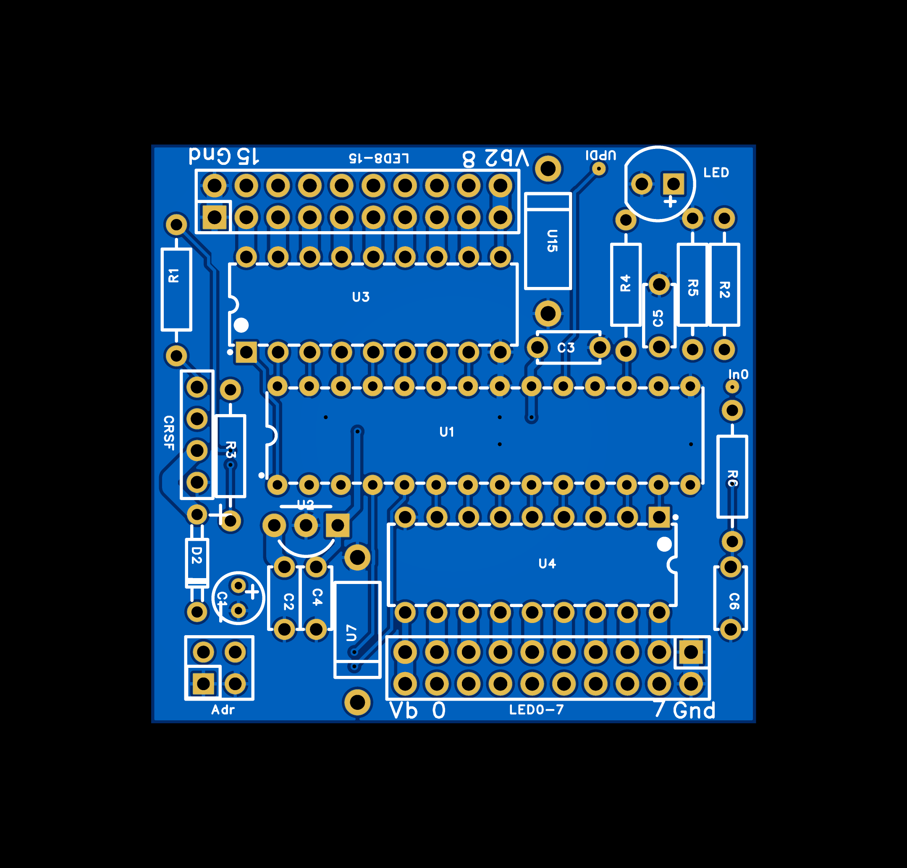

Das Modul hat 16 Ausgangskanäle und belegt deshalb grundsätzlich _zwei_ MultiSwitch-Adressen. Seine Basisadresse lässt sich über zwei Steckbrücken auf der Platine auswählen.

Die Firmware findet sich hier: https://github.com/wimalopaan/wmucpp/tree/master/boards/rcsupersimplemultiswitch[]. Wer sie nicht lokal
auf dem Notebook oder PC kompilieren möchte, kann dafür `github` _CodeSpaces_ verwenden. Siehe dazu  <<building.de.adoc#cs_wm,`github` CodeSpaces verwenden>>.

Folgende Schritte ausführen:

* In das Verzeichnis wechseln: `boards/rcsupersimplemultiswitch`
* Die obersten Zeilen der Datei `settings.h` bearbeiten
** Eingang auswählen (CRSF oder SBUS oder IBUS oder S.Port oder SUMDV3)
** auswählen, ob SBus _normal_ oder _invertiert_ ist
** RC-Funkstrecke auswählen (ELRS/AFHDS2A/ACCST für SBUS)
* Den Befehl ausführen: `make -f Makefile all`
* `ssmsw02.hex` herunterladen
* Den µC an den UPDI-Programmieradapter anschließen (USBserial mit einer Diode)
* Flashen, z. B.: `pymcuprog write --erase -d avr128da32 -t uart -u /dev/ttyUSB0 -f ssmsw02.hex`

.Einschränkungen
[TIP]
--
Die Firmware verwendet weder den RESPONSE_SLOT-Algorithmus noch eine Open-Drain-TX-Leitung,
deshalb sollte nur ein Modul Telemetriedaten an den RX senden.
Bei parallel angeschlossenen Modulen sollte nur eines mit seiner TX-Leitung an die RX-Leitung des Empfängers angeschlossen sein.
Alternativ können zwei Module mit Telemetrie an unterschiedliche serielle Anschlüsse
des Empfängers angeschlossen werden, oder es muss der CRSF-Switch/Router verwendet werden.
--

[[msw_nucleo]]
==== STM32G031F8 Nucleo-Board als MultiSwitch

[caption=""]
.Projektinfo
[cols="1h,5",width="100%"]
|===
| Status | 🟢 aktiv
| Hardware | https://www.st.com/en/evaluation-tools/nucleo-g031k8.html[ST Nucleo-G031K8]
| Firmware | https://github.com/wimalopaan/wmucpp/tree/master/boards/rcmultiswitchG030[wmucpp: `boards/rcmultiswitchG030`]
| Steuerung | <<msw_widget>>
| Video | https://www.youtube.com/watch?v=-KHh-UYU7IA[2025-08-21], <<videos.de.adoc#v-msw_nucleo,alle Videos (1)>>
|===

Obwohl viele ihren eigenen <<mswe8>> zusammenbauen, gibt es auch Leute, die diese Platinen nicht bestellen und sämtliche
Bauteile selbst bestücken möchten, aber auch keinen Bestückungsservice eines großen Leiterplattenherstellers nutzen wollen. Deshalb bestand der Wunsch nach einer leichter selbst nachzubauenden
Version dieses MultiSwitch.

Die Lösung besteht darin, vorgefertigte µC-Platinen zu verwenden, auf denen bereits alle SMD-Bauteile bestückt sind und die zugleich 2.54mm-Stiftleisten besitzen. An diese werden alle Verbindungen
zum Empfänger, zur Stromversorgung, zu den Ausgängen und zum Programmieren angeschlossen. Die hier verwendeten STM Nucleo-Boards besitzen außerdem einen einfach zu bedienenden
integrierten Programmieradapter: Zum Programmieren genügt es, die Firmwaredatei auf dessen emuliertes USB-Laufwerk zu kopieren (alternativ kann auch die st-link-Programmiersoftware
verwendet werden).

Das STM Nucleo-Board: https://www.st.com/en/evaluation-tools/nucleo-g031k8.html[]. In dieser Dokumentation finden sich alle Einzelheiten zur Platine.

Die für den MultiSwitch verwendete Pinbelegung des Nucleo-Boards findet sich hier: https://github.com/wimalopaan/wmucpp/blob/a9a4ad7189aacfe1117c3167641f161669980336/boards/rcmultiswitchG030/devices_2.h#L310-L319[]

Es muss also nur die Firmware mit gitpod erstellt werden (siehe: <<building.de.adoc#gitpod_wm,Den Quellcode meiner Projekte (`wmucpp`) kompilieren>>).

Unbedingt die richtige Firmwareversion aktivieren: https://github.com/wimalopaan/wmucpp/blob/69835d2d781f9924fd9ded9a67e0e75d033ec7dc/boards/rcmultiswitchG030/msw20.cc#L19-L24[hier]

Hier `HW_NUCLEO` aktivieren (alle anderen auskommentieren).

.Pins des Nucleo STM32G031-Boards
|===
| Beschreibung | Pin | Stiftleistenbezeichnung

| Ausgang 0 | PA7 | A7
| Ausgang 1 | PA6 | A6
| Ausgang 2 | PA11 | A5
| Ausgang 3 | PA8 | D9
| Ausgang 4 | PA5 | A3
| Ausgang 5 | PA4 | A2
| Ausgang 6 | PA1 | A1
| Ausgang 7 | PB3 | D13
| zum CRSF-TX des Empfängers | PA9 | D5 
| zum CRSF-RX des Empfängers | PA10 | D4 
| Taster | PB6 | D1
| serielle Debugausgabe | PA2 | (über USB) 
| LED (auf der Platine) | PC6 | 
| Testpunkt (falls aktiviert) | PB4 | D12
|===

Zum Schluss mit `make` die `G031`-Version des Quellcodes kompilieren:

[source]
--
make clean g031
--

[TIP]
--
Wer mehrere Nucleo-MultiSwitches parallel verwenden möchte, muss unbedingt `CRSF_TX_OPENDRAIN` im Quellcode setzen. Dann können die `tx`- und `rx`-Leitungen aller
Module parallel angeschlossen werden.
--

[[msw_weact]]
==== WeAct STM32G031F8 als MultiSwitch

[caption=""]
.Projektinfo
[cols="1h,5",width="100%"]
|===
| Status | 🟢 aktiv
| Hardware | https://de.aliexpress.com/item/1005005748198584.html[WeAct STM32G0-Platine]
| Firmware | https://github.com/wimalopaan/wmucpp/tree/master/boards/rcmultiswitchG030[wmucpp: `boards/rcmultiswitchG030`]
| Steuerung | <<msw_widget>>
| Video | https://www.youtube.com/watch?v=vY8LG9SDndU[2025-08-23], https://www.youtube.com/watch?v=LgFiy0gqKGg[2025-09-07], <<videos.de.adoc#v-msw_weact,alle Videos (2)>>
|===

Die https://de.aliexpress.com/item/1005005748198584.html[] ist noch kleiner als die <<msw_nucleo, Nucleo>>-Version. Hinsichtlich Preis und Größe ist diese Platine daher eine sehr gute Wahl.

Die Unterschiede zum <<msw_nucleo, Nucleo>> bestehen darin, dass kein Programmieradapter integriert ist (es muss ein separater `st-link`-Programmieradapter verwendet werden) und die Pinbelegung anders ist

Es muss also nur die Firmware mit gitpod erstellt werden (siehe: <<building.de.adoc#gitpod_wm,Den Quellcode meiner Projekte (`wmucpp`) kompilieren>>).

Unbedingt die richtige Firmwareversion aktivieren: https://github.com/wimalopaan/wmucpp/blob/a9a4ad7189aacfe1117c3167641f161669980336/boards/rcmultiswitchG030/msw20.cc#L19-L22[]
Hier `HW_WEACT` aktivieren (alle anderen auskommentieren).

.Pins der WeAct STM32G031-Platine
|===
| Beschreibung | Pin | Stiftleistenbezeichnung | Bezeichnung auf der Platine

| Ausgang 0 | PA0 | P2-7 | A0
| Ausgang 1 | PA1 | P2-8 | A1
| Ausgang 2 | PA2 | P2-9 | A2
| Ausgang 3 | PA3 | P2-10 | A3
| Ausgang 4 | PB6 | P3-1 | B6
| Ausgang 5 | PA6 | P3-6 | A6
| Ausgang 6 | PA7 | P3-5 | A7
| Ausgang 7 | PA8 | P3-4 | A8
| zum CRSF-TX des Empfängers | PA9 | P3-3  | A9 
| zum CRSF-RX des Empfängers | PA10 | P3-2  | A10
| Taster auf der Platine | PA14 | 
| serielle Debugausgabe | PA14 | (Konflikt mit dem Taster) 
| LED (auf der Platine) | PA4 | 
| Testpunkt (falls aktiviert) | PB7 | P2-1
| Statuseingang 0 | PA5 | P3-7 | A5
| Statuseingang 1 | PB7 | P2-1 | B7
|===

Zum Schluss mit `make` die `G031`-Version des Quellcodes kompilieren:

[source]
--
make clean g031
--

[TIP]
--
Wer mehrere Nucleo-MultiSwitches parallel verwenden möchte, muss unbedingt `CRSF_TX_OPENDRAIN` im Quellcode setzen. Dann können die `tx`- und `rx`-Leitungen aller
Module parallel angeschlossen werden.
--

[[msw_tht]]
==== WeAct STM32G031F8 als MultiSwitch mit THT-Leiterplatte

[caption=""]
.Projektinfo
[cols="1h,5",width="100%"]
|===
| Status | 🔵 stabil
| Hardware | link:../images/elrs_msw/seaspotter/Gerber_CRSF-Multiswitch-THT-v1.1.zip[Gerber (zip)]
| Firmware | https://github.com/wimalopaan/wmucpp/tree/master/boards/rcmultiswitchG030[wmucpp: `boards/rcmultiswitchG030`]
| Steuerung | <<msw_widget>>
| Video | https://www.youtube.com/watch?v=DVyyuaLCTKw[2025-09-17], <<videos.de.adoc#v-msw_tht,alle Videos (1)>>
|===

Der folgende Leiterplattenentwurf wurde freundlicherweise von Florian (`seaspotter`) zur Verfügung gestellt.

.Die `MultiSwitch`-Leiterplatte mit THT-Bauteilen
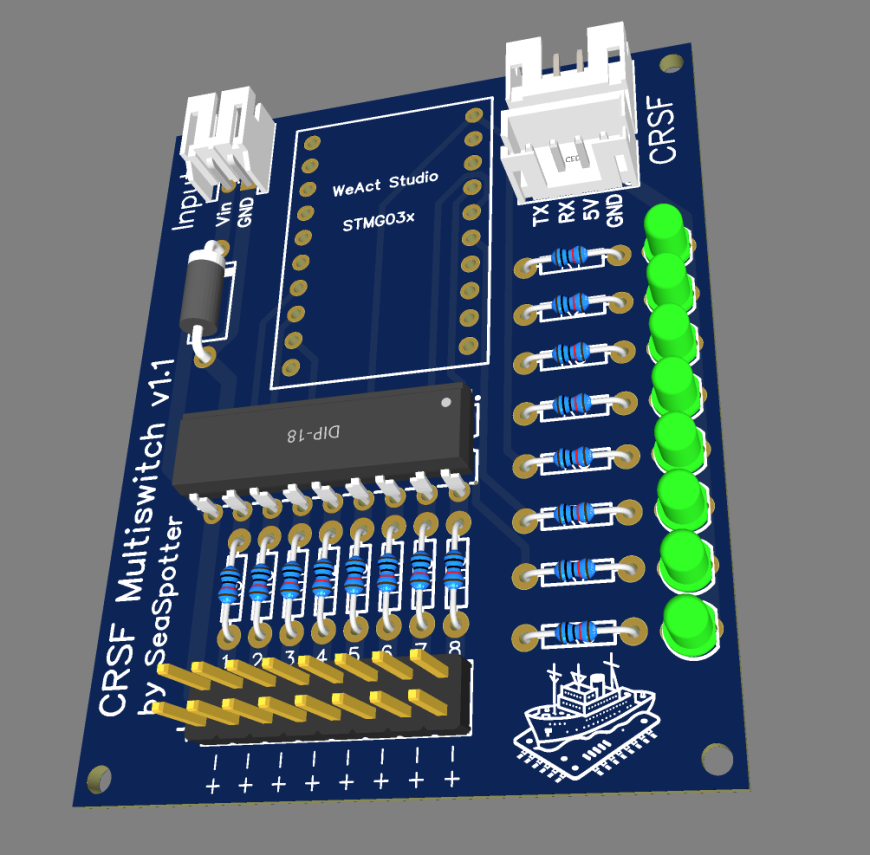

.Der Schaltplan der `MultiSwitch`-Leiterplatte mit THT-Bauteilen
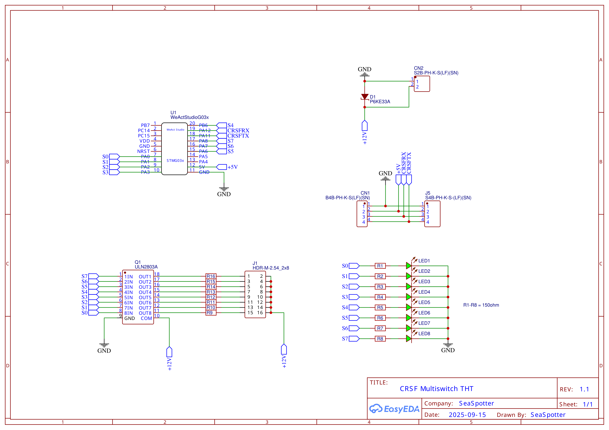

Wer diese Leiterplatte fertigen lassen möchte, kann den folgenden Link zu den Gerber-Dateien verwenden.

Link zu link:../images/elrs_msw/seaspotter/Gerber_CRSF-Multiswitch-THT-v1.1.zip[Gerber].

[[msw_widget_ng]]
==== MultiSwitch NG-Widget

[caption=""]
.Projektinfo
[cols="1h,5",width="100%"]
|===
| Status | 🟢 aktiv
| Software | https://github.com/wimalopaan/LUA/tree/main/WIDGETS/lvglMultiSwNG[LUA: `lvglMultiSwNG`] (Sender mit Farbdisplay)
| Voraussetzungen | EdgeTX 2.11.3 oder neuer mit LVGL-Unterstützung
| Protokoll | <<protocols.de.adoc#crsf_sw,CRSF-MultiSwitch-Befehle>>, S.Port WM, S.Port ACW 1.5 / 1.4
| Dokumentation | https://github.com/wimalopaan/LUA/blob/main/WIDGETS/lvglMultiSwNG/README.adoc[Installation, Bedienung und Konfiguration]
|===

`MultiSwitch NG` ist eine Neuimplementierung des LVGL-MultiSwitch-Widgets. Das bestehende <<msw_widget,MultiSwitch-Widget>> bleibt unverändert verfügbar.

Das Widget bietet:

* konfigurierbare Registerkarten mit individuellen Standardadressen, Layouts und Bedienelementen
* einrastende Schaltflächen, Umschalter, Bedienelemente mit drei Stellungen, Taster und Schieberegler (Schieberegler benötigen CRSF)
* Zuweisungen physischer Schalter und Quellen, Aktivierungsschalter und registerkartenübergreifende Exklusivgruppen
* konfigurierbare Namen, Farben, Schriftarten und optionale Bilder auf Schaltflächen
* Schalten über CRSF, proportionale Ausgänge und optionale LED-Farbübertragung oder Ausgabe über S.Port WM / ACW
* gemeinsame Konfiguration und Ausgangszustände für Widget-Instanzen desselben Modells
* automatisches Speichern und separate Anzeigen für Konfigurations-, Speicher- und Betriebsstatus
* eine deutsche oder englische Oberfläche, die automatisch anhand der EdgeTX-Menüsprache ausgewählt wird

Das vollständige Verzeichnis nach `/WIDGETS/lvglMultiSwNG/` auf die SD-Karte kopieren und das Widget `MultiSw NG` auswählen.
Bedienung und Konfiguration erfolgen im Vollbildmodus.

[WARNING]
--
Das Widget vor dem Einsatz in einem Modell auf dem Sender oder im EdgeTX-Simulator testen.
Die Konfiguration des alten Widgets wird weder geladen noch überschrieben; eine Migration wird noch nicht unterstützt.
--

[[msw_widget]]
==== MultiSwitch-Widget

[caption=""]
.Projektinfo
[cols="1h,5",width="100%"]
|===
| Status | 🔵 stabil
| Software | https://github.com/wimalopaan/LUA?tab=readme-ov-file#lvglmsw[LUA: `lvglMultiSw`] (Sender mit Farbdisplay)
| Protokoll | <<protocols.de.adoc#crsf-sw,CRSF-MultiSwitch-Befehle>>
| Video | https://www.youtube.com/watch?v=aaKBlDT08Tc[2025-07-28], https://www.youtube.com/watch?v=s7mjQJYgb9o[2025-08-15], https://www.youtube.com/watch?v=fQk5mrm1Hiw[2025-10-15], https://www.youtube.com/watch?v=NAWFy8ZdQog[2025-11-05], https://www.youtube.com/watch?v=Gw56sHEIoD8[2025-11-12], https://www.youtube.com/watch?v=7_HkYi2aqZk[2025-11-15], <<videos.de.adoc#v-msw_widget,alle Videos (7)>>
|===

Das stabile Widget findet sich hier: https://github.com/wimalopaan/LUA?tab=readme-ov-file#lvglmsw[]
Zur aktiv weiterentwickelten Neuimplementierung siehe <<msw_widget_ng,MultiSwitch NG-Widget>>.

[TIP]
--
Unbedingt alle Dateien _in_ ein Verzeichnis namens `lvglMultiSw` kopieren (Groß- und Kleinschreibung beachten).
--

[WARNING]
--
Vor der Installation einer neuen Widget-Version _immer_ eine Kopie _aller_ Konfigurationsdateien des Widgets anlegen. Die Konfigurationsdateien
heißen `<modelname>_<startaddress>.lua`
--

.Die Hauptansicht des `MultiSwitch`-Widgets

.Die Ansicht Einstellungen 1 des `MultiSwitch`-Widgets
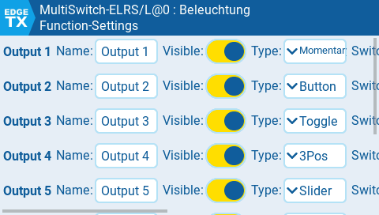

.Die Ansicht der globalen Einstellungen des `MultiSwitch`-Widgets
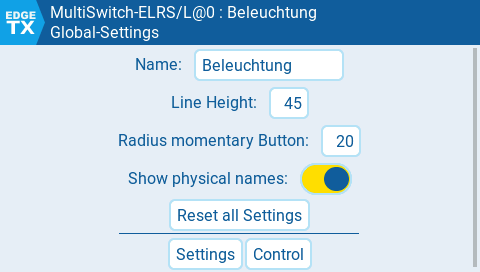

.Die Telemetrieansicht des `MultiSwitch`-Widgets
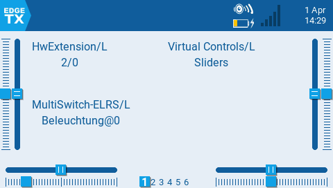

Das Widget kann:

* MultiSwitch-E steuern (über CRSF, auch SBus, IBus, SPort)
* Schaltflächen, Taster, Kontrollkästchen und Schieberegler zur Steuerung der Ausgänge verwenden
* Namen und Farben der Schaltflächen einstellen
* physische Schalter zur Steuerung von Multiswitch-W verwenden
* logische und virtuelle Schalter setzen
* unterschiedliche Schaltadressen und Ausgänge zuordnen
* eine konfigurierbare Anzahl von Schaltflächen verwenden
* Farbinformationen an RGB-LEDs senden (ELRS-Empfänger, Cruise-Controller)
* Statusbits anzeigen
* ...

////
(Die folgenden Informationen sind *veraltet*)

Der Code des Widgets findet sich hier: https://github.com/wimalopaan/LUA[]

.Das `MultiSwitch`-Widget
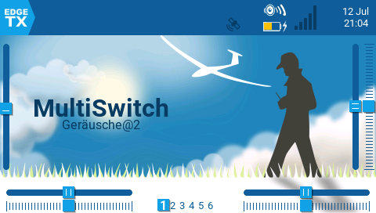

.Das `MultiSwitch`-Widget (Vollbild)
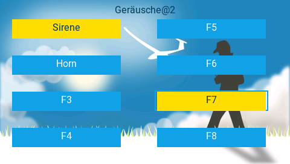

Normalerweise verwendet das Widget eine _Konfigurationsdatei_ (Dateiname: `<name_of_model>.lua`), um die Art der Schaltflächen, ihre Beschriftung, den zu verwendenden logischen Schalter usw. festzulegen.
Das funktioniert gut, aber bei einem Senderwechsel muss auf dem neuen Sender derselbe Modellname eingestellt sein. Außerdem muss die Konfigurationsdatei kopiert und identisch gehalten werden. Das kann mühsam sein.
Um diese Einschränkung zu umgehen, kann das `MultiSwitch-E`-Modul die Konfiguration selbst enthalten, und das Widget kann sie vom Modul anfordern.

Um dies zu nutzen, die Option `AutoConf` des Widgets aktivieren.
////

[[msw_bw]]
==== MultiSwitch-Telemetrieskript

[caption=""]
.Projektinfo
[cols="1h,5",width="100%"]
|===
| Status | 🔵 stabil
| Software | https://github.com/wimalopaan/LUA?tab=readme-ov-file#multiswitch-bw-telemetry-script[LUA-Telemetrieskript] (Sender mit Schwarzweißdisplay)
| Video | https://www.youtube.com/watch?v=bK-Kyz6lSjs[2025-06-20], <<videos.de.adoc#v-msw_bw,alle Videos (1)>>
| Siehe auch | <<edgetx.de.adoc#edgetx_shm_bw,SHM-Variablen für Sender mit Schwarzweißdisplay>>
|===

Um den `MultiSwitch` mit Sendern mit Schwarzweiß-LCD zu verwenden, muss ein _Telemetrieskript_ installiert werden.
Dieses _Skript_ findet sich hier: https://github.com/wimalopaan/LUA?tab=readme-ov-file#multiswitch-bw-telemetry-script[]

Dieses Skript läuft auf Sendern mit 192kB RAM problemlos neben `elrcV3.lua`. Auf Sendern mit nur 128kB RAM oder weniger sollte man jedoch nicht erwarten, dass es läuft.

.Die Bedienansicht des `MultiSwitch`-Telemetrieskripts

.Die Ansicht Einstellungen 1 des `MultiSwitch`-Telemetrieskripts
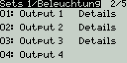

.Die Detailansicht der Einstellungen des `MultiSwitch`-Telemetrieskripts
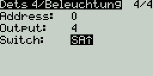

.Die Ansicht Einstellungen 2 des `MultiSwitch`-Telemetrieskripts
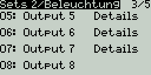

.Die globale Ansicht des `MultiSwitch`-Telemetrieskripts
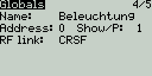

.Die Informationsansicht des `MultiSwitch`-Telemetrieskripts
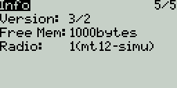

[[crsf_enc]]
==== CRSF-Codierung

Die Schaltzustände werden über das CRSF-Protokoll codiert (siehe <<protocols.de.adoc#crsf_sw,Vorschlag für das CRSF-Protokoll>>).

[[sport_enc]]
==== S.Port-Codierung

Die Schaltzustände werden über S.Port-Befehle codiert. Für den MultiSwitch-Teil wird ein _Schreibbefehl_ (`0x31`) verwendet:

* S.Port-Befehl: `0x31`
* physische ID: konfigurierbar
* Anwendungs-ID: `0x5100` (DIY1) (Schaltadresse `0`) bis `0x51ff` (Schaltadresse `255`)
* Wert: 16bit (von 32bit): jeder Schalter als 2-Bit-Wert (binäre, ternäre und quaternäre Schalter sind möglich)

Diese S.Port-Befehle werden an das MultiSwitch-Modul gesendet, das den jeweiligen Befehl decodieren muss.

[[sbus_enc]]
==== Einfache (unzuverlässige) SBus-Codierung

Die Schaltzustände werden über Kanalwerte codiert.

Ein Warnhinweis: Bei der Übertragung der Kanalwerte finden mehrere Skalierungsschritte statt, unter anderem in `EdgeTx`, im HF-Modul und im Empfänger. Unterschiedliche Hersteller verwenden unterschiedliche
Skalierungsverfahren. Deshalb sind von den 11 Bits der SBus-Kanalwerte nur 6 Bits nutzbar. Auf der Senderseite werden der Zustand eines Ausgangs (1Bit), die
Nummer des Ausgangs (3bit) und die Adresse des MultiSwitch-Moduls (2bit) zu einem 6bit-Code zusammengefasst und nach links verschoben, um den gesamten SBus-Wertebereich auszunutzen. Auf der Empfängerseite
wird im MultiSwitch-Modul der Kanalwert um 4 nach rechts verschoben und die 6bit werden decodiert.
