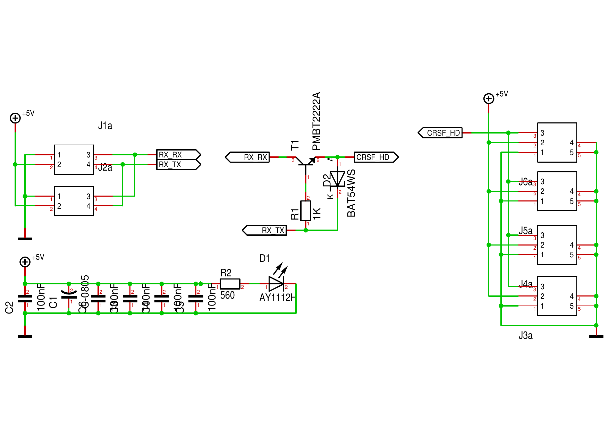
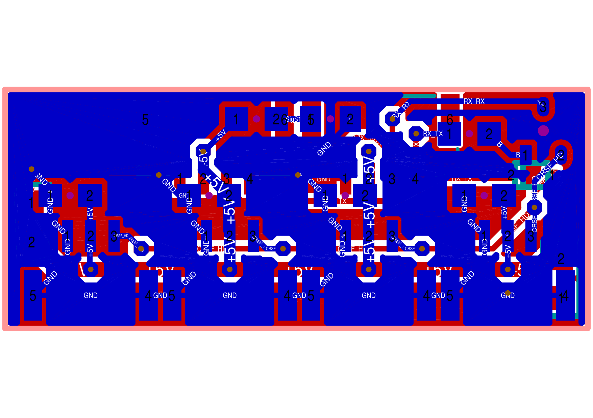
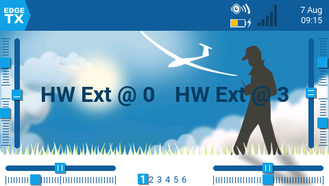
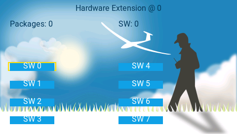

= Protocols
Wilhelm Meier <wilhelm.wm.meier@googlemail.com>
:toc:
:toclevels: 3
:toc-placement!:
:sectnums:
:sectnumlevels: 5
:tip-caption: :bulb:
:note-caption: :information_source:
:important-caption: :heavy_exclamation_mark:
:caution-caption: :fire:
:warning-caption: :warning:

*English* | <<protocols.de.adoc#,Deutsch>>

<<../README.adoc#,RC Electronics>> / Protocols

[NOTE]
--
CRSF protocol extensions (MultiSwitch, Prop32, ESP-NOW), CRSF half-duplex bus, Hardware-Extension-Protocol.
--

toc::[]

[[crsf_sw]]
== Proposal for the CRSF protocol

This is a proposal for an extension to the `CRSF` protocol. Because the protocol is extensible, it works with every handset, transmitter module and receiver.

Refer to https://github.com/crsf-wg/crsf/wiki[crsf].

This is used by a <<multiswitch.adoc#msw_widget,EdgeTx-Widget>> (encoder) together with the <<cruise-control.adoc#CC,The `CruiseController`>> (decoder).

The byte tables below were taken from the reference implementations:
https://github.com/wimalopaan/LUA/blob/main/WIDGETS/lvglMultiSw/crsf.lua[MultiSwitch widget] and
https://github.com/wimalopaan/LUA/blob/main/SCRIPTS/MIXES/crsfch.lua[`crsfch.lua`] (encoders), plus
https://github.com/wimalopaan/wmucpp/blob/master/include_stm32/rc/rc_2.h[`rc_2.h`] (decoders, constants).
All example frames contain correctly computed CRCs.

[[crsf-frame]]
=== Frame structure

==== General CRSF frame

[cols="1,2,2,5",options="header"]
|===
| Byte | Field | Value | Description
| 0 | `sync` | `0xc8` | Sync / address byte. Frames from the receiver use `0xc8`. EdgeTX uses the module address `0xee` towards the TX module.
| 1 | `len` | `2` ... `62` | Number of the following bytes: `type` + payload + `crc8` (= total frame length - 2)
| 2 | `type` | | Frame type (e.g. `0x32` command, `0x7f` passthrough)
| 3 ... n-2 | payload | | Extended frame types (`type >= 0x28`) start with `dest` and `src`.
| n-1 | `crc8` | | CRC8 (polynomial `0xd5`, init `0x00`) over `type` and payload, i.e. bytes 2 ... n-2
|===

The total frame length is at most 64 bytes, so `len` is at most 62.

[[crsf-cmd-frame]]
==== Command frame (type `0x32`)

All extensions in this section use the extended frame type `CRSF_FRAMETYPE_COMMAND` (`0x32`) and add new _realms_ (command classes).
The byte indices are absolute frame indices, as used by the firmware decoders (e.g. `data[7]` = first command parameter).

[cols="1,2,2,5",options="header"]
|===
| Byte | Field | Value | Description
| 0 | `sync` | `0xc8` | see above
| 1 | `len` | | `1` (type) + `4` (dest, src, realm, cmd) + _k_ (parameters) + `1` (cmd-crc) + `1` (crc8) = _k_ + 7
| 2 | `type` | `0x32` | `CRSF_FRAMETYPE_COMMAND`
| 3 | `dest` | | Destination address (see <<crsf-addresses>>)
| 4 | `src` | | Source address (see <<crsf-addresses>>)
| 5 | `realm` | `0xa0`, `0xa1`, ... | Command realm (see <<crsf-realms>>)
| 6 | `cmd` | | Command within the realm
| 7 ... 6+_k_ | parameters | | _k_ command-specific bytes (see below)
| 7+_k_ | `cmd-crc` | | _optional_: command CRC8 (polynomial `0xba`, init `0x00`) over bytes 2 ... 6+_k_
| n-1 | `crc8` | | Frame CRC8 (polynomial `0xd5`) over bytes 2 ... n-2 (including `cmd-crc`)
|===

[NOTE]
--
EdgeTX `crossfireTelemetryPush(0x32, {...})` automatically appends the command CRC (`cmd-crc`). Lua scripts therefore pass only
`dest`, `src`, `realm`, `cmd` and the parameters. Frames generated by the devices themselves (the intermodule commands `0x11` ... `0x13`)
do *not* contain a `cmd-crc`. Decoders read the parameters by index and ignore the `cmd-crc`, so both forms are accepted.
--

[[crsf-addresses]]
.CRSF addresses
[cols="1,2,5",options="header"]
|===
| Address | Name | Usage
| `0x00` | Broadcast | Default `dest` of the MultiSwitch widget (configurable as _command broadcast address_). Also the `dest` of the intermodule commands.
| `0xc8` | Flight controller / controller | `dest` of `crsfch.lua` (Prop32)
| `0xea` | Radio / handset | `src` of all frames sent by EdgeTX scripts. `dest` of telemetry messages to the radio.
| `0xec` | Receiver |
| `0xee` | Transmitter module |
|===

[[crsf-realms]]
.Realms
[cols="1,3,3",options="header"]
|===
| Realm | Name | Description
| `0xa0` | `CruiseController` | Cruise controller, proportional channels (<<prop32>>)
| `0xa1` | `MultiSwitch` | Switch modules (<<crsf-sw>>)
| `0xa2` | `Schottel-Controller` | Schottel / azimuth drives
|===

[[crsf-sw]]
=== Commands for MultiSwitch (realm `0xa1`)

* Packet type: `CRSF_FRAMETYPE_COMMAND`, `0x32`
* Command realm: `MultiSwitch`, `0xa1` (user-defined realm)

Overall packet: `[0xc8]` `[len]` `[0x32]` `[` `[dst]` `[src]` `[0xa1]` `<command>` `<payload>` `]` `[cmd-crc]` `[crc8]`

The first parameter byte (byte 7) is the _switch address_ (0 ... 255) for most commands. It selects the module (or the output group of a module).
This is *not* the CRSF address.

.Commands in realm `0xa1`
[cols="1,3,2,5",options="header"]
|===
| Cmd | Name | Parameters (bytes) | Description
| `0x01` | `Set` | 2 | set 8 binary switches
| `0x02` | `Prop` | 3 | set a proportional value (8-bit resolution)
| `0x03` | `RequestTelemetry` | | deprecated
| `0x04` | `RequestTelemetryItem` | | deprecated
| `0x05` | `RequestConfigItem` | | deprecated
| `0x06` | `RequestDeviceInfo` | | deprecated
| `0x07` | `Set4` | 3 | set 8 4-state switches (2 bits for each switch)
| `0x08` | `Set64` | | reserved (experimental, tbd)
| `0x09` | `Set4M` | 1 + 3 * _count_ | set multiple 4-state switches with different switch addresses
| `0x0a` | `SetRGB` | 2 + 2 * _count_ | set the colour of the RGB LEDs of the switch
| `0x0b` | `SetText` | | reserved (experimental: morse text)
| `0x10` | `InterModule` | | intermodule communication (deprecated)
| `0x11` | `InterModulePatternStart` | 2 | intermodule pattern start
| `0x12` | `InterModulePatternStopAll` | 1 | intermodule pattern stop all
| `0x13` | `InterModuleSlaveSet` | 2 | intermodule slave set
|===

==== Command `0x01` (Set)

Payload: `<address>` `<state>`

[cols="1,2,2,5",options="header"]
|===
| Byte | Field | Range | Description
| 7 | `<address>` | `0` ... `255` | switch address
| 8 | `<state>` | `0x00` ... `0xff` | state of 8 binary switches: bit _k_ = output _k_ (`1` = on)
|===

.Bit layout of `<state>`
[cols="2,1,1,1,1,1,1,1,1"]
|===
| Bit | 7 | 6 | 5 | 4 | 3 | 2 | 1 | 0
| Output | 7 | 6 | 5 | 4 | 3 | 2 | 1 | 0
|===

Outputs are numbered from 0. In the widget they are numbered 1 ... 8, so widget output 1 is bit 0.

Example: switch address `0`, outputs 0 and 2 on (`state = 0b0000'0101`):

 C8 09 32 00 EA A1 01 00 05 4E F3

==== Command `0x07` (Set4)

Payload: `<address>` `<stateH>` `<stateL>`

[cols="1,2,2,5",options="header"]
|===
| Byte | Field | Range | Description
| 7 | `<address>` | `0` ... `255` | switch address
| 8 | `<stateH>` | `0x00` ... `0xff` | state of the 4-state switches (outputs) 4 ... 7
| 9 | `<stateL>` | `0x00` ... `0xff` | state of the 4-state switches (outputs) 0 ... 3
|===

`<stateH>` and `<stateL>` form a 16-bit value `state = (stateH << 8) | stateL` (big-endian). Output _k_ uses bits `2k+1 .. 2k`:

.Bit layout of `<stateH>` / `<stateL>`
[cols="2,1,1,1,1,1,1,1,1"]
|===
| Bit | 7 | 6 | 5 | 4 | 3 | 2 | 1 | 0
| `<stateH>` 2+| output 7 2+| output 6 2+| output 5 2+| output 4
| `<stateL>` 2+| output 3 2+| output 2 2+| output 1 2+| output 0
|===

[[crsf-sw-state4]]
.2-bit state codes
[cols="1,6",options="header"]
|===
| Code | Meaning
| `00` | off
| `01` | state 1: on (e.g. 3-position switch in position "up")
| `10` | state 2: alternate state (e.g. 3-position switch in position "down"). The meaning depends on the device. Simple devices treat every non-zero code as "on".
| `11` | reserved
|===

Example: switch address `0`, output 0 in state 1 and output 5 in state 2 (`state = 0x0801`):

 C8 0A 32 00 EA A1 07 00 08 01 00 F0

==== Command `0x09` (Set4M)

Payload: `<count>` [ `<address>` `<stateH>` `<stateL>` ] (repeated `count` times)

This command has no single switch address. Byte 7 is `<count>`.

[cols="1,2,2,5",options="header"]
|===
| Byte | Field | Range | Description
| 7 | `<count>` | `1` ... `18` | number of following 3-byte groups
| 8 + 3__i__ | `<address>` | `0` ... `255` | switch address of group _i_ (_i_ = 0 ... count-1)
| 9 + 3__i__ | `<stateH>` | | as in `Set4`
| 10 + 3__i__ | `<stateL>` | | as in `Set4`
|===

The maximum frame length limits `<count>` to 18.

Example: two groups. Address `0`: outputs 0 and 1 on. Address `1`: output 7 in state 2.

 C8 0E 32 00 EA A1 09 02 00 00 05 01 80 00 3A 18

==== Command `0x02` (Prop)

Payload: `<address>` `<channel>` `<duty>`

[cols="1,2,2,5",options="header"]
|===
| Byte | Field | Range | Description
| 7 | `<address>` | `0` ... `255` | switch address
| 8 | `<channel>` | `0` ... `7` | number of the output channel (counted from 0; widget output 1 = channel 0)
| 9 | `<duty>` | `0` ... `100` | duty for the output channel in percent
|===

Example: switch address `0`, channel 2, duty 50 %:

 C8 0A 32 00 EA A1 02 00 02 32 1E 36

==== Command `0x0a` (setRGB)

Payload: `<address>` `<count>` [ `<adr_color_r>` `<color_gb>` ] (repeated `count` times)

[cols="1,2,2,5",options="header"]
|===
| Byte | Field | Range | Description
| 7 | `<address>` | `0` ... `255` | switch address (of the LED group)
| 8 | `<count>` | `1` ... `8` | number of following 2-byte groups
| 9 + 2__i__ | `<adr_color_r>` | | bit 7: reserved (`0`), bits 6..4: output number (`0` ... `7`), bits 3..0: red (`0x0` ... `0xf`)
| 10 + 2__i__ | `<color_gb>` | | bits 7..4: green (`0x0` ... `0xf`), bits 3..0: blue (`0x0` ... `0xf`)
|===

.Bit layout of a colour group
[cols="2,1,1,1,1,1,1,1,1"]
|===
| Bit | 7 | 6 | 5 | 4 | 3 | 2 | 1 | 0
| `<adr_color_r>` | 0 3+| output 4+| red
| `<color_gb>` 4+| green 4+| blue
|===

The widget reduces the RGB565 colour of each button to 4 bits per colour. The decoder scales each 4-bit value by 16 (`0x0` ... `0xf` -> `0` ... `240`).

Example: switch address `8`, output 0 red and output 1 blue:

 C8 0D 32 00 EA A1 0A 08 02 0F 00 10 0F 5A 93

==== Command `0x11` (intermodule pattern start)

This message type is sent from one module to another module in the _same_ model.
The modules must be connected to a CRSF router (or something similar, such as an ELRS-v4 receiver).

Usually this is a _broadcast_ message (destination address `0x00`), because the sending module does not
know the CRSF address of the destination module. Decoders accept intermodule commands only if `dest` is `0x00`.
`src` is the CRSF address of the sending module. The frame contains no `cmd-crc`.

It starts a specific pattern generator on the destination module.

Payload: `<address>` `<pattern>`

[cols="1,2,2,5",options="header"]
|===
| Byte | Field | Range | Description
| 7 | `<address>` | `0` ... `255` | switch address
| 8 | `<pattern>` | `4` ... `7` | pattern
|===

Example (sending module with CRSF address `0xc0`): switch address `0`, pattern 4:

 C8 08 32 00 C0 A1 11 00 04 75

==== Command `0x12` (intermodule pattern stop all)

This message type is sent from one module to another module in the _same_ model.
The modules must be connected to a CRSF router (or something similar, such as an ELRS-v4 receiver).
As with `0x11`, this is a broadcast message without `cmd-crc`.

It stops the pattern currently running on all modules that belong to the specified group.

Payload: `<group>`

[cols="1,2,2,5",options="header"]
|===
| Byte | Field | Range | Description
| 7 | `<group>` | `0` ... `255` | group
|===

Example: group 1:

 C8 07 32 00 C0 A1 12 01 F7

==== Command `0x13` (intermodule slave set)

This message type is sent from one module to another. The modules can be in the _same_ model
_or_ in two different models (e.g. mother and daughter boat, or truck and trailer).
The modules must be connected to a CRSF router (or something similar, such as an ELRS-v4 receiver).
As with `0x11`, this is a broadcast message without `cmd-crc`.

It sets the outputs of the slave to match the master. The master sends this message
every time the state of its outputs changes.

Payload: `<master>` `<state>`

[cols="1,2,2,5",options="header"]
|===
| Byte | Field | Range | Description
| 7 | `<master>` | `0` ... `255` | switch address of the master (source)
| 8 | `<state>` | `0x00` ... `0xff` | state of 8 outputs (bit layout as in `Set`)
|===

Example: master switch address `0`, outputs 0 and 1 on:

 C8 08 32 00 C0 A1 13 00 03 F2

[[prop32]]
=== Proportional data (e.g. additional channels: >=8bit)

This is implemented in https://github.com/wimalopaan/LUA/blob/main/SCRIPTS/MIXES/crsfch.lua[].
The mixer script sends 16 additional channels (default: channels 17 ... 32, parameter `StartC`) every `Interv` x 10 ms (default: 50 ms).

* Packet type: `CRSF_FRAMETYPE_COMMAND`, `0x32`
* Command realm: `CruiseController`, `0xa0` (user-defined realm)
* `dest`: `0xc8`, `src`: `0xea`

.Variant `0x03`

16 channels with 8 bits each (16 bytes).

Overall packet: `[0xc8]` `[len]` `[0x32]` `[` `[dst]` `[src]` `[0xa0]` `[0x03]` `<byte0>` ... `<byte15>` `]` `[cmd-crc]` `[crc8]`

[cols="1,2,2,5",options="header"]
|===
| Byte | Field | Range | Description
| 1 | `len` | `23` (`0x17`) |
| 6 | `cmd` | `0x03` | `SetChannel`
| 7 ... 22 | `<byte0>` ... `<byte15>` | `-128` ... `127` | channel `StartC` + _i_ as signed 8-bit value (two's complement)
| 23 | `cmd-crc` | |
| 24 | `crc8` | |
|===

.Variant `0x04`

Like variant `0x03`, with an additional flags byte. `crsfch.lua` uses this variant if `Flags` is not 0.

Overall packet: `[0xc8]` `[len]` `[0x32]` `[` `[dst]` `[src]` `[0xa0]` `[0x04]` `<flags>` `<byte0>` ... `<byte15>` `]` `[cmd-crc]` `[crc8]`

[cols="1,2,2,5",options="header"]
|===
| Byte | Field | Range | Description
| 1 | `len` | `24` (`0x18`) |
| 6 | `cmd` | `0x04` | `SetChannelExtended`
| 7 | `<flags>` | `0` ... `3` | bit 0: swap ch1-16 and ch17-32 on SBus-capable receivers / controllers. Bit 1: swap ch1-16 and ch17-32 on SumDV3-capable receivers / controllers.
| 8 ... 23 | `<byte0>` ... `<byte15>` | `-128` ... `127` | channel `StartC` + _i_ as signed 8-bit value (two's complement)
| 24 | `cmd-crc` | |
| 25 | `crc8` | |
|===

.Scaling
The EdgeTX output value `v` (`-1024` ... `1024`) is scaled to 8 bits, truncated towards zero:

* `v >= 0`: `v * 127 / 1024` -> `0` ... `127` (`0x00` ... `0x7f`)
* `v < 0`: `v * 128 / 1024` -> `-128` ... `-1` (`0x80` ... `0xff`)

Example (variant `0x03`): ch17 = +100 % (`0x7f`), ch18 = -100 % (`0x80`), ch19 = +50 % (`0x40`), all others 0:

 C8 17 32 C8 EA A0 03 7F 80 40 00 00 00 00 00 00 00 00 00 00 00 00 00 C0 DE

=== Telemetry passthrough messages

Status messages from devices such as the MultiSwitch (SuperSimpleMultiSwitch) carry one byte of status bits. The meaning of the bits depends
on the application. The MultiSwitch widget can display these status bits, see <<multiswitch.adoc#msw_widget,MultiSwitch Widget>>.

* Packet type: `CRSF_FRAMETYPE_PASSTHRU`, `0x7f` (extended frame type, no `cmd-crc`)
* Sub type: MultiSwitch, `0xa1`
* AppId: Status, `6100` (`0x17d4`)
* `<switch address>`
* `<status bits>`

Overall packet: `[0xc8]` `[len]` `[0x7f]` `[` `[0xea]` `[crsf-address]` `[0xa1]` `[high_byte(6100)]` `[low_byte(6100)]` `[address]` `[statusbits]` `]` `[crc8]`

[cols="1,2,2,5",options="header"]
|===
| Byte | Field | Value | Description
| 0 | `sync` | `0xc8` |
| 1 | `len` | `9` |
| 2 | `type` | `0x7f` | `CRSF_FRAMETYPE_PASSTHRU`
| 3 | `dest` | `0xea` | radio / handset
| 4 | `src` | | CRSF address of the sending device
| 5 | sub type | `0xa1` | MultiSwitch
| 6 | AppId high | `0x17` | AppId `6100` = `0x17d4`, big-endian
| 7 | AppId low | `0xd4` |
| 8 | `<address>` | `0` ... `255` | switch address
| 9 | `<statusbits>` | `0x00` ... `0xff` | application-specific status bits
| 10 | `crc8` | |
|===

Example (device with CRSF address `0xc0`, switch address `0`, status bits `0x05`):

 C8 09 7F EA C0 A1 17 D4 00 05 EF

[[crsf-esp-now]]
=== CRSF over ESP-NOW

This sends a CRSF frame over ESP-NOW.

The _start byte_ (`0xc8`), the frame-length field and the CRC are omitted, because ESP-NOW already provides framing and error checking.
To authorise the ESP-NOW frames of a device, the 6 `UID` bytes of the _bind-phrase_ hash are prepended.

Overall `ESP-NOW` packet: `[uid]` (6 bytes) `[type]` `[payload]`

[cols="1,2,5",options="header"]
|===
| Byte | Field | Description
| 0 ... 5 | `UID` | 6 bytes of the bind-phrase hash, in the same order as the ELRS `UID` array
| 6 | `type` | CRSF frame type
| 7 ... | payload | CRSF payload (byte 3 ... n-2 of the CRSF frame). Extended frames include `dest`/`src` (and `cmd-crc` for type `0x32`).
|===

The ESP-NOW packet length is `len + 5` (`type` + payload = at most 61 bytes). The receiver rebuilds `sync`, `len` and `crc8`.

See also <<elrs.adoc#elrs-esp-now,CRSF-over-ESP-NOW for ELRS V4>>.

[[crsf-bus]]
== CRSF-Half-Duplex Bus

Allows to connect up to 4 half-duplex CRSF devices to a full-duplex receiver.

[TIP]
--
If you use a TBS receiver e.g. TBS Nano RX 6Ch, then the `rx`-line of the receiver lacks a pullup-resistor. You need to solder an extra pullup of 4k7 or upto 20k between twe `+5V` and the `rx` -line. Using
a `0805` SMD resistor you can solder this directly to the 4-pin `JST-GH` connector of the bus pcb.
--

This requires an external means (or arbitration scheme: see <<crsf_hd_scheme>>) to _activate_ the attached half-duplex devices (e.g. a button on the devices), because at most only _one_ device can be active on the bus (s.a. <<crsf-devices.adoc#crsf-switch,CRSF-Switch / Router>>). 

[[crsf_hd_scheme]]
[TIP]
--
.CRSF Half-Duplex Arbitration Scheme

If all the devices obey a simple arbitration scheme, there could be more than _one active device_ on this half-dupley bus: 

The arbritration scheme works as follows:

* because this is half-duplex, the (immediate) time after receiving a _RC-channels_ packet is free to send packets for the attached devices
* each device _has to_ use a special time slot (depending on his own crsf-address) to place his packet on the bus
* a received _link-stat_ (`0x14`) crsf packet starts the counting of time-slots for sending packets
* the time-slot number for a device is calculated as: (<crsf-address> - 192) * 2
* requirement: the unique adresses of all attached devices are in the range: `0xc0` ... `0xcf` 

The above scheme must hold for all packets to send: especially the `crsf device info` packet after receiving a `crsf ping` or the unconditionally send telemetry packets must be restricted to the devices time slot. 
--

.The schematic  (click to enlarge)

.The PCB  (click to enlarge)

Link to the PCB order (Aisler): https://aisler.net/p/KPBJUCXN[PCB Order]

Link to link:../images/elrs_msw/RC_CRSF_HalfDuplex_Bus.T3001[Target 3001 design file].

Link to link:../images/elrs_msw/RC_CRSF_HalfDuplex_Bus.zip[Gerber design files].

=== Demo (Video)

Prototyp: https://www.youtube.com/watch?v=PeuxACw40io[Video]

[[hwext]]
== Hardware-Extension-Protocol

The _hardware-extension-protocol_ is a simple serial protocol to send the state of external switches and potentiometers to the handset. The `RadioMaster TX16S` handset has two 
serial interfaces one can use to extend the handset, e.g. to provide more switches or potentiometers (s.a. <<hwlua>>).

The protocol is designed as a multi-master / slave protocol, which gives the chance to have more than one external controller that sends data to the handset (s.a. <<radio-mods.adoc#extswitch,The TX16s internal switch controller>> and <<rc-desk.adoc#rcdesk,The RC-Desk (for RadioMaster TX16S, FrSky X12S, X9E, ...)>>).

In the case of the `RadioMaster TX16S`, which has _two_ serial interfaces, the other serial interface remains free to used for other purposes, e.g. 
to connect a `SBUS`-receiver realizing a trainer connection or connecting other gear (s.a. <<rc-desk.adoc#rcdesk,The RC-Desk (for RadioMaster TX16S, FrSky X12S, X9E, ...)>>).

=== Physical layer

* Baudrate: 115200 Baud
* 8 Bits
* no parity
* 1 Stop bit
* half-duplex

=== Application Layer

An external switch controller (_master_) sends packages to the handset. It is possible to connect more than one external switch controller to the
same half-duplex serial-line (the `rx` line of the handset). This requires unique IDs of the switch controllers (s.a. <<hwext_timing>>)

==== Packet Format

Format: `[0xaa]` `<cntrl-nr>` `<type>` `<payload-length>` `<payload>` `<check-sum>`

* `<cntrl-nr>`: the controller-number (source) (one instance of the LUA-scripts acts upon one specific controller-number (must be a unique number on the bus)
* `<type>`: type of message
** `0x00`: binary switches in payload (each byte encodes 8 switches)
** `0x01`: 8-bit-values in the payload (each byte encodes an distinct value)
** `0x02`: 16-bit-values in the payload (every two bytes encodes an distinct value), LSB-first
** `0x03`: 64 binary switches (8 bytes) | 16 values (2 bytes each, 32 bytes total) (40 bytes payload total)
* `<length>`: number of bytes of the `<payload>`
* `<payload>`: bytes encoding switches or values
* `<check-sum>`: arithmetic sum of `<payload>` byte, only one byte, may overflow

[[hwext_timing]]
==== Multi-Master Timing

The master with the _controller-number_ `0` sends a package every 100ms (maybe down to 20ms) unconditionally. The user has to ensure, that excactly _one_ controller
with number `0` exists on the serial bus.

If there are other masters on the bus with _controller-number_ greater `0` (e.g. `N`), they listen on the bus and wait for a message to see with _controller-number_ `(N-1)`.
If this master receives such a message, it waits 2 byte-times after the last byte of the just received message and then switches to send-mode and sends its own messages.

The user has to ensure, that the inter-message gaps are long enough so that all masters can send their messages. All controllers must have numbers in ascending order 
without gaps starting with `0`.

[[hwlua]]
== LUA-script for the Hardware-Extension-Protocol

=== New version of the LUA-script for the Hardware-Extension-Protocol

To use the new (`lvgl`) version you also have to use thsi PR https://github.com/EdgeTX/edgetx/pull/5885[].
Please also see <<building.adoc#edgetx_custom,Custom EdgeTx builds>> how to build and install it.

The new version can be found here: https://github.com/wimalopaan/LUA[]

=== Old version

There are several ways to read the information send via the <<hwext>> and some of the serial interfaces of a handset. The two most obvious are:

* modify the `EdgeTx`-firmware to read the data via theserial interface, parse the <<hwext>> and modify the state of switches and inputs, or
* use a `LUA`-script to read the data

To modify the `EdgeTx`-firmware would be the most powerful, because the external hardware read via the <<hwext>> could _act_ like the internal control elements like sticks and switches. 
But, this would be a huge modification of `edgeTx` for only a small number of users I think. So, there will be little chance to get these modifications _offcially_ approved and get them into
the main version of the source code of `EdgeTx`.

To use a LUA-script isn't intrusive in any way, one can use the standard LUA-API of `EdgeTx` (some useful functions for this I got into `EdgeTx` soem time ago). 
Clearly, this approach has limitations: you can't introduce _new_ inputs or _new_ switches.

But

* the `LUA`-script can set/reset some of the 64 _logical-switches_ as a reaction to flipping of an external switch, and
* it can set set one of the 16 _shared-memory_ variables, which then can be used inside a _mixer-script_ to produce an output-channel value.

Sure, there is a limitation of 64 logical-switches and 16 shared-memory variables: but I think there is a good chance to increase these limits a least on the 
color-LCD radios with a substantial amount of RAM.

The code of the widget can be found here: https://github.com/wimalopaan/LUA[]

[[hwluaimg1]]
.Two widgets installed (click to enlarge)  

[[hwluaimg2]]
.The information screnn of the widget (click to enlarge)  

https://www.youtube.com/watch?v=oPbaWQnMffA[Video]
