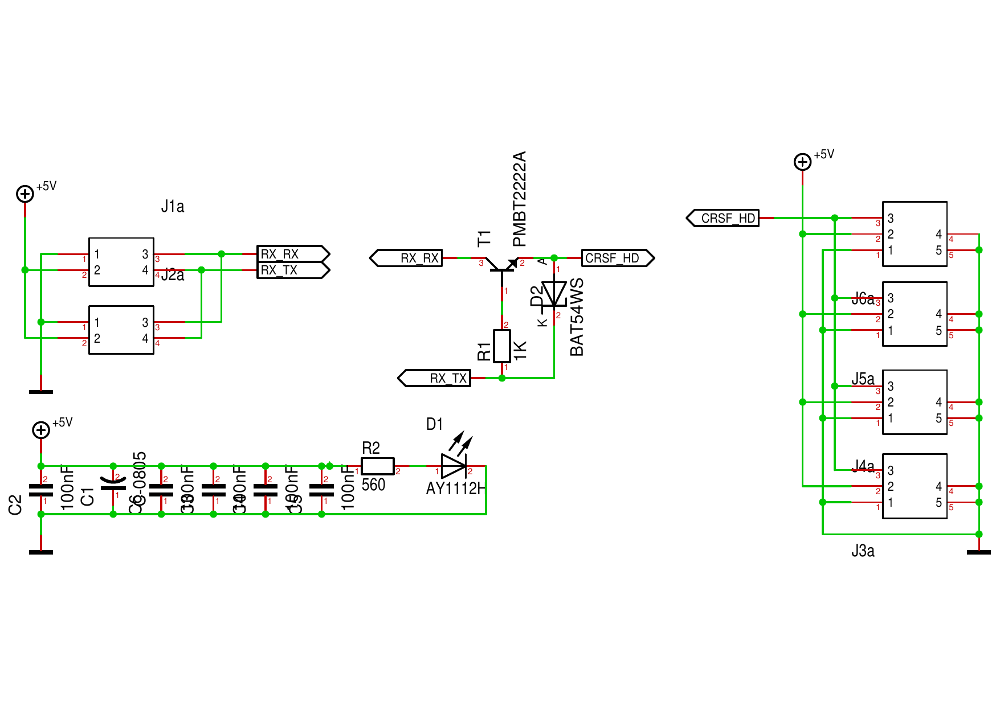
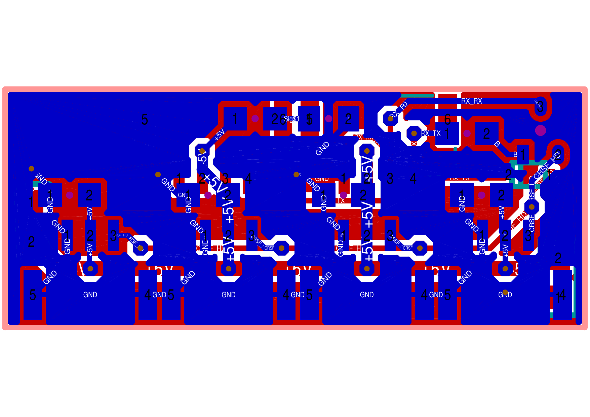
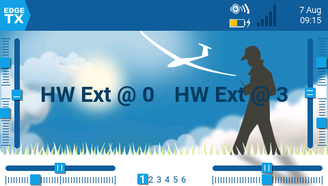
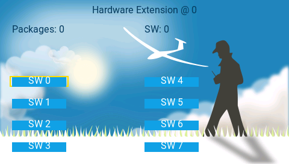

= Protokolle
Wilhelm Meier <wilhelm.wm.meier@googlemail.com>
:toc:
:toclevels: 3
:toc-placement!:
:sectnums:
:sectnumlevels: 5
:tip-caption: :bulb:
:note-caption: :information_source:
:important-caption: :heavy_exclamation_mark:
:caution-caption: :fire:
:warning-caption: :warning:
:lang: de
:toc-title: Inhaltsverzeichnis
:figure-caption: Abbildung
:table-caption: Tabelle
:example-caption: Beispiel

<<protocols.adoc#,English>> | *Deutsch*

<<../README.de.adoc#,RC-Elektronik>> / Protokolle

[NOTE]
--
CRSF-Protokollerweiterungen (MultiSwitch, Prop32, ESP-NOW), CRSF-Halbduplex-Bus, Hardware-Erweiterungsprotokoll.
--

toc::[]

[[crsf_sw]]
== Vorschlag für das CRSF-Protokoll

Dies ist ein Vorschlag zur Erweiterung des `CRSF`-Protokolls. Da das Protokoll erweiterbar ist, funktioniert dies mit jedem Sender, Sendemodul und Empfänger.

Siehe https://github.com/crsf-wg/crsf/wiki[crsf].

Dies wird von einem <<multiswitch.de.adoc#msw_widget,EdgeTx-Widget>> (Encoder) zusammen mit dem <<cruise-control.de.adoc#CC,`CruiseController`>> (Decoder) verwendet.

Die folgenden Byte-Tabellen stammen aus den Referenzimplementierungen:
https://github.com/wimalopaan/LUA/blob/main/WIDGETS/lvglMultiSw/crsf.lua[MultiSwitch-Widget] und
https://github.com/wimalopaan/LUA/blob/main/SCRIPTS/MIXES/crsfch.lua[`crsfch.lua`] (Encoder) sowie
https://github.com/wimalopaan/wmucpp/blob/master/include_stm32/rc/rc_2.h[`rc_2.h`] (Decoder, Konstanten).
Alle Beispielframes enthalten korrekt berechnete CRCs.

[[crsf-frame]]
=== Frame-Aufbau

[[_general_crsf_frame]]
==== Allgemeiner CRSF-Frame

[cols="1,2,2,5",options="header"]
|===
| Byte | Feld | Wert | Beschreibung
| 0 | `sync` | `0xc8` | Synchronisations- / Adressbyte. Frames vom Empfänger verwenden `0xc8`. EdgeTX verwendet zum Sendemodul hin die Moduladresse `0xee`.
| 1 | `len` | `2` ... `62` | Anzahl der folgenden Bytes: `type` + Nutzdaten + `crc8` (= gesamte Framelänge - 2)
| 2 | `type` | | Frametyp (z. B. `0x32` Befehl, `0x7f` Durchleitung)
| 3 ... n-2 | payload | | Erweiterte Frametypen (`type >= 0x28`) beginnen mit `dest` und `src`.
| n-1 | `crc8` | | CRC8 (Polynom `0xd5`, Initialwert `0x00`) über `type` und Nutzdaten, also Bytes 2 ... n-2
|===

Die gesamte Framelänge beträgt höchstens 64 Bytes; `len` ist daher höchstens 62.

[[crsf-cmd-frame]]
==== Befehlsframe (Typ `0x32`)

Alle Erweiterungen in diesem Abschnitt verwenden den erweiterten Frametyp `CRSF_FRAMETYPE_COMMAND` (`0x32`) und ergänzen neue _Befehlsbereiche_ (Befehlsklassen, „Realms“).
Die Byte-Indizes sind absolute Frame-Indizes, wie sie die Firmware-Decoder verwenden (z. B. `data[7]` = erster Befehlsparameter).

[cols="1,2,2,5",options="header"]
|===
| Byte | Feld | Wert | Beschreibung
| 0 | `sync` | `0xc8` | siehe oben
| 1 | `len` | | `1` (type) + `4` (dest, src, realm, cmd) + _k_ (Parameter) + `1` (cmd-crc) + `1` (crc8) = _k_ + 7
| 2 | `type` | `0x32` | `CRSF_FRAMETYPE_COMMAND`
| 3 | `dest` | | Zieladresse (siehe <<crsf-addresses>>)
| 4 | `src` | | Quelladresse (siehe <<crsf-addresses>>)
| 5 | `realm` | `0xa0`, `0xa1`, ... | Befehlsbereich (siehe <<crsf-realms>>)
| 6 | `cmd` | | Befehl innerhalb des Bereichs
| 7 ... 6+_k_ | Parameter | | _k_ befehlsspezifische Bytes (siehe unten)
| 7+_k_ | `cmd-crc` | | _optional_: Befehls-CRC8 (Polynom `0xba`, Initialwert `0x00`) über Bytes 2 ... 6+_k_
| n-1 | `crc8` | | Frame-CRC8 (Polynom `0xd5`) über Bytes 2 ... n-2 (einschließlich `cmd-crc`)
|===

[NOTE]
--
EdgeTX hängt bei `crossfireTelemetryPush(0x32, {...})` automatisch die Befehls-CRC (`cmd-crc`) an. Lua-Skripte übergeben deshalb nur
`dest`, `src`, `realm`, `cmd` und die Parameter. Von den Geräten selbst erzeugte Frames (die Befehle zur Kommunikation zwischen Modulen `0x11` ... `0x13`)
enthalten *keine* `cmd-crc`. Decoder lesen die Parameter anhand ihrer Indizes und ignorieren die `cmd-crc`, sodass beide Formen akzeptiert werden.
--

[[crsf-addresses]]
.CRSF-Adressen
[cols="1,2,5",options="header"]
|===
| Adresse | Name | Verwendung
| `0x00` | Rundruf (Broadcast) | Standard-`dest` des MultiSwitch-Widgets (als _Broadcast-Adresse für Befehle_ konfigurierbar). Auch `dest` der Befehle zur Kommunikation zwischen Modulen.
| `0xc8` | Flugcontroller / Controller | `dest` von `crsfch.lua` (Prop32)
| `0xea` | Sender / Handgerät | `src` aller von EdgeTX-Skripten gesendeten Frames. `dest` der Telemetriemeldungen an den Sender.
| `0xec` | Empfänger |
| `0xee` | Sendemodul |
|===

[[crsf-realms]]
.Befehlsbereiche
[cols="1,3,3",options="header"]
|===
| Befehlsbereich | Name | Beschreibung
| `0xa0` | `CruiseController` | Fahrregler, proportionale Kanäle (<<prop32>>)
| `0xa1` | `MultiSwitch` | Schaltmodule (<<crsf-sw>>)
| `0xa2` | `Schottel-Controller` | Schottel- / Azimutantriebe
|===

[[crsf-sw]]
=== Befehle für MultiSwitch (Befehlsbereich `0xa1`)

* Pakettyp: `CRSF_FRAMETYPE_COMMAND`, `0x32`
* Befehlsbereich: `MultiSwitch`, `0xa1` (benutzerdefinierter Bereich)

Gesamtes Paket: `[0xc8]` `[len]` `[0x32]` `[` `[dst]` `[src]` `[0xa1]` `<command>` `<payload>` `]` `[cmd-crc]` `[crc8]`

Bei den meisten Befehlen ist das erste Parameterbyte (Byte 7) die _Schaltadresse_ (0 ... 255). Sie wählt das Modul (oder die Ausgangsgruppe eines Moduls) aus.
Dies ist *nicht* die CRSF-Adresse.

.Befehle im Befehlsbereich `0xa1`
[cols="1,3,2,5",options="header"]
|===
| Befehl | Name | Parameter (Bytes) | Beschreibung
| `0x01` | `Set` | 2 | 8 binäre Schalter setzen
| `0x02` | `Prop` | 3 | einen proportionalen Wert setzen (8-Bit-Auflösung)
| `0x03` | `RequestTelemetry` | | veraltet
| `0x04` | `RequestTelemetryItem` | | veraltet
| `0x05` | `RequestConfigItem` | | veraltet
| `0x06` | `RequestDeviceInfo` | | veraltet
| `0x07` | `Set4` | 3 | 8 Schalter mit je 4 Zuständen setzen (2 Bits pro Schalter)
| `0x08` | `Set64` | | reserviert (experimentell, noch festzulegen)
| `0x09` | `Set4M` | 1 + 3 * _count_ | mehrere Schalter mit je 4 Zuständen und unterschiedlichen Schaltadressen setzen
| `0x0a` | `SetRGB` | 2 + 2 * _count_ | die Farbe der RGB-LEDs des Schalters setzen
| `0x0b` | `SetText` | | reserviert (experimentell: Morsetext)
| `0x10` | `InterModule` | | Kommunikation zwischen Modulen (veraltet)
| `0x11` | `InterModulePatternStart` | 2 | Muster auf einem anderen Modul starten
| `0x12` | `InterModulePatternStopAll` | 1 | alle Muster auf anderen Modulen stoppen
| `0x13` | `InterModuleSlaveSet` | 2 | Slave-Ausgänge eines anderen Moduls setzen
|===

[[_command_0x01_set]]
==== Befehl `0x01` (Set)

Nutzdaten: `<address>` `<state>`

[cols="1,2,2,5",options="header"]
|===
| Byte | Feld | Bereich | Beschreibung
| 7 | `<address>` | `0` ... `255` | Schaltadresse
| 8 | `<state>` | `0x00` ... `0xff` | Zustand von 8 binären Schaltern: Bit _k_ = Ausgang _k_ (`1` = ein)
|===

.Bitbelegung von `<state>`
[cols="2,1,1,1,1,1,1,1,1"]
|===
| Bit | 7 | 6 | 5 | 4 | 3 | 2 | 1 | 0
| Ausgang | 7 | 6 | 5 | 4 | 3 | 2 | 1 | 0
|===

Die Ausgänge werden ab 0 nummeriert. Im Widget sind sie mit 1 ... 8 nummeriert, sodass Widget-Ausgang 1 dem Bit 0 entspricht.

Beispiel: Schaltadresse `0`, Ausgänge 0 und 2 eingeschaltet (`state = 0b0000'0101`):

 C8 09 32 00 EA A1 01 00 05 4E F3

[[_command_0x07_set4]]
==== Befehl `0x07` (Set4)

Nutzdaten: `<address>` `<stateH>` `<stateL>`

[cols="1,2,2,5",options="header"]
|===
| Byte | Feld | Bereich | Beschreibung
| 7 | `<address>` | `0` ... `255` | Schaltadresse
| 8 | `<stateH>` | `0x00` ... `0xff` | Zustand der Schalter mit je 4 Zuständen (Ausgänge) 4 ... 7
| 9 | `<stateL>` | `0x00` ... `0xff` | Zustand der Schalter mit je 4 Zuständen (Ausgänge) 0 ... 3
|===

`<stateH>` und `<stateL>` bilden einen 16-Bit-Wert `state = (stateH << 8) | stateL` (Big-Endian). Ausgang _k_ verwendet die Bits `2k+1 .. 2k`:

.Bitbelegung von `<stateH>` / `<stateL>`
[cols="2,1,1,1,1,1,1,1,1"]
|===
| Bit | 7 | 6 | 5 | 4 | 3 | 2 | 1 | 0
| `<stateH>` 2+| Ausgang 7 2+| Ausgang 6 2+| Ausgang 5 2+| Ausgang 4
| `<stateL>` 2+| Ausgang 3 2+| Ausgang 2 2+| Ausgang 1 2+| Ausgang 0
|===

[[crsf-sw-state4]]
.2-Bit-Zustandscodes
[cols="1,6",options="header"]
|===
| Code | Bedeutung
| `00` | aus
| `01` | Zustand 1: ein (z. B. 3-Stellungs-Schalter in Stellung „oben“)
| `10` | Zustand 2: alternativer Zustand (z. B. 3-Stellungs-Schalter in Stellung „unten“). Die Bedeutung hängt vom Gerät ab. Einfache Geräte behandeln jeden Code ungleich null als „ein“.
| `11` | reserviert
|===

Beispiel: Schaltadresse `0`, Ausgang 0 in Zustand 1 und Ausgang 5 in Zustand 2 (`state = 0x0801`):

 C8 0A 32 00 EA A1 07 00 08 01 00 F0

[[_command_0x09_set4m]]
==== Befehl `0x09` (Set4M)

Nutzdaten: `<count>` [ `<address>` `<stateH>` `<stateL>` ] (`count`-mal wiederholt)

Dieser Befehl besitzt keine einzelne Schaltadresse. Byte 7 ist `<count>`.

[cols="1,2,2,5",options="header"]
|===
| Byte | Feld | Bereich | Beschreibung
| 7 | `<count>` | `1` ... `18` | Anzahl der folgenden 3-Byte-Gruppen
| 8 + 3__i__ | `<address>` | `0` ... `255` | Schaltadresse der Gruppe _i_ (_i_ = 0 ... count-1)
| 9 + 3__i__ | `<stateH>` | | wie bei `Set4`
| 10 + 3__i__ | `<stateL>` | | wie bei `Set4`
|===

Die maximale Framelänge begrenzt `<count>` auf 18.

Beispiel: zwei Gruppen. Adresse `0`: Ausgänge 0 und 1 eingeschaltet. Adresse `1`: Ausgang 7 in Zustand 2.

 C8 0E 32 00 EA A1 09 02 00 00 05 01 80 00 3A 18

[[_command_0x02_prop]]
==== Befehl `0x02` (Prop)

Nutzdaten: `<address>` `<channel>` `<duty>`

[cols="1,2,2,5",options="header"]
|===
| Byte | Feld | Bereich | Beschreibung
| 7 | `<address>` | `0` ... `255` | Schaltadresse
| 8 | `<channel>` | `0` ... `7` | Nummer des Ausgangskanals (ab 0 gezählt; Widget-Ausgang 1 = Kanal 0)
| 9 | `<duty>` | `0` ... `100` | Tastgrad des Ausgangskanals in Prozent
|===

Beispiel: Schaltadresse `0`, Kanal 2, Tastgrad 50 %:

 C8 0A 32 00 EA A1 02 00 02 32 1E 36

[[_command_0x0a_setrgb]]
==== Befehl `0x0a` (setRGB)

Nutzdaten: `<address>` `<count>` [ `<adr_color_r>` `<color_gb>` ] (`count`-mal wiederholt)

[cols="1,2,2,5",options="header"]
|===
| Byte | Feld | Bereich | Beschreibung
| 7 | `<address>` | `0` ... `255` | Schaltadresse (der LED-Gruppe)
| 8 | `<count>` | `1` ... `8` | Anzahl der folgenden 2-Byte-Gruppen
| 9 + 2__i__ | `<adr_color_r>` | | Bit 7: reserviert (`0`), Bits 6..4: Ausgangsnummer (`0` ... `7`), Bits 3..0: Rot (`0x0` ... `0xf`)
| 10 + 2__i__ | `<color_gb>` | | Bits 7..4: Grün (`0x0` ... `0xf`), Bits 3..0: Blau (`0x0` ... `0xf`)
|===

.Bitbelegung einer Farbgruppe
[cols="2,1,1,1,1,1,1,1,1"]
|===
| Bit | 7 | 6 | 5 | 4 | 3 | 2 | 1 | 0
| `<adr_color_r>` | 0 3+| Ausgang 4+| Rot
| `<color_gb>` 4+| Grün 4+| Blau
|===

Das Widget reduziert die RGB565-Farbe jeder Schaltfläche auf 4 Bits pro Farbe. Der Decoder skaliert jeden 4-Bit-Wert mit dem Faktor 16 (`0x0` ... `0xf` -> `0` ... `240`).

Beispiel: Schaltadresse `8`, Ausgang 0 rot und Ausgang 1 blau:

 C8 0D 32 00 EA A1 0A 08 02 0F 00 10 0F 5A 93

[[_command_0x11_intermodule_pattern_start]]
==== Befehl `0x11` (Musterstart zwischen Modulen)

Dieser Nachrichtentyp wird von einem Modul an ein anderes Modul im _selben_ Modell gesendet.
Die Module müssen mit einem CRSF-Router (oder etwas Vergleichbarem, etwa einem ELRS-v4-Empfänger) verbunden sein.

Üblicherweise ist dies eine _Broadcast_-Nachricht (Zieladresse `0x00`), da das sendende Modul
die CRSF-Adresse des Zielmoduls nicht kennt. Decoder akzeptieren Befehle zur Kommunikation zwischen Modulen nur, wenn `dest` gleich `0x00` ist.
`src` ist die CRSF-Adresse des sendenden Moduls. Der Frame enthält keine `cmd-crc`.

Der Befehl startet einen bestimmten Mustergenerator auf dem Zielmodul.

Nutzdaten: `<address>` `<pattern>`

[cols="1,2,2,5",options="header"]
|===
| Byte | Feld | Bereich | Beschreibung
| 7 | `<address>` | `0` ... `255` | Schaltadresse
| 8 | `<pattern>` | `4` ... `7` | Muster
|===

Beispiel (sendendes Modul mit CRSF-Adresse `0xc0`): Schaltadresse `0`, Muster 4:

 C8 08 32 00 C0 A1 11 00 04 75

[[_command_0x12_intermodule_pattern_stop_all]]
==== Befehl `0x12` (alle Muster zwischen Modulen stoppen)

Dieser Nachrichtentyp wird von einem Modul an ein anderes Modul im _selben_ Modell gesendet.
Die Module müssen mit einem CRSF-Router (oder etwas Vergleichbarem, etwa einem ELRS-v4-Empfänger) verbunden sein.
Wie bei `0x11` handelt es sich um eine Broadcast-Nachricht ohne `cmd-crc`.

Der Befehl stoppt das aktuell laufende Muster auf allen Modulen, die zur angegebenen Gruppe gehören.

Nutzdaten: `<group>`

[cols="1,2,2,5",options="header"]
|===
| Byte | Feld | Bereich | Beschreibung
| 7 | `<group>` | `0` ... `255` | Gruppe
|===

Beispiel: Gruppe 1:

 C8 07 32 00 C0 A1 12 01 F7

[[_command_0x13_intermodule_slave_set]]
==== Befehl `0x13` (Slave-Ausgänge zwischen Modulen setzen)

Dieser Nachrichtentyp wird von einem Modul an ein anderes gesendet. Die Module können sich im _selben_ Modell
_oder_ in zwei verschiedenen Modellen befinden (z. B. Mutter- und Tochterboot oder Lkw und Anhänger).
Die Module müssen mit einem CRSF-Router (oder etwas Vergleichbarem, etwa einem ELRS-v4-Empfänger) verbunden sein.
Wie bei `0x11` handelt es sich um eine Broadcast-Nachricht ohne `cmd-crc`.

Der Befehl setzt die Ausgänge des Slaves entsprechend denen des Masters. Der Master sendet diese Nachricht
bei jeder Änderung des Zustands seiner Ausgänge.

Nutzdaten: `<master>` `<state>`

[cols="1,2,2,5",options="header"]
|===
| Byte | Feld | Bereich | Beschreibung
| 7 | `<master>` | `0` ... `255` | Schaltadresse des Masters (Quelle)
| 8 | `<state>` | `0x00` ... `0xff` | Zustand von 8 Ausgängen (Bitbelegung wie bei `Set`)
|===

Beispiel: Schaltadresse des Masters `0`, Ausgänge 0 und 1 eingeschaltet:

 C8 08 32 00 C0 A1 13 00 03 F2

[[prop32]]
=== Proportionale Daten (z. B. zusätzliche Kanäle: >=8bit)

Dies ist in https://github.com/wimalopaan/LUA/blob/main/SCRIPTS/MIXES/crsfch.lua[] implementiert.
Das Mischerskript sendet alle `Interv` x 10 ms (Standard: 50 ms) 16 zusätzliche Kanäle (Standard: Kanäle 17 ... 32, Parameter `StartC`).

* Pakettyp: `CRSF_FRAMETYPE_COMMAND`, `0x32`
* Befehlsbereich: `CruiseController`, `0xa0` (benutzerdefinierter Bereich)
* `dest`: `0xc8`, `src`: `0xea`

.Variante `0x03`

16 Kanäle mit je 8 Bits (16 Bytes).

Gesamtes Paket: `[0xc8]` `[len]` `[0x32]` `[` `[dst]` `[src]` `[0xa0]` `[0x03]` `<byte0>` ... `<byte15>` `]` `[cmd-crc]` `[crc8]`

[cols="1,2,2,5",options="header"]
|===
| Byte | Feld | Bereich | Beschreibung
| 1 | `len` | `23` (`0x17`) |
| 6 | `cmd` | `0x03` | `SetChannel`
| 7 ... 22 | `<byte0>` ... `<byte15>` | `-128` ... `127` | Kanal `StartC` + _i_ als vorzeichenbehafteter 8-Bit-Wert (Zweierkomplement)
| 23 | `cmd-crc` | |
| 24 | `crc8` | |
|===

.Variante `0x04`

Wie Variante `0x03`, mit einem zusätzlichen Flag-Byte. `crsfch.lua` verwendet diese Variante, wenn `Flags` ungleich 0 ist.

Gesamtes Paket: `[0xc8]` `[len]` `[0x32]` `[` `[dst]` `[src]` `[0xa0]` `[0x04]` `<flags>` `<byte0>` ... `<byte15>` `]` `[cmd-crc]` `[crc8]`

[cols="1,2,2,5",options="header"]
|===
| Byte | Feld | Bereich | Beschreibung
| 1 | `len` | `24` (`0x18`) |
| 6 | `cmd` | `0x04` | `SetChannelExtended`
| 7 | `<flags>` | `0` ... `3` | Bit 0: ch1-16 und ch17-32 auf SBus-fähigen Empfängern / Controllern vertauschen. Bit 1: ch1-16 und ch17-32 auf SumDV3-fähigen Empfängern / Controllern vertauschen.
| 8 ... 23 | `<byte0>` ... `<byte15>` | `-128` ... `127` | Kanal `StartC` + _i_ als vorzeichenbehafteter 8-Bit-Wert (Zweierkomplement)
| 24 | `cmd-crc` | |
| 25 | `crc8` | |
|===

.Skalierung
Der EdgeTX-Ausgabewert `v` (`-1024` ... `1024`) wird auf 8 Bits skaliert und dabei zur Null hin abgeschnitten:

* `v >= 0`: `v * 127 / 1024` -> `0` ... `127` (`0x00` ... `0x7f`)
* `v < 0`: `v * 128 / 1024` -> `-128` ... `-1` (`0x80` ... `0xff`)

Beispiel (Variante `0x03`): ch17 = +100 % (`0x7f`), ch18 = -100 % (`0x80`), ch19 = +50 % (`0x40`), alle anderen 0:

 C8 17 32 C8 EA A0 03 7F 80 40 00 00 00 00 00 00 00 00 00 00 00 00 00 C0 DE

[[_telemetry_passthrough_messages]]
=== Durchgeleitete Telemetriemeldungen

Statusmeldungen von Geräten wie dem MultiSwitch (SuperSimpleMultiSwitch) enthalten ein Byte mit Statusbits. Die Bedeutung der Bits hängt
von der Anwendung ab. Das MultiSwitch-Widget kann diese Statusbits anzeigen, siehe <<multiswitch.de.adoc#msw_widget,MultiSwitch-Widget>>.

* Pakettyp: `CRSF_FRAMETYPE_PASSTHRU`, `0x7f` (erweiterter Frametyp, keine `cmd-crc`)
* Untertyp: MultiSwitch, `0xa1`
* AppId: Status, `6100` (`0x17d4`)
* `<switch address>` (Schaltadresse)
* `<status bits>` (Statusbits)

Gesamtes Paket: `[0xc8]` `[len]` `[0x7f]` `[` `[0xea]` `[crsf-address]` `[0xa1]` `[high_byte(6100)]` `[low_byte(6100)]` `[address]` `[statusbits]` `]` `[crc8]`

[cols="1,2,2,5",options="header"]
|===
| Byte | Feld | Wert | Beschreibung
| 0 | `sync` | `0xc8` |
| 1 | `len` | `9` |
| 2 | `type` | `0x7f` | `CRSF_FRAMETYPE_PASSTHRU`
| 3 | `dest` | `0xea` | Sender / Handgerät
| 4 | `src` | | CRSF-Adresse des sendenden Geräts
| 5 | sub type | `0xa1` | MultiSwitch
| 6 | AppId high | `0x17` | AppId `6100` = `0x17d4`, Big-Endian
| 7 | AppId low | `0xd4` |
| 8 | `<address>` | `0` ... `255` | Schaltadresse
| 9 | `<statusbits>` | `0x00` ... `0xff` | anwendungsspezifische Statusbits
| 10 | `crc8` | |
|===

Beispiel (Gerät mit CRSF-Adresse `0xc0`, Schaltadresse `0`, Statusbits `0x05`):

 C8 09 7F EA C0 A1 17 D4 00 05 EF

[[crsf-esp-now]]
=== CRSF über ESP-NOW

Hiermit wird ein CRSF-Frame über ESP-NOW gesendet.

Das _Startbyte_ (`0xc8`), das Framelängenfeld und die CRC entfallen, da ESP-NOW bereits für die Frame-Abgrenzung und Fehlerprüfung sorgt.
Zur Autorisierung der ESP-NOW-Frames eines Geräts werden die 6 `UID`-Bytes des Hashs der _Bindungsphrase_ vorangestellt.

Gesamtes `ESP-NOW`-Paket: `[uid]` (6 Bytes) `[type]` `[payload]`

[cols="1,2,5",options="header"]
|===
| Byte | Feld | Beschreibung
| 0 ... 5 | `UID` | 6 Bytes des Hashs der Bindungsphrase, in derselben Reihenfolge wie im ELRS-Array `UID`
| 6 | `type` | CRSF-Frametyp
| 7 ... | payload | CRSF-Nutzdaten (Byte 3 ... n-2 des CRSF-Frames). Erweiterte Frames enthalten `dest`/`src` (und bei Typ `0x32` auch `cmd-crc`).
|===

Die ESP-NOW-Paketlänge beträgt `len + 5` (`type` + Nutzdaten = höchstens 61 Bytes). Der Empfänger stellt `sync`, `len` und `crc8` wieder her.

Siehe auch <<elrs.de.adoc#elrs-esp-now,CRSF über ESP-NOW für ELRS V4>>.

[[crsf-bus]]
== CRSF-Halbduplex-Bus

Ermöglicht den Anschluss von bis zu 4 Halbduplex-CRSF-Geräten an einen Vollduplex-Empfänger.

[TIP]
--
Bei TBS-Empfängern, etwa dem TBS Nano RX 6Ch, fehlt an der `rx`-Leitung des Empfängers ein Pull-up-Widerstand. Du musst einen zusätzlichen Pull-up von 4k7 bis zu 20k zwischen `+5V` und die `rx`-Leitung löten. Ein
SMD-Widerstand der Bauform `0805` lässt sich direkt an den 4-poligen `JST-GH`-Stecker der Busplatine löten.
--

Zum _Aktivieren_ der angeschlossenen Halbduplex-Geräte wird eine externe Möglichkeit (z. B. ein Taster am Gerät) oder ein Arbitrierungsverfahren (siehe <<crsf_hd_scheme>>) benötigt, da höchstens _ein_ Gerät auf dem Bus aktiv sein darf (siehe auch <<crsf-devices.de.adoc#crsf-switch,CRSF-Schalter / Router>>).

[[crsf_hd_scheme]]
[TIP]
--
.Arbitrierungsverfahren für CRSF-Halbduplex

Wenn alle Geräte ein einfaches Arbitrierungsverfahren einhalten, kann es auf diesem Halbduplex-Bus mehr als _ein aktives Gerät_ geben:

Das Arbitrierungsverfahren funktioniert folgendermaßen:

* Da es sich um Halbduplex handelt, steht die Zeit unmittelbar nach dem Empfang eines _RC-channels_-Pakets den angeschlossenen Geräten zum Senden von Paketen zur Verfügung.
* Jedes Gerät _muss_ einen bestimmten Zeitschlitz (abhängig von seiner eigenen CRSF-Adresse) verwenden, um sein Paket auf den Bus zu legen.
* Ein empfangenes CRSF-Paket _link-stat_ (`0x14`) startet die Zählung der Zeitschlitze zum Senden von Paketen.
* Die Zeitschlitznummer eines Geräts wird wie folgt berechnet: (<crsf-address> - 192) * 2
* Voraussetzung: Die eindeutigen Adressen aller angeschlossenen Geräte liegen im Bereich `0xc0` ... `0xcf`.

Das obige Verfahren muss für alle zu sendenden Pakete eingehalten werden: Insbesondere das Paket `crsf device info` nach dem Empfang eines `crsf ping` sowie unaufgefordert gesendete Telemetriepakete müssen auf den Zeitschlitz des jeweiligen Geräts beschränkt bleiben.
--

.Der Schaltplan (zum Vergrößern anklicken)

.Die Platine (zum Vergrößern anklicken)

Link zur Platinenbestellung (Aisler): https://aisler.net/p/KPBJUCXN[Platinenbestellung]

Link zur link:../images/elrs_msw/RC_CRSF_HalfDuplex_Bus.T3001[Target-3001-Entwurfsdatei].

Link zu den link:../images/elrs_msw/RC_CRSF_HalfDuplex_Bus.zip[Gerber-Entwurfsdateien].

[[_demo_video]]
=== Vorführung (Video)

Prototyp: https://www.youtube.com/watch?v=PeuxACw40io[Video]

[[hwext]]
== Hardware-Erweiterungsprotokoll

Das _Hardware-Erweiterungsprotokoll_ ist ein einfaches serielles Protokoll, um den Zustand externer Schalter und Potentiometer an den Sender zu übertragen. Der Sender `RadioMaster TX16S` besitzt zwei
serielle Schnittstellen, über die sich der Sender erweitern lässt, etwa um zusätzliche Schalter oder Potentiometer (siehe auch <<hwlua>>).

Das Protokoll ist als Multi-Master-/Slave-Protokoll ausgelegt. Dadurch können mehrere externe Controller Daten an den Sender schicken (siehe auch <<radio-mods.de.adoc#extswitch,Der interne Schaltercontroller der TX16s>> und <<rc-desk.de.adoc#rcdesk,Das RC-Pult (für RadioMaster TX16S, FrSky X12S, X9E, ...)>>).

Bei der `RadioMaster TX16S` mit ihren _zwei_ seriellen Schnittstellen bleibt die andere Schnittstelle für weitere Zwecke frei, etwa
zum Anschluss eines `SBUS`-Empfängers für eine Lehrer-Schüler-Verbindung oder weiterer Geräte (siehe auch <<rc-desk.de.adoc#rcdesk,Das RC-Pult (für RadioMaster TX16S, FrSky X12S, X9E, ...)>>).

[[_physical_layer]]
=== Physikalische Schicht

* Baudrate: 115200 Baud
* 8 Bits
* keine Parität
* 1 Stoppbit
* Halbduplex

[[_application_layer]]
=== Anwendungsschicht

Ein externer Schaltercontroller (_Master_) sendet Pakete an den Sender. Mehrere externe Schaltercontroller können an
dieselbe serielle Halbduplex-Leitung (die `rx`-Leitung des Senders) angeschlossen werden. Dazu benötigen die Schaltercontroller eindeutige IDs (siehe auch <<hwext_timing>>).

[[_packet_format]]
==== Paketformat

Format: `[0xaa]` `<cntrl-nr>` `<type>` `<payload-length>` `<payload>` `<check-sum>`

* `<cntrl-nr>`: die Controllernummer (Quelle). Eine Instanz der LUA-Skripte verarbeitet jeweils eine bestimmte Controllernummer, die auf dem Bus eindeutig sein muss.
* `<type>`: Nachrichtentyp
** `0x00`: binäre Schalter in den Nutzdaten (jedes Byte codiert 8 Schalter)
** `0x01`: 8-Bit-Werte in den Nutzdaten (jedes Byte codiert einen eigenen Wert)
** `0x02`: 16-Bit-Werte in den Nutzdaten (je zwei Bytes codieren einen eigenen Wert), LSB zuerst
** `0x03`: 64 binäre Schalter (8 Bytes) | 16 Werte (je 2 Bytes, insgesamt 32 Bytes) (insgesamt 40 Bytes Nutzdaten)
* `<length>`: Anzahl der Bytes von `<payload>`
* `<payload>`: Bytes, die Schalter oder Werte codieren
* `<check-sum>`: arithmetische Summe der `<payload>`-Bytes, nur ein Byte, kann überlaufen

[[hwext_timing]]
==== Zeitsteuerung bei mehreren Mastern

Der Master mit der _Controllernummer_ `0` sendet unaufgefordert alle 100ms (gegebenenfalls bis hinunter zu 20ms) ein Paket. Der Nutzer muss sicherstellen, dass auf dem seriellen Bus genau _ein_ Controller
mit der Nummer `0` vorhanden ist.

Weitere Master auf dem Bus mit einer _Controllernummer_ größer als `0` (z. B. `N`) hören den Bus ab und warten auf eine Nachricht mit der _Controllernummer_ `(N-1)`.
Empfängt ein solcher Master diese Nachricht, wartet er nach deren letztem Byte 2 Byte-Zeiten ab, schaltet dann in den Sendemodus und sendet seine eigenen Nachrichten.

Der Nutzer muss sicherstellen, dass die Abstände zwischen den Nachrichten lang genug sind, damit alle Master ihre Nachrichten senden können. Alle Controller müssen aufsteigende Nummern
ohne Lücken besitzen, beginnend mit `0`.

[[hwlua]]
== LUA-Skript für das Hardware-Erweiterungsprotokoll

[[_new_version_of_the_lua_script_for_the_hardware_extension_protocol]]
=== Neue Version des LUA-Skripts für das Hardware-Erweiterungsprotokoll

Für die neue Version (`lvgl`) benötigst du auch diesen PR: https://github.com/EdgeTX/edgetx/pull/5885[].
Wie du ihn kompilierst und installierst, beschreibt <<building.de.adoc#edgetx_custom,Angepasste EdgeTx-Builds>>.

Die neue Version findest du hier: https://github.com/wimalopaan/LUA[]

[[_old_version]]
=== Alte Version

Es gibt verschiedene Möglichkeiten, die über das <<hwext>> und eine serielle Schnittstelle des Senders übertragenen Informationen auszulesen. Die beiden naheliegendsten sind:

* Die `EdgeTx`-Firmware so ändern, dass sie die Daten über die serielle Schnittstelle liest, das <<hwext>> auswertet und den Zustand der Schalter und Eingänge verändert, oder
* ein `LUA`-Skript zum Lesen der Daten verwenden.

Eine Änderung der `EdgeTx`-Firmware wäre die leistungsfähigste Lösung, da die über das <<hwext>> ausgelesene externe Hardware wie die internen Bedienelemente, etwa Steuerknüppel und Schalter, _wirken_ könnte.
Meiner Einschätzung nach wäre dies jedoch eine umfangreiche Änderung an `edgeTx` für nur wenige Nutzer. Daher wäre die Chance gering, dass diese Änderungen _offiziell_ angenommen
und in den Hauptzweig des `EdgeTx`-Quellcodes übernommen werden.

Ein LUA-Skript erfordert dagegen keinerlei Eingriff in die Firmware. Es kann die standardmäßige LUA-API von `EdgeTx` verwenden (einige hierfür nützliche Funktionen habe ich vor einiger Zeit in `EdgeTx` eingebracht).
Dieser Ansatz hat allerdings Grenzen: Es lassen sich keine _neuen_ Eingänge oder _neuen_ Schalter hinzufügen.

Aber:

* Das `LUA`-Skript kann als Reaktion auf das Umlegen eines externen Schalters einige der 64 _logischen Schalter_ setzen beziehungsweise zurücksetzen.
* Es kann eine der 16 _Shared-Memory-Variablen_ setzen, die anschließend in einem _Mischerskript_ zur Erzeugung eines Ausgangskanalwerts verwendet werden kann.

Natürlich besteht die Begrenzung auf 64 logische Schalter und 16 Shared-Memory-Variablen. Ich halte es aber für gut möglich, diese Grenzen zumindest bei
Sendern mit Farb-LCD und ausreichend RAM anzuheben.

Den Quellcode des Widgets findest du hier: https://github.com/wimalopaan/LUA[]

[[hwluaimg1]]
.Zwei installierte Widgets (zum Vergrößern anklicken)

[[hwluaimg2]]
.Die Informationsansicht des Widgets (zum Vergrößern anklicken)

https://www.youtube.com/watch?v=oPbaWQnMffA[Video]
