= Transmitter modifications
Wilhelm Meier <wilhelm.wm.meier@googlemail.com>
:toc:
:toclevels: 3
:toc-placement!:
:sectnums:
:sectnumlevels: 5
:tip-caption: :bulb:
:note-caption: :information_source:
:important-caption: :heavy_exclamation_mark:
:caution-caption: :fire:
:warning-caption: :warning:

<<../README.adoc#,RC Electronics>> / Transmitter modifications

[NOTE]
--
Renewed VarioProp mainboard, X12S touch/sticks, 40MHz module, TX16S switch controller, haptic stick.
--

toc::[]

[[varioprop]]
== Renewed mainboard for some (old) 27/35/40MHz RC transmitters

As you can see in <<vintage.adoc#gr_txs,Transmitter>> or <<vintage.adoc#rb_txs,Transmitter>> I own some old, vintage RC transmitters. As of this writing some of them are more than 40 years old.
The majority of them does kind of work, but due to aging of the components the do not meet the RC criteria of the RF regulations in the EU.

But there are also some other shortcomings with these old transmitters:

* to change the rf channel one has to change the quarz in the transmitter.
** quarzes are very expensive nowadays
** if not using receivers with quarzes, scan-receivers are ubiquous (see also <<vhf-receivers.adoc#corona,Corona RP8D1 replacement firmware>>) and they don't need a quarz
* With the exception of the Robbe/Futaba F-14 most of them are not capable of having switches together with a switching encoder
* They don't have features like mixers, trainer ...

All this lead to the idea to design a new mainboard not only for the Robbe/Futaba F14, but also for the yellow, red and black Graupner/Grundig
Varioprop series of transmitters. 

The first attempt was to make a new mainboard for the yellow Varioprop S8. This mainboard uses a small µC `atmega324pb` to sample the potentiometers 
of the handset and produce a `ppm`-signal, which was fed into a FrSky DHT 2.4GHz module. This worked quite well but felt a bit like abusing the
old yellow Varioprop, which is very cool stuff nowadays (in germany). Actually the attempt is undocumented.

The next attempt was to design a kind of relais-station to transform the 2.4-GHz FrSky ACCST into FM-FSK-40MHz. I thought this to be a cool idea
because this relais-station could (in theory) used by more than one pilot / captain. The main reason was to re-use a modern 
transmitter with all its features like mixers and other cool stuff for the 40MHz band. But then came Corona (the disease, not <<vhf-receivers.adoc#corona,Corona RP8D1 replacement firmware>>) ... 

I learned a lot about rf electronics in the sub-GHZ range and this was great fun, so I decided to design something that would combine 
all the features I played with in the previous versions.

This lead to the actual design ...

=== The new mainboard

The mainboard comes as pcb that coul be easily adapted to the three form factors for the

* Robbe/Futaba F-14 (see <<vintage.adoc#robbe_f14,Robbe Futaba F-14 Navy 40MHz>>)
* yellow Graupner/Grundig Varioprop 8S (see <<vintage.adoc#varioprop_yellow,Varioprop Graupner Grundig 8S 27MHz>>)
* red/black Graupner/Grundig Varioprop (see <<vintage.adoc#varioprop_red,Varioprop Graupner Grundig C8 27MHz>> and <<vintage.adoc#varioprop_black,Varioprop Graupner Grundig 8S 40MHz>>)

The mainboard 

* handles up to 8 analog inputs (usually the potentiometers of the handset)
* has a 100mW rf module (27/35/40 MHz)
* uses the analog gauge as an accu monitor
* has a beeper
* has a I2C-connector to use with up to two switches-boads with 8 3pos-switches each
* has a bluetooth (BLE) module
* has an ELRS module (to be used as receiver or transmitter)
* can switch channels via BLE or ELRS
* has a free uart for further s

==== Previous versions of the new mainboard

There have been some iterations for the design of the new mainboard though. In the following you see
the last iteration: this one really works, but has some design flaws that I'm actually in process of fixing ;-) 

.The new mainboard populated, but with many design problems (click to enlarge)
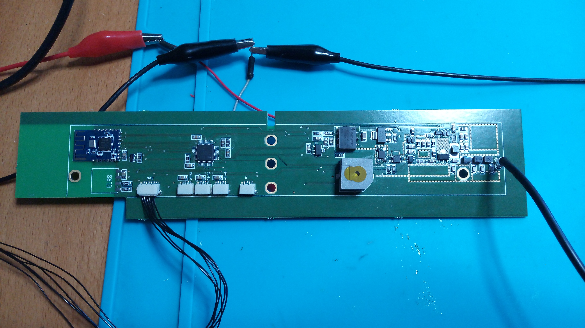

.The new mainboard inside an old VarioProp case (click to enlarge)
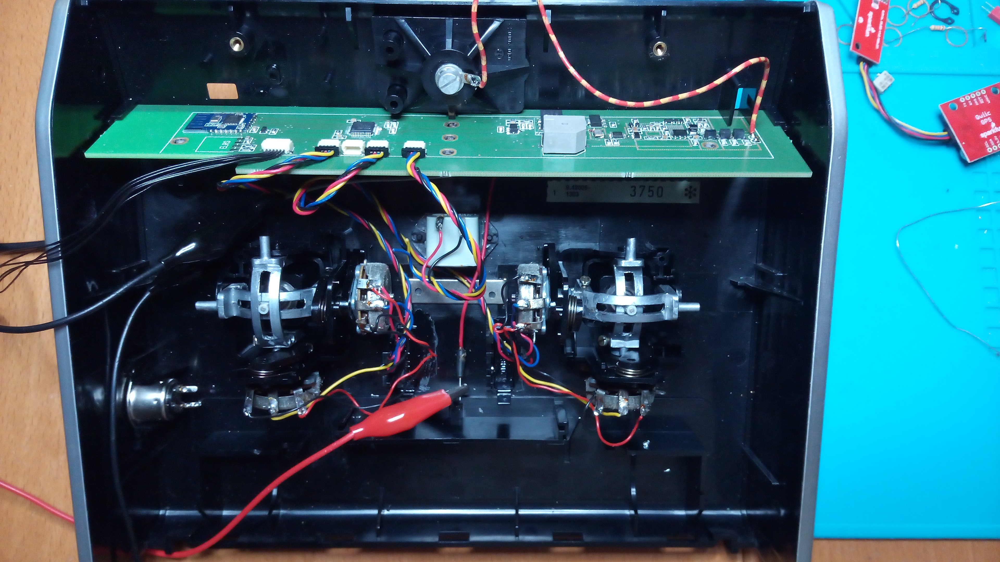

In <<VarNG02>> you see the schematic. Aside from some minor flaws there is one major issue with this board: the generation 
of the frequency-shift-signal! As you see in the schematic the `Si5361` genarates two rectangular signals, one with the `space`
frequency _f0_ on `CLK0` and one with the `mark` frequency _f1_ on `CLK1`. Thereafter a `74LVC1G157` is used to switch between
these two frequencies with the `cppm` signal. 

Although this appears to work there are very serious problems! (Do not use this part of the schematic in your projects.)

A little bit of theory: the switching between these two signals can be seen as a convolution of each signal 
(each itself a _si()_ signal in the frequency domain) with another according _si()_ signal (the cppm rectagular signal in the time domain) 
and then added together. This produces two main problems:

* The switching in the time-domain witch a rectangular signal or convolution in the frequency domain of two _si()_ function results in a very broad spectrum (see <<hardsw>>).

* Additionally the switching is not synchronized with the base signal, so there are additional short-term pulses and therefore broad fequency components.

It turns out that this renders the rf part unusable, because several conventional receivers were not able to decode the signal if the signal strength goes down. 
And clearly this was not acceptable.

[[VarNG02]]
.Schematic of Version 2 (click to enlarge)  
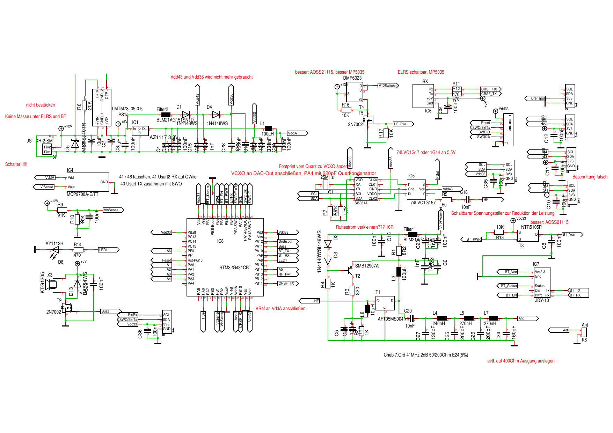

Well, although I was aware of this problem from the beginning I didn't think that the negative impact was as this huge!

I looked around and I found some `27MHz` VCXO (voltage controlled crystal oszillator) with an appropriate pulling range up to 100ppm. This looks quite reasonable: the µC could generate the cppm signal 
with some exponential (gaussian) roll-on / roll-off via its DAC. The VCXO clock signal is the used as the input for the SI5351. And the SI5351 simply generates the desired output
frequency from the modulated clock signal. I made several test with different roll-on / roll-off curves and found that an exponential gives the best results with respect 
to the smallest frequency sprectrum of the resulting rf signal. Very good (see <<gausssw>>).

The roll-on / roll-off via DAC of the µC (STM32G431) is easily realized via timer-triggered DMA to the DAC for each pulse-edge of the cppm signal.

All modifications are now in <<VarNG03>>.

[[VarNG03]]
.Schematic of Version 3 (click to enlarge)  
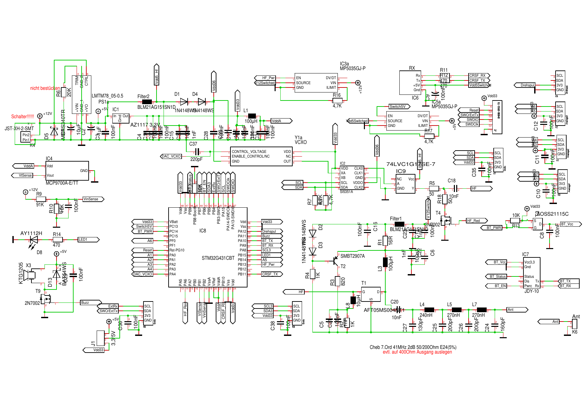

[[VarNG03pcbtop]]
.PCB top (click to enlarge)  
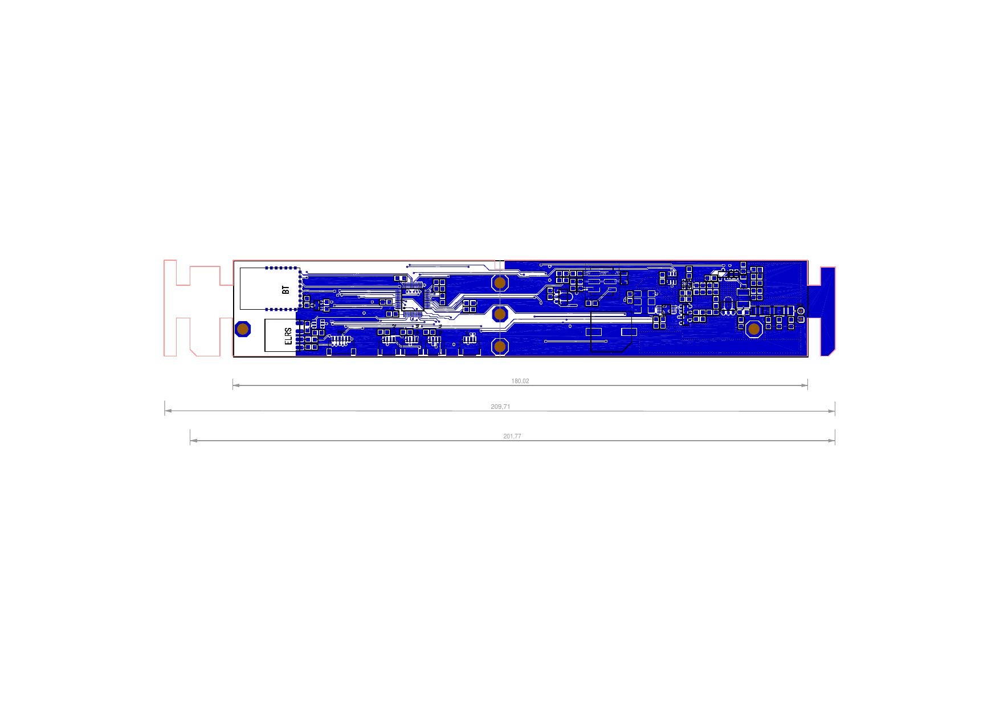

[[VarNG03pcbbot]]
.PCB bottom (click to enlarge)  
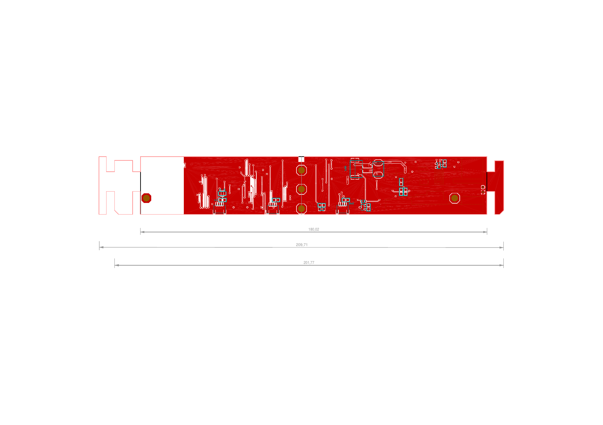

As said above the main reason for this version was the problematic rf signal generation part, but there are other modifications:

* new rf signal generation part to produce way better spectral results
* additional I2C interface (in total now two interfaces)
* on/off switching of the ELRS
* circuit to reduce rf power
* simplified power switching for submodules

This version is actually under test.

[[hardsw]]
.Spectrum when hard-switching the frequencies (click to enlarge)  
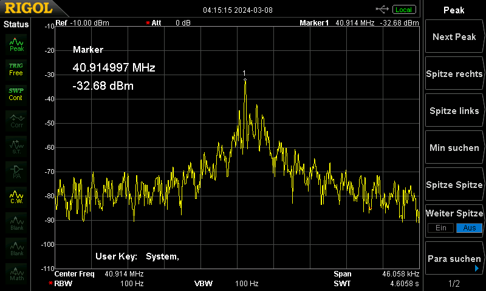

[[gausssw]]
.Spectrum when using gaussian roll-on  / roll-off (click to enlarge)  
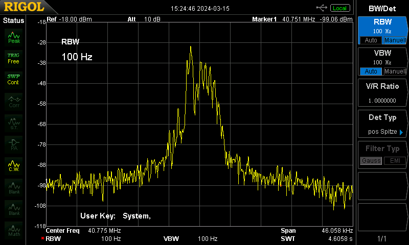

[[f14spec]]
.Spectrum Futaba F14 (click to enlarge)  
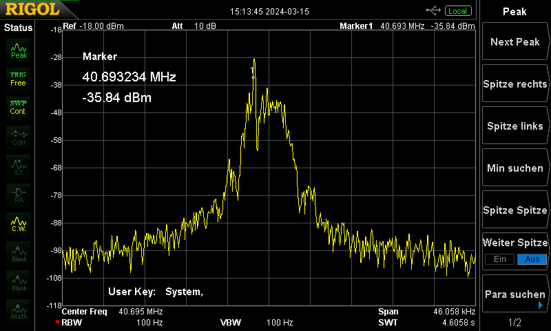

[[grspec]]
.Spectrum Graupner 40MHz JR module (click to enlarge)  
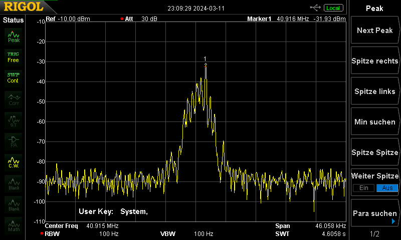

=== The new switches-board

The switches board is very simple: it is connected via `I2C` to the main board. And it can be cascaded.

.Schematic (click to enlarge)
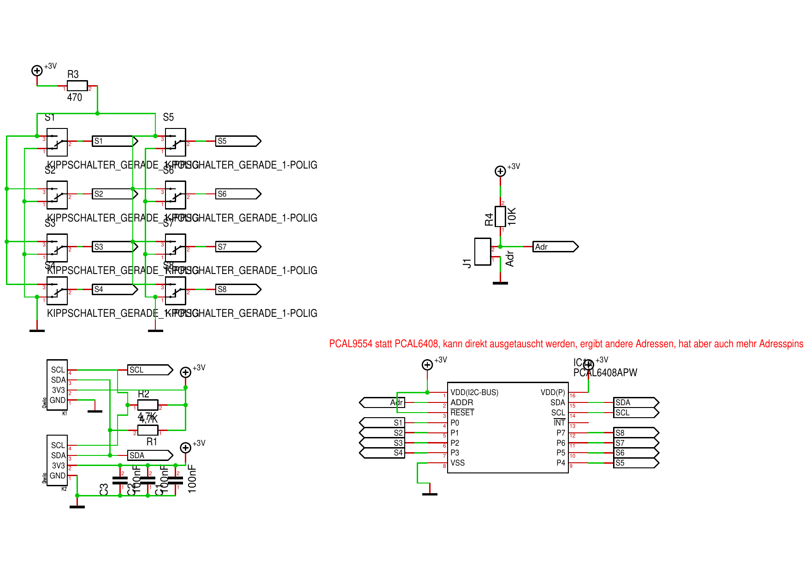

.PCB (click to enlarge)
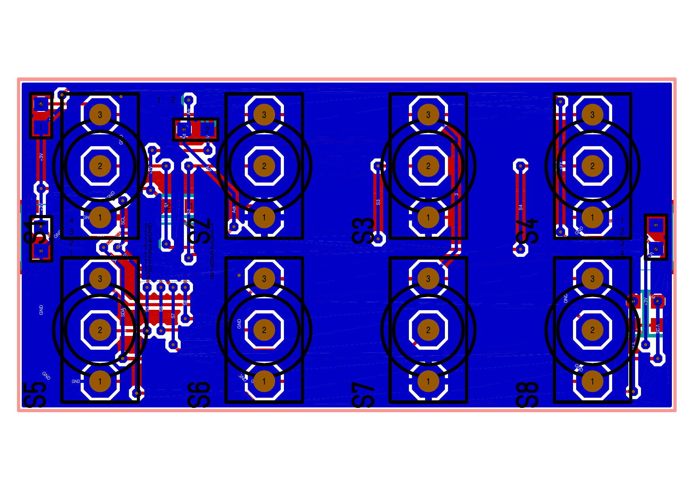

.Two switches boards connected to the new mainboard (click to enlarge)
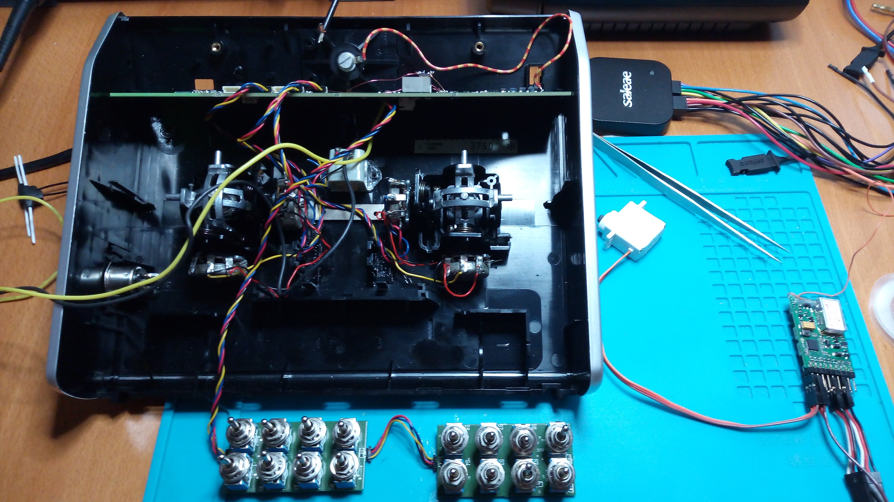

=== Remote control the remote control via BlueTooth

.RoboRemo App Interface (click to enlarge)
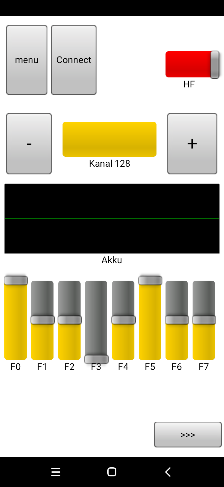

.RoboRemo App Interface conncting to the new mainboard via BLE (click to enlarge)
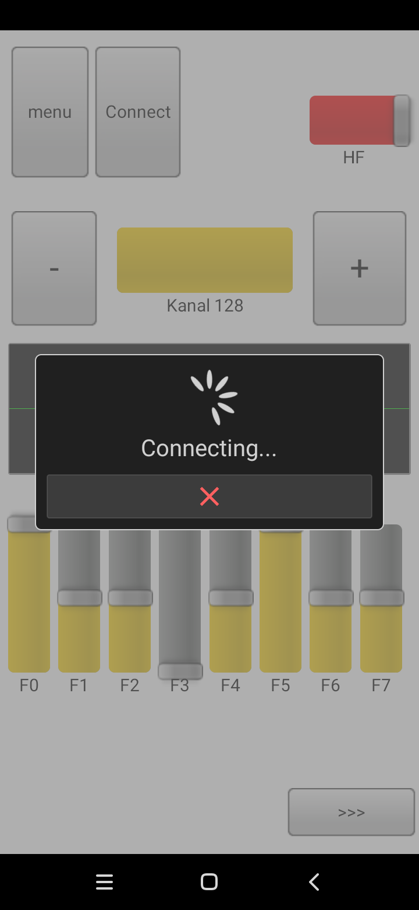

=== Inside the housing

tbd

[[x12s_touch]]
== Touch-Screen for the FrSky X12S

In my opinion the `FrSky X12S` is a very well designed and high-quality RC transmitter. Together with https://edgetx.org[EdgeTx] this is unbeatable.
The only drawback is, that it has no touch-screen. I managed to modify https://edgetx.org[EdgeTx] and the hardware to get the same touch-LCD as with the 
RadioMaster TX16S working inside the X12s.

The software modifications are in mainline https://edgetx.org[EdgeTx] (no need to patch or modify) and the hardware modification is described in an extra 
document: 
https://htmlpreview.github.io/?https://github.com/wimalopaan/Electronics/blob/main/rc/touch.html[X12S touch]

For better mounting the FPC/FFC-cable adapter, there is a printable adapter: https://www.printables.com/model/1342784-frsky-horus-x12s-touch-screen-mod-fpc-6p-05mm-adap[]

Video: https://www.youtube.com/watch?v=BhzwIHQNJnw[Demo]

[[sfrog]]
== SFrog 5D Sticks for the FrSky X12S

The following document decribes a modification for the X12S: 
https://htmlpreview.github.io/?https://github.com/wimalopaan/Electronics/blob/main/rc/sfrog.html[X12S SFrog 5D Stick modification] 

(the document is unfortunately in german, but due the large amount of images).

== Modification of an old Graupner / JR 40MHz transmitter RF modul for use in e.g. a Radiomaster TX16s / FrSky X12S/X9e or similar

Modern handsets with a JR-like module bay provide a `cppm`-signal and battery-voltage on the pins of the connector. 
Therefore it must be possible to use an old vintage _Graupner JR 40MHz_ quarz transmitter module together with an old 40MHz quarz receiver.

The good news are: yes, it is possible. *But* ...

[CAUTION]
--
It is tempting to place an old 40MHz JR module into the module bay of a modern handset. 

Please: *don't do this!!!*

You can damage your handset!
--

.Some old vintage 40MHz transmitter modules
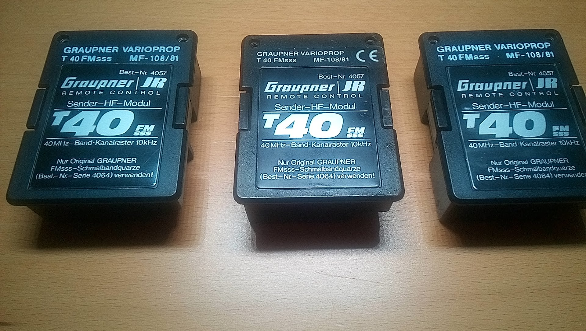

.After the modification
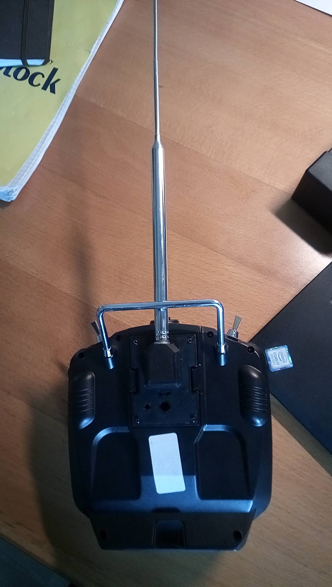

For the full story, please follow this 
https://htmlpreview.github.io/?https://github.com/wimalopaan/Electronics/blob/main/rc/jr40mhz.html[Howto (german)]

[[extswitch]]
== The TX16s internal switch controller

This is a simple AVR `attiny1614` that reads the stick switches of my TX16s and uses the <<protocols.adoc#hwext,Hardware-Extension-Protocol>> to send the data to the handset. The <<protocols.adoc#hwlua,LUA-script for the Hardware-Extension-Protocol>> decodes the stick-switches into _logical-switches_ in 
`EdgeTx`. This controller has the _controller-number_ `0`, so one can connect more controllers using the <<protocols.adoc#hwext,Hardware-Extension-Protocol>> connected to the _same_ serial interface of the TX16s.

[[hwattiny1]]
.Attiny1614 as external switch controller (click to enlarge)  
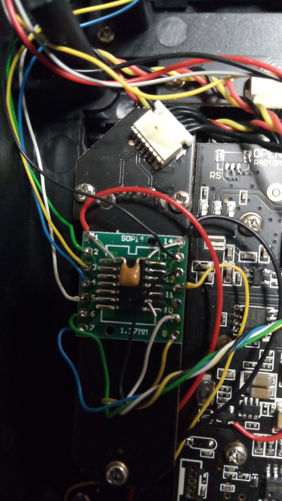

[[hwattiny2]]
.Attiny1614 as external switch controller (click to enlarge)  
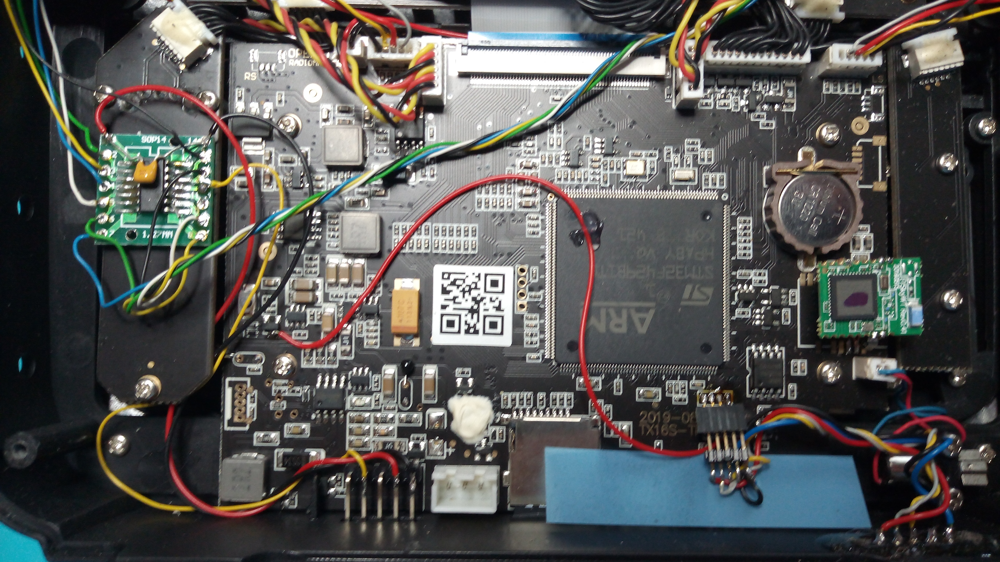

[[hwattiny3]]
.Attiny1614 as external switch controller (click to enlarge)  
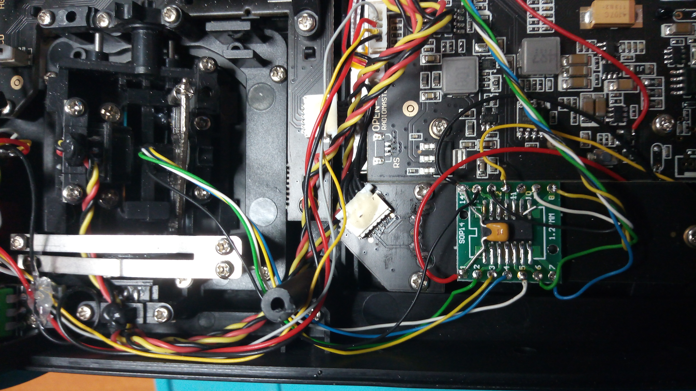

[[hwattiny4]]
.Attiny1614 as external switch controller (click to enlarge)  
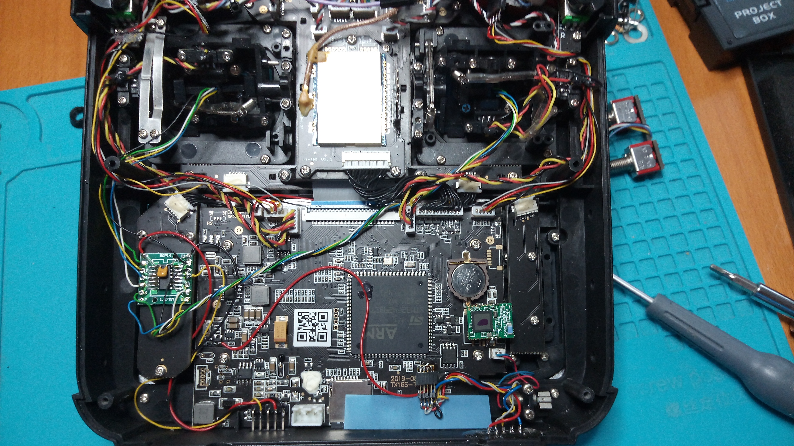

=== Code

Link to the code repo: https://github.com/wimalopaan/wmucpp/tree/master/boards/rcswitch[]

(unfortunately you have to clone to whole repo to include all neccessary files. Maybe this will change in the future)

=== Stick-End Switches

The following stick end switches are used for my RadioMaster TX16s: https://rctechnik.de/products/stick-switch-Radiomaster[stick end switches]

[[haptic]]
== A new kind of stick: haptic-control

.The stick model (click to view in full-scale)
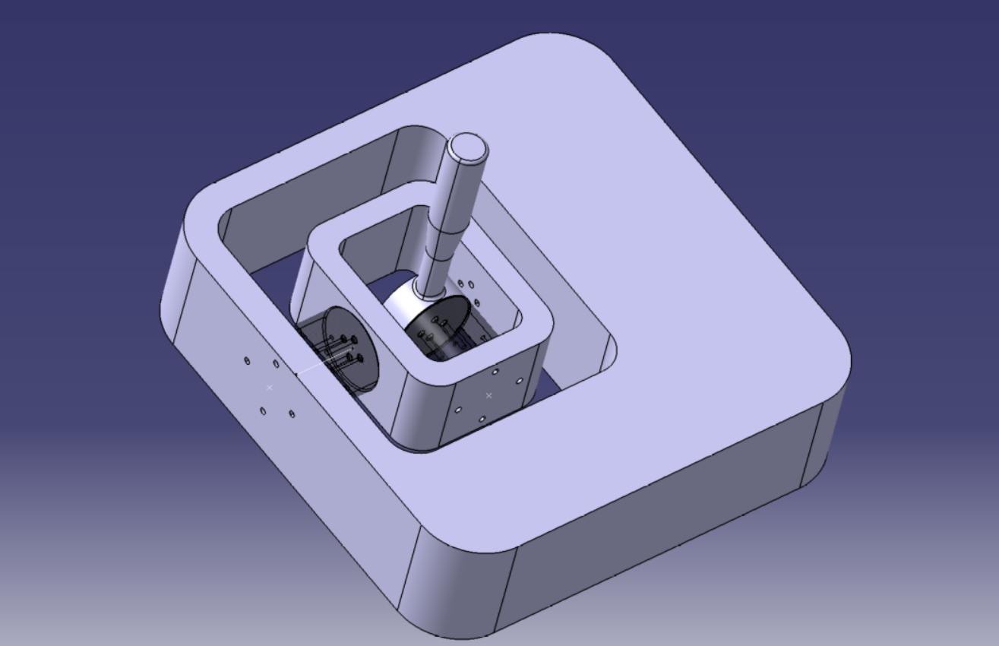

tbd
