= Sender-Modifikationen
Wilhelm Meier <wilhelm.wm.meier@googlemail.com>
:toc:
:toclevels: 3
:toc-placement!:
:sectnums:
:sectnumlevels: 5
:tip-caption: :bulb:
:note-caption: :information_source:
:important-caption: :heavy_exclamation_mark:
:caution-caption: :fire:
:warning-caption: :warning:
:lang: de
:toc-title: Inhaltsverzeichnis
:figure-caption: Abbildung
:table-caption: Tabelle
:example-caption: Beispiel

<<radio-mods.adoc#,English>> | *Deutsch*

<<../README.de.adoc#,RC-Elektronik>> / Sender-Modifikationen

[NOTE]
--
Neue VarioProp-Hauptplatine, X12S-Touchscreen/Steuerknüppel, 40MHz-Modul, TX16S-Schaltercontroller, haptischer Steuerknüppel.
--

toc::[]

[[varioprop]]
== Neue Hauptplatine für einige (alte) 27/35/40MHz-RC-Sender

[caption=""]
.Projektinfo
[cols="1h,5",width="100%"]
|===
| Status | 🟡 experimentell
| Firmware | https://github.com/wimalopaan/wmucpp/tree/master/boards/rcVarioprop[wmucpp: `boards/rcVarioprop`]
| Video | https://www.youtube.com/watch?v=kfBMQlL-LIU[2024-03-25], <<videos.de.adoc#v-varioprop,alle Videos (1)>>
|===

Wie in <<vintage.de.adoc#gr_txs,Sender>> oder <<vintage.de.adoc#rb_txs,Sender>> zu sehen ist, besitze ich einige alte, historische RC-Sender. Zum Zeitpunkt dieses Textes sind einige davon mehr als 40 Jahre alt.
Die meisten funktionieren noch einigermaßen, erfüllen aber aufgrund der Alterung der Bauteile nicht mehr die RC-Anforderungen der HF-Vorschriften in der EU.

Diese alten Sender haben aber auch noch andere Nachteile:

* Um den HF-Kanal zu wechseln, muss der Quarz im Sender ausgetauscht werden.
** Quarze sind heutzutage sehr teuer
** Als Alternative zu Quarzempfängern sind Scan-Empfänger weit verbreitet (siehe auch <<vhf-receivers.de.adoc#corona,Alternative Firmware für den Corona RP8D1>>), die keinen Quarz benötigen
* Mit Ausnahme des Robbe/Futaba F-14 lassen sich bei den meisten keine Schalter zusammen mit einem Schaltencoder verwenden
* Sie haben keine Funktionen wie Mischer, Lehrer-Schüler-Betrieb ...

All das führte zu der Idee, eine neue Hauptplatine nicht nur für den Robbe/Futaba F14, sondern auch für die gelben, roten und schwarzen Sender der Graupner/Grundig
Varioprop-Serie zu entwickeln.

Der erste Versuch war eine neue Hauptplatine für die gelbe Varioprop S8. Diese Hauptplatine verwendet einen kleinen µC `atmega324pb`, um die Potentiometer
des Senders abzutasten und ein `ppm`-Signal zu erzeugen, das einem FrSky DHT 2.4GHz-Modul zugeführt wurde. Das funktionierte recht gut, fühlte sich aber etwas so an, als würde man die
alte gelbe Varioprop zweckentfremden, die heutzutage (in Deutschland) als ziemlich cool gilt. Dieser Versuch ist bislang nicht dokumentiert.

Der nächste Versuch war die Entwicklung einer Art Relaisstation, um 2.4-GHz FrSky ACCST in FM-FSK-40MHz umzusetzen. Ich fand das eine coole Idee,
weil diese Relaisstation (theoretisch) von mehr als einem Piloten / Kapitän verwendet werden könnte. Der Hauptgrund war, einen modernen
Sender mit all seinen Funktionen wie Mischern und anderen schönen Dingen im 40MHz-Band weiterzuverwenden. Aber dann kam Corona (die Krankheit, nicht <<vhf-receivers.de.adoc#corona,Alternative Firmware für den Corona RP8D1>>) ...

Ich lernte viel über HF-Elektronik im Sub-GHz-Bereich, und das machte großen Spaß. Daher entschied ich mich, etwas zu entwickeln, das
alle Funktionen vereint, mit denen ich in den vorherigen Versionen experimentiert hatte.

Das führte zum aktuellen Entwurf ...

[[_the_new_mainboard]]
=== Die neue Hauptplatine

Die Hauptplatine ist als Platine ausgeführt, die sich leicht an die drei Bauformen der folgenden Sender anpassen lässt:

* Robbe/Futaba F-14 (siehe <<vintage.de.adoc#robbe_f14,Robbe Futaba F-14 Navy 40MHz>>)
* gelbe Graupner/Grundig Varioprop 8S (siehe <<vintage.de.adoc#varioprop_yellow,Varioprop Graupner Grundig 8S 27MHz>>)
* rote/schwarze Graupner/Grundig Varioprop (siehe <<vintage.de.adoc#varioprop_red,Varioprop Graupner Grundig C8 27MHz>> und <<vintage.de.adoc#varioprop_black,Varioprop Graupner Grundig 8S 40MHz>>)

Die Hauptplatine

* verarbeitet bis zu 8 analoge Eingänge (üblicherweise die Potentiometer des Senders)
* hat ein 100mW-HF-Modul (27/35/40 MHz)
* nutzt das analoge Anzeigeinstrument als Akkuüberwachung
* hat einen Signalgeber
* hat einen I2C-Anschluss für bis zu zwei Schalterplatinen mit jeweils 8 3-Stufen-Schaltern
* hat ein Bluetooth-Modul (BLE)
* hat ein ELRS-Modul (als Empfänger oder Sender nutzbar)
* kann die Kanäle über BLE oder ELRS umschalten
* hat eine freie UART für weitere Erweiterungen

[[_previous_versions_of_the_new_mainboard]]
==== Frühere Versionen der neuen Hauptplatine

Der Entwurf der neuen Hauptplatine hat allerdings einige Iterationen durchlaufen. Im Folgenden ist
die letzte Iteration zu sehen: Diese funktioniert wirklich, hat aber einige Entwurfsfehler, die ich gerade behebe ;-)

.Die neue Hauptplatine, bestückt, aber mit vielen Entwurfsproblemen (zum Vergrößern anklicken)
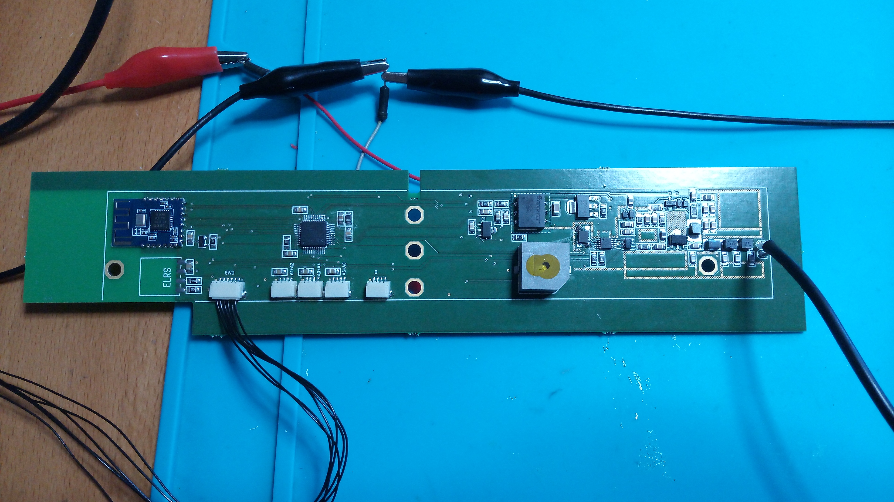

.Die neue Hauptplatine in einem alten VarioProp-Gehäuse (zum Vergrößern anklicken)
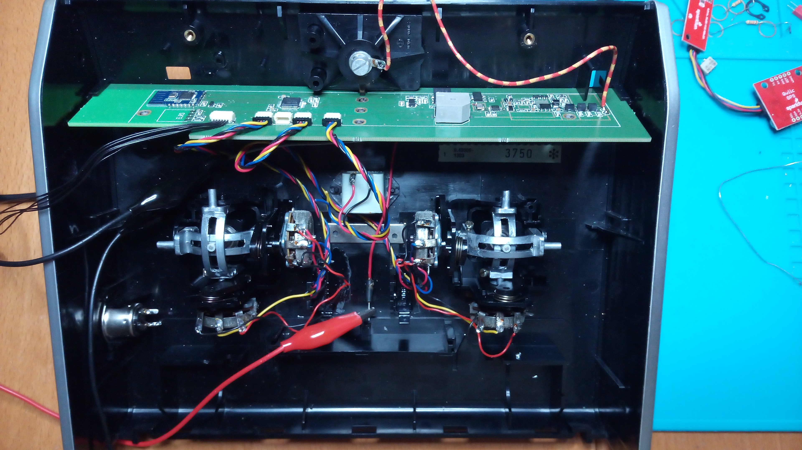

In <<VarNG02>> ist der Schaltplan zu sehen. Abgesehen von einigen kleineren Fehlern hat diese Platine ein großes Problem: die Erzeugung
des Frequenzumtastungssignals! Wie im Schaltplan zu sehen, erzeugt der `Si5361` zwei Rechtecksignale, eines mit der
`space`-Frequenz _f0_ an `CLK0` und eines mit der `mark`-Frequenz _f1_ an `CLK1`. Anschließend schaltet ein `74LVC1G157` mit dem `cppm`-Signal zwischen
diesen beiden Frequenzen um.

Obwohl das zu funktionieren scheint, gibt es sehr ernsthafte Probleme! (Diesen Teil des Schaltplans nicht in eigenen Projekten verwenden.)

Ein wenig Theorie: Das Umschalten zwischen diesen beiden Signalen kann als Faltung jedes Signals
(im Frequenzbereich jeweils selbst ein _si()_-Signal) mit einem weiteren entsprechenden _si()_-Signal (dem cppm-Rechtecksignal im Zeitbereich)
und anschließender Addition betrachtet werden. Daraus ergeben sich zwei Hauptprobleme:

* Das Umschalten im Zeitbereich mit einem Rechtecksignal beziehungsweise die Faltung zweier _si()_-Funktionen im Frequenzbereich ergibt ein sehr breites Spektrum (siehe <<hardsw>>).

* Außerdem ist das Umschalten nicht mit dem Grundsignal synchronisiert, wodurch zusätzliche kurzzeitige Impulse und damit breitbandige Frequenzanteile entstehen.

Es stellte sich heraus, dass der HF-Teil dadurch unbrauchbar wird, weil mehrere konventionelle Empfänger das Signal bei abnehmender Signalstärke nicht dekodieren konnten.
Das war natürlich nicht akzeptabel.

[[VarNG02]]
.Schaltplan von Version 2 (zum Vergrößern anklicken)  
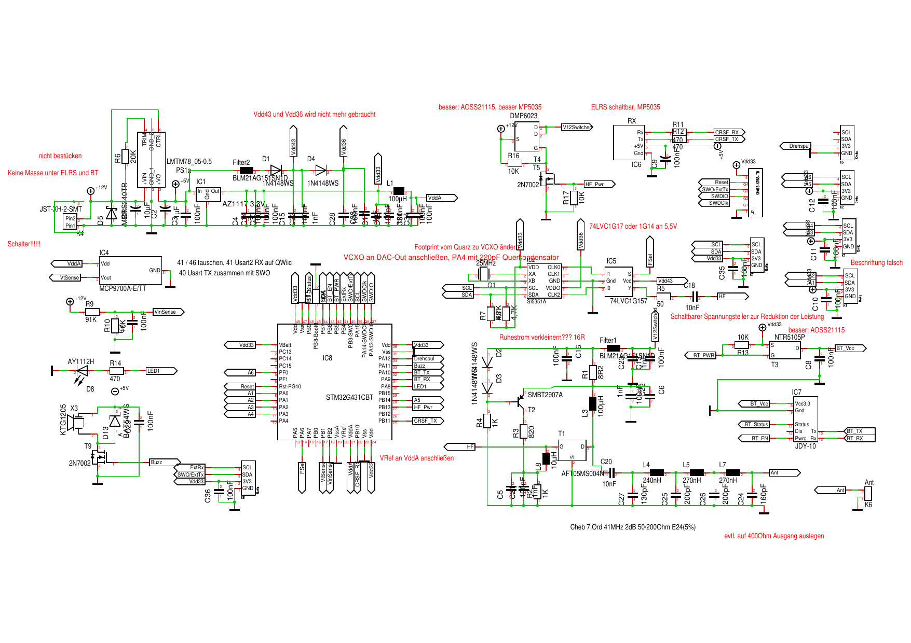

Nun, obwohl mir dieses Problem von Anfang an bewusst war, hätte ich nicht gedacht, dass die negativen Auswirkungen so groß wären!

Ich sah mich um und fand einige `27MHz`-VCXO (spannungsgesteuerte Quarzoszillatoren) mit einem geeigneten Ziehbereich bis zu 100ppm. Das erscheint recht sinnvoll: Der µC könnte das cppm-Signal
mit exponentiell (gaußförmig) geglätteten Anstiegs- / Abfallflanken über seinen DAC erzeugen. Das VCXO-Taktsignal wird dann als Eingang für den SI5351 verwendet. Der SI5351 erzeugt einfach die gewünschte
Ausgangsfrequenz aus dem modulierten Taktsignal. Ich führte mehrere Tests mit verschiedenen Anstiegs- / Abfallkurven durch und stellte fest, dass eine Exponentialkurve die besten Ergebnisse hinsichtlich
eines möglichst schmalen Frequenzspektrums des resultierenden HF-Signals liefert. Sehr gut (siehe <<gausssw>>).

Die geglätteten Anstiegs- / Abfallflanken über den DAC des µC (STM32G431) lassen sich für jede Impulsflanke des cppm-Signals einfach per timergesteuerter DMA zum DAC erzeugen.

Alle Änderungen sind nun in <<VarNG03>> enthalten.

[[VarNG03]]
.Schaltplan von Version 3 (zum Vergrößern anklicken)  
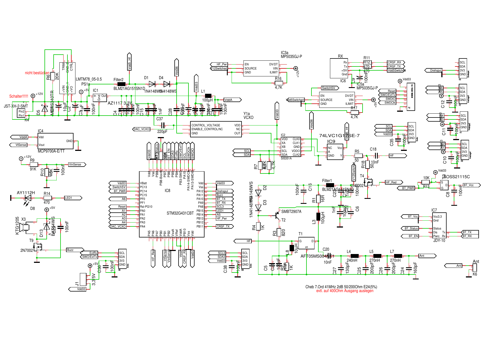

[[VarNG03pcbtop]]
.Platinenoberseite (zum Vergrößern anklicken)  
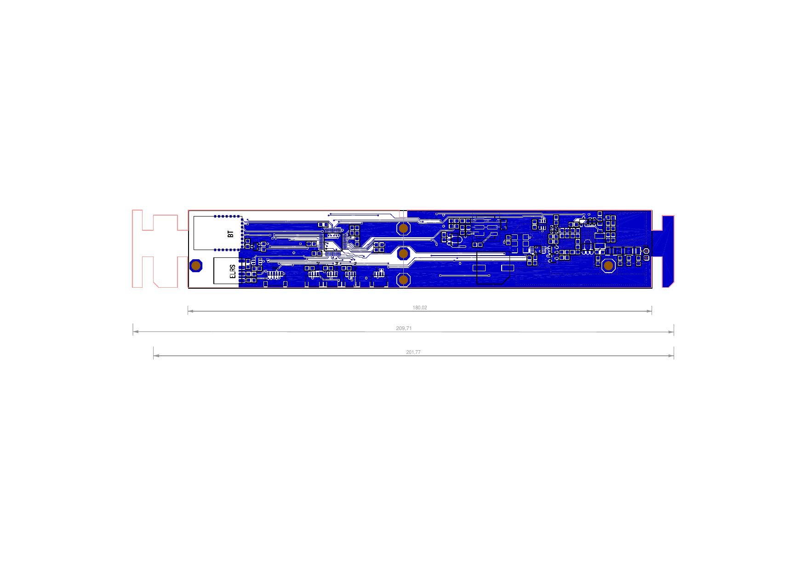

[[VarNG03pcbbot]]
.Platinenunterseite (zum Vergrößern anklicken)  
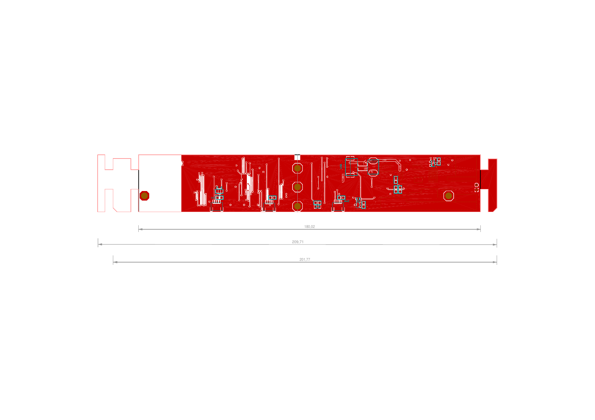

Wie oben erwähnt, war die problematische HF-Signalerzeugung der Hauptgrund für diese Version, es gibt aber weitere Änderungen:

* neue HF-Signalerzeugung für deutlich bessere spektrale Ergebnisse
* zusätzliche I2C-Schnittstelle (jetzt insgesamt zwei Schnittstellen)
* Ein-/Ausschalten des ELRS
* Schaltung zur Reduzierung der HF-Leistung
* vereinfachte Versorgungsschaltung für Untermodule

Diese Version wird derzeit getestet.

[[hardsw]]
.Spektrum bei hartem Umschalten der Frequenzen (zum Vergrößern anklicken)  
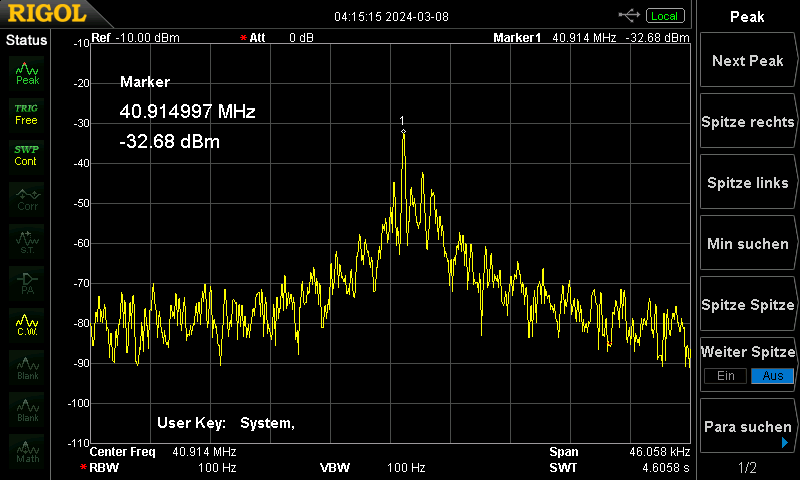

[[gausssw]]
.Spektrum bei gaußförmig geglätteten Anstiegs- / Abfallflanken (zum Vergrößern anklicken)  
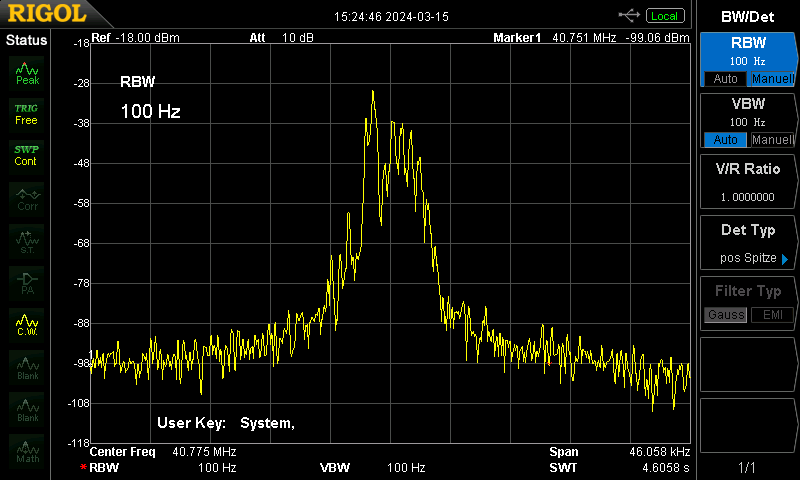

[[f14spec]]
.Spektrum Futaba F14 (zum Vergrößern anklicken)  
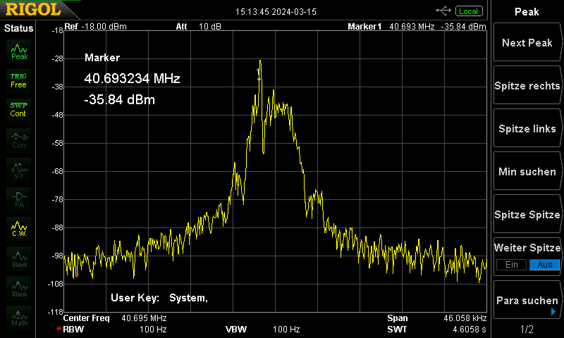

[[grspec]]
.Spektrum Graupner 40MHz-JR-Modul (zum Vergrößern anklicken)  
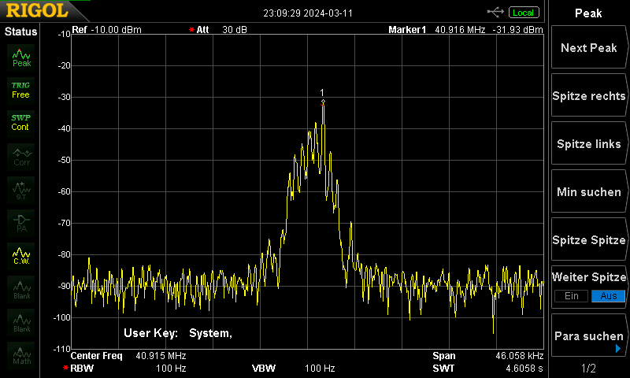

[[_the_new_switches_board]]
=== Die neue Schalterplatine

Die Schalterplatine ist sehr einfach: Sie wird über `I2C` mit der Hauptplatine verbunden. Sie kann außerdem kaskadiert werden.

.Schaltplan (zum Vergrößern anklicken)
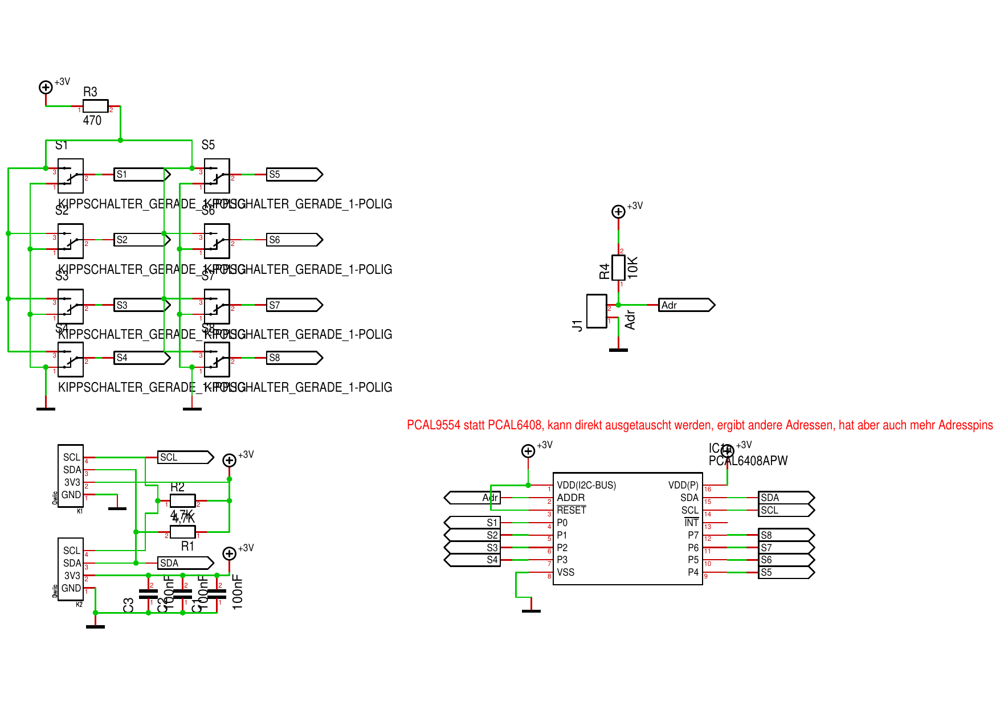

.Platine (zum Vergrößern anklicken)
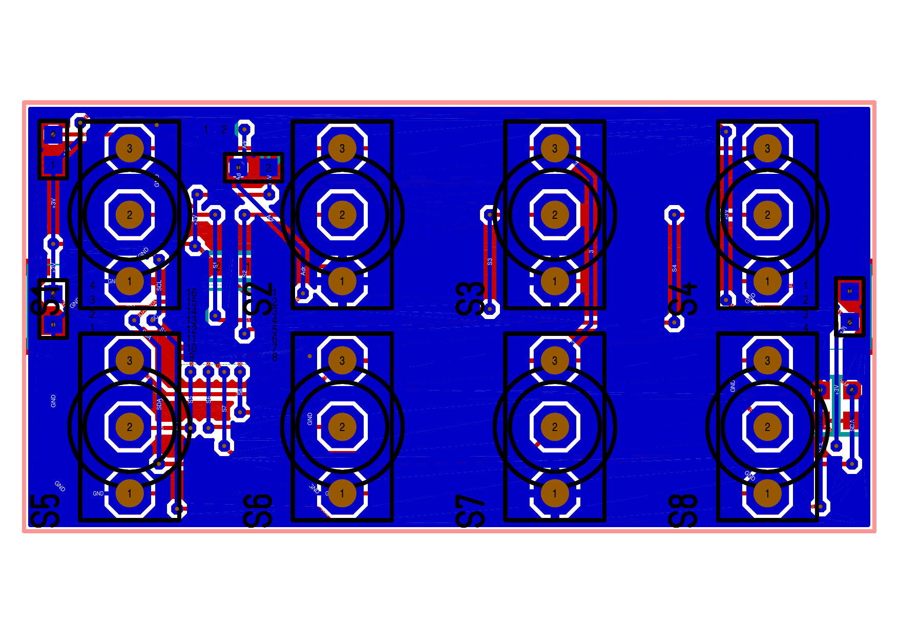

.Zwei Schalterplatinen an der neuen Hauptplatine (zum Vergrößern anklicken)
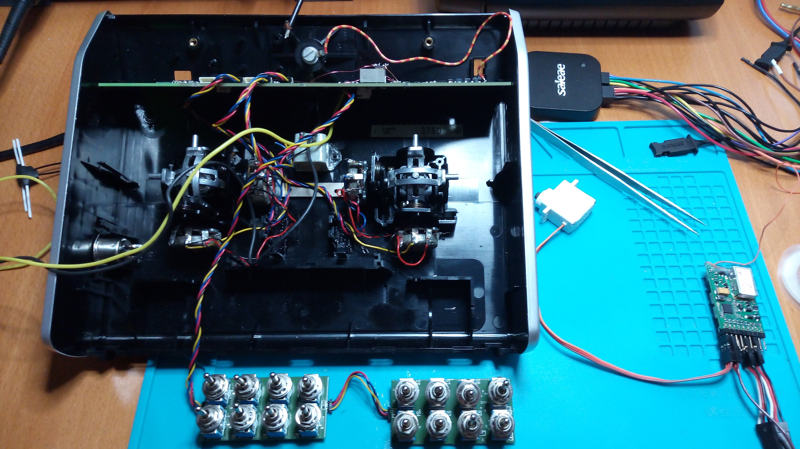

[[_remote_control_the_remote_control_via_bluetooth]]
=== Die Fernsteuerung über BlueTooth fernsteuern

.Bedienoberfläche der RoboRemo-App (zum Vergrößern anklicken)
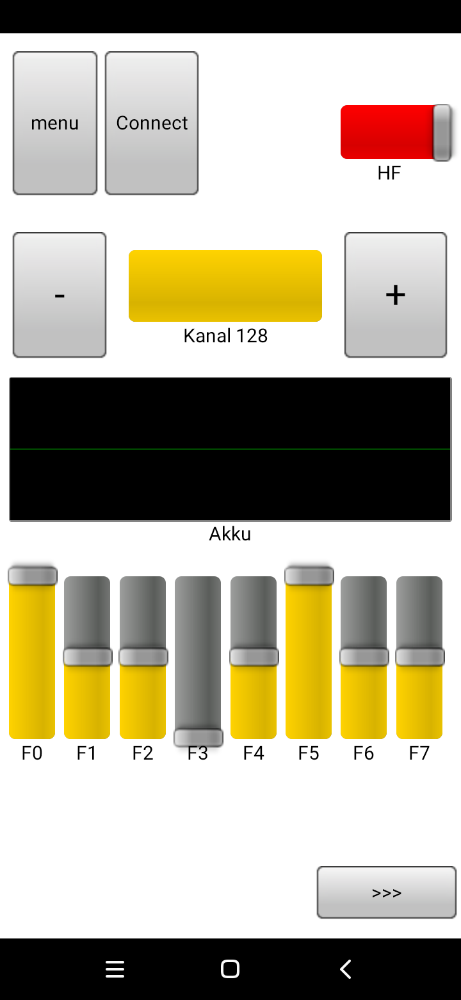

.Bedienoberfläche der RoboRemo-App mit BLE-Verbindung zur neuen Hauptplatine (zum Vergrößern anklicken)
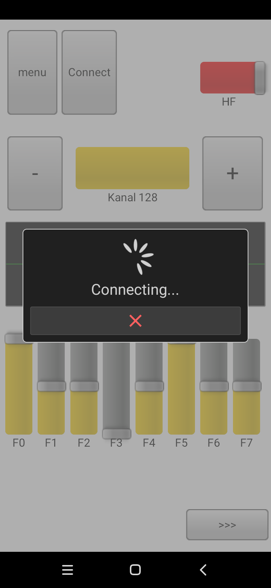

[[_inside_the_housing]]
=== Im Gehäuse

Noch auszuarbeiten

[[x12s_touch]]
== Touchscreen für den FrSky X12S

[caption=""]
.Projektinfo
[cols="1h,5",width="100%"]
|===
| Status | 🔵 stabil
| Dokumentation | https://htmlpreview.github.io/?https://github.com/wimalopaan/Electronics/blob/main/rc/touch.html[Details]
| Hardware | https://www.printables.com/model/1342784-frsky-horus-x12s-touch-screen-mod-fpc-6p-05mm-adap[FPC-Adapter (Printables)]
| Video | https://www.youtube.com/watch?v=BhzwIHQNJnw[2022-03-31], <<videos.de.adoc#v-x12s_touch,alle Videos (1)>>
|===

Meiner Meinung nach ist der `FrSky X12S` ein sehr gut durchdachter und hochwertiger RC-Sender. Zusammen mit https://edgetx.org[EdgeTx] ist das unschlagbar.
Der einzige Nachteil ist, dass er keinen Touchscreen hat. Ich konnte https://edgetx.org[EdgeTx] und die Hardware so modifizieren, dass dasselbe Touch-LCD wie beim
RadioMaster TX16S auch im X12s funktioniert.

Die Softwareänderungen sind im Hauptentwicklungszweig von https://edgetx.org[EdgeTx] enthalten (keine Patches oder Änderungen nötig), und die Hardware-Modifikation ist in einem eigenen
Dokument beschrieben:
https://htmlpreview.github.io/?https://github.com/wimalopaan/Electronics/blob/main/rc/touch.html[X12S-Touchscreen]

Zur besseren Befestigung des FPC/FFC-Kabeladapters gibt es einen druckbaren Adapter: https://www.printables.com/model/1342784-frsky-horus-x12s-touch-screen-mod-fpc-6p-05mm-adap[]

Video: https://www.youtube.com/watch?v=BhzwIHQNJnw[Demo]

[[sfrog]]
== SFrog 5D-Steuerknüppel für den FrSky X12S

[caption=""]
.Projektinfo
[cols="1h,5",width="100%"]
|===
| Status | 🔵 stabil
| Dokumentation | https://htmlpreview.github.io/?https://github.com/wimalopaan/Electronics/blob/main/rc/sfrog.html[Details]
| Video | https://www.youtube.com/watch?v=AKuuXripmW0[2026-01-15], <<videos.de.adoc#v-sfrog,alle Videos (1)>>
|===

Das folgende Dokument beschreibt eine Modifikation für den X12S:
https://htmlpreview.github.io/?https://github.com/wimalopaan/Electronics/blob/main/rc/sfrog.html[X12S-Modifikation mit SFrog 5D-Steuerknüppeln]

(Das Dokument ist leider auf Deutsch, enthält aber viele Bilder.)

[[_modification_of_an_old_graupner_jr_40mhz_transmitter_rf_modul_for_use_in_e_g_a_radiomaster_tx16s_frsky_x12sx9e_or_similar]]
== Modifikation eines alten Graupner / JR 40MHz-Sender-HF-Moduls für den Einsatz z. B. in einem Radiomaster TX16s / FrSky X12S/X9e oder ähnlichen Sendern

[caption=""]
.Projektinfo
[cols="1h,5",width="100%"]
|===
| Status | 🔵 stabil
| Dokumentation | https://htmlpreview.github.io/?https://github.com/wimalopaan/Electronics/blob/main/rc/jr40mhz.html[Details]
| Video | https://www.youtube.com/watch?v=Ts7rE-eQF9k[2021-11-25], https://www.youtube.com/watch?v=zVdzESDU7Og[2021-11-30], https://www.youtube.com/watch?v=gUPJTPywyzM[2021-12-04], https://www.youtube.com/watch?v=OCwq4FE56SY[2021-12-09], <<videos.de.adoc#v-jr40,alle Videos (4)>>
|===

Moderne Sender mit einem JR-kompatiblen Modulschacht stellen an den Pins des Steckverbinders ein `cppm`-Signal und die Akkuspannung bereit.
Daher müsste sich ein altes historisches Quarz-Sendermodul _Graupner JR 40MHz_ zusammen mit einem alten 40MHz-Quarzempfänger verwenden lassen.

Die gute Nachricht: Ja, es ist möglich. *Aber* ...

[CAUTION]
--
Es ist verlockend, ein altes 40MHz-JR-Modul in den Modulschacht eines modernen Senders zu stecken.

Bitte: *Nicht machen!!!*

Der Sender kann dadurch beschädigt werden!
--

.Einige alte historische 40MHz-Sendermodule
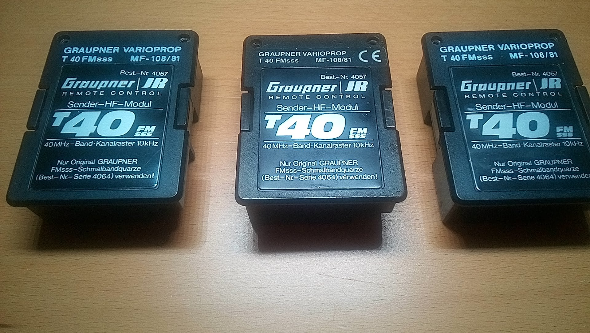

.Nach der Modifikation
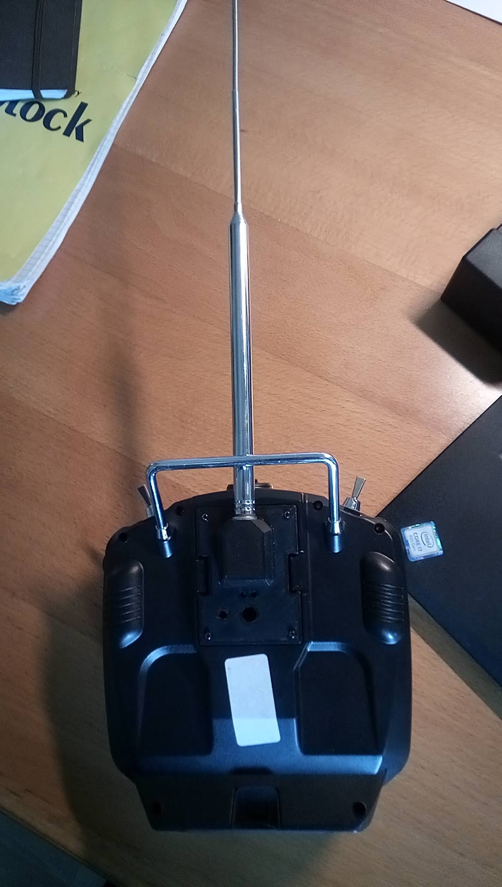

Die vollständige Beschreibung steht in dieser
https://htmlpreview.github.io/?https://github.com/wimalopaan/Electronics/blob/main/rc/jr40mhz.html[Anleitung (Deutsch)]

[[extswitch]]
== Der interne Schaltercontroller des TX16s

[caption=""]
.Projektinfo
[cols="1h,5",width="100%"]
|===
| Status | 🔵 stabil
| Firmware | https://github.com/wimalopaan/wmucpp/tree/master/boards/rcswitch[wmucpp: `boards/rcswitch`]
| Hardware | https://rctechnik.de/products/stick-switch-Radiomaster[Knüppelschalter (rctechnik)]
|===

Dies ist ein einfacher AVR `attiny1614`, der die Knüppelschalter meines TX16s einliest und die Daten über das <<protocols.de.adoc#hwext,Hardware-Erweiterungsprotokoll>> an den Sender sendet. Das <<protocols.de.adoc#hwlua,LUA-Skript für das Hardware-Erweiterungsprotokoll>> dekodiert die Knüppelschalter als _logische Schalter_ in
`EdgeTx`. Dieser Controller hat die _Controllernummer_ `0`, sodass weitere Controller über das <<protocols.de.adoc#hwext,Hardware-Erweiterungsprotokoll>> an _derselben_ seriellen Schnittstelle des TX16s angeschlossen werden können.

[[hwattiny1]]
.Attiny1614 als externer Schaltercontroller (zum Vergrößern anklicken)  
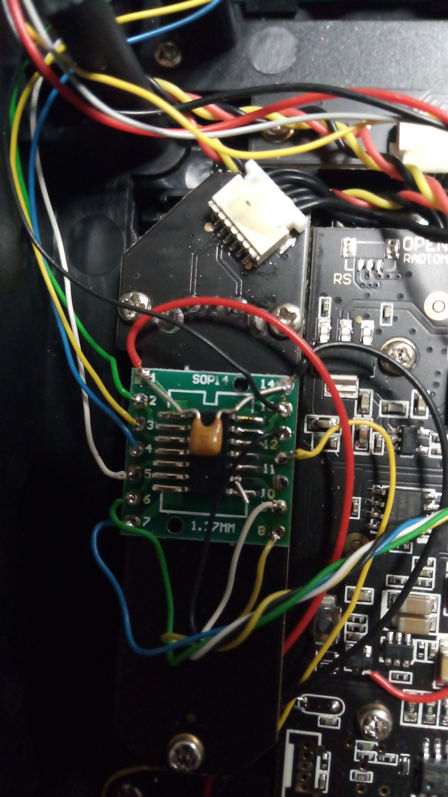

[[hwattiny2]]
.Attiny1614 als externer Schaltercontroller (zum Vergrößern anklicken)  
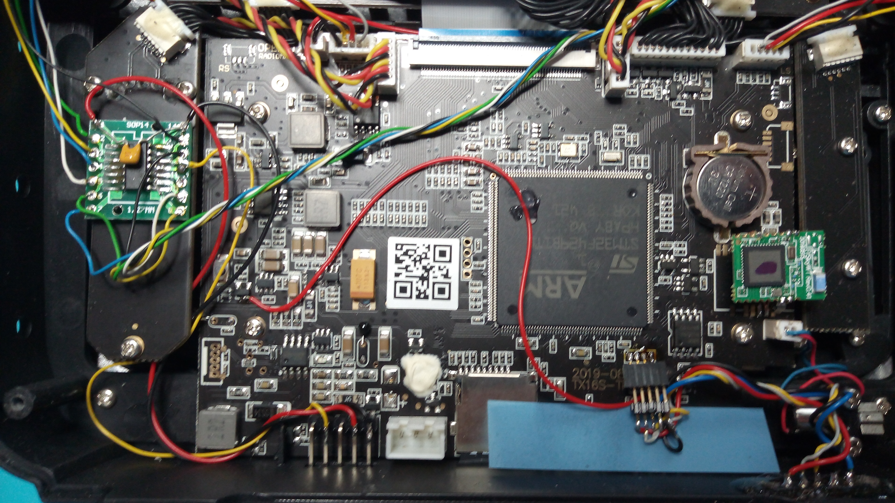

[[hwattiny3]]
.Attiny1614 als externer Schaltercontroller (zum Vergrößern anklicken)  
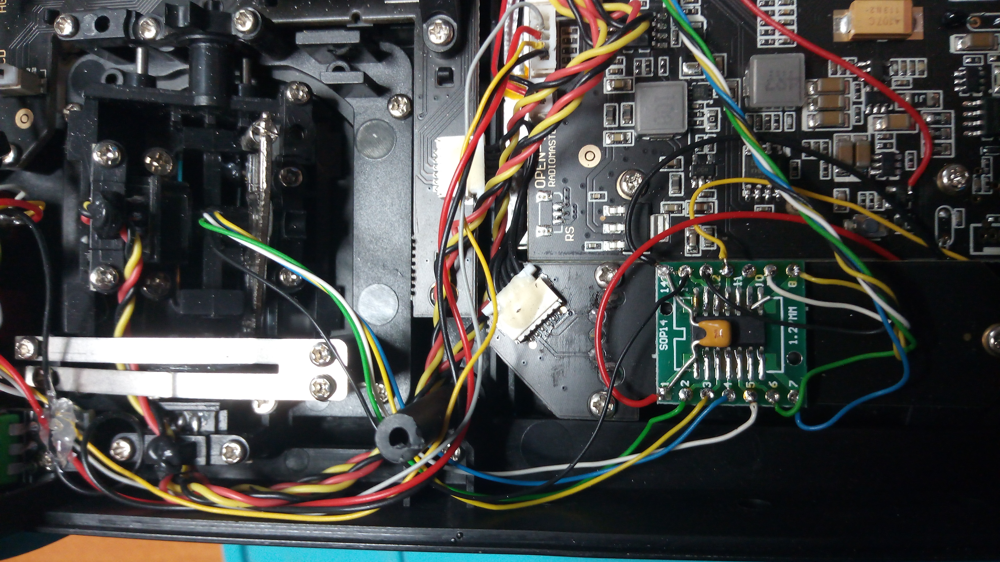

[[hwattiny4]]
.Attiny1614 als externer Schaltercontroller (zum Vergrößern anklicken)  
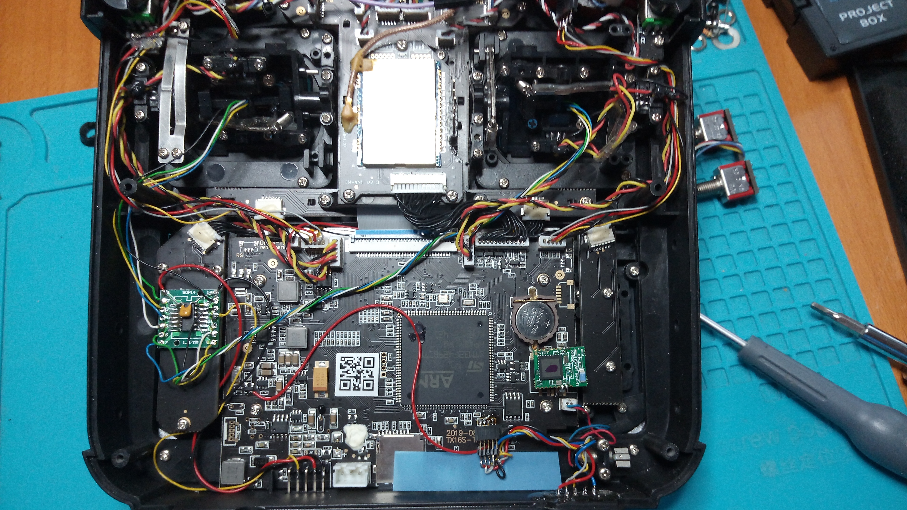

[[_code]]
=== Quellcode

Link zum Quellcode-Repository: https://github.com/wimalopaan/wmucpp/tree/master/boards/rcswitch[]

(Leider muss das gesamte Repository geklont werden, um alle erforderlichen Dateien zu erhalten. Vielleicht ändert sich das in Zukunft.)

[[_stick_end_switches]]
=== Knüppelschalter

Für meinen RadioMaster TX16s werden die folgenden Knüppelschalter verwendet: https://rctechnik.de/products/stick-switch-Radiomaster[Knüppelschalter]

[[haptic]]
== Eine neue Art von Steuerknüppel: haptische Steuerung

[caption=""]
.Projektinfo
[cols="1h,5",width="100%"]
|===
| Status | 📝 geplant
| Video | https://www.youtube.com/watch?v=KmKqtQulzzM[2021-08-03], https://www.youtube.com/watch?v=Rj6FijD5dco[2021-08-03 #2], https://www.youtube.com/watch?v=1llRP9EBrLc[2021-08-03 #3], https://www.youtube.com/watch?v=G81UkoHOj9A[2021-08-03 #4], https://www.youtube.com/watch?v=i7hTHSYI2aA[2021-08-03 #5], <<videos.de.adoc#v-haptic,alle Videos (5)>>
|===

.Das Steuerknüppelmodell (für die Ansicht in voller Größe anklicken)
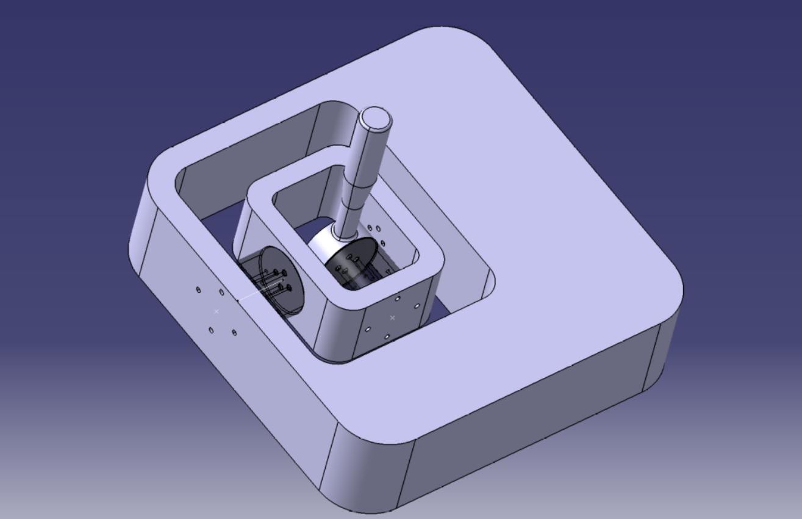

Noch auszuarbeiten
