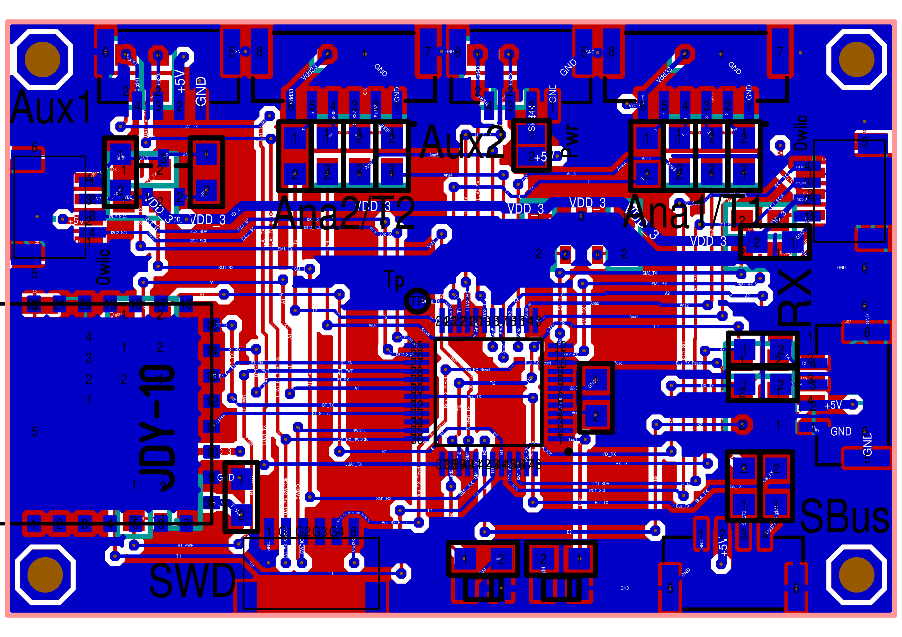
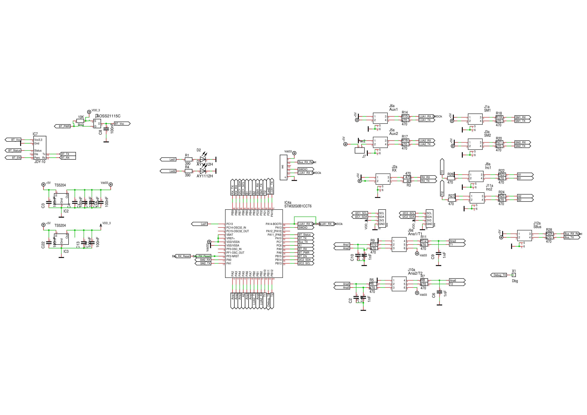

= RC-Desk
Wilhelm Meier <wilhelm.wm.meier@googlemail.com>
:toc:
:toclevels: 3
:toc-placement!:
:sectnums:
:sectnumlevels: 5
:tip-caption: :bulb:
:note-caption: :information_source:
:important-caption: :heavy_exclamation_mark:
:caution-caption: :fire:
:warning-caption: :warning:

*English* | <<rc-desk.de.adoc#,Deutsch>>

<<../README.adoc#,RC Electronics>> / RC-Desk

[NOTE]
--
RC-Desk and RC-Desk mini for TX16S, TX15, X12S, X9E.
--

toc::[]

[[rcdesk]]
== The RC-Desk (for RadioMaster TX16S, FrSky X12S, X9E, ...)

[caption=""]
.Project info
[cols="1h,5",width="100%"]
|===
| Status | 🟢 active
| Hardware | link:../desk/RC_Desk32_01.T3001[TARGET 3001!]
| Firmware | https://github.com/wimalopaan/wmucpp/tree/master/boards/rcDesk32[wmucpp: `boards/rcDesk32`]
|===

This project is a hardware extension for all radios with an exposed serial interface (s.a. <<protocols.adoc#hwext,Hardware-Extension-Protocol>>).

It controls and sends the following data to the radio:

* two 4D-Sticks (each has 3 pots and one momentary button): 6 analogs, 2 buttons
* upto 64 buttons / switches (via I2C)
* 2 space-mouse
* 2 incremental with button each
* connection to upto two serials to the radio (e.g. AUX1 / 2 of the RadioMaster TX16S)
* bluetooth (virtual controls on smart phone)
* SBus/IBus/SumDV3 input
* ELRS receiver (configuarion and / or slave radio)
* two LEDs

Normally, one would use the RC-Desk at least with one serial connection to the handset. To to the
longer update intervall of the <<protocols.adoc#hwext,Hardware-Extension-Protocol>>, it might be useful to use a second (or the one and only) serial
connection that transports the proportional values via SBUS, and this can be used as SBUS-input / trainer-serial
in EdgeTx.

.The RC-desk32 PCB

.The RC-desk32 Schematic

If you use _Target 3001_ as your EDA: link:../desk/RC_Desk32_01.T3001[Target 3001 design file].

Link to the code repo: https://github.com/wimalopaan/wmucpp/tree/master/boards/rcDesk32[]

[[rcdesk32mini]]
== The RC-Desk mini (for RadioMaster TX16S, TX15, FrSky X12S, X9E, ...)

[caption=""]
.Project info
[cols="1h,5",width="100%"]
|===
| Status | 🟢 active
| Hardware | https://de.aliexpress.com/item/1005005748198584.html[WeAct STM32G0 board]
| Firmware | https://github.com/wimalopaan/wmucpp/tree/master/boards/rcDesk32mini[wmucpp: `boards/rcDesk32mini`]
| Video | https://www.youtube.com/watch?v=B_YVf5j0ufc[2025-11-28], https://www.youtube.com/watch?v=4ywRSnH-egw[2025-12-02], <<videos.adoc#v-rcdesk32mini,all videos (2)>>
|===

This project is a hardware extension for all radios with an exposed serial interface. It is preferred
to use it via `SBUS`-input / trainer-serial to the handset. One can connect up to 8 analog and
4 digital inputs. The analog inputs can be potiometers or e.g. 3-pos switches (preferrably with two
resistors connected from `Vcc` to middle, and from middle to `Gnd`). The digital inputs can be 2-pos
switches.

The 8 analog inputs are converted to `SBUS` values in SBus channel 1 - 8 and the 4 digital inputs are converted to 
`SBUS` channels 9 - 12. This requires to define _logical switches_ 
in EdgeTx to make use of the digital inputs to the `RC-Desk mini`.

Additionally to `SBUS` one can use `CRSF` protocoll or the <<protocols.adoc#hwext,Hardware-Extension-Protocol>> as a transport to the handset.

Using `CRSF` makes it possible to use an ELRS-Tx-Module or a Rx-as-TX as a transmitter (no handset running EdgeTx needed).
This maybe a simple means to renew old vintage transmitters.

`CRSF` makes it also possible to transport the digital switch information via the <<protocols.adoc#crsf-sw,Commands for MultiSwitch (realm `0xa1`)>> protocol. So, 
an <<multiswitch.adoc#elrs_msw,ELRS-MultiSwitch>> can be used as a multiswitch connected to the receiver or use an ELRS pwm receiver as a
multiswitch (<<elrs.adoc#elrs_pwm_msw,Use an ELRS PWM-receiver as MultiSwitch>>).

The https://de.aliexpress.com/item/1005005748198584.html[WeAct STM32G031F8] is used as the hardware platform.

The firmware con be found here: https://github.com/wimalopaan/wmucpp/tree/master/boards/rcDesk32mini[]

.Pins of the WeAct STM32G031 Board
|===
| Description | Pin | Pin-Header-Name | Name on the board

| Analog Input 0 | PA0 | P2-7 | A0
| Analog Input 1 | PA1 | P2-8 | A1
| Analog Input 2 | PA2 | P2-9 | A2
| Analog Input 3 | PA3 | P2-10 | A3
| Analog Input 4 | PA5 | P3-7 | A5
| Analog Input 5 | PA6 | P3-6 | A6
| Analog Input 6 | PA7 | P3-5 | A7
| Analog Input 7 | PA8 | P3-4 | A8
| to handset aux tx | PA9 | P3-3  | A9 (A11)
| to handset aux rx | PA10 | P3-2  | A10 (A12)
| button on-board | PA14 |  | not exposed
| serial debug output | PA2 | P2-8 | A2 (collision with analog input 2) 
| LED (onboard) | PA4 | A4 | A4
| Switch input 0 | PB6 | P3-1 | B6
| Switch input 1 | PB7 | P2-1 | B7
| Switch input 2 | PC14 | P2-2 | C14
| Switch input 3 | PC15 | P2-3 | C15
|===
