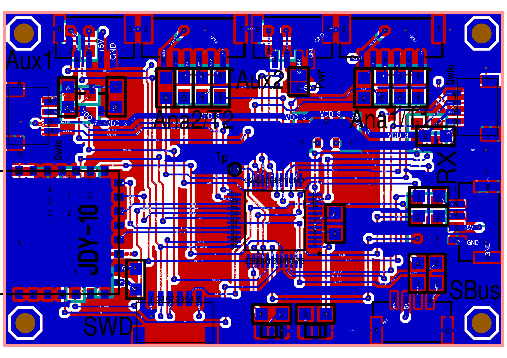
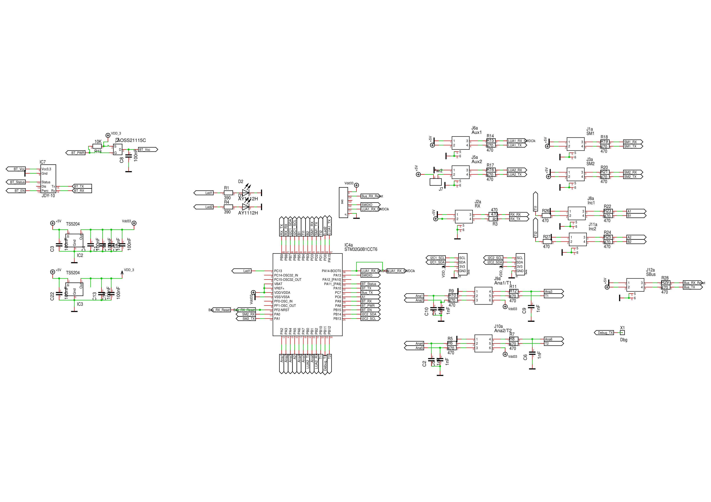

= RC-Desk
Wilhelm Meier <wilhelm.wm.meier@googlemail.com>
:toc:
:toclevels: 3
:toc-placement!:
:sectnums:
:sectnumlevels: 5
:tip-caption: :bulb:
:note-caption: :information_source:
:important-caption: :heavy_exclamation_mark:
:caution-caption: :fire:
:warning-caption: :warning:
:lang: de
:toc-title: Inhaltsverzeichnis
:figure-caption: Abbildung
:table-caption: Tabelle
:example-caption: Beispiel

<<rc-desk.adoc#,English>> | *Deutsch*

<<../README.de.adoc#,RC-Elektronik>> / RC-Desk

[NOTE]
--
RC-Desk und RC-Desk mini für TX16S, TX15, X12S, X9E.
--

toc::[]

[[rcdesk]]
== Der RC-Desk (für RadioMaster TX16S, FrSky X12S, X9E, ...)

[caption=""]
.Projektinfo
[cols="1h,5",width="100%"]
|===
| Status | 🟢 aktiv
| Hardware | link:../desk/RC_Desk32_01.T3001[TARGET 3001!]
| Firmware | https://github.com/wimalopaan/wmucpp/tree/master/boards/rcDesk32[wmucpp: `boards/rcDesk32`]
|===

Dieses Projekt ist eine Hardware-Erweiterung für alle Sender mit einer zugänglichen seriellen Schnittstelle (siehe auch <<protocols.de.adoc#hwext,Hardware-Erweiterungsprotokoll>>).

Es erfasst die folgenden Bedienelemente und sendet ihre Daten an den Sender:

* zwei 4D-Steuerknüppel (mit jeweils 3 Potentiometern und einem Taster): 6 Analogeingänge, 2 Taster
* bis zu 64 Taster / Schalter (über I2C)
* 2 Space-Mäuse
* 2 Inkrementalgeber mit jeweils einem Taster
* Verbindung zum Sender über bis zu zwei serielle Schnittstellen (z. B. AUX1 / 2 des RadioMaster TX16S)
* Bluetooth (virtuelle Bedienelemente auf dem Smartphone)
* SBus/IBus/SumDV3-Eingang
* ELRS-Empfänger (Konfiguration und / oder Schülersender)
* zwei LEDs

Normalerweise verwendet man den RC-Desk mit mindestens einer seriellen Verbindung zum Sender. Aufgrund des
längeren Aktualisierungsintervalls des <<protocols.de.adoc#hwext,Hardware-Erweiterungsprotokolls>> kann es sinnvoll sein, eine zweite (oder die einzige) serielle
Verbindung zu verwenden, die die Proportionalwerte über SBUS überträgt. Diese lässt sich als SBUS-Eingang / serielle Lehrer-Schüler-Schnittstelle
in EdgeTx nutzen.

.Die RC-desk32-Platine

.Der RC-desk32-Schaltplan

Wer _Target 3001_ als EDA-Software verwendet: link:../desk/RC_Desk32_01.T3001[Target 3001-Entwurfsdatei].

Link zum Quellcode-Repository: https://github.com/wimalopaan/wmucpp/tree/master/boards/rcDesk32[]

[[rcdesk32mini]]
== Der RC-Desk mini (für RadioMaster TX16S, TX15, FrSky X12S, X9E, ...)

[caption=""]
.Projektinfo
[cols="1h,5",width="100%"]
|===
| Status | 🟢 aktiv
| Hardware | https://de.aliexpress.com/item/1005005748198584.html[WeAct STM32G0-Platine]
| Firmware | https://github.com/wimalopaan/wmucpp/tree/master/boards/rcDesk32mini[wmucpp: `boards/rcDesk32mini`]
| Video | https://www.youtube.com/watch?v=B_YVf5j0ufc[2025-11-28], https://www.youtube.com/watch?v=4ywRSnH-egw[2025-12-02], <<videos.de.adoc#v-rcdesk32mini,alle Videos (2)>>
|===

Dieses Projekt ist eine Hardware-Erweiterung für alle Sender mit einer zugänglichen seriellen Schnittstelle. Vorzugsweise
wird sie über den `SBUS`-Eingang / die serielle Lehrer-Schüler-Schnittstelle mit dem Sender verbunden. Es lassen sich bis zu 8 analoge und
4 digitale Eingänge anschließen. Die analogen Eingänge können Potentiometer oder z. B. 3-Stufen-Schalter sein (vorzugsweise mit zwei
Widerständen von `Vcc` zum Mittelkontakt und vom Mittelkontakt zu `Gnd`). An den digitalen Eingängen können
2-Stufen-Schalter verwendet werden.

Die 8 analogen Eingänge werden in `SBUS`-Werte auf den SBus-Kanälen 1 - 8 umgesetzt, die 4 digitalen Eingänge in
die `SBUS`-Kanäle 9 - 12. Dazu müssen _logische Schalter_
in EdgeTx definiert werden, um die digitalen Eingänge des `RC-Desk mini` nutzen zu können.

Zusätzlich zu `SBUS` lassen sich das `CRSF`-Protokoll oder das <<protocols.de.adoc#hwext,Hardware-Erweiterungsprotokoll>> zur Übertragung an den Sender verwenden.

Mit `CRSF` lässt sich ein ELRS-Tx-Modul oder ein Rx-as-TX als Sender nutzen (ein Sender mit EdgeTx ist nicht erforderlich).
Dies kann eine einfache Möglichkeit sein, alte historische Sender zu modernisieren.

`CRSF` ermöglicht es außerdem, die digitalen Schaltinformationen über das Protokoll <<protocols.de.adoc#crsf-sw,Befehle für MultiSwitch (Bereich `0xa1`)>> zu übertragen. So
kann ein <<multiswitch.de.adoc#elrs_msw,ELRS-MultiSwitch>> als am Empfänger angeschlossener Multiswitch verwendet werden, oder ein ELRS-PWM-Empfänger dient als
Multiswitch (<<elrs.de.adoc#elrs_pwm_msw,Einen ELRS-PWM-Empfänger als MultiSwitch verwenden>>).

Als Hardware-Plattform dient der https://de.aliexpress.com/item/1005005748198584.html[WeAct STM32G031F8].

Die Firmware ist hier zu finden: https://github.com/wimalopaan/wmucpp/tree/master/boards/rcDesk32mini[]

.Pins der WeAct STM32G031-Platine
|===
| Beschreibung | Pin | Bezeichnung an der Stiftleiste | Bezeichnung auf der Platine

| Analogeingang 0 | PA0 | P2-7 | A0
| Analogeingang 1 | PA1 | P2-8 | A1
| Analogeingang 2 | PA2 | P2-9 | A2
| Analogeingang 3 | PA3 | P2-10 | A3
| Analogeingang 4 | PA5 | P3-7 | A5
| Analogeingang 5 | PA6 | P3-6 | A6
| Analogeingang 6 | PA7 | P3-5 | A7
| Analogeingang 7 | PA8 | P3-4 | A8
| zum Sender AUX-TX | PA9 | P3-3  | A9 (A11)
| zum Sender AUX-RX | PA10 | P3-2  | A10 (A12)
| Taster auf der Platine | PA14 |  | nicht herausgeführt
| serieller Debug-Ausgang | PA2 | P2-8 | A2 (Konflikt mit Analogeingang 2) 
| LED (auf der Platine) | PA4 | A4 | A4
| Schaltereingang 0 | PB6 | P3-1 | B6
| Schaltereingang 1 | PB7 | P2-1 | B7
| Schaltereingang 2 | PC14 | P2-2 | C14
| Schaltereingang 3 | PC15 | P2-3 | C15
|===
