= ELRS receivers as transmitter modules
Wilhelm Meier <wilhelm.wm.meier@googlemail.com>
:toc:
:toclevels: 3
:toc-placement!:
:sectnums:
:sectnumlevels: 5
:tip-caption: :bulb:
:note-caption: :information_source:
:important-caption: :heavy_exclamation_mark:
:caution-caption: :fire:
:warning-caption: :warning:

<<../README.adoc#,RC Electronics>> / ELRS receivers as transmitter modules

[NOTE]
--
JR-module-bay adapter and X12S internal adapter for ELRS receivers.
--

toc::[]

[[elrs_jr]]
== JR-module-bay adapter for ELRS receiver as transmitter

=== Using ELRS receivers as transmitter-modules

Since the differences between ELRS receivers and transmitters (well: both are transceivers and the differences are mostly in transmit-power) are
marginal, one can use every ELRS receiver as a transmitter. Of course, you have to flash a different firmware to it.
See <<elrs_esp8285>> and <<elrs_esp32>> for the correct setting in `expresslrs-configurator`.

[CAUTION]
--
Don't expect the range to be more than 1km. Please test before going to the field (or lake or sea)!
--

=== ESP8285-based receivers

The small receivers based upon the `ESP8285` are very well suited to either placed inside the handset or to the used 
mounted inside a typical _JR-bay module_.

But they have two (not so major) drawbacks: 

* they allow only _univerted_, _full-duplex_ serial communication
* they need regulated 5V as power source

If you want to use this kind of receiver as an _external module_ it is neccessary to

* uninvert and split the _inverted_, _half-duplex_ serial signal out of the _S.Port_ connector in the module bay
* produce a regulated 5V out of the unregulated battery voltage out ouf the module bay connector.

A special case is the _FlySky-I6X_ handset: here you get an uninverted, half-duplex serial, that can simply be converted 
to the full-duplex of the ESP8285-based rx-as-tx.

* on OpenI6X uninverted mode is compile-time option until version 2.1, afterwards is a runtime setting

[[elrs_esp8285]]
.ELRS firmware selection for ESP8285 based receivers
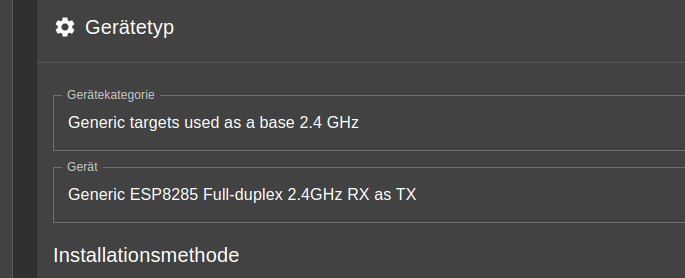

=== ESP32 and ESP32C3-based receivers

Instead of the small / simple ESP8285-based receivers you can also use the ESP32 or ESP32C3-based (since ELRS 3.6) receiver (e.g. TuneRC Nano RX/PA). 
Fortunately the are capable of inverting the serial polarity ond also to use half-suplex on one (tx) pin. Therefore, they can directly 
connected to the _S.Port_ connector-pin.

[CAUTION]
--
Please check that to supply voltage you use from the JR-bay of your handset is no more than 5V.

Please check that the max. voltage of the serial signal on the _S.Port_ connector is no more than 3.3V (or that it uses an open-drain circuit, since the receiver uses a pull-up resistor on that line).
--

==== Using `expresslrs-configurator` to flash an ESP32/C3 receiver as a transmitter

As of version `v1.7.7` of the `exprexxlrs-configurator` it is fairly easy to flash an Rx as Tx. 

Please select the correct categorie and type of actual device (e.g. TuneRC 2.4GHz and TuneRC 2.4G nano PA RX, please refer to <<elrs_esp32>>) and select 
under compatibility options to use the receiver as transmitter (TX). Normally you would use the receiver in the external module bay of the handset, so select
`external`, but if you want to use to receiver as internal module select `internal` (this comes into place e.g. if you change the internal module of a e.g. 
FrSky X12S, see <<elrs_x12s>>).

Please be sure to check the `force` option. This is because when in comes to the flashing procedure the receiver itself identifies as _receiver_ and normally refuses to accept
the tx firmware.

Please be sure to select an ELRS version above or equal 3.4 for ESP32-based receivers and an ELRS version above or equal 3.6 for ESP32C3-based receivers. 

[[elrs_esp32]]
.ELRS firmware selection for ESP32 / ESP32C3 based receivers
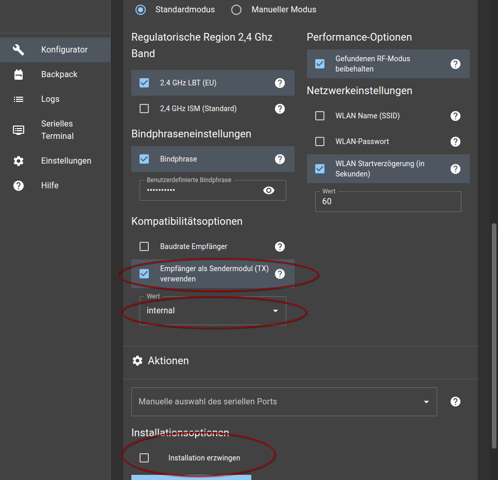

After flashing the receiver starts blinking _yellow_ if it does not receive a CRSF signal. If it gets a signal, it changes to _blue heartbeat_, and when it connects, it changes 
to _steady blue_.

[TIP]
--
As a side benefit, the ESP32 / ESP32C3 based receivers are also capable of _PPM_ input. They _autodetect_ if they get a serial or ppm signal.
So, this is super handy to renew an old handset.
--

==== Using `platformio` `cli` to flash an ESP32/C3 receiver as a transmitter

If you want to do the same without the `expresslrs-configurator` and use raw `paltformio` for the same purpose (maybe because you want to use the <<elrs.adoc#elrs-mods,ELRS modifications and pull-requests>> 
or other foreign github-repo or special PRs) then you have to do the follwoing steps:

* power-up the receiver into wifi-mode and connect
* save the hardware-definition: browse to http::/10.0.0.1/hardware.json and save it to a local file
* compile and flash the firmware (see also <<elrs.adoc#elrs-mods,ELRS modifications and pull-requests>>): `platformio run --environment Unified_ESP32C32_2400_TX_via_WIFI --target=uploadforce`. 
* restore the hardware-definition: browse to http::/10.0.0.1/hardware.html and upload the previously saved hardware-definition
* change the hardware-definition: the `serial-rx` and `serial-tx` pin numbers must be the same (half-duplex), use the appropriate connection that you want to use in your adapter
* save the changed hardware-definition and reboot the rx

You are done!

==== Outdated information

Instead of the small / simple ESP8285-based receivers you can also use the (slightly larger) ESP32-based receiver (e.g. BetaFPV SuperD). 
Fortunately the are capable of inverting the serial polarity ond also to use half-suplex on one (tx) pin. Therefore, they can directly 
connected to the _S.Port_ connector-pin.

Pleas be aware, that you now have to use a special firmware (`gemini`), see <<elrs_esp32>>.

In the hardware-config (wifi) you can now:

* disable gemini mode
* use inverted serial on one (tx) pin 

For more detals see this https://github.com/ExpressLRS/ExpressLRS/pull/1914[PR].

// [[elrs_esp32]]
.ELRS firmware selection for ESP32 based receivers
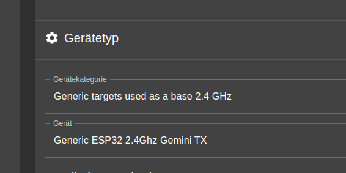

=== JR-Module-bay adapter

The communication between the handset and the tranceiver-module inside the JR-module bay takes place over 
`CRSF` / half-duplex serial protocol. The main difficulty here is that for historic reasons the polarity of the 
physical layer is inverted, so the idle level is low (0V) instead of high (3.3V) as normal. The `ESP8285` based boards
aren't capable of processing inverted serial signals. 

The next culprit is that there is no 5V regulated voltage on the pins of the module bay, but the ELRS receiver boad needs
5V regulated voltage.

Due to this fact it would be most convenient to have a adapter, that

* produces the regulated 5V out of the main battery voltage of the handset,
* uninvertes the inverted serial data, and
* splits the half-duplex connection into a separated full-duplex one.

If you are interested in the pinout of the module bay, see: https://www.expresslrs.org/quick-start/transmitters/tx-prep[pinout]

[[jr_elrs_sch]]
.The schematic (click to view in full-scale)
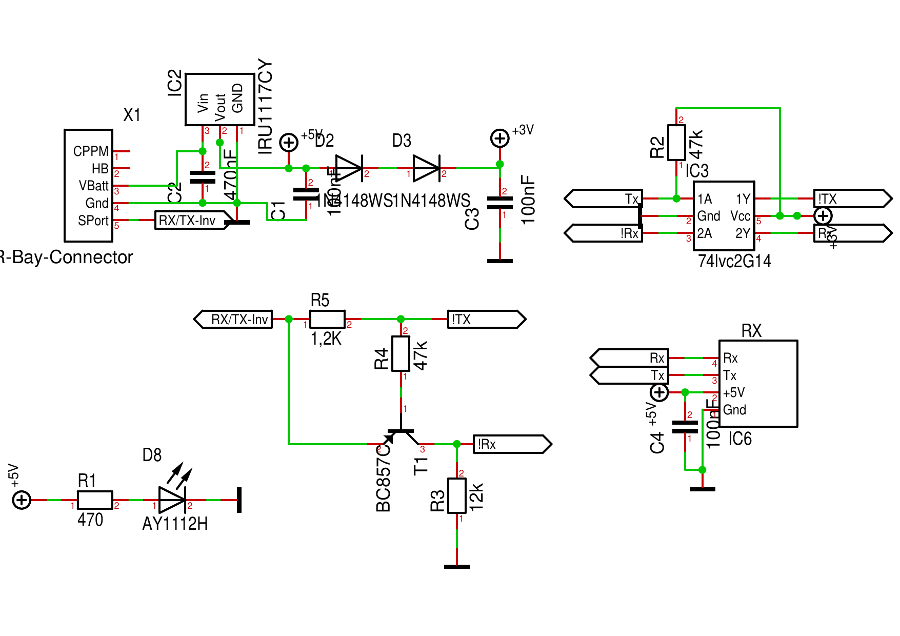

[[jr_elrs_pcb]]
.The PCB (click to view in full-scale)
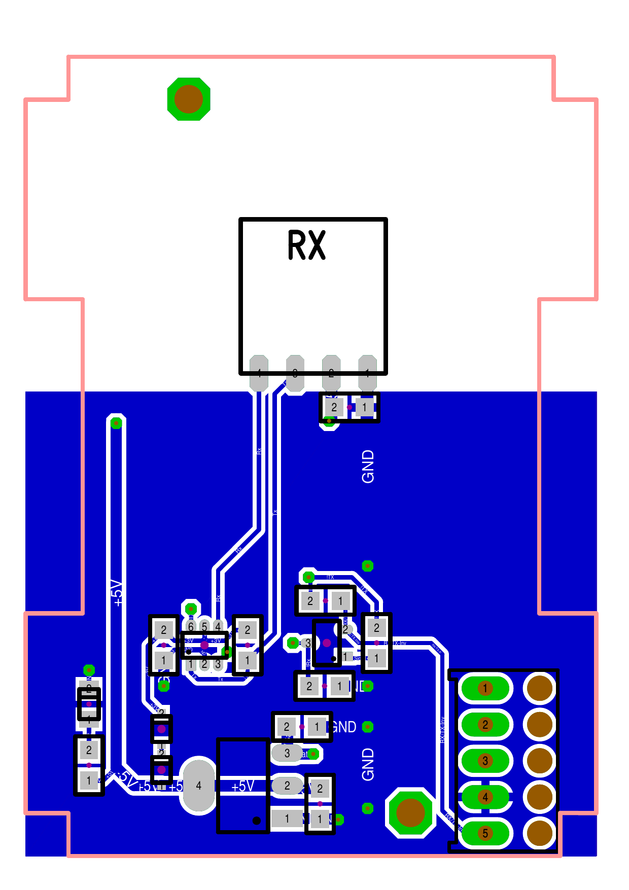

[[jr_elrs_target]]
If you use _Target 3001_ as your EDA: link:../elrs/jr/JR-ELRS.T3001[Target 3001 design file].

In <<jr_elrs_la>> you see a logic-analyser trace of the `rx` and `tx` serial signal as they appear
at the ELRS-receiver. So, they are in normal polarity. 
Please not, the the sent bytes at the `tx` do not appear at the `rx`-pin: no local echo. This is 
suppressed by the circuit.

[[jr_elrs_la]]
.Signals from the ELRS receiver (click to view in full-scale)
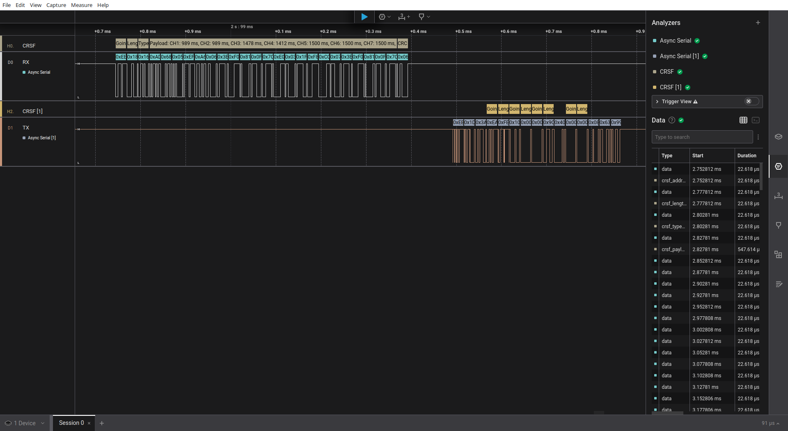

=== Assembling

The assembling is straight forward, all components are placed on one side. Please refer to the <<jr_elrs_target>>.

.The unpopulated pcb and the empty box (click to enlarge)
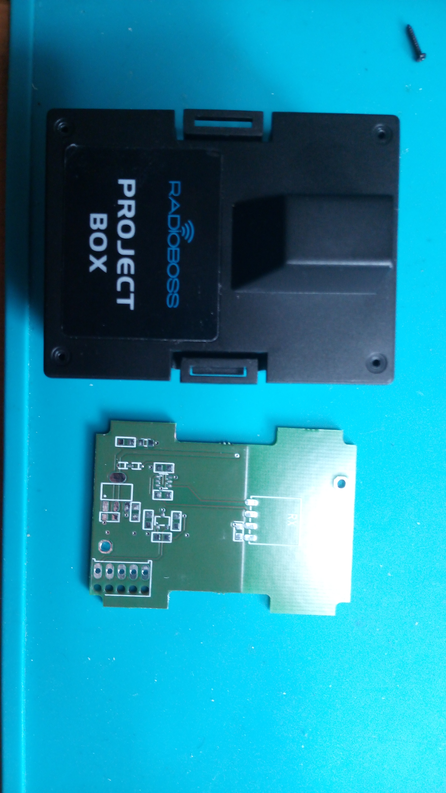

.The unpopulated pcb, the empty box, the 5-pin connector and a Happymodel EP2 receiver (click to enlarge)
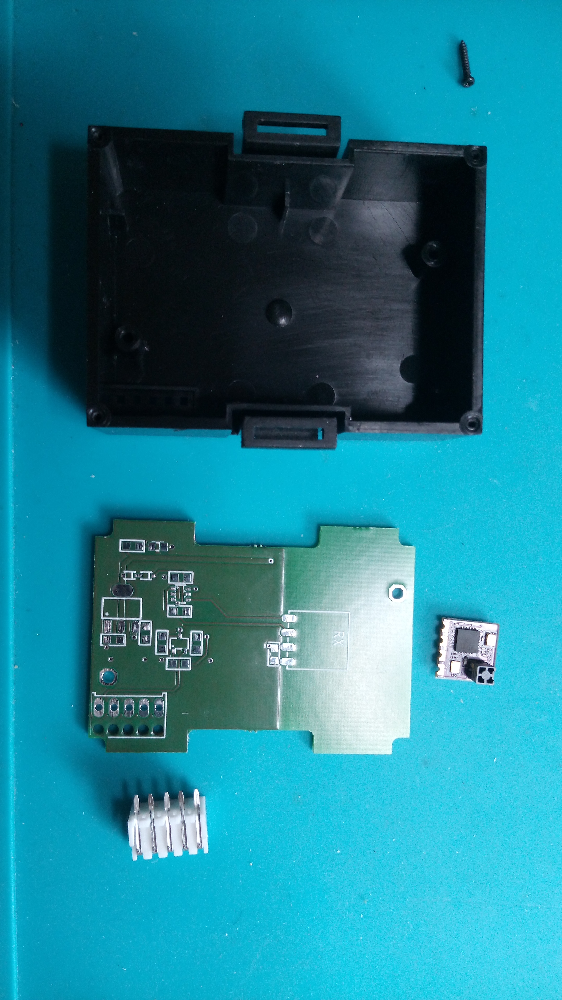

.All parts assembled (click to enlarge)
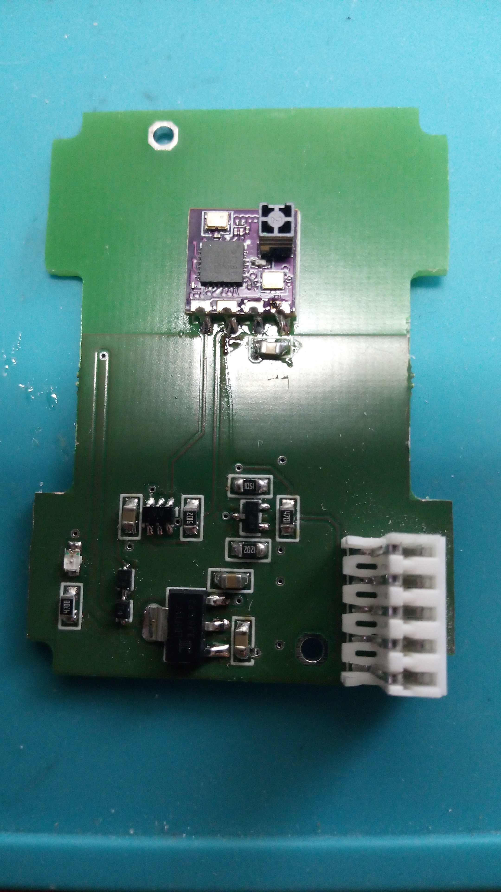

.Assembled pcb inside the JR box (click to enlarge)
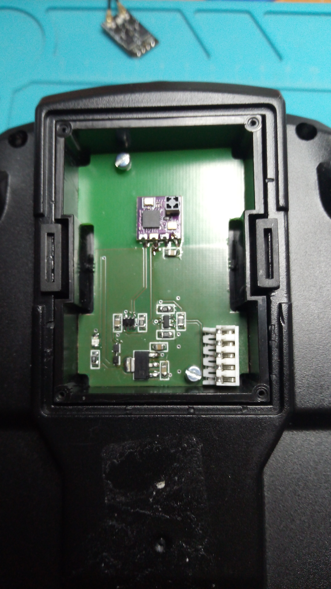

=== Usages

==== Jumper T12

.JR box snapped into the module bay of a Jumper T12 (click to enlarge)
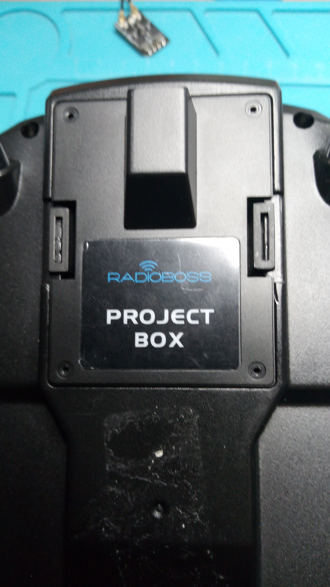

==== FrSky X9e

Unfortunately, one cannot easily replace the internal XJT-module of a _FrSky X9E_. 

.JR box inside a FrSky X9e (click to enlarge)
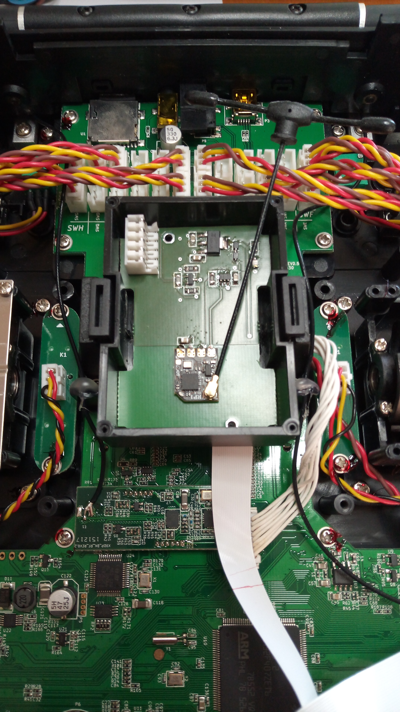

It would be possible to use the antenne of the internal XJT oder the Bluetooth module as well as an antenna for the ELRS.

.JR box inside a FrSky X9e (click to enlarge)
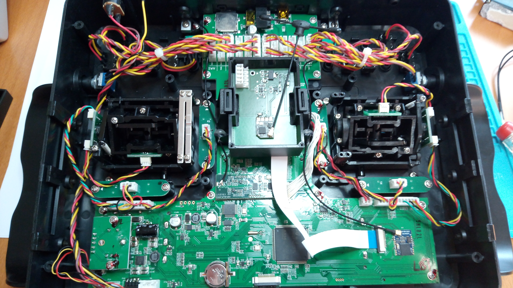

.ELRSV3.lua on FrSky X9E(click to enlarge)
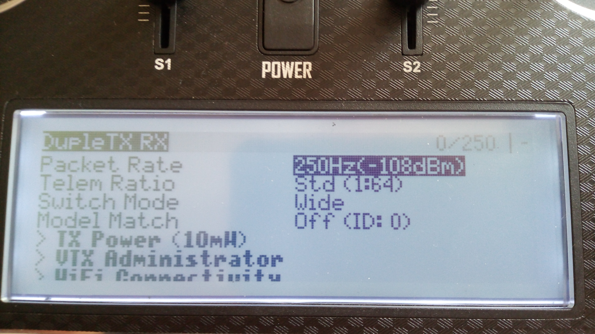

[[elrs_x12s]]
== Adapter for ELRS receiver as internal XJT/ISRM module for FrSky X12S

If you don't want to use an external ELRS transceiver module e.g. for the JR-bay of your handset, then you may choose to replace the 
internal XJT / ISRM module of the X12S with an ELRS module. 

As mentioned in <<elrs_jr>> it is possible to use (most) ELRS receivers as trasmitters (well: transceiver). The advantage of this approach
is that the ELRS is so tiny, that you can mount it onto the X12S internal daughter boad. Maybe you can also use the antennas of the X12S if
the ELRS is also working at 2.4 GHz. The disadvantage is clearly, that the range is somewhat limited: don't expect it to be more than 1km and 
please make range tests before going to the field or lake.

You can hand-wire all the stuff but much more convenient is a small adapter board as is <<x12s_elrs_sch>> and <<x12s_elrs_pcb>>.

[[x12s_elrs_target]]
If you use _Target 3001_ as your EDA: link:../elrs/x12s/X12S_ELRS_Adapter.T3001[Target 3001 design file].

.The Adapter mounted onto the X12S daughter board (click to view in full-scale)
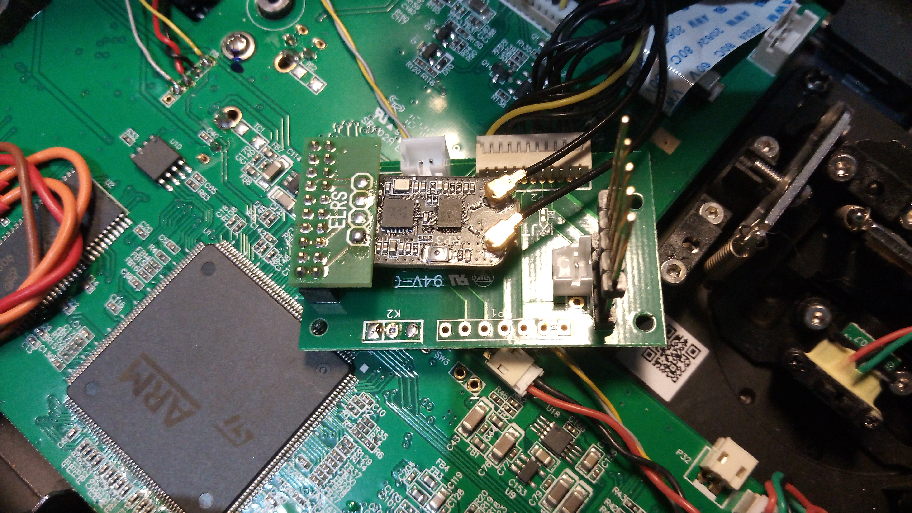

.Soldering the ELRS RX-as-TX to the adapter (click to view in full-scale)
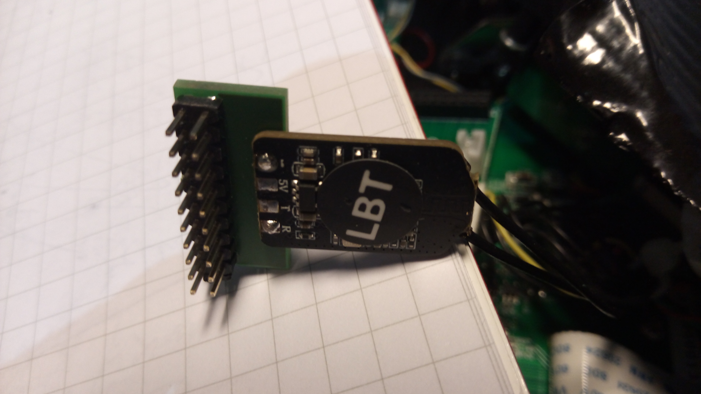

.Using the antennas (click to view in full-scale)
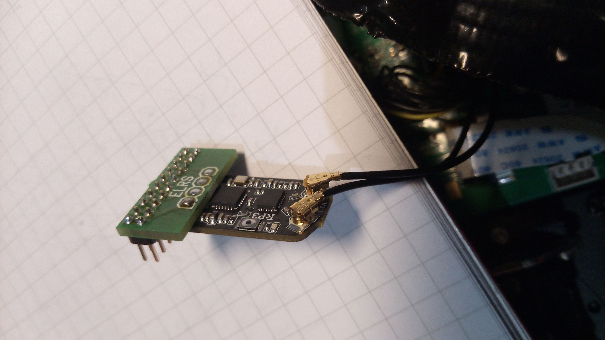

[[x12s_elrs_sch]]
.The schematic (click to view in full-scale)
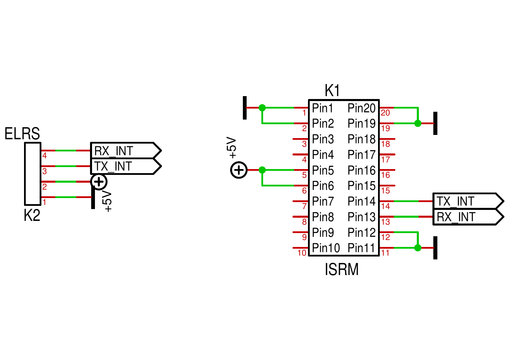

[[x12s_elrs_pcb]]
.The PCB (click to view in full-scale)
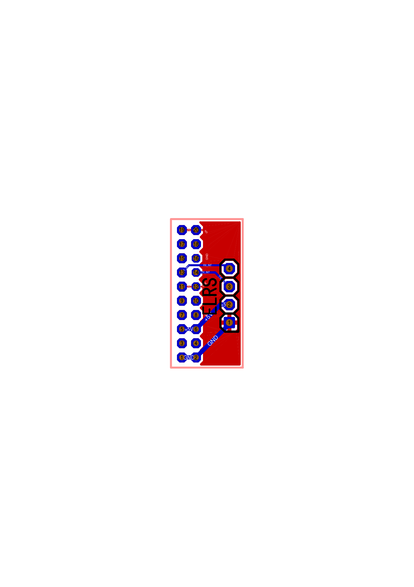
