= ELRS-Empfänger als Sendermodule
Wilhelm Meier <wilhelm.wm.meier@googlemail.com>
:toc:
:toclevels: 3
:toc-placement!:
:sectnums:
:sectnumlevels: 5
:tip-caption: :bulb:
:note-caption: :information_source:
:important-caption: :heavy_exclamation_mark:
:caution-caption: :fire:
:warning-caption: :warning:
:lang: de
:toc-title: Inhaltsverzeichnis
:figure-caption: Abbildung
:table-caption: Tabelle
:example-caption: Beispiel

<<rx-as-tx.adoc#,English>> | *Deutsch*

<<../README.de.adoc#,RC-Elektronik>> / ELRS-Empfänger als Sendermodule

[NOTE]
--
Adapter für den JR-Modulschacht und interner X12S-Adapter für ELRS-Empfänger.
--

toc::[]

[[elrs_jr]]
== JR-Modulschachtadapter für ELRS-Empfänger als Sender

[caption=""]
.Projektinfo
[cols="1h,5",width="100%"]
|===
| Status | 🔵 stabil
| Hardware | link:../elrs/jr/JR-ELRS.T3001[TARGET 3001!]
| Firmware | unverändertes ExpressLRS (Empfänger als Sender geflasht)
| Video | https://www.youtube.com/watch?v=uC7tb50pWVg[2024-04-09], <<videos.de.adoc#v-elrs_jr,alle Videos (1)>>
|===

[[_using_elrs_receivers_as_transmitter_modules]]
=== ELRS-Empfänger als Sendermodule verwenden

Da die Unterschiede zwischen ELRS-Empfängern und -Sendern (genauer gesagt: Beide sind Transceiver, und die Unterschiede liegen hauptsächlich in der Sendeleistung)
gering sind, kann jeder ELRS-Empfänger als Sender verwendet werden. Natürlich müssen Sie dafür eine andere Firmware flashen.
Die richtigen Einstellungen im `expresslrs-configurator` finden Sie in <<elrs_esp8285>> und <<elrs_esp32>>.

[CAUTION]
--
Erwarten Sie keine Reichweite von mehr als 1km. Testen Sie die Reichweite, bevor Sie auf das Flugfeld (oder an den See oder ans Meer) gehen!
--

[[_esp8285_based_receivers]]
=== ESP8285-basierte Empfänger

Die kleinen Empfänger auf Basis des `ESP8285` eignen sich sehr gut für den Einbau direkt im Sender oder 
in einem üblichen _JR-Schachtmodul_.

Sie haben allerdings zwei (nicht allzu gravierende) Nachteile: 

* Sie unterstützen nur _nicht invertierte_ serielle Kommunikation im _Vollduplex_-Modus.
* Sie benötigen geregelte 5V als Versorgungsspannung.

Wenn Sie einen solchen Empfänger als _externes Modul_ verwenden möchten, müssen Sie

* das _invertierte_ serielle _Halbduplex_-Signal am _S.Port_-Anschluss des Modulschachts entinvertieren und aufteilen,
* geregelte 5V aus der ungeregelten Akkuspannung am Modulschachtanschluss erzeugen.

Ein Sonderfall ist der Sender _FlySky-I6X_: Hier steht ein nicht invertiertes serielles Halbduplex-Signal zur Verfügung, das sich einfach 
in das Vollduplex-Signal des ESP8285-basierten RX-as-TX umwandeln lässt.

* Bei OpenI6X ist der nicht invertierte Modus bis Version 2.1 eine Option beim Kompilieren, danach eine Einstellung zur Laufzeit.

[[elrs_esp8285]]
.ELRS-Firmwareauswahl für ESP8285-basierte Empfänger
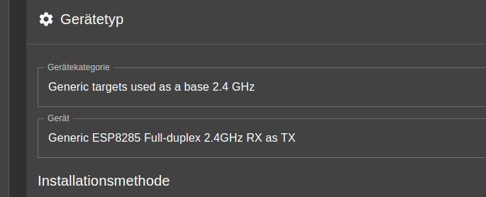

[[_esp32_and_esp32c3_based_receivers]]
=== ESP32- und ESP32C3-basierte Empfänger

Statt der kleinen / einfachen ESP8285-basierten Empfänger können Sie auch ESP32- oder ESP32C3-basierte Empfänger (seit ELRS 3.6) verwenden (z.B. TuneRC Nano RX/PA). 
Glücklicherweise können diese die Polarität des seriellen Signals invertieren und Halbduplex auf einem einzigen (TX-)Pin nutzen. Daher lassen sie sich direkt 
mit dem _S.Port_-Anschlusspin verbinden.

[CAUTION]
--
Prüfen Sie, dass die Versorgungsspannung aus dem JR-Schacht Ihres Senders nicht mehr als 5V beträgt.

Prüfen Sie, dass die maximale Spannung des seriellen Signals am _S.Port_-Anschluss nicht mehr als 3.3V beträgt (oder dass eine Open-Drain-Schaltung verwendet wird, da der Empfänger auf dieser Leitung einen Pull-up-Widerstand verwendet).
--

[[_using_expresslrs_configurator_to_flash_an_esp32c3_receiver_as_a_transmitter]]
==== Einen ESP32/C3-Empfänger mit `expresslrs-configurator` als Sender flashen

Ab Version `v1.7.7` des `exprexxlrs-configurator` lässt sich ein RX recht einfach als TX flashen. 

Wählen Sie die richtige Kategorie und den Typ des tatsächlichen Geräts (z.B. TuneRC 2.4GHz und TuneRC 2.4G nano PA RX, siehe <<elrs_esp32>>) und wählen Sie 
unter den Kompatibilitätsoptionen die Verwendung des Empfängers als Sender (TX). Normalerweise verwenden Sie den Empfänger im externen Modulschacht des Senders; wählen Sie daher
`external`. Wenn Sie den Empfänger als internes Modul verwenden möchten, wählen Sie `internal` (das ist z.B. relevant, wenn Sie das interne Modul einer 
FrSky X12S ersetzen, siehe <<elrs_x12s>>).

Aktivieren Sie unbedingt die Option `force`. Beim Flashen identifiziert sich der Empfänger nämlich als _Empfänger_ und verweigert normalerweise
die Annahme der TX-Firmware.

Wählen Sie für ESP32-basierte Empfänger unbedingt eine ELRS-Version größer oder gleich 3.4 und für ESP32C3-basierte Empfänger eine ELRS-Version größer oder gleich 3.6. 

[[elrs_esp32]]
.ELRS-Firmwareauswahl für ESP32- / ESP32C3-basierte Empfänger
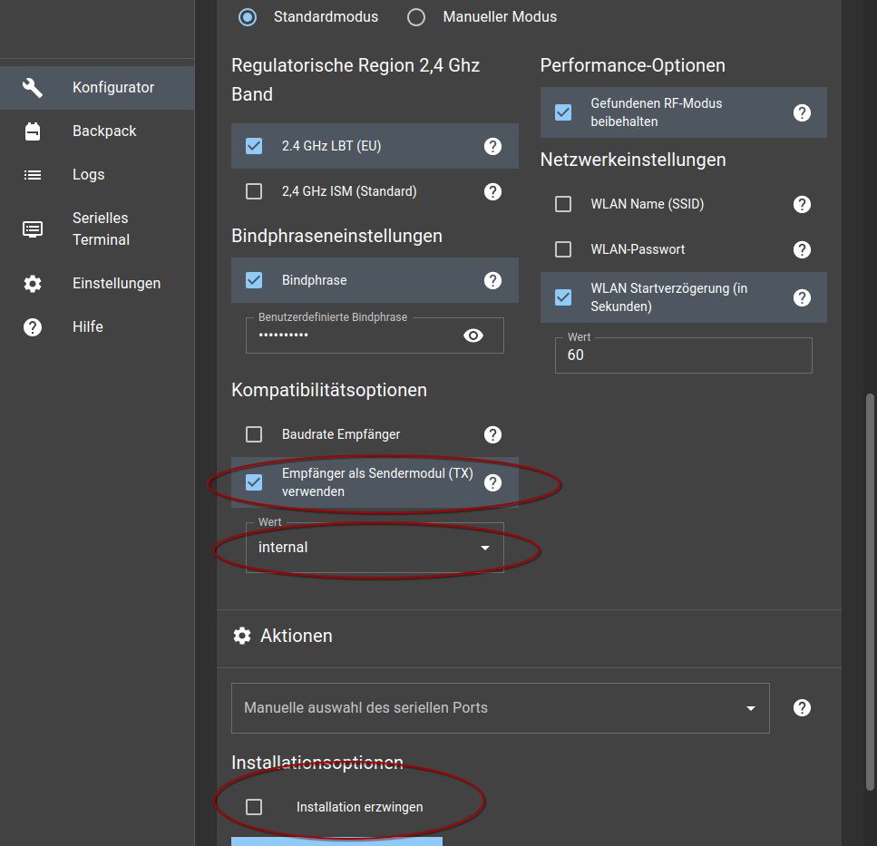

Nach dem Flashen blinkt der Empfänger _gelb_, wenn er kein CRSF-Signal empfängt. Sobald ein Signal anliegt, wechselt er zu einem _blauen Herzschlagmuster_; nach dem Verbindungsaufbau 
leuchtet er _dauerhaft blau_.

[TIP]
--
Als zusätzlichen Vorteil unterstützen die ESP32- / ESP32C3-basierten Empfänger auch einen _PPM_-Eingang. Sie _erkennen automatisch_, ob ein serielles oder ein PPM-Signal anliegt.
Das ist sehr praktisch, um einen alten Sender zu modernisieren.
--

[[_using_platformio_cli_to_flash_an_esp32c3_receiver_as_a_transmitter]]
==== Einen ESP32/C3-Empfänger mit der `platformio`-`cli` als Sender flashen

Wenn Sie dasselbe ohne den `expresslrs-configurator` direkt mit `paltformio` durchführen möchten (etwa um die <<elrs.de.adoc#elrs-mods,ELRS-Änderungen und Pull-Requests>> 
oder ein anderes GitHub-Repository oder spezielle PRs zu verwenden), gehen Sie wie folgt vor:

* Starten Sie den Empfänger im WLAN-Modus und verbinden Sie sich mit ihm.
* Sichern Sie die Hardwaredefinition: Öffnen Sie http::/10.0.0.1/hardware.json und speichern Sie sie in einer lokalen Datei.
* Kompilieren und flashen Sie die Firmware (siehe auch <<elrs.de.adoc#elrs-mods,ELRS-Änderungen und Pull-Requests>>): `platformio run --environment Unified_ESP32C32_2400_TX_via_WIFI --target=uploadforce`. 
* Stellen Sie die Hardwaredefinition wieder her: Öffnen Sie http::/10.0.0.1/hardware.html und laden Sie die zuvor gespeicherte Hardwaredefinition hoch.
* Ändern Sie die Hardwaredefinition: Die Pinnummern von `serial-rx` und `serial-tx` müssen identisch sein (Halbduplex). Verwenden Sie den passenden Anschluss, den Sie in Ihrem Adapter nutzen möchten.
* Speichern Sie die geänderte Hardwaredefinition und starten Sie den RX neu.

Fertig!

[[_outdated_information]]
==== Veraltete Informationen

Statt der kleinen / einfachen ESP8285-basierten Empfänger können Sie auch die (etwas größeren) ESP32-basierten Empfänger verwenden (z.B. BetaFPV SuperD). 
Glücklicherweise können diese die Polarität des seriellen Signals invertieren und Halbduplex auf einem einzigen (TX-)Pin nutzen. Daher lassen sie sich direkt 
mit dem _S.Port_-Anschlusspin verbinden.

Beachten Sie, dass Sie hierfür eine spezielle Firmware (`gemini`) verwenden müssen, siehe <<elrs_esp32>>.

In der Hardwarekonfiguration (WLAN) können Sie nun:

* den Gemini-Modus deaktivieren,
* ein invertiertes serielles Signal auf einem einzigen (TX-)Pin verwenden. 

Weitere Einzelheiten finden Sie in diesem https://github.com/ExpressLRS/ExpressLRS/pull/1914[PR].

// [[elrs_esp32]]
.ELRS-Firmwareauswahl für ESP32-basierte Empfänger
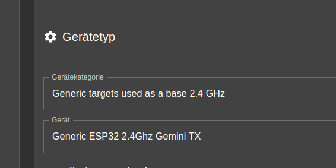

[[_jr_module_bay_adapter]]
=== JR-Modulschachtadapter

Die Kommunikation zwischen dem Sender und dem Transceivermodul im JR-Modulschacht erfolgt über 
`CRSF` / ein serielles Halbduplex-Protokoll. Die Hauptschwierigkeit besteht darin, dass aus historischen Gründen die Polarität der 
physikalischen Schicht invertiert ist: Der Ruhepegel ist also niedrig (0V) statt wie üblich hoch (3.3V). Die `ESP8285`-basierten Platinen
können keine invertierten seriellen Signale verarbeiten. 

Das nächste Problem ist, dass an den Pins des Modulschachts keine geregelte 5V-Spannung zur Verfügung steht, die ELRS-Empfängerplatine aber
geregelte 5V benötigt.

Deshalb ist ein Adapter besonders praktisch, der

* geregelte 5V aus der Hauptakkuspannung des Senders erzeugt,
* die invertierten seriellen Daten entinvertiert und
* die Halbduplex-Verbindung in eine Vollduplex-Verbindung mit getrennten Leitungen aufteilt.

Die Pinbelegung des Modulschachts finden Sie hier: https://www.expresslrs.org/quick-start/transmitters/tx-prep[Pinbelegung]

[[jr_elrs_sch]]
.Der Schaltplan (zum Anzeigen in voller Größe anklicken)
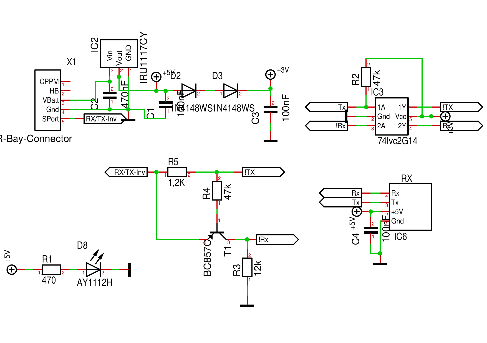

[[jr_elrs_pcb]]
.Die Platine (zum Anzeigen in voller Größe anklicken)
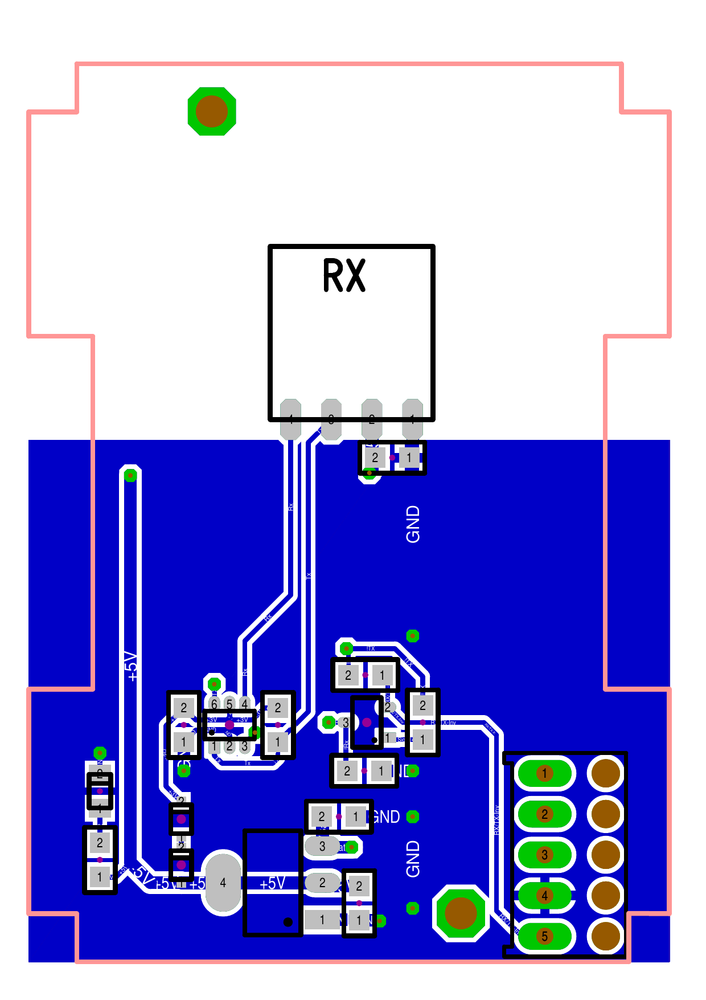

[[jr_elrs_target]]
Wenn Sie _Target 3001_ als EDA-Software verwenden: link:../elrs/jr/JR-ELRS.T3001[Target-3001-Designdatei].

In <<jr_elrs_la>> sehen Sie eine Logikanalysator-Aufzeichnung der seriellen Signale `rx` und `tx`, wie sie
am ELRS-Empfänger anliegen. Sie haben also die normale Polarität. 
Beachten Sie, dass die am `tx` gesendeten Bytes nicht am `rx`-Pin erscheinen: Es gibt kein lokales Echo. Dieses wird 
durch die Schaltung unterdrückt.

[[jr_elrs_la]]
.Signale des ELRS-Empfängers (zum Anzeigen in voller Größe anklicken)
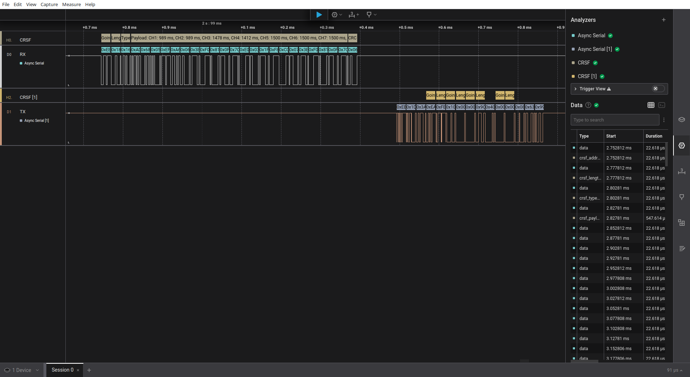

[[_assembling]]
=== Zusammenbau

Der Zusammenbau ist unkompliziert; alle Bauteile befinden sich auf einer Seite. Siehe <<jr_elrs_target>>.

.Die unbestückte Platine und das leere Gehäuse (zum Vergrößern anklicken)
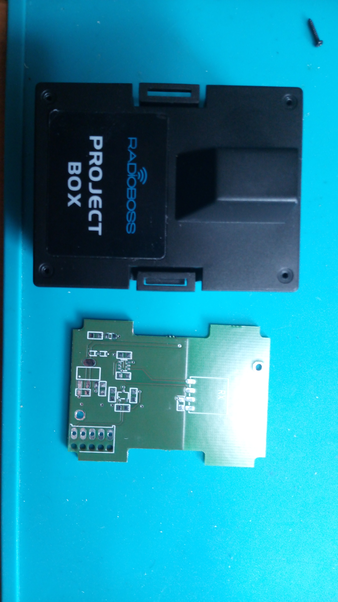

.Die unbestückte Platine, das leere Gehäuse, der 5-polige Steckverbinder und ein Happymodel-EP2-Empfänger (zum Vergrößern anklicken)
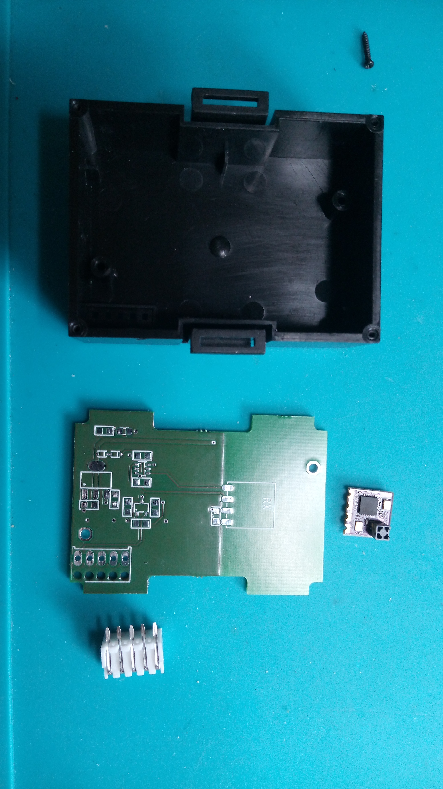

.Alle Teile zusammengebaut (zum Vergrößern anklicken)
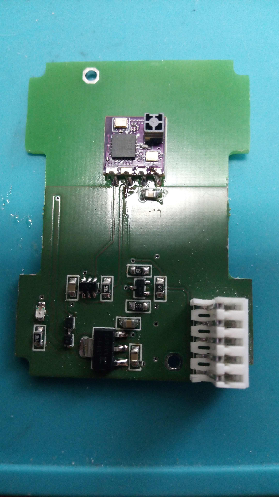

.Bestückte Platine im JR-Gehäuse (zum Vergrößern anklicken)
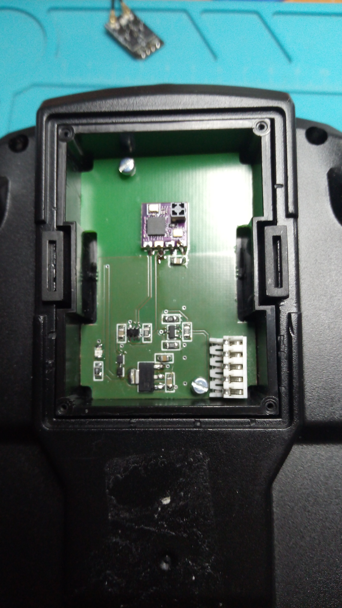

[[_usages]]
=== Einsatzbeispiele

[[_jumper_t12]]
==== Jumper T12

.JR-Gehäuse im Modulschacht einer Jumper T12 eingerastet (zum Vergrößern anklicken)
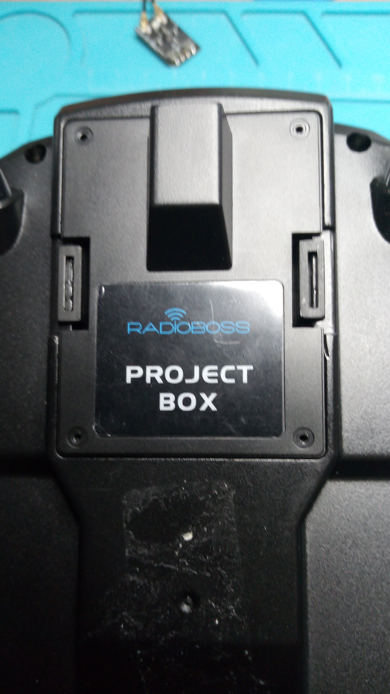

[[_frsky_x9e]]
==== FrSky X9e

Leider lässt sich das interne XJT-Modul einer _FrSky X9E_ nicht ohne Weiteres ersetzen. 

.JR-Gehäuse in einer FrSky X9e (zum Vergrößern anklicken)
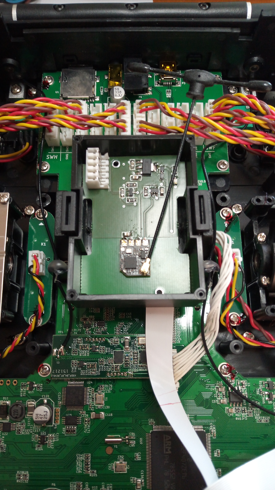

Es wäre möglich, die Antenne des internen XJT- oder des Bluetooth-Moduls auch als Antenne für ELRS zu verwenden.

.JR-Gehäuse in einer FrSky X9e (zum Vergrößern anklicken)
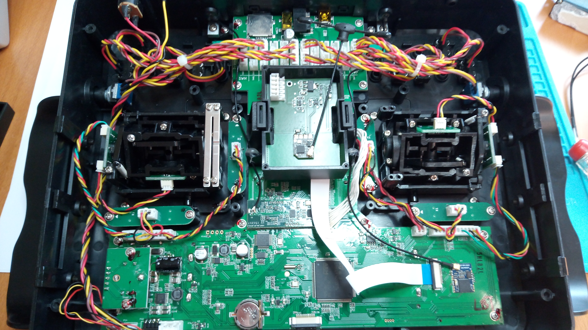

.ELRSV3.lua auf einer FrSky X9E(zum Vergrößern anklicken)
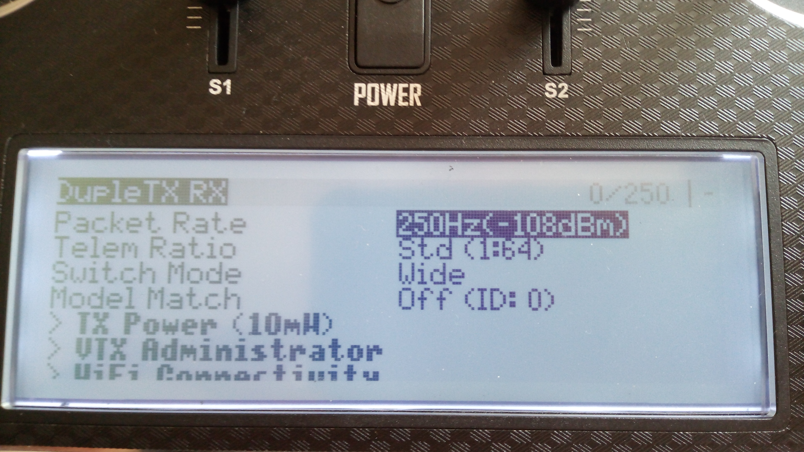

[[elrs_x12s]]
== Adapter für ELRS-Empfänger als internes XJT/ISRM-Modul für FrSky X12S

[caption=""]
.Projektinfo
[cols="1h,5",width="100%"]
|===
| Status | 🔵 stabil
| Hardware | link:../elrs/x12s/X12S_ELRS_Adapter.T3001[TARGET 3001!]
| Firmware | unverändertes ExpressLRS (Empfänger als Sender geflasht)
| Video | https://www.youtube.com/watch?v=WdRQwT1bnJs[2023-12-23], <<videos.de.adoc#v-elrs_x12s,alle Videos (1)>>
|===

Wenn Sie kein externes ELRS-Transceivermodul, z.B. für den JR-Schacht Ihres Senders, verwenden möchten, können Sie das 
interne XJT- / ISRM-Modul der X12S durch ein ELRS-Modul ersetzen. 

Wie in <<elrs_jr>> erwähnt, lassen sich (die meisten) ELRS-Empfänger als Sender (genauer: Transceiver) verwenden. Der Vorteil dieses Ansatzes
ist, dass der ELRS-Empfänger so klein ist, dass Sie ihn auf der internen Tochterplatine der X12S montieren können. Vielleicht können Sie auch die Antennen der X12S verwenden, wenn
ELRS ebenfalls auf 2.4 GHz arbeitet. Der Nachteil ist eindeutig die begrenzte Reichweite: Erwarten Sie nicht mehr als 1km und 
führen Sie Reichweitentests durch, bevor Sie auf das Flugfeld oder an den See gehen.

Sie können alles von Hand verdrahten; wesentlich praktischer ist jedoch eine kleine Adapterplatine wie in <<x12s_elrs_sch>> und <<x12s_elrs_pcb>>.

[[x12s_elrs_target]]
Wenn Sie _Target 3001_ als EDA-Software verwenden: link:../elrs/x12s/X12S_ELRS_Adapter.T3001[Target-3001-Designdatei].

.Der Adapter auf der X12S-Tochterplatine montiert (zum Anzeigen in voller Größe anklicken)
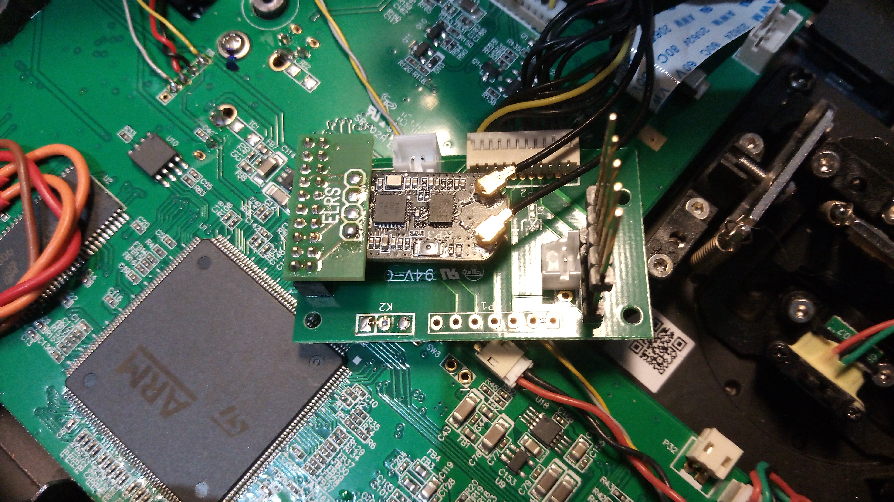

.ELRS RX-as-TX an den Adapter löten (zum Anzeigen in voller Größe anklicken)
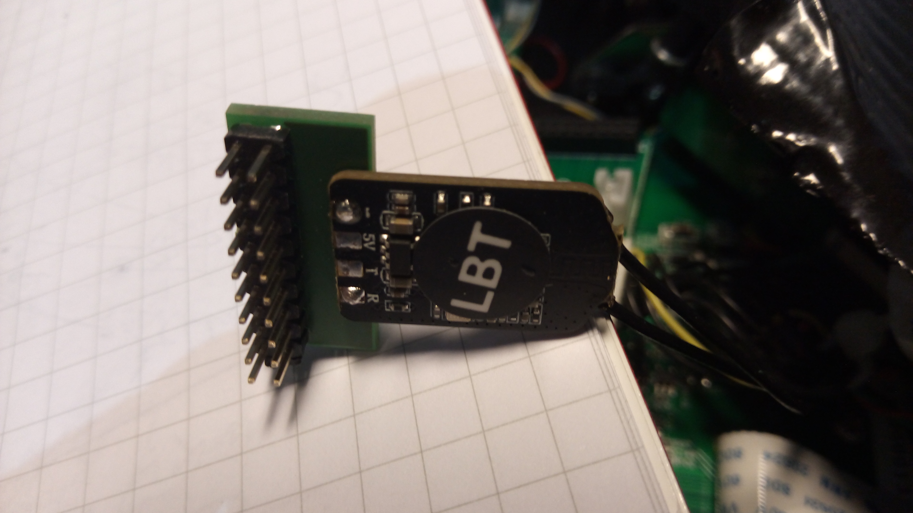

.Verwendung der Antennen (zum Anzeigen in voller Größe anklicken)
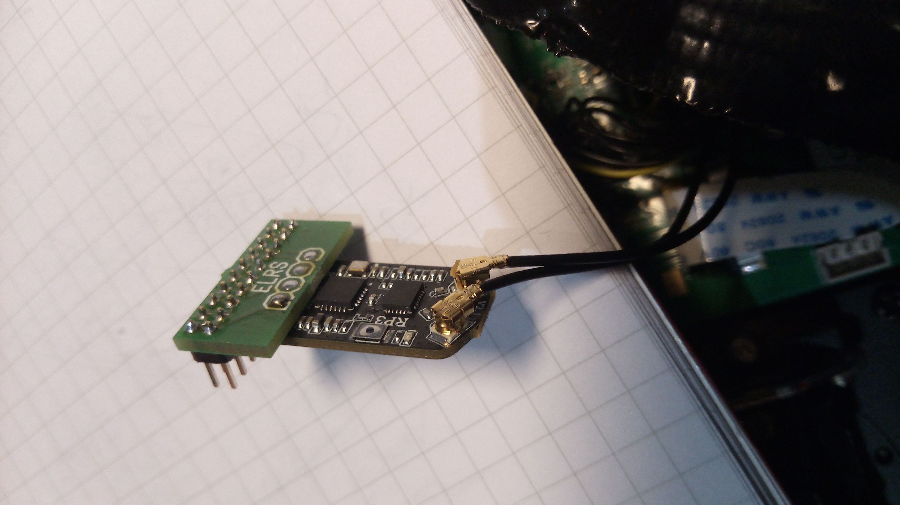

[[x12s_elrs_sch]]
.Der Schaltplan (zum Anzeigen in voller Größe anklicken)
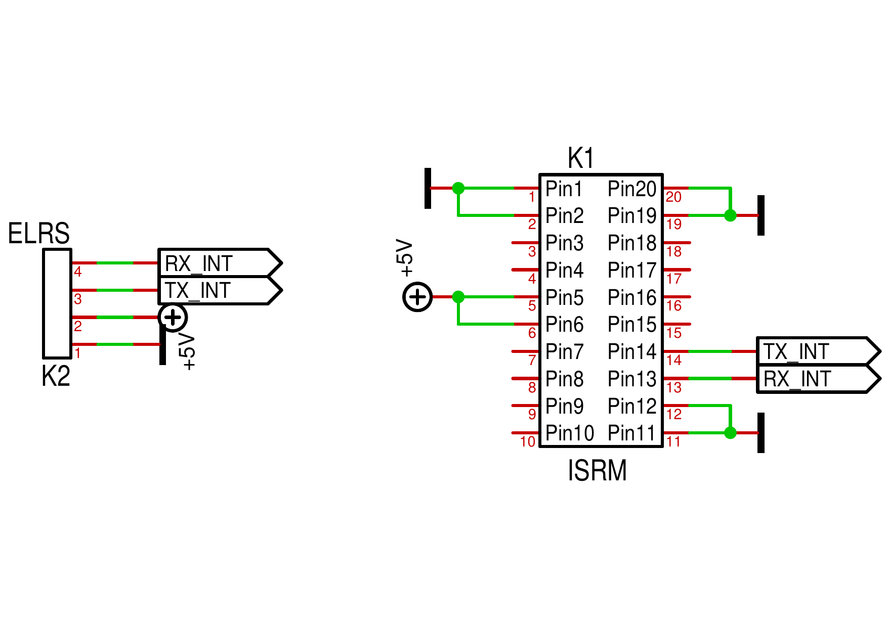

[[x12s_elrs_pcb]]
.Die Platine (zum Anzeigen in voller Größe anklicken)
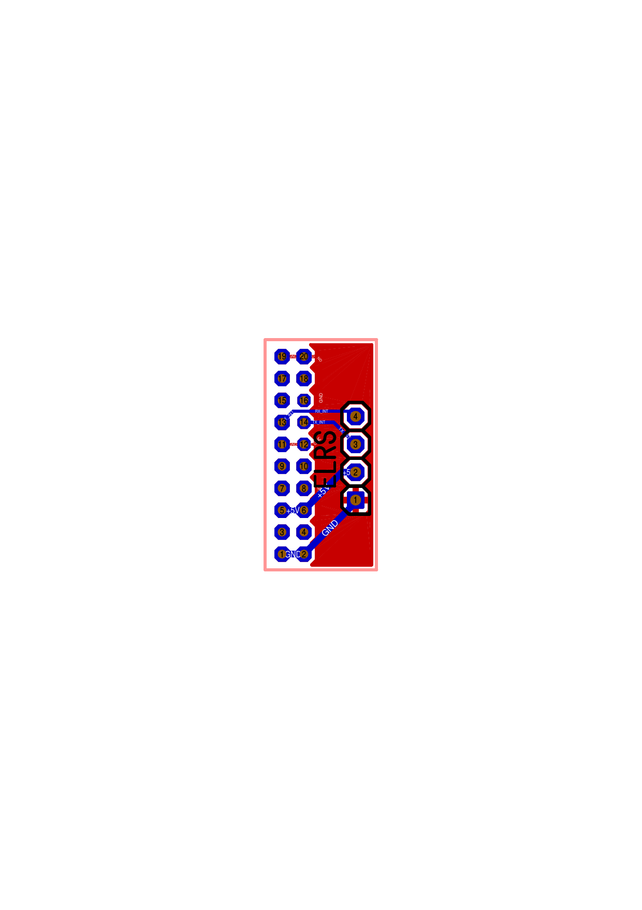
