= Vintage RC
Wilhelm Meier <wilhelm.wm.meier@googlemail.com>
:toc:
:toclevels: 3
:toc-placement!:
:sectnums:
:sectnumlevels: 5
:tip-caption: :bulb:
:note-caption: :information_source:
:important-caption: :heavy_exclamation_mark:
:caution-caption: :fire:
:warning-caption: :warning:

<<../README.adoc#,RC Electronics>> / Vintage RC

[NOTE]
--
Vintage RC equipment.
--

toc::[]

== Graupner / Grundig / JR

[[gr_txs]]
=== Transmitter

.MiniProp4 transmitter
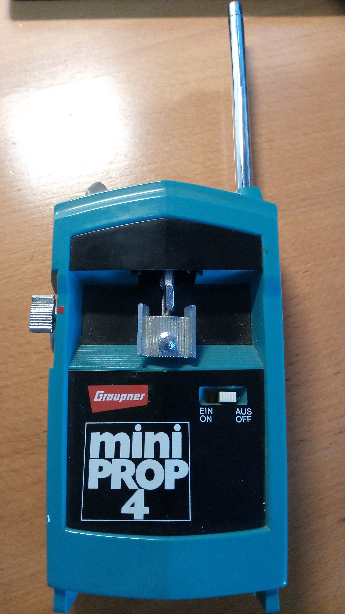

.MiniProp4 receiver
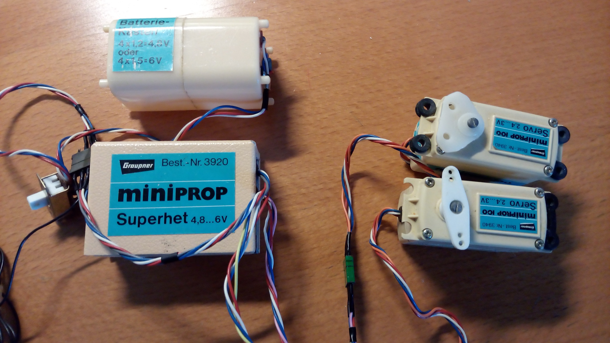

.Varioprop Expert Modulsystem FM 6014
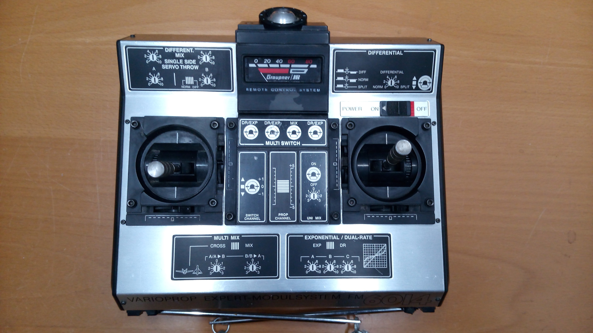

.Varioprop Graupner Grundig 12S
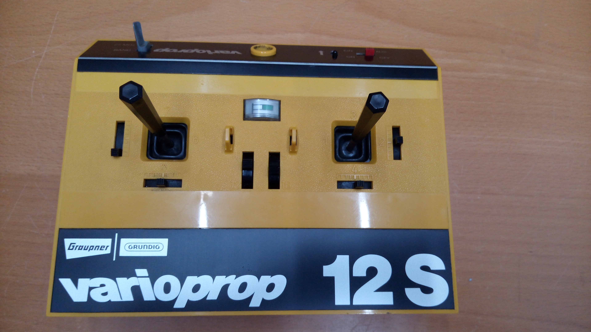

.Varioprop Graupner Grundig T14 Expert Modulsystem
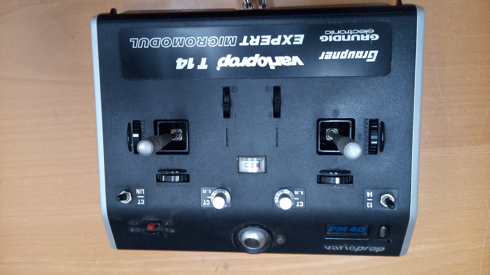

.Varioprop Graupner Grundig 14S 27MHz
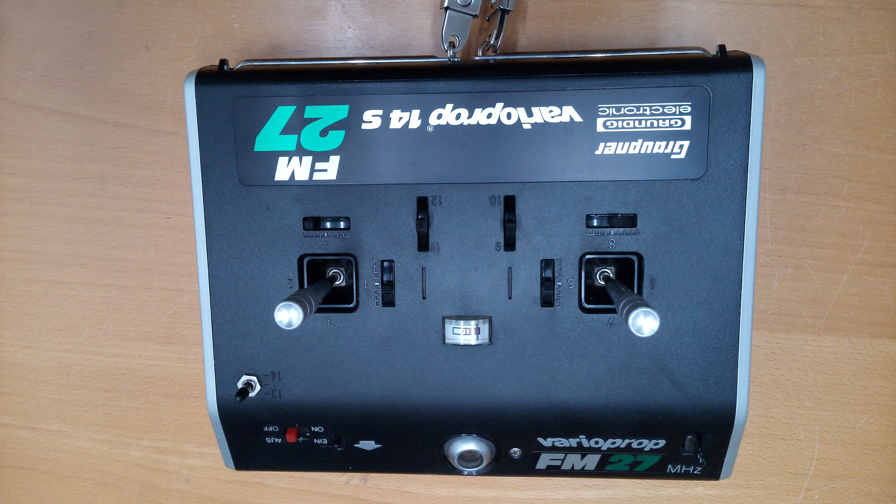

[[varioprop_black]]
.Varioprop Graupner Grundig 8S 40MHz
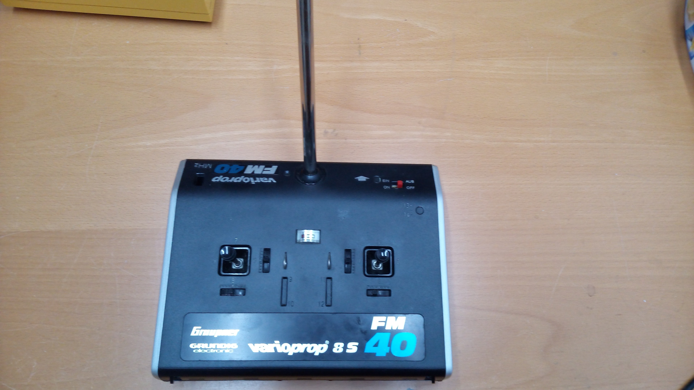

[[varioprop_yellow]]
.Varioprop Graupner Grundig 8S 27MHz
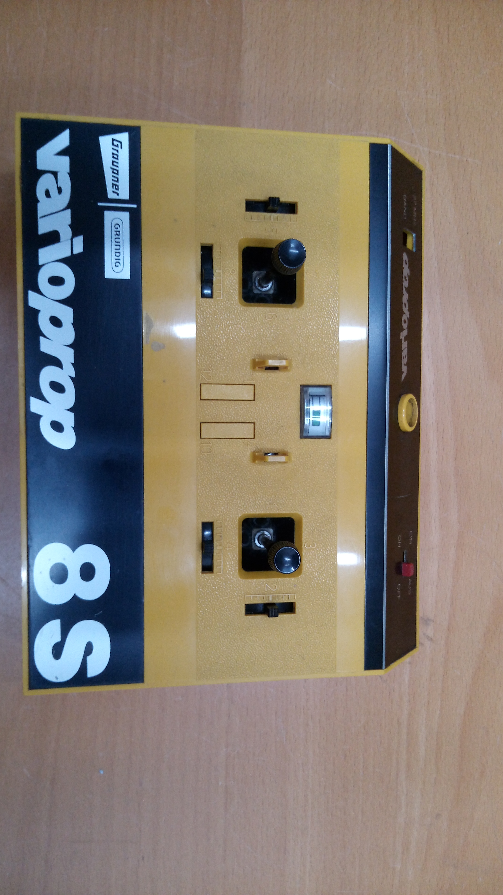

[[varioprop_red]]
.Varioprop Graupner Grundig C8 27MHz
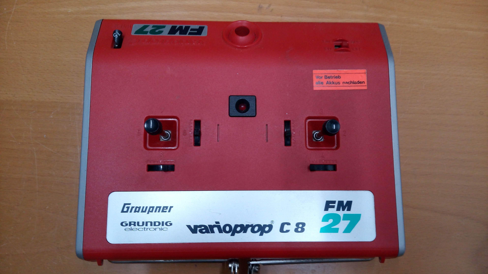

=== Receiver

.Varioprop miniSuperhet FM 40S
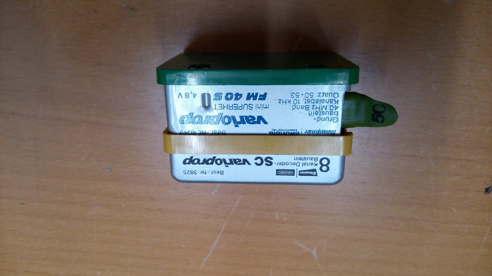

.Varioprop miniSuperhet 27MHz
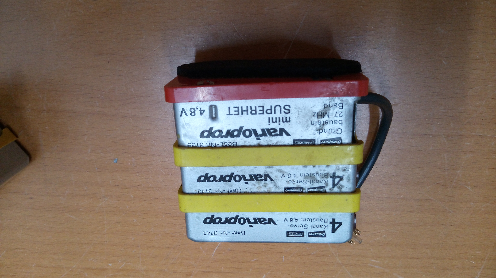

.Varioprop miniSuperhet FM 35S
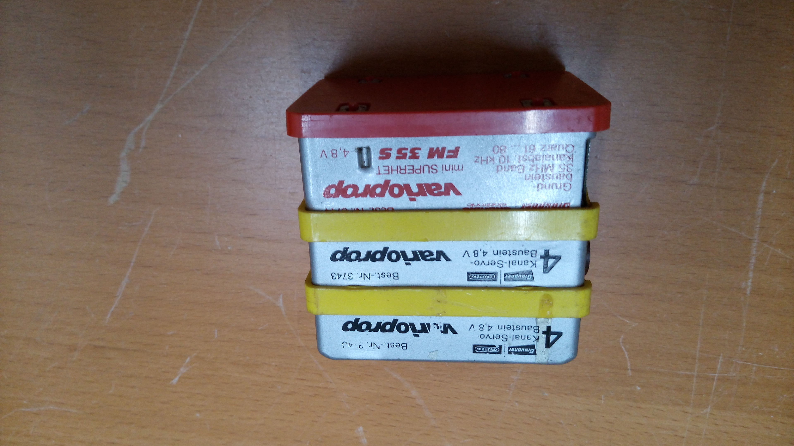

=== Other

.Varioprop Fahrtregler
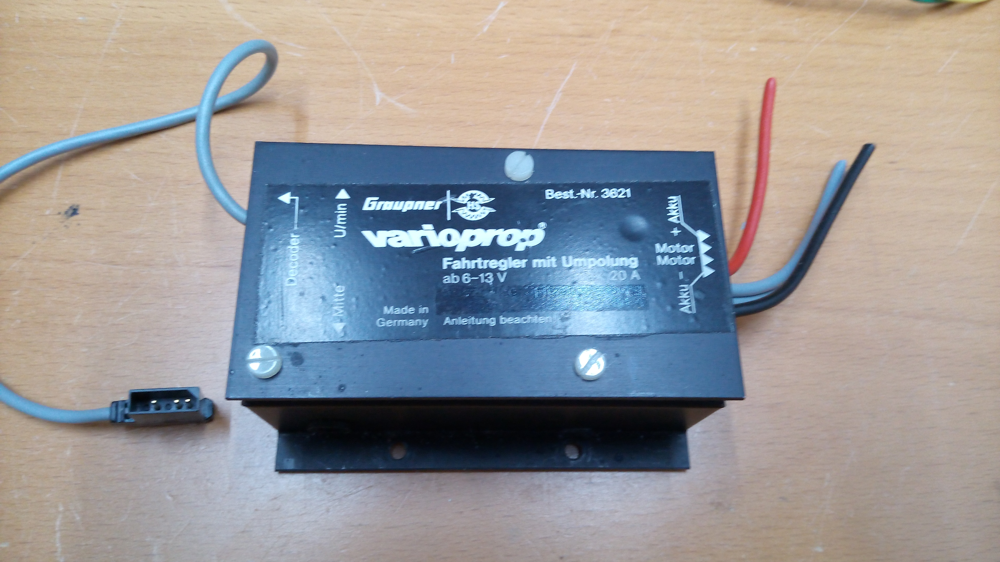

== Robbe / Futaba

[[rb_txs]]
=== Transmitter

.Robbe Promars
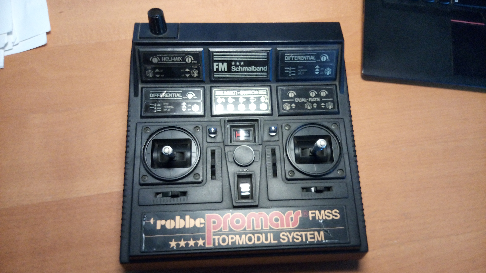

.Robbe digital4
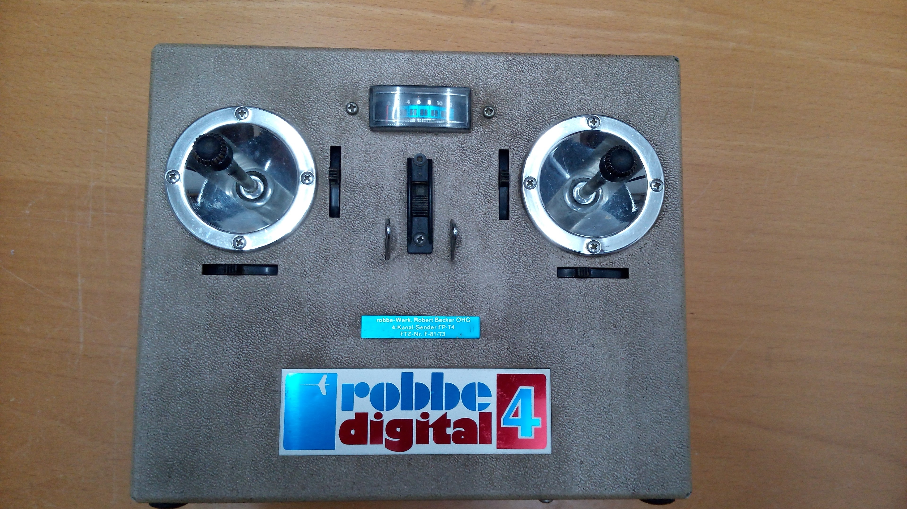

[[robbe_f14]]
.Robbe Futaba F-14 Navy 40MHz
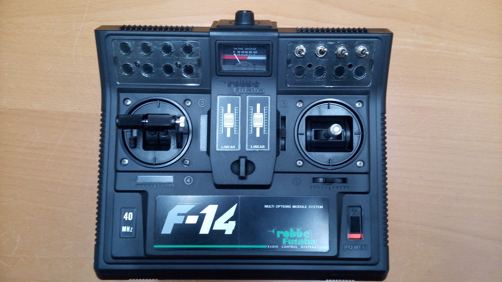

=== Receiver

=== Other

== Other

=== Transmitter

=== Receiver

=== Other

.Model Craft Speed Controller
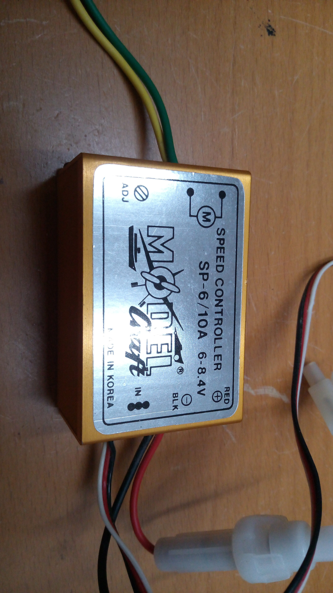

.hitec Speed Controller
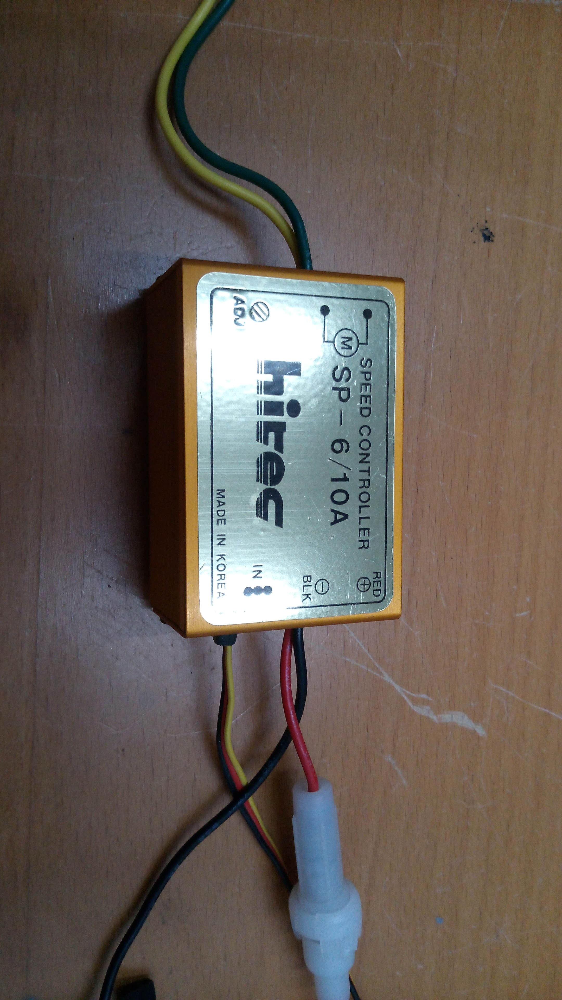
